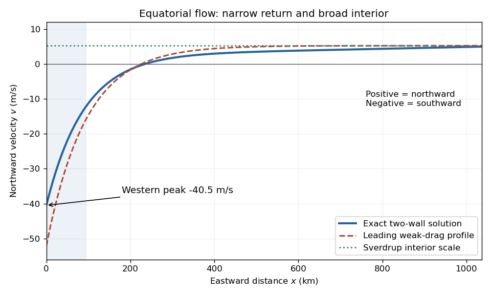

<h1 id="6/c/ii/solution">Solution</h1>

↑ **Parent:** [Ii](../ii.md)

Along $y=0$, differentiating the approximate [streamfunction](../../../../../stream-function.md) gives

$$
v(x)\simeq A\gamma\left[\lambda L e^{-\lambda x}-e^{\gamma(x-L)}\right]
\simeq\frac{F_0}\beta\left[1-\frac L{\delta_W}e^{-x/\delta_W}\right]
$$

in the leading small-friction limit. Hence the [velocity](../../../../../velocity.md) is strongly southward at the west wall, crosses zero after a few [Stommel boundary layer](../../../../../stommel-boundary-layer.md) widths, and approaches a much weaker northward interior value $F_0/\beta$. The leading zero is $x\simeq\delta_W\ln(L/\delta_W)$ when $L/\delta_W\gg1$.

For plotting or finite-friction evaluation, use the exact derivative

$$
\boxed{v(x)=A\left[\lambda C_W e^{-\lambda x}-\gamma C_E e^{\gamma(x-L)}\right].}
$$

It increases monotonically from its negative western value to its positive eastern value because $v'(x)=-A[\lambda^2C_W e^{-\lambda x}+\gamma^2C_E e^{\gamma(x-L)}]>0$. Moreover $\int_0^L v(x)\,dx=\Psi(L)-\Psi(0)=0$, as required for a closed basin.

**[Figure 4](#6/c/ii/image-equatorial-northward-velocity-profile-exact-linear-drag-solution-and-leading-stommel-boundary-layer-approximation). Equatorial northward velocity profile: exact linear-drag solution and leading Stommel boundary layer approximation**.

## ↑ Ancestors (13)

1. [Ii](../ii.md)
2. [C](../../c.md)
3. [6](../../../6.md)
4. [2021](../../../../2021-split.md)
5. [Past exam of the physics of atmospheres and oceans course of the University of Oxford](../../../../split.md)
6. [Physics of atmospheres and oceans course of the University of Oxford](../../../../../physics-of-atmospheres-and-oceans-course-of-the-university-of-oxford.md)
7. [Year 4 of the physics course of the University of Oxford](../../../../../year-4-of-the-physics-course-of-the-university-of-oxford.md)
8. [Physics course of the University of Oxford](../../../../../physics-course-of-the-university-of-oxford.md)
9. [Undergraduate course of the University of Oxford](../../../../../undergraduate-course-of-the-university-of-oxford.md)
10. [Course of the University of Oxford](../../../../../course-of-the-university-of-oxford.md)
11. [University of Oxford](../../../../../university-of-oxford-split.md)
12. [List of universities](../../../../../list-of-universities.md)
13. [Codex Wiki](../../../../../split.md)
