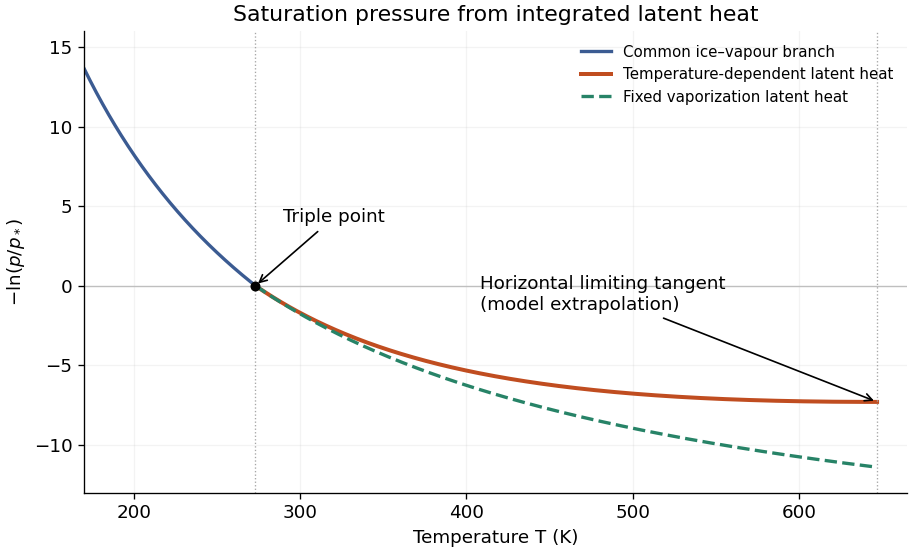
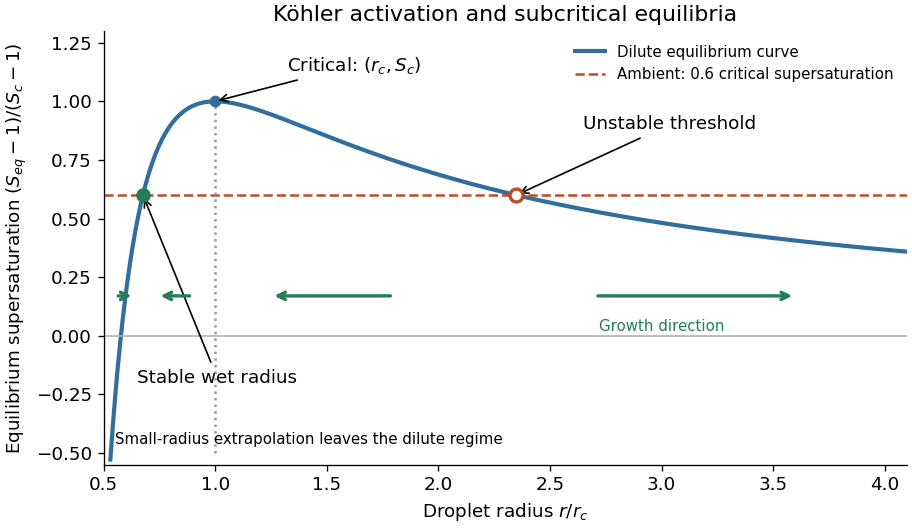
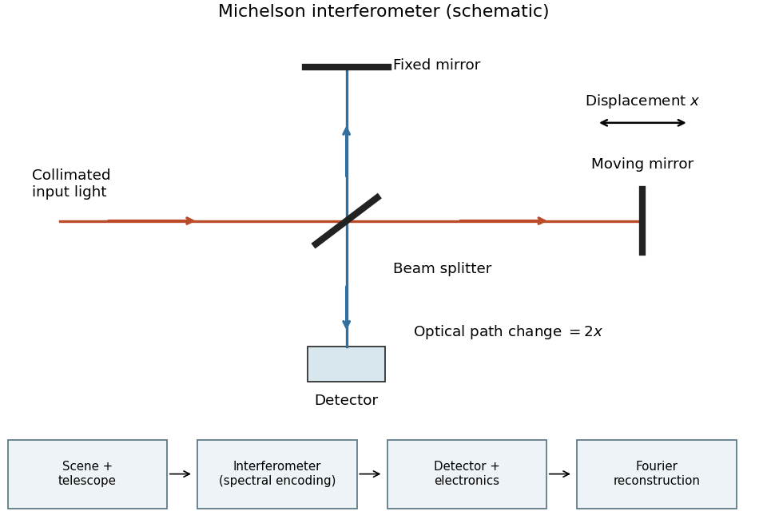
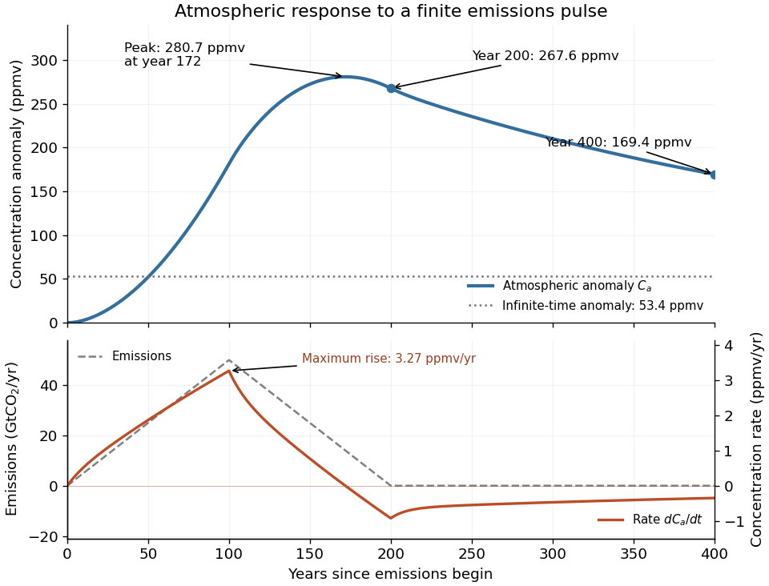
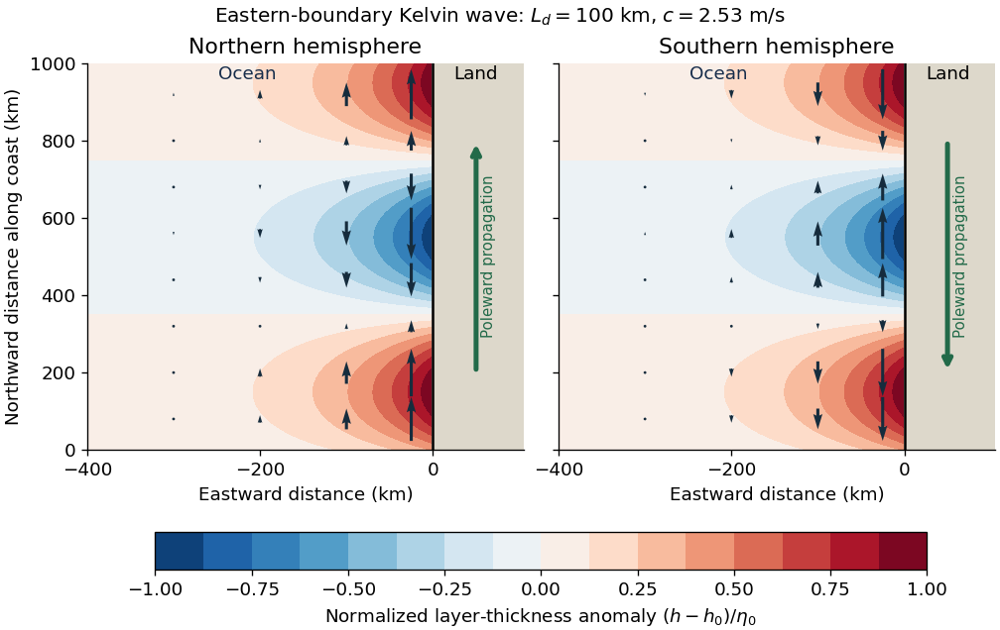

# 2022

↑ **Parent:** [Past exam of the physics of atmospheres and oceans course of the University of Oxford](../past-exam-of-the-physics-of-atmospheres-and-oceans-course-of-the-university-of-oxford.md)

Source: [https://www.whatdotheyknow.com/request/oxford_physics_past_papers_2/response/2340696/attach/10/Physics%20Papers%202021.pdf?cookie_passthrough=1](https://www.whatdotheyknow.com/request/oxford_physics_past_papers_2/response/2340696/attach/10/Physics%20Papers%202021.pdf?cookie_passthrough=1)

Source bundle pages 40–47. The cover establishes 2022 despite the attachment filename. Solutions use the source notation; approximation limits and normalization conventions are stated where they affect the result.

**Table of contents**

- [1](#1)
  - [a](#1/a)
    - [Solution](#1/a/solution)
  - [b](#1/b)
    - [Solution](#1/b/solution)
  - [c](#1/c)
    - [Solution](#1/c/solution)
  - [d](#1/d)
    - [Solution](#1/d/solution)
- [2](#2)
  - [a](#2/a)
    - [Solution](#2/a/solution)
  - [b](#2/b)
    - [Solution](#2/b/solution)
  - [c](#2/c)
    - [Solution](#2/c/solution)
  - [d](#2/d)
    - [Solution](#2/d/solution)
  - [e](#2/e)
    - [Solution](#2/e/solution)
- [3](#3)
  - [a](#3/a)
    - [Solution](#3/a/solution)
  - [b](#3/b)
    - [Solution](#3/b/solution)
  - [c](#3/c)
    - [Solution](#3/c/solution)
  - [d](#3/d)
    - [Solution](#3/d/solution)
- [4](#4)
  - [a](#4/a)
    - [Solution](#4/a/solution)
  - [b](#4/b)
    - [Solution](#4/b/solution)
  - [c](#4/c)
    - [Solution](#4/c/solution)
  - [d](#4/d)
    - [Solution](#4/d/solution)
- [5](#5)
  - [a](#5/a)
    - [Solution](#5/a/solution)
  - [b](#5/b)
    - [Solution](#5/b/solution)
  - [c](#5/c)
    - [Solution](#5/c/solution)
  - [d](#5/d)
    - [Solution](#5/d/solution)
- [6](#6)
  - [a](#6/a)
    - [Solution](#6/a/solution)
  - [b](#6/b)
    - [Solution](#6/b/solution)
  - [c](#6/c)
    - [Solution](#6/c/solution)
  - [d](#6/d)
    - [Solution](#6/d/solution)

## 1

↑ **Parent:** [2022](2022.md)

<h3 id="1/a">a</h3>

↑ **Parent:** [1](#1)

<h4 id="1/a/solution">Solution</h4>

↑ **Parent:** [A](#1/a)

For the [variable-latent-heat saturation curve](../thermodynamic-potential.md#variable-latent-heat-saturation-curve) of a pure saturated [water](../chemical-substance.md#water) [atmosphere](../planetary-science.md#atmosphere), the total [pressure](../pressure.md) equals the [saturation pressure](../thermodynamic-potential.md#vapor-pressure). The exact [Clausius-Clapeyron relation](../thermodynamic-potential.md#clausius-clapeyron-relation) along the [phase coexistence curve](../thermodynamic-potential.md#phase-coexistence-curve) is

$$
\frac{dp}{dT}=\frac{L(T)}{T(v_v-v_c)},
$$

where $v_v,v_c$ are the specific volumes of the [vapor](../thermodynamics.md#vapor) and condensed [thermodynamic phase](../thermodynamics.md#thermodynamic-phase). Neglecting $v_c$ and using the [ideal gas law](../ideal-gas.md#ideal-gas-law), $v_v=R_{\rm wv}T/p$, gives

$$
\frac{d\ln p}{dT}=\frac{L(T)}{R_{\rm wv}T^2},\qquad
\ln\frac p{p_*}=\int_{T_*}^{T}\frac{L(\theta)}{R_{\rm wv}\theta^2}\,d\theta.
$$

The [triple point](../thermodynamic-potential.md#triple-point) provides the integration constant. Below it, the prescribed [latent heat](../thermodynamic-potential.md#latent-heat) is constant, so

$$
\boxed{\ln\frac p{p_*}=\frac{L_s}{R_{\rm wv}}\left(\frac1{T_*}-\frac1T\right),\quad T\leq T_*.}
$$

Above it, write $K=L_*/[R_{\rm wv}(T_c-T_*)]$. Integrating $K(T_c/T^2-1/T)$ gives

$$
\boxed{\ln\frac p{p_*}=K\left[T_c\left(\frac1{T_*}-\frac1T\right)-\ln\frac{T}{T_*}\right],\quad T_*\leq T<T_c.}
$$

These are the requested implicit [temperature](../temperature.md) profiles $T(p)$. Both branches meet at $(T_*,p_*)$, and each is monotone before the limiting [liquid-gas critical point](../critical-phenomenon.md#liquid-gas-critical-point). The lower branch describes equilibrium with [ice](../chemical-substance.md#ice), rather than a stable [liquid](../thermodynamics.md#liquid) surface. A stable [liquid](../thermodynamics.md#liquid) [ocean](../planetary-science.md#ocean) surface belongs to the upper branch; the colder upper [atmosphere](../planetary-science.md#atmosphere) may use the lower branch. [Hydrostatic balance](../fluid-mechanics.md#hydrostatic-balance) is needed to convert this relation into a height profile, but not to obtain $T(p)$.

<h3 id="1/b">b</h3>

↑ **Parent:** [1](#1)

<h4 id="1/b/solution">Solution</h4>

↑ **Parent:** [B](#1/b)

Let $Y=-\ln(p/p_*)$. For the temperature-dependent [latent heat](../thermodynamic-potential.md#latent-heat),

$$
Y(T)=\begin{cases}
\dfrac{L_s}{R_{\rm wv}}\left(\dfrac1T-\dfrac1{T_*}\right),&T\leq T_*,\\[4pt]
K\left[T_c\left(\dfrac1T-\dfrac1{T_*}\right)+\ln\dfrac T{T_*}\right],&T_*\leq T<T_c.
\end{cases}
$$

Keeping the [latent heat](../thermodynamic-potential.md#latent-heat) of vaporization fixed changes only the upper branch to

$$
Y_{\rm fixed}(T)=\frac{L_*}{R_{\rm wv}}\left(\frac1T-\frac1{T_*}\right).
$$

Both curves fall from $+\infty$ as $T\to0^+$, pass through $Y=0$ at the [triple point](../thermodynamic-potential.md#triple-point), and are convex. At the [triple point](../thermodynamic-potential.md#triple-point) there is a corner because the [latent heat](../thermodynamic-potential.md#latent-heat) changes from $L_s$ to $L_*$. Their right-hand slopes there agree. Above the [triple point](../thermodynamic-potential.md#triple-point),

$$
Y'_{\rm variable}=-K\frac{T_c-T}{T^2},\qquad
Y'_{\rm fixed}=-\frac{L_*}{R_{\rm wv}T^2},\qquad
Y''_{\rm variable}=K\frac{2T_c-T}{T^3}>0.
$$

The variable-[latent heat](../thermodynamic-potential.md#latent-heat) curve lies **above** the fixed-[latent heat](../thermodynamic-potential.md#latent-heat) curve: its downward slope has smaller magnitude at every $T>T_*$. It reaches a horizontal tangent at $T_c$, whereas the fixed-[latent heat](../thermodynamic-potential.md#latent-heat) curve is still descending. Both limiting ordinates are finite; this model gives $Y_{\rm variable}(T_c)\simeq-7.30$ and $Y_{\rm fixed}(T_c)\simeq-11.40$. These are extrapolations of the stipulated model, not accurate [water](../chemical-substance.md#water) [liquid-gas critical point](../critical-phenomenon.md#liquid-gas-critical-point) data. Extending the variable branch beyond $T_c$ would give negative [latent heat](../thermodynamic-potential.md#latent-heat) and is physically inadmissible.

**[Figure 1](#1/b/image-integrated-saturation-curves-for-fixed-and-temperature-dependent-latent-heat). Integrated saturation curves for fixed and temperature-dependent latent heat**.

<h3 id="1/c">c</h3>

↑ **Parent:** [1](#1)

<h4 id="1/c/solution">Solution</h4>

↑ **Parent:** [C](#1/c)

For constant [gravitational acceleration](../newton-s-law-of-universal-gravitation.md#gravitational-acceleration), [hydrostatic balance](../fluid-mechanics.md#hydrostatic-balance) gives the [atmospheric column mass](../planetary-science.md#atmospheric-column-mass) $m=p_{\rm sfc}/g$, with negligible [pressure](../pressure.md) at the top. For the same surface [temperature](../temperature.md) $T_*<T_{\rm sfc}<T_c$, the variable [latent heat](../thermodynamic-potential.md#latent-heat) gives a smaller integrated $\ln(p_{\rm sfc}/p_*)$, and hence

$$
\boxed{\frac{m_{\rm variable}}{m_{\rm fixed}}=
\exp\left\{K\left[T_c\left(\frac1{T_*}-\frac1{T_{\rm sfc}}\right)-\ln\frac{T_{\rm sfc}}{T_*}\right]
-\frac{L_*}{R_{\rm wv}}\left(\frac1{T_*}-\frac1{T_{\rm sfc}}\right)\right\}<1.}
$$

Multiplying by the same planetary surface area gives the same comparison for total [mass](../classical-mechanics.md#mass). The models agree for a surface at or below the [triple point](../thermodynamic-potential.md#triple-point), where they use the same [sublimation](../critical-phenomenon.md#sublimation) branch. The comparison assumes the same surface [temperature](../temperature.md), rather than the same surface [pressure](../pressure.md).

<h3 id="1/d">d</h3>

↑ **Parent:** [1](#1)

<h4 id="1/d/solution">Solution</h4>

↑ **Parent:** [D](#1/d)

No. Near the [liquid-gas critical point](../critical-phenomenon.md#liquid-gas-critical-point), the [mass densities](../fluid-mechanics.md#density) of [liquid](../thermodynamics.md#liquid) and [vapor](../thermodynamics.md#vapor) approach each other, so the neglected condensed-phase specific volume becomes comparable with the [vapor](../thermodynamics.md#vapor) specific volume. The [vapor](../thermodynamics.md#vapor) also ceases to obey the dilute [ideal gas law](../ideal-gas.md#ideal-gas-law). Although the [latent heat](../thermodynamic-potential.md#latent-heat) tends to zero, the specific-volume difference tends to zero too: the exact [Clausius-Clapeyron relation](../thermodynamic-potential.md#clausius-clapeyron-relation) contains their ratio. Setting only the numerator to zero therefore does not justify a vanishing physical [saturation pressure](../thermodynamic-potential.md#vapor-pressure) slope. A realistic [equation of state](../pressure.md#equation-of-state) and coexistence data are required near the surface; the dilute colder upper [atmosphere](../planetary-science.md#atmosphere) can still be described approximately by the earlier expression.

## 2

↑ **Parent:** [2022](2022.md)

<h3 id="2/a">a</h3>

↑ **Parent:** [2](#2)

<h4 id="2/a/solution">Solution</h4>

↑ **Parent:** [A](#2/a)

The [pressure-linear grey opacity](../astrophysics.md#pressure-linear-grey-opacity) model interprets $\kappa$ as a [mass absorption coefficient](../astrophysics.md#mass-absorption-coefficient). If it is instead a molecular [absorption cross section](../quantum-mechanics.md#absorption-cross-section), replace $\kappa$ below by that cross section divided by molecular [mass](../classical-mechanics.md#mass). Assume a plane-parallel [atmosphere](../planetary-science.md#atmosphere), [hydrostatic balance](../fluid-mechanics.md#hydrostatic-balance), local [thermodynamic equilibrium](../thermodynamics.md#thermodynamic-equilibrium), and thermal [absorption](../radiometry.md#absorption-electromagnetic-radiation) and emission without [scattering of light](../optics.md#scattering-of-light). With height $z$ increasing upwards,

$$
d\tau=\kappa\rho\,dz=-\frac{\kappa}{g}\,dp.
$$

Integrating upwards from the surface gives

$$
\tau(p)=\frac{\kappa_s}{gp_s}\int_p^{p_s}p'\,dp'
=\frac{\kappa_sp_s}{2g}\left[1-\left(\frac p{p_s}\right)^2\right].
$$

Thus

$$
\boxed{\tau_\infty=\frac{\kappa_sp_s}{2g},\qquad
\tau(p)=\tau_\infty[1-(p/p_s)^2].}
$$

The vertical [optical depth](../astrophysics.md#optical-depth) is dimensionless. The [atmosphere](../planetary-science.md#atmosphere) is optically thick when $\tau_\infty\gg1$ and optically thin when $\tau_\infty\ll1$. A ray with zenith-angle cosine $\mu$ sees [optical depth](../astrophysics.md#optical-depth) $\tau_\infty/\mu$, so even a vertically thin layer can be opaque along a sufficiently grazing ray.

<h3 id="2/b">b</h3>

↑ **Parent:** [2](#2)

<h4 id="2/b/solution">Solution</h4>

↑ **Parent:** [B](#2/b)

It is convenient to use the [optical depth](../astrophysics.md#optical-depth) **above** a level,

$$
t(p)=\tau_\infty-\tau(p)=\tau_\infty(p/p_s)^2.
$$

Thermal [radiation](../physics.md#radiation) escapes mainly from levels with $t$ of order unity: emission much deeper is attenuated, while the column far above contains little emitting material. Hence, in an optically thick [atmosphere](../planetary-science.md#atmosphere),

$$
\boxed{p_{\rm rad}\sim\frac{p_s}{\sqrt{\tau_\infty}}
=\sqrt{\frac{2gp_s}{\kappa_s}},\qquad
T_{\rm rad}\sim T_s\tau_\infty^{-a/2}.}
$$

For a particular viewing direction, $t\sim\mu$ instead gives $p_{\rm rad}\sim p_s\sqrt{\mu/\tau_\infty}$. These are characteristic levels, not sharp emitting surfaces; the contribution function depends on the [temperature](../temperature.md) exponent $a$. If $\tau_\infty\lesssim1$, the formal level lies below the surface and the surface itself contributes strongly. A useful estimate then clips $p_{\rm rad}$ at $p_s$.

<h3 id="2/c">c</h3>

↑ **Parent:** [2](#2)

<h4 id="2/c/solution">Solution</h4>

↑ **Parent:** [C](#2/c)

Write $\tau_0=\tau_\infty$, $n=2a$, and $t=\tau_0(p/p_s)^2$. The integrated [Planck function](../astrophysics.md#planck-function) is $B(T)=\sigma T^4/\pi$ by the [Stefan–Boltzmann law](../heat.md#stefan-boltzmann-law), and

$$
B(t)=\frac{\sigma T_s^4}{\pi}\left(\frac t{\tau_0}\right)^n.
$$

The formal [radiative transfer equation](../astrophysics.md#radiative-transfer-equation) solution for upward [radiance](../radiometry.md#radiance) at the top is

$$
I(0,\mu)=\frac{\sigma T_s^4}{\pi}e^{-\tau_0/\mu}
+\int_0^{\tau_0}B(t)e^{-t/\mu}\frac{dt}{\mu},\qquad0<\mu\leq1.
$$

The first term is transmitted surface emission; the second is emission from the [atmosphere](../planetary-science.md#atmosphere). Integrating [radiance](../radiometry.md#radiance) over the upward hemisphere gives the outgoing [radiant flux](../radiometry.md#radiant-flux) per unit area,

$$
\boxed{F=2\sigma T_s^4\left[E_3(\tau_0)+\tau_0^{-n}
\int_0^{\tau_0}t^nE_2(t)\,dt\right],\qquad
E_j(t)=\int_0^1\mu^{j-2}e^{-t/\mu}\,d\mu.}
$$

Here $E_j$ is an [exponential integral](../complex-analysis.md#exponential-integral). For fixed $a$ and $\tau_0\to\infty$, surface transmission is negligible and the upper limit can be extended to infinity. Positivity permits interchanging the [integrals](../integral.md); putting $t=\mu x$ gives

$$
\int_0^\infty t^nE_2(t)\,dt
=\int_0^1\mu^{n+1}\,d\mu\int_0^\infty x^ne^{-x}\,dx
=\frac{\Gamma(n+1)}{n+2}.
$$

Consequently the exact hemispheric optically thick result is

$$
\boxed{F\sim\sigma T_s^4\tau_0^{-2a}\,
\frac{\Gamma(2a+1)}{a+1}.}
$$

This is a dimensional scale times a dimensionless definite [integral](../integral.md) depending only on $a$. In the commonly used vertical-ray approximation, define $F_{\rm v}=\pi I(0,1)$. Then

$$
F_{\rm v}=\sigma T_s^4\left[e^{-\tau_0}+\tau_0^{-2a}\int_0^{\tau_0}t^{2a}e^{-t}\,dt\right]
\sim\sigma T_s^4\tau_0^{-2a}\Gamma(2a+1).
$$

A vertical-ray approximation therefore has the same scaling but omits the angular factor $1/(a+1)$. Stating which quantity is used prevents a purely angular normalization discrepancy.

<h3 id="2/d">d</h3>

↑ **Parent:** [2](#2)

<h4 id="2/d/solution">Solution</h4>

↑ **Parent:** [D](#2/d)

At fixed $T_s$ and $a>0$, the outgoing [radiant flux](../radiometry.md#radiant-flux) scales as $F\propto\tau_\infty^{-2a}$. Increasing the [optical depth](../astrophysics.md#optical-depth) shifts the effective emitting region to lower [pressure](../pressure.md) and lower [temperature](../temperature.md). A surface [temperature](../temperature.md) cannot be inferred from emission alone: specify the absorbed stellar [radiant flux](../radiometry.md#radiant-flux) $F_0$ and impose [radiative equilibrium](../heat.md#radiative-equilibrium), $F=F_0$. If the no-[atmosphere](../planetary-science.md#atmosphere) [blackbody](../astrophysics.md#blackbody) has $T_0=(F_0/\sigma)^{1/4}$, then

$$
\boxed{\frac{T_s}{T_0}\sim
\left[\frac{a+1}{\Gamma(2a+1)}\right]^{1/4}\tau_\infty^{a/2}.}
$$

The vertical-ray approximation omits $a+1$ from this prefactor. For fixed $a>0$ and sufficiently large [optical depth](../astrophysics.md#optical-depth), the surface is warmer than $T_0$: this is the thermal [greenhouse effect](../exoplanet.md#greenhouse-effect) within the prescribed [temperature](../temperature.md) profile. It does not by itself establish a self-consistent vertical heating or [convection](../convection.md) balance.

<h3 id="2/e">e</h3>

↑ **Parent:** [2](#2)

<h4 id="2/e/solution">Solution</h4>

↑ **Parent:** [E](#2/e)

For $a=0,\frac12,1,\frac32,2,\ldots$, put $n=2a=0,1,2,3,4,\ldots$. Repeated [integration by parts](../calculus.md#integration-by-parts) gives $\Gamma(n+1)=n!$. The hemispheric thick-limit results are

$$
\begin{array}{c|ccccc}
a&0&1/2&1&3/2&2\\ \hline
F/(\sigma T_s^4)&1&2/(3\tau_0)&1/\tau_0^2&12/(5\tau_0^3)&8/\tau_0^4\\
T_s/T_0&1&(3\tau_0/2)^{1/4}&\tau_0^{1/2}&(5\tau_0^3/12)^{1/4}&(\tau_0^4/8)^{1/4}
\end{array}
$$

The second row assumes fixed surface [temperature](../temperature.md); the third assumes fixed absorbed [radiant flux](../radiometry.md#radiant-flux). In the vertical-ray approximation the first of these rows becomes $1,1/\tau_0,2/\tau_0^2,6/\tau_0^3,24/\tau_0^4$, and the surface [temperature](../temperature.md) factors are the inverse fourth roots.

Thus increasing $a$ makes the [atmosphere](../planetary-science.md#atmosphere) colder at every fixed $0<p<p_s$, decreases outgoing [radiation](../physics.md#radiation) at fixed $T_s$, and requires a warmer surface at fixed absorbed [radiant flux](../radiometry.md#radiant-flux). The case $a=0$ is isothermal and gives $F=\sigma T_s^4$ exactly, including finite [optical depth](../astrophysics.md#optical-depth).

There is an essential approximation limit. The extension of the [integral](../integral.md) to infinity is valid for fixed $a$ as $\tau_0\to\infty$, and is not uniform for arbitrarily large $a$ at fixed $\tau_0$. The vertical integrand peaks at $t=2a$, so one needs that peak well above the surface in [optical depth](../astrophysics.md#optical-depth), with a negligible tail beyond $\tau_0$. For example, at $\tau_0=10$ the thick formula predicts $F/(\sigma T_s^4)=20!/(11\,10^{20})\simeq0.00221$ for $a=10$ but approximately $0.04773$ for $a=12$. This artificial increase contradicts the exact monotonicity: in the finite-[optical depth](../astrophysics.md#optical-depth) expression every atmospheric emission factor $(t/\tau_0)^{2a}$ decreases with $a$. At fixed finite $\tau_0$, the exact limiting outgoing [radiant flux](../radiometry.md#radiant-flux) is the transmitted surface term $2\sigma T_s^4E_3(\tau_0)$, rather than factorial divergence.

## 3

↑ **Parent:** [2022](2022.md)

<h3 id="3/a">a</h3>

↑ **Parent:** [3](#3)

<h4 id="3/a/solution">Solution</h4>

↑ **Parent:** [A](#3/a)

The [dilute Köhler curve](../chemistry.md#dilute-kohler-curve) follows because the [Kelvin equation](../thermodynamic-potential.md#kelvin-equation) multiplies the planar-solution [saturation pressure](../thermodynamic-potential.md#vapor-pressure) by the curvature correction. Combining it with [Raoult's law](../mixture.md#raoult-s-law) therefore gives

$$
S_{\rm eq}(r)=\frac{e_S^{\rm sol}(r)}{e_S(\infty)}
=\left(1-\frac B{r^3}\right)\exp\left(\frac Ar\right).
$$

For a dilute [chemical solution](../mixture.md#solution-chemistry) and a small curvature correction, $B/r^3\ll1$ and $A/r\ll1$. A first-order [Taylor expansion](../calculus.md#taylor-expansion) gives

$$
S_{\rm eq}=1+\frac Ar-\frac B{r^3}
+O\left((A/r)^2,(A/r)(B/r^3)\right).
$$

Thus the simplified [Köhler theory](../chemistry.md#kohler-theory) relation is

$$
\boxed{S_{\rm eq}(r)\simeq1+\frac Ar-\frac B{r^3}.}
$$

The curvature term raises the required ambient [vapor pressure](../thermodynamic-potential.md#vapor-pressure); the solute term lowers it. These laws combine multiplicatively before linearization, so the displayed simplified relation is an approximation, not an exact identity.

<h3 id="3/b">b</h3>

↑ **Parent:** [3](#3)

<h4 id="3/b/solution">Solution</h4>

↑ **Parent:** [B](#3/b)

For $A,B>0$, differentiating the simplified [Köhler theory](../chemistry.md#kohler-theory) curve gives

$$
\frac{dS_{\rm eq}}{dr}=-\frac A{r^2}+\frac{3B}{r^4},\qquad
\boxed{r_c=\sqrt{\frac{3B}{A}}.}
$$

The [derivative](../calculus.md#derivative) is positive below $r_c$ and negative above it, so $r_c$ is the [Köhler activation radius](../chemistry.md#kohler-activation-radius), the unique maximum. At that point $B/r_c^3=A/(3r_c)$, giving

$$
\boxed{S_c=1+\frac{2A}{3r_c}=1+\sqrt{\frac{4A^3}{27B}}.}
$$

The curve crosses $S=1$ at $r=\sqrt{B/A}=r_c/\sqrt3$, reaches $S_c$ at $r_c$, and approaches $1$ from above as $r\to\infty$. Its formal divergence to negative values as $r\to0$ is outside the dilute-[chemical solution](../mixture.md#solution-chemistry) approximation; a finite dry solute core and composition-dependent properties must replace that extrapolation.

**[Figure 2](#3/b/image-kohler-equilibrium-curve-and-growth-directions-at-subcritical-supersaturation). Köhler equilibrium curve and growth directions at subcritical supersaturation**.

<h3 id="3/c">c</h3>

↑ **Parent:** [3](#3)

<h4 id="3/c/solution">Solution</h4>

↑ **Parent:** [C](#3/c)

Let $1<S<S_c$ be the ambient [saturation ratio](../critical-phenomenon.md#saturation-ratio). There are two equilibrium radii: $r_-<r_c<r_+$. [Condensation](../critical-phenomenon.md#condensation) occurs if $S>S_{\rm eq}(r)$; [evaporation](../critical-phenomenon.md#evaporation) occurs if $S<S_{\rm eq}(r)$. Therefore droplets with $r<r_-$ grow towards $r_-$, while those with $r_-<r<r_c$ shrink towards $r_-$. The smaller equilibrium is stable.

Above $r_c$, droplets with $r_c<r<r_+$ still undergo [evaporation](../critical-phenomenon.md#evaporation) and ultimately approach $r_-$. Droplets with $r>r_+$ grow, and the larger equilibrium $r_+$ is unstable. Merely exceeding $r_c$ is therefore **not sufficient** for continued growth at subcritical ambient [atmospheric supersaturation](../critical-phenomenon.md#atmospheric-supersaturation). For example, if $(S-1)/(S_c-1)=0.6$, the two intersections have approximately $r_-/r_c=0.676$ and $r_+/r_c=2.349$; a droplet of radius $1.5r_c$ undergoes [evaporation](../critical-phenomenon.md#evaporation). If instead $S>S_c$, there is no equilibrium barrier in this approximation and droplets activate into growing [cloud droplets](../geophysics.md#cloud-droplet).

[Köhler theory](../chemistry.md#kohler-theory) explains activation of [cloud condensation nuclei](../chemistry.md#cloud-condensation-nucleus), rather than rapid production of [atmospheric precipitation](../geophysics.md#atmospheric-precipitation). [Diffusion-controlled droplet growth](../critical-phenomenon.md#diffusion-controlled-droplet-growth) is limited by [diffusion](../thermodynamics.md#diffusion) of [water](../chemical-substance.md#water) [vapor](../thermodynamics.md#vapor) and removal of released [latent heat](../thermodynamic-potential.md#latent-heat); approximately $d(r^2)/dt$ is proportional to the ambient [atmospheric supersaturation](../critical-phenomenon.md#atmospheric-supersaturation). It slows in radius and tends to narrow a droplet size distribution. The available [water](../chemical-substance.md#water) [vapor](../thermodynamics.md#vapor), changing [temperature](../temperature.md) and shared depletion of [atmospheric supersaturation](../critical-phenomenon.md#atmospheric-supersaturation) also invalidate unlimited growth at prescribed $S$. Formation of rain-sized drops normally requires [collision-coalescence](../geophysics.md#collision-coalescence), while colder [clouds](../geophysics.md#cloud) can additionally use [cloud ice nucleation versus ice growth](../geophysics.md#cloud-ice-nucleation-versus-ice-growth).

<h3 id="3/d">d</h3>

↑ **Parent:** [3](#3)

<h4 id="3/d/solution">Solution</h4>

↑ **Parent:** [D](#3/d)

At the [Köhler activation radius](../chemistry.md#kohler-activation-radius), the two coefficients satisfy

$$
S_c-1=\frac{2A}{3r_c},\qquad
A=\frac32r_c(S_c-1).
$$

Converting the [atmospheric supersaturation](../critical-phenomenon.md#atmospheric-supersaturation) to a fraction gives $S_c-1=0.004$, not $0.4$. Hence

$$
A=\frac32(2.0\times10^{-7}\,\mathrm m)(0.004)
=1.2\times10^{-9}\,\mathrm m,
$$

and the supplied curvature coefficient gives the [temperature](../temperature.md)

$$
\boxed{T=\frac{3.3\times10^{-7}\,\mathrm{K\,m}}{1.2\times10^{-9}\,\mathrm m}
=275\,\mathrm K\simeq1.9\,{}^\circ\mathrm C.}
$$

The coefficient and the stated radius consistently use a radius convention; replacing radius by diameter without changing the coefficient would introduce a factor-of-two error.

## 4

↑ **Parent:** [2022](2022.md)

<h3 id="4/a">a</h3>

↑ **Parent:** [4](#4)

<h4 id="4/a/solution">Solution</h4>

↑ **Parent:** [A](#4/a)

A [Michelson interferometer](../physical-optics.md#michelson-interferometer) uses a [beam splitter](../optical-instrument.md#beam-splitter) to divide collimated input [light](../optics.md#light) between a fixed mirror and a moving mirror. Returning beams recombine at the [beam splitter](../optical-instrument.md#beam-splitter); one output reaches a [photodetector](../optical-instrument.md#photodetector). A compensator plate can equalize the glass traversed in the two arms. Moving one mirror by $x$ changes the [optical path difference](../physical-optics.md#optical-path-difference) by $2x$.

**[Figure 3](#4/a/image-michelson-interferometer-and-the-corresponding-measurement-chain). Michelson interferometer and the corresponding measurement chain**.

The usual nominal [Fourier transform spectroscopy](../optical-instrument.md#fourier-transform-spectroscopy) specification is $\delta\nu\simeq1/d_{\max}$, where $d_{\max}$ is the maximum [optical path difference](../physical-optics.md#optical-path-difference) measured from equal arms. It gives

$$
\boxed{d_{\max}\simeq\frac1{0.5\,\mathrm{cm}^{-1}}=2\,\mathrm{cm},\qquad
x_{\max}\simeq1\,\mathrm{cm}.}
$$

This is a nominal [spectral resolution element](../optical-instrument.md#spectral-resolution-element) convention.[optical path difference equals reciprocal resolution; mirror travel is half the optical path difference](../physics-bibliography.md#ftir-moving-mirror-travel-distance-calculation-by-thermo-fisher-scientific) A symmetric rectangular scan from $-d_{\max}$ to $d_{\max}$ instead has a sinc instrumental line shape with first-zero offset $1/(2d_{\max})$. Quoting that first-zero criterion would give $d_{\max}=1$ cm; [interferogram apodization](../optical-instrument.md#interferogram-apodization) and other linewidth criteria change the numerical factor. An exact mathematical minimum requires such a criterion.

In the measurement chain, the [Michelson interferometer](../physical-optics.md#michelson-interferometer) is the spectral analyzer or modulator, between the collection optics and the [photodetector](../optical-instrument.md#photodetector). It encodes the incoming [radiation spectrum](../electromagnetic-radiation.md#radiation-spectrum) into an [interferogram](../physical-optics.md#interferogram); detector electronics digitize that signal and a [Fourier transform](../fourier-transform.md) reconstructs the [radiation spectrum](../electromagnetic-radiation.md#radiation-spectrum). It does not itself turn [radiant power](../radiometry.md#radiant-flux) into an electrical signal.

<h3 id="4/b">b</h3>

↑ **Parent:** [4](#4)

<h4 id="4/b/solution">Solution</h4>

↑ **Parent:** [B](#4/b)

Let the two returning monochromatic fields at the chosen detector port be

$$
E_1=a\cos(\omega t),\qquad E_2=a\cos(\omega t+\varphi),\qquad
\varphi=2\pi\nu\Delta d.
$$

Here $\nu$ is [wavenumber](../wave-equation.md#wavenumber), rather than temporal [frequency](../wave.md#frequency). An optical-cycle average uses $\langle\cos^2\omega t\rangle=1/2$ and $\langle\cos\omega t\cos(\omega t+\varphi)\rangle=\cos\varphi/2$. In units absorbing the detector's field-to-power conversion,

$$
\boxed{P=\langle(E_1+E_2)^2\rangle=a^2[1+\cos(2\pi\nu\Delta d)].}
$$

The choice of output port can reverse the cosine sign. For mutually incoherent components of the [radiation spectrum](../electromagnetic-radiation.md#radiation-spectrum), add powers rather than instantaneous fields, giving

$$
P(\Delta d)=\int_0^\infty Q(\nu)[1+\cos(2\pi\nu\Delta d)]\,d\nu.
$$

Subtracting the constant term leaves the [Fourier cosine transform](../fourier-transform.md#fourier-cosine-transform) of the detected spectral weighting $Q(\nu)$, including throughput and detector response.

The printed prefactor requires a normalization convention. In the derivation, $a$ is the amplitude of each returning field at the detector, not an entrance amplitude with input power $a^2$. For a lossless balanced [beam splitter](../optical-instrument.md#beam-splitter) and literal input power $P_{\rm in}$, [conservation of energy](../mathematical-physics.md#conservation-of-energy) instead gives $P_{\rm out}=P_{\rm in}[1+\cos\varphi]/2$, so the source formula identifies $a^2=P_{\rm in}/2$. Taking both $P_{\rm in}=a^2$ and the printed formula literally would give $P_{\rm out}=2P_{\rm in}$ at zero [optical path difference](../physical-optics.md#optical-path-difference), a concrete normalization contradiction.

<h3 id="4/c">c</h3>

↑ **Parent:** [4](#4)

<h4 id="4/c/solution">Solution</h4>

↑ **Parent:** [C](#4/c)

Ignoring [refraction](../optics.md#refraction), the line of sight is perpendicular to the radius at its tangent point. For a surface tangent, [Pythagorean theorem](../euclidean-geometry.md#pythagorean-theorem) gives the satellite-to-tangent distance

$$
\boxed{D=\sqrt{(R+H)^2-R^2}
=\sqrt{7171^2-6371^2}\,\mathrm{km}
=3291\,\mathrm{km}\simeq3300\,\mathrm{km}.}
$$

For tangent altitude $z_t$, replace $R^2$ by $(R+z_t)^2$; lower [atmospheric scale heights](../exoplanet.md#atmospheric-scale-height) change the estimate little. The required angular resolution is

$$
\theta\simeq\frac{8.5\,\mathrm{km}}{3291\,\mathrm{km}}
=2.58\times10^{-3}\,\mathrm{rad}.
$$

Using the [Rayleigh criterion](../point-spread-function.md#rayleigh-criterion) for a circular telescope aperture, $\theta=1.22\lambda/d$. The longest [wavelength](../wave-equation.md#wavelength) imposes the strongest condition, so

$$
\boxed{d_{\rm diffraction}\gtrsim
\frac{1.22(20\times10^{-6}\,\mathrm m)}{2.58\times10^{-3}}
=9.45\times10^{-3}\,\mathrm m\simeq9.5\,\mathrm{mm}.}
$$

The corresponding requirement at $7\,\mu\mathrm m$ is $3.3$ mm. This is a [diffraction](../quantum-scattering.md#diffraction) limit, without allowance for scan sampling, aberrations or instrumental field of view.

<h3 id="4/d">d</h3>

↑ **Parent:** [4](#4)

<h4 id="4/d/solution">Solution</h4>

↑ **Parent:** [D](#4/d)

Use one [spectral resolution element](../optical-instrument.md#spectral-resolution-element), $\Delta\nu=0.5\,\mathrm{cm}^{-1}$, and assume comparable angular resolution horizontally and vertically, so the pixel [solid angle](../euclidean-geometry.md#solid-angle) is $\Omega\simeq\theta^2=6.67\times10^{-6}\,\mathrm{sr}$. The question specifies only the vertical angle; without an assumption about horizontal field of view the diameter is not unique. Interpret throughput $\eta=0.5$ as dimensionless transmission. With primary collecting area $A_p=\pi d^2/4$, the power in that element is

$$
P_s=\eta B_\nu\Delta\nu\,A_p\Omega
=1.30\times10^{-7}A_p\,\mathrm W,
$$

when $A_p$ is in square metres. There is no extra factor of $\pi$ multiplying the supplied [spectral radiance](../radiometry.md#spectral-radiance).

For an integration time $t=1$ s, the order-of-magnitude [effective noise bandwidth](../electrical-engineering.md#effective-noise-bandwidth) is $\Delta f\simeq1/t=1$ Hz. The root-mean-square [noise-equivalent power](../optical-instrument.md#noise-equivalent-power) is then $P_n={\rm NEP}\sqrt{\Delta f}=5\times10^{-11}$ W.[p. 1, NEP Definition; p. 2, equations (2)–(3): minimum power and averaging time](../physics-bibliography.md#nep-noise-equivalent-power-by-thorlabs) A [signal-to-noise ratio](../electrical-engineering.md#signal-to-noise-ratio) of 10 requires $P_s=5\times10^{-10}$ W, and therefore

$$
\boxed{A_p\simeq3.84\times10^{-3}\,\mathrm{m^2},\qquad d\simeq7.0\,\mathrm{cm}.}
$$

An ideal rectangular average of a one-sided white [noise](../electrical-engineering.md#noise-signal-processing) spectral density has $\Delta f=1/(2t)$, giving $d\simeq5.9$ cm instead. A circular field with diameter $\theta$ changes the diameter by another order-unity factor. These convention choices all require an aperture substantially larger than the $9.5$ mm [diffraction](../quantum-scattering.md#diffraction) estimate, so signal collection is the stronger constraint. The estimate treats the quoted NEP as applicable to the reconstructed channel; a detailed [Fourier transform spectroscopy](../optical-instrument.md#fourier-transform-spectroscopy) design would also specify scan weighting, background and how interferogram noise propagates into that channel.

## 5

↑ **Parent:** [2022](2022.md)

<h3 id="5/a">a</h3>

↑ **Parent:** [5](#5)

<h4 id="5/a/solution">Solution</h4>

↑ **Parent:** [A](#5/a)

The constants $R_a,R_b,R_d$ are effective reservoir capacities: stored [carbon dioxide](../chemical-substance.md#carbon-dioxide) [mass](../classical-mechanics.md#mass) anomaly per unit effective concentration anomaly, in GtCO$_2$ per ppmv. Only $C_a$ is a literal atmospheric mole fraction; $C_b,C_d$ are scaled reservoir variables chosen to share its equilibrium value. The exchange coefficients $r,s$ are conductances, in GtCO$_2$ per ppmv per year: $r(C_a-C_b)$ is transfer from the [atmosphere](../planetary-science.md#atmosphere) to the fast reservoir and $s(C_b-C_d)$ transfer from that reservoir to the deep [ocean](../planetary-science.md#ocean). They are not by themselves inverse times; division by a reservoir capacity gives an inverse-time rate.

[Hydrostatic balance](../fluid-mechanics.md#hydrostatic-balance) estimates total atmospheric [mass](../classical-mechanics.md#mass) as $M_{\rm air}=4\pi R_E^2\bar p/g$. One ppmv of a dilute [ideal gas](../ideal-gas.md) is a mole fraction $10^{-6}$, so, with dry-air [molar mass](../chemistry.md#molar-mass) $M_{\rm mol,air}\simeq28.97$ g/mol and [carbon dioxide](../chemical-substance.md#carbon-dioxide) [molar mass](../chemistry.md#molar-mass) $44.01$ g/mol,

$$
R_a=\frac{4\pi(6.371\times10^6)^2(98500)}{9.81}
\frac{44.01}{28.97}\frac{10^{-6}}{10^{12}}
\simeq\boxed{7.8\,\mathrm{GtCO_2/ppmv}.}
$$

The final factor converts kilograms to gigatonnes. This is [carbon dioxide](../chemical-substance.md#carbon-dioxide) [mass](../classical-mechanics.md#mass), not the smaller [carbon](../chemical-substance.md#carbon) [mass](../classical-mechanics.md#mass).

<h3 id="5/b">b</h3>

↑ **Parent:** [5](#5)

<h4 id="5/b/solution">Solution</h4>

↑ **Parent:** [B](#5/b)

For the [linear three-reservoir carbon model](../chemistry.md#linear-three-reservoir-carbon-model), with concentrations as a column [vector](../vector-space.md#vector), the linear [ordinary differential equation](../differential-equation.md#ordinary-differential-equation) is

$$
\boxed{\dot{\mathbf x}=J\mathbf x+\mathbf f,\qquad
J=\begin{pmatrix}
-r/R_a&r/R_a&0\\
r/R_b&-(r+s)/R_b&s/R_b\\
0&s/R_d&-s/R_d
\end{pmatrix},\qquad
\mathbf f=\begin{pmatrix}E/R_a\\0\\0\end{pmatrix}.}
$$

A homogeneous [normal mode](../wave-equation.md#normal-mode) has $\mathbf x=\mathbf v e^{\lambda t}$, where $J\mathbf v=\lambda\mathbf v$. For negative real [eigenvalues](../linear-operator-theory.md#eigenvalue) the e-folding relaxation time is $\tau=-1/\lambda$. The row sums vanish, so $\mathbf v_3=(1,1,1)^T$ has $\lambda_3=0$ and

$$
\boxed{\tau_3=\infty.}
$$

Equal effective concentrations generate no exchange. Summing the reservoir budgets gives

$$
\frac{d}{dt}(R_aC_a+R_bC_b+R_dC_d)=E.
$$

Thus injected [carbon dioxide](../chemical-substance.md#carbon-dioxide) is conserved after emissions cease: the model redistributes it but contains no permanent removal. The zero [normal mode](../wave-equation.md#normal-mode) records this conserved excess [mass](../classical-mechanics.md#mass), rather than a long but finite decay.

To check the other [normal modes](../wave-equation.md#normal-mode) are damped, set $D=\operatorname{diag}(R_a,R_b,R_d)$ and $L=-DJ$. Then

$$
\mathbf z^TL\mathbf z=r(z_a-z_b)^2+s(z_b-z_d)^2\geq0.
$$

The [similarity transformation](../linear-algebra.md#similarity-transformation) $D^{1/2}JD^{-1/2}=-D^{-1/2}LD^{-1/2}$ is a symmetric negative-semidefinite [matrix](../vector-space.md#matrix) with a one-dimensional [kernel](../kernel-of-a-linear-map.md), so the remaining two [eigenvalues](../linear-operator-theory.md#eigenvalue) are strictly negative.

<h3 id="5/c">c</h3>

↑ **Parent:** [5](#5)

<h4 id="5/c/solution">Solution</h4>

↑ **Parent:** [C](#5/c)

Define the two concentration differences $u=C_a-C_b$ and $v=C_b-C_d$. For zero emissions and $R_a=R_b=R$, their [ordinary differential equation](../differential-equation.md#ordinary-differential-equation) is

$$
\frac d{dt}\begin{pmatrix}u\\v\end{pmatrix}
=\begin{pmatrix}-2r/R&s/R\\r/R&-s(1/R+1/R_d)\end{pmatrix}
\begin{pmatrix}u\\v\end{pmatrix}.
$$

Writing the positive decay rates as $\mu_i=1/\tau_i$, their characteristic equation is

$$
\mu^2-P\mu+Q=0,\qquad
P=\frac{2r+s}{R}+\frac s{R_d},\qquad
Q=\frac{rs(R_d+2R)}{R^2R_d}.
$$

Consequently

$$
\boxed{\tau_1=\frac2{P+\sqrt{P^2-4Q}},\qquad
\tau_2=\frac2{P-\sqrt{P^2-4Q}}.}
$$

For $r\gg s$, the first [normal mode](../wave-equation.md#normal-mode) rapidly equalizes the fast reservoirs, giving $\mu_1\simeq2r/R$. The slower evolution treats them as a combined capacity $2R$ exchanging with $R_d$, giving $\mu_2\simeq s[1/(2R)+1/R_d]$. Therefore

$$
\boxed{\tau_1\simeq\frac R{2r},\qquad
\tau_2\simeq\frac{2RR_d}{s(R_d+2R)}\simeq\frac{2R}s\quad(R_d\gg R).}
$$

The timescale ratio is $\tau_2/\tau_1\simeq4r/s\gg1$ in the joint limit. Since the conserved [normal mode](../wave-equation.md#normal-mode) has $\tau_3=\infty$, the hierarchy is $\tau_1\ll\tau_2\ll\tau_3$.

<h3 id="5/d">d</h3>

↑ **Parent:** [5](#5)

<h4 id="5/d/solution">Solution</h4>

↑ **Parent:** [D](#5/d)

Here $R=7.8$, $R_d=78$, $r=0.4$, and $s=0.04$, in the stated reservoir units. The exact characteristic coefficients are $P=0.10820513\,\mathrm{yr}^{-1}$ and $Q=0.000315582\,\mathrm{yr}^{-2}$, giving

$$
\boxed{\tau_1=9.51\,\mathrm{yr},\qquad\tau_2=333.4\,\mathrm{yr},\qquad\tau_3=\infty.}
$$

The leading separation estimates give $9.75$ yr and $325$ yr if finite $R_d$ is retained, or $390$ yr if $R_d/R$ is also sent to infinity. Thus $\tau_1\ll100\,\mathrm{yr}<\tau_2$; a ratio of ten warrants using the exact values for the requested sketch.

Assume initially zero anomalies in all reservoirs. The atmospheric impulse response, obtained by decomposing $e^{Jt}$ into the three [normal modes](../wave-equation.md#normal-mode), is

$$
G(t)=w_0+w_1e^{-t/\tau_1}+w_2e^{-t/\tau_2},\qquad t\geq0,
$$

with $w_0=1/93.6=0.01068376$, $w_1=0.06087812$, and $w_2=0.05664324$, in ppmv/GtCO$_2$. The checks $w_0+w_1+w_2=1/R_a$ and $w_1/\tau_1+w_2/\tau_2=r/R_a^2$ fix the instantaneous injection response and its initial decay.

The concentration is the [convolution](../fourier-analysis.md#convolution) $C_a(t)=\int_0^tG(t-t')E(t')\,dt'$. To evaluate it transparently, define $H_0(q)=q^2/2$ for $q>0$, and

$$
H_i(q)=\tau_iq-\tau_i^2(1-e^{-q/\tau_i}),\qquad q>0,\quad i=1,2,
$$

setting every $H_i(q)=0$ when $q\leq0$. Expressing the triangular emission history as $E(t)=0.5[t_+-2(t-100)_++(t-200)_+]$ gives

$$
C_a(t)=\frac12\sum_{i=0}^2w_i[H_i(t)-2H_i(t-100)+H_i(t-200)].
$$

Here times are in years and $0.5$ has the corresponding emission-ramp units. Differentiating or evaluating the [convolution](../fourier-analysis.md#convolution) gives

$$
\boxed{\max\dot C_a\simeq3.27\,\mathrm{ppmv/yr}\ \text{at year }100,\qquad
C_a(200)\simeq267.6\,\mathrm{ppmv},\qquad C_a(400)\simeq169.4\,\mathrm{ppmv}.}
$$

The maximum concentration occurs earlier than the end of emissions, at approximately year $172$, with $C_a\simeq280.7$ ppmv. Initially there is a short adjustment over $\tau_1$; the curve then rises, turns over as emissions fall, and continues declining after year 200 as the deep [ocean](../planetary-science.md#ocean) takes up [carbon dioxide](../chemical-substance.md#carbon-dioxide).

The total emitted [mass](../classical-mechanics.md#mass) is the area of the emission triangle, $\frac12(200)(50)=5000$ GtCO$_2$. All reservoirs eventually share one concentration, so [conservation of mass](../continuum-mechanics.md#mass-conservation) gives

$$
\boxed{C_a(\infty)=\frac{5000}{7.8+7.8+78}=53.4\,\mathrm{ppmv}.}
$$

**[Figure 4](#5/d/image-atmospheric-concentration-and-its-rate-of-change-under-a-triangular-emissions-pulse). Atmospheric concentration and its rate of change under a triangular emissions pulse**.

## 6

↑ **Parent:** [2022](2022.md)

<h3 id="6/a">a</h3>

↑ **Parent:** [6](#6)

<h4 id="6/a/solution">Solution</h4>

↑ **Parent:** [A](#6/a)

Use a shallow, homogeneous active upper layer of mean thickness $h_0$ and [mass density](../fluid-mechanics.md#density) $\rho_1$, over a much deeper, effectively stationary layer with [mass density](../fluid-mechanics.md#density) $\rho_2>\rho_1$. The [Boussinesq approximation](../geophysical-fluid-dynamics.md#boussinesq-approximation) keeps the small density contrast only in [buoyancy](../fluid-mechanics.md#buoyancy), giving [reduced gravity](../reduced-gravity.md) $g'=g(\rho_2-\rho_1)/\rho_0$. The [hydrostatic approximation](../fluid-mechanics.md#hydrostatic-approximation) and [shallow-water approximation](../mathematical-physics.md#shallow-water-approximation) make horizontal [velocity](../classical-mechanics.md#velocity) nearly depth independent and turn the interface slope into the horizontal force $-g'\nabla h$.

Linearize about rest and uniform $h_0$, with $|h-h_0|\ll h_0$, neglecting products of perturbations and [convective acceleration](../continuum-mechanics.md#convective-acceleration). The [f-plane](../geophysical-fluid-dynamics.md#f-plane) approximation sets the [Coriolis parameter](../geophysical-fluid-dynamics.md#coriolis-parameter) to constant $f_0$. Neglect wind forcing, [viscosity](../dynamic-viscosity.md), entrainment and bottom drag. The two horizontal [momentum](../momentum.md) equations then balance local [acceleration](../classical-mechanics.md#acceleration), the [Coriolis force](../mathematical-physics.md#coriolis-force) and the [pressure gradient](../fluid-mechanics.md#pressure-gradient). The signs $-f_0v$ and $+f_0u$ follow from eastward and northward coordinates.

The thickness equation is the linearized [conservation of mass](../continuum-mechanics.md#mass-conservation) law: horizontal [divergence](../multivariable-calculus.md#divergence) decreases $h$, while horizontal convergence increases it. Here $h$ is active-layer thickness, not total ocean depth, and $g'$ rather than $g$ gives the restoring force because the motion principally displaces the [thermocline](../physics.md#thermocline).

<h3 id="6/b">b</h3>

↑ **Parent:** [6](#6)

<h4 id="6/b/solution">Solution</h4>

↑ **Parent:** [B](#6/b)

Put $\eta=h-h_0$ and $c=\sqrt{g'h_0}$. With $u=0$ and complex dependence $e^{i(\omega_Kt-\ell_Ky)}$, the northward [momentum](../momentum.md) equation and [continuity equation](../mathematical-physics.md#continuity-equation) give

$$
\omega_Kv=\ell_Kg'\eta,\qquad
\omega_K\eta=\ell_Kh_0v.
$$

Thus $\omega_K^2=c^2\ell_K^2$. Write the signed [phase velocity](../dispersion-relation.md#phase-velocity) as $c_y=\omega_K/\ell_K=\pm c$, so $v=(c_y/h_0)\eta$. The eastward [momentum](../momentum.md) equation is the transverse [geostrophic balance](../mathematical-physics.md#geostrophic-balance) $g'\eta_x=f_0v$. Hence

$$
\boxed{A(x)=A_b\exp\left[\frac{f_0}{c_y}(x-x_b)\right],\qquad
\frac{\omega_K}{\ell_K}=c_y=\pm\sqrt{g'h_0}.}
$$

The decaying sign is selected by which side of $x_b$ contains the [ocean](../planetary-science.md#ocean). For an eastern boundary the [ocean](../planetary-science.md#ocean) occupies $x<x_b$, so decay offshore requires $f_0/c_y>0$. Consequently the [Kelvin wave](../geophysical-fluid-dynamics.md#kelvin-wave) moves northwards in the northern hemisphere and southwards in the southern hemisphere, with the coast respectively on its right and left. The positive offshore decay length is

$$
\boxed{L_d=\frac{\sqrt{g'h_0}}{|f_0|}.}
$$

The sign of $f_0$ reverses the propagation direction and the sign of $v$ relative to $\eta$, but not the speed or offshore decay length. The real physical fields are the real parts of the complex solution. At the equator itself this local [f-plane](../geophysical-fluid-dynamics.md#f-plane) coastal solution loses its finite trapping scale.

<h3 id="6/c">c</h3>

↑ **Parent:** [6](#6)

<h4 id="6/c/solution">Solution</h4>

↑ **Parent:** [C](#6/c)

Use Earth's rotation rate $\Omega=7.292\times10^{-5}\,\mathrm{s}^{-1}$ and the [Coriolis parameter](../geophysical-fluid-dynamics.md#coriolis-parameter) $f=2\Omega\sin\phi$. At $|\phi|=10^\circ$,

$$
|f|=2.53\times10^{-5}\,\mathrm{s}^{-1},\qquad
\boxed{c=|f|L_d\simeq2.53\,\mathrm{m\,s}^{-1}.}
$$

The [Kelvin waves](../geophysical-fluid-dynamics.md#kelvin-wave) propagate polewards along the eastern boundary: northwards at $10^\circ$ N and southwards at $10^\circ$ S. The positive [Rossby deformation radius](../mathematical-physics.md#rossby-deformation-radius) uses $|f|$; the source's expression $c/f$ must be interpreted as a magnitude in the southern hemisphere.

The east-west e-folding distance is approximately $100$ km, or

$$
\Delta\lambda\simeq\frac{100\,\mathrm{km}}{R_E\cos10^\circ}
=0.0159\,\mathrm{rad}\simeq0.91^\circ
$$

of longitude. With the coast at $x=0$ and [ocean](../planetary-science.md#ocean) at $x<0$, a northern-hemisphere snapshot can be written

$$
\eta=\eta_0e^{x/L_d}\cos[\ell_K(y-ct)],\qquad
u=0,\qquad v=\frac c{h_0}\eta.
$$

At a positive thickness crest, the [thermocline](../physics.md#thermocline) is depressed and the alongshore [velocity](../classical-mechanics.md#velocity) points polewards; a negative thickness trough reverses that [velocity](../classical-mechanics.md#velocity). In the southern hemisphere replace $c$ by $-c$ in the propagation and in $v/\eta$. The envelopes of both thickness and alongshore [velocity](../classical-mechanics.md#velocity) decay offshore, and the cross-shore [velocity](../classical-mechanics.md#velocity) vanishes.

**[Figure 5](#6/c/image-eastern-boundary-kelvin-wave-thickness-and-horizontal-velocity-in-both-hemispheres). Eastern-boundary Kelvin-wave thickness and horizontal velocity in both hemispheres**.

<h3 id="6/d">d</h3>

↑ **Parent:** [6](#6)

<h4 id="6/d/solution">Solution</h4>

↑ **Parent:** [D](#6/d)

[Coastal Kelvin-wave radiation of long Rossby waves](../geophysical-fluid-dynamics.md#coastal-kelvin-wave-radiation-of-long-rossby-waves) requires a common [phase](../wave.md#phase-waves) convention to match the two [waves](../wave.md). The supplied [Rossby wave](../geophysical-fluid-dynamics.md#rossby-wave) formula conventionally multiplies $e^{i(k_Rx+\ell_Ry-\omega_Rt)}$, while the coastal expression uses $e^{i(\omega_Kt-\ell_Ky)}$. Since physical fields are real, matching may use the complex-conjugate representative; in either convention the boundary forcing fixes the absolute [frequency](../wave.md#frequency) and alongshore [wavenumber](../wave-equation.md#wavenumber). Thus $|\omega_R|=|\omega_K|$ and $|\ell_R|=|\ell_K|$.

For $k_R^2+\ell_R^2\ll L_d^{-2}$, the [shallow-water Rossby-wave dispersion relation](../geophysical-fluid-dynamics.md#shallow-water-rossby-wave-dispersion-relation) reduces to

$$
\omega_R\simeq-\beta L_d^2k_R,
\qquad
\boxed{|\omega_K|\simeq\beta|k_R|L_d^2
=\frac{\beta|k_R|g'h_0}{f_0^2}.}
$$

Choosing $k_R>0$ recovers the printed magnitude relation. Both the zonal [phase velocity](../dispersion-relation.md#phase-velocity) and zonal [group velocity](../dispersion-relation.md#group-velocity) are approximately $-\beta L_d^2$, so the long [Rossby waves](../geophysical-fluid-dynamics.md#rossby-wave) carry the coastal signal westwards into the basin.

The coastal condition $|\ell_K|L_d\ll1$ alone does not guarantee a long zonal [wavelength](../wave-equation.md#wavelength). Since $|\omega_K|=c|\ell_K|$, matching requires $|k_R|=c|\ell_K|/(\beta L_d^2)$ and hence the stronger consistency condition

$$
|\ell_K|\ll\frac{\beta L_d}{c},\qquad\text{equivalently}\qquad |\omega_K|\ll\beta L_d.
$$

For example, at $10^\circ$ a coastal [wavenumber](../wave-equation.md#wavenumber) with $|\ell_K|L_d=0.05$ gives $|k_R|L_d\simeq0.56$, which is not asymptotically small even though the meridional [wavelength](../wave-equation.md#wavelength) is long. Thus the source's proposed excitation is possible at sufficiently low [frequency](../wave.md#frequency); it is not an automatic consequence of its meridional long-wave assumption.

At $10^\circ$ N or S the [beta plane](../geophysical-fluid-dynamics.md#beta-plane) parameter is

$$
\beta=\frac{2\Omega\cos10^\circ}{R_E}
=2.25\times10^{-11}\,\mathrm{m}^{-1}\mathrm{s}^{-1},\qquad
\beta L_d^2\simeq0.225\,\mathrm{m\,s}^{-1}.
$$

Taking a representative Pacific basin width $W\simeq1.5\times10^7$ m gives

$$
\boxed{t_{\rm cross}\simeq\frac W{\beta L_d^2}
=6.65\times10^7\,\mathrm s\simeq2.1\,\mathrm{yr}.}
$$

A width of $1.4$–$1.7\times10^7$ m gives roughly $2.0$–$2.4$ years. This is propagation near $10^\circ$ latitude, not an equatorial $f=0$ calculation. Slow [Rossby wave](../geophysical-fluid-dynamics.md#rossby-wave) adjustment supplies a basin-scale delay relevant to [El Niño–Southern Oscillation](../physics.md#el-nino-southern-oscillation): changing [thermocline](../physics.md#thermocline) depth can affect later [sea surface temperature](../planetary-science.md#sea-surface-temperature) and coupled wind forcing. Reflection and coupling may help produce interannual memory, but this travel-time estimate alone does not establish a climate oscillation or its period.

## ↑ Ancestors (9)

1. [Past exam of the physics of atmospheres and oceans course of the University of Oxford](../past-exam-of-the-physics-of-atmospheres-and-oceans-course-of-the-university-of-oxford.md)
2. [Physics of atmospheres and oceans course of the University of Oxford](../university-of-oxford.md#physics-of-atmospheres-and-oceans-course-of-the-university-of-oxford)
3. [Year 4 of the physics course of the University of Oxford](../university-of-oxford.md#year-4-of-the-physics-course-of-the-university-of-oxford)
4. [Physics course of the University of Oxford](../university-of-oxford.md#physics-course-of-the-university-of-oxford)
5. [Undergraduate course of the University of Oxford](../university-of-oxford.md#undergraduate-course-of-the-university-of-oxford)
6. [Course of the University of Oxford](../university-of-oxford.md#course-of-the-university-of-oxford)
7. [University of Oxford](../university-of-oxford.md)
8. [List of universities](../README.md#list-of-universities)
9. [Codex Wiki](../README.md)
