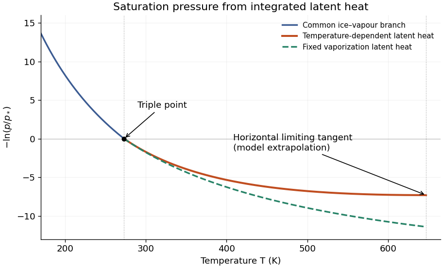

<h1 id="1/b/solution">Solution</h1>

↑ **Parent:** [B](../b.md)

Let $Y=-\ln(p/p_*)$. For the temperature-dependent [latent heat](../../../../latent-heat.md),

$$
Y(T)=\begin{cases}
\dfrac{L_s}{R_{\rm wv}}\left(\dfrac1T-\dfrac1{T_*}\right),&T\leq T_*,\\[4pt]
K\left[T_c\left(\dfrac1T-\dfrac1{T_*}\right)+\ln\dfrac T{T_*}\right],&T_*\leq T<T_c.
\end{cases}
$$

Keeping the [latent heat](../../../../latent-heat.md) of vaporization fixed changes only the upper branch to

$$
Y_{\rm fixed}(T)=\frac{L_*}{R_{\rm wv}}\left(\frac1T-\frac1{T_*}\right).
$$

Both curves fall from $+\infty$ as $T\to0^+$, pass through $Y=0$ at the [triple point](../../../../triple-point.md), and are convex. At the [triple point](../../../../triple-point.md) there is a corner because the [latent heat](../../../../latent-heat.md) changes from $L_s$ to $L_*$. Their right-hand slopes there agree. Above the [triple point](../../../../triple-point.md),

$$
Y'_{\rm variable}=-K\frac{T_c-T}{T^2},\qquad
Y'_{\rm fixed}=-\frac{L_*}{R_{\rm wv}T^2},\qquad
Y''_{\rm variable}=K\frac{2T_c-T}{T^3}>0.
$$

The variable-[latent heat](../../../../latent-heat.md) curve lies **above** the fixed-[latent heat](../../../../latent-heat.md) curve: its downward slope has smaller magnitude at every $T>T_*$. It reaches a horizontal tangent at $T_c$, whereas the fixed-[latent heat](../../../../latent-heat.md) curve is still descending. Both limiting ordinates are finite; this model gives $Y_{\rm variable}(T_c)\simeq-7.30$ and $Y_{\rm fixed}(T_c)\simeq-11.40$. These are extrapolations of the stipulated model, not accurate [water](../../../../water.md) [liquid-gas critical point](../../../../liquid-gas-critical-point.md) data. Extending the variable branch beyond $T_c$ would give negative [latent heat](../../../../latent-heat.md) and is physically inadmissible.

**[Figure 1](#1/b/image-integrated-saturation-curves-for-fixed-and-temperature-dependent-latent-heat). Integrated saturation curves for fixed and temperature-dependent latent heat**.

## ↑ Ancestors (12)

1. [B](../b.md)
2. [1](../../1.md)
3. [2022](../../../2022-split.md)
4. [Past exam of the physics of atmospheres and oceans course of the University of Oxford](../../../split.md)
5. [Physics of atmospheres and oceans course of the University of Oxford](../../../../physics-of-atmospheres-and-oceans-course-of-the-university-of-oxford.md)
6. [Year 4 of the physics course of the University of Oxford](../../../../year-4-of-the-physics-course-of-the-university-of-oxford.md)
7. [Physics course of the University of Oxford](../../../../physics-course-of-the-university-of-oxford.md)
8. [Undergraduate course of the University of Oxford](../../../../undergraduate-course-of-the-university-of-oxford.md)
9. [Course of the University of Oxford](../../../../course-of-the-university-of-oxford.md)
10. [University of Oxford](../../../../university-of-oxford-split.md)
11. [List of universities](../../../../list-of-universities.md)
12. [Codex Wiki](../../../../split.md)
