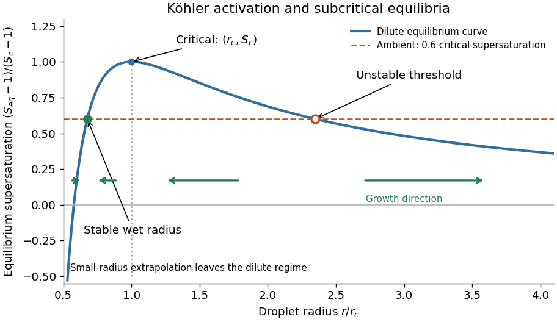

<h1 id="3/b/solution">Solution</h1>

↑ **Parent:** [B](../b.md)

For $A,B>0$, differentiating the simplified [Köhler theory](../../../../kohler-theory.md) curve gives

$$
\frac{dS_{\rm eq}}{dr}=-\frac A{r^2}+\frac{3B}{r^4},\qquad
\boxed{r_c=\sqrt{\frac{3B}{A}}.}
$$

The [derivative](../../../../derivative.md) is positive below $r_c$ and negative above it, so $r_c$ is the [Köhler activation radius](../../../../kohler-activation-radius.md), the unique maximum. At that point $B/r_c^3=A/(3r_c)$, giving

$$
\boxed{S_c=1+\frac{2A}{3r_c}=1+\sqrt{\frac{4A^3}{27B}}.}
$$

The curve crosses $S=1$ at $r=\sqrt{B/A}=r_c/\sqrt3$, reaches $S_c$ at $r_c$, and approaches $1$ from above as $r\to\infty$. Its formal divergence to negative values as $r\to0$ is outside the dilute-[chemical solution](../../../../solution-chemistry.md) approximation; a finite dry solute core and composition-dependent properties must replace that extrapolation.

**[Figure 2](#3/b/image-kohler-equilibrium-curve-and-growth-directions-at-subcritical-supersaturation). Köhler equilibrium curve and growth directions at subcritical supersaturation**.

## ↑ Ancestors (12)

1. [B](../b.md)
2. [3](../../3.md)
3. [2022](../../../2022-split.md)
4. [Past exam of the physics of atmospheres and oceans course of the University of Oxford](../../../split.md)
5. [Physics of atmospheres and oceans course of the University of Oxford](../../../../physics-of-atmospheres-and-oceans-course-of-the-university-of-oxford.md)
6. [Year 4 of the physics course of the University of Oxford](../../../../year-4-of-the-physics-course-of-the-university-of-oxford.md)
7. [Physics course of the University of Oxford](../../../../physics-course-of-the-university-of-oxford.md)
8. [Undergraduate course of the University of Oxford](../../../../undergraduate-course-of-the-university-of-oxford.md)
9. [Course of the University of Oxford](../../../../course-of-the-university-of-oxford.md)
10. [University of Oxford](../../../../university-of-oxford-split.md)
11. [List of universities](../../../../list-of-universities.md)
12. [Codex Wiki](../../../../split.md)
