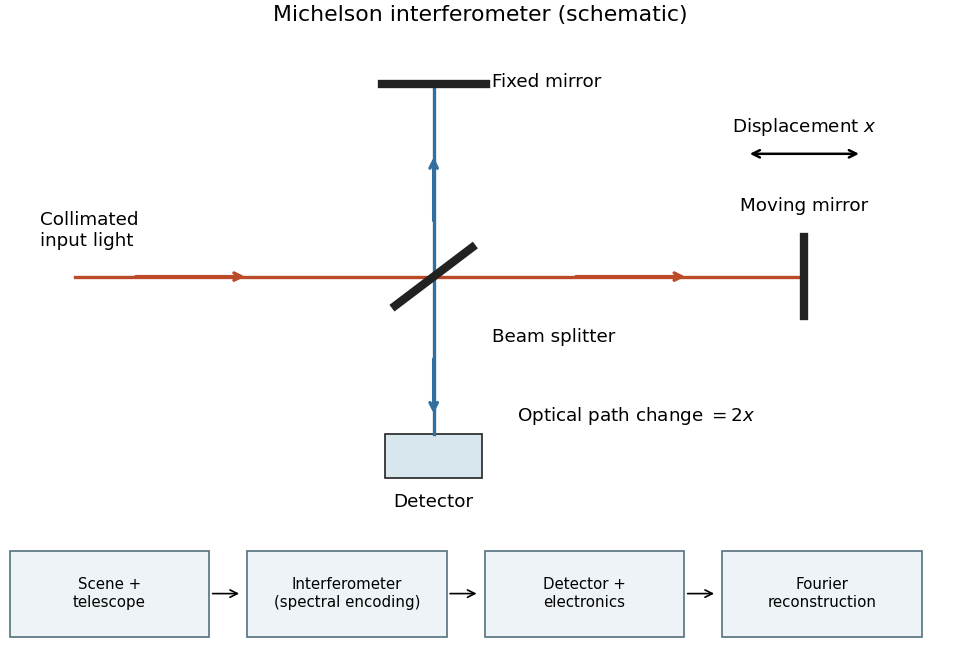

<h1 id="4/a/solution">Solution</h1>

↑ **Parent:** [A](../a.md)

A [Michelson interferometer](../../../../michelson-interferometer.md) uses a [beam splitter](../../../../beam-splitter.md) to divide collimated input [light](../../../../light.md) between a fixed mirror and a moving mirror. Returning beams recombine at the [beam splitter](../../../../beam-splitter.md); one output reaches a [photodetector](../../../../photodetector.md). A compensator plate can equalize the glass traversed in the two arms. Moving one mirror by $x$ changes the [optical path difference](../../../../optical-path-difference.md) by $2x$.

**[Figure 3](#4/a/image-michelson-interferometer-and-the-corresponding-measurement-chain). Michelson interferometer and the corresponding measurement chain**.

The usual nominal [Fourier transform spectroscopy](../../../../fourier-transform-spectroscopy.md) specification is $\delta\nu\simeq1/d_{\max}$, where $d_{\max}$ is the maximum [optical path difference](../../../../optical-path-difference.md) measured from equal arms. It gives

$$
\boxed{d_{\max}\simeq\frac1{0.5\,\mathrm{cm}^{-1}}=2\,\mathrm{cm},\qquad
x_{\max}\simeq1\,\mathrm{cm}.}
$$

This is a nominal [spectral resolution element](../../../../spectral-resolution-element.md) convention.[optical path difference equals reciprocal resolution; mirror travel is half the optical path difference](../../../../ftir-moving-mirror-travel-distance-calculation-by-thermo-fisher-scientific.md) A symmetric rectangular scan from $-d_{\max}$ to $d_{\max}$ instead has a sinc instrumental line shape with first-zero offset $1/(2d_{\max})$. Quoting that first-zero criterion would give $d_{\max}=1$ cm; [interferogram apodization](../../../../interferogram-apodization.md) and other linewidth criteria change the numerical factor. An exact mathematical minimum requires such a criterion.

In the measurement chain, the [Michelson interferometer](../../../../michelson-interferometer.md) is the spectral analyzer or modulator, between the collection optics and the [photodetector](../../../../photodetector.md). It encodes the incoming [radiation spectrum](../../../../radiation-spectrum.md) into an [interferogram](../../../../interferogram.md); detector electronics digitize that signal and a [Fourier transform](../../../../fourier-transform-split.md) reconstructs the [radiation spectrum](../../../../radiation-spectrum.md). It does not itself turn [radiant power](../../../../radiant-flux.md) into an electrical signal.

## ↑ Ancestors (12)

1. [A](../a.md)
2. [4](../../4.md)
3. [2022](../../../2022-split.md)
4. [Past exam of the physics of atmospheres and oceans course of the University of Oxford](../../../split.md)
5. [Physics of atmospheres and oceans course of the University of Oxford](../../../../physics-of-atmospheres-and-oceans-course-of-the-university-of-oxford.md)
6. [Year 4 of the physics course of the University of Oxford](../../../../year-4-of-the-physics-course-of-the-university-of-oxford.md)
7. [Physics course of the University of Oxford](../../../../physics-course-of-the-university-of-oxford.md)
8. [Undergraduate course of the University of Oxford](../../../../undergraduate-course-of-the-university-of-oxford.md)
9. [Course of the University of Oxford](../../../../course-of-the-university-of-oxford.md)
10. [University of Oxford](../../../../university-of-oxford-split.md)
11. [List of universities](../../../../list-of-universities.md)
12. [Codex Wiki](../../../../split.md)
