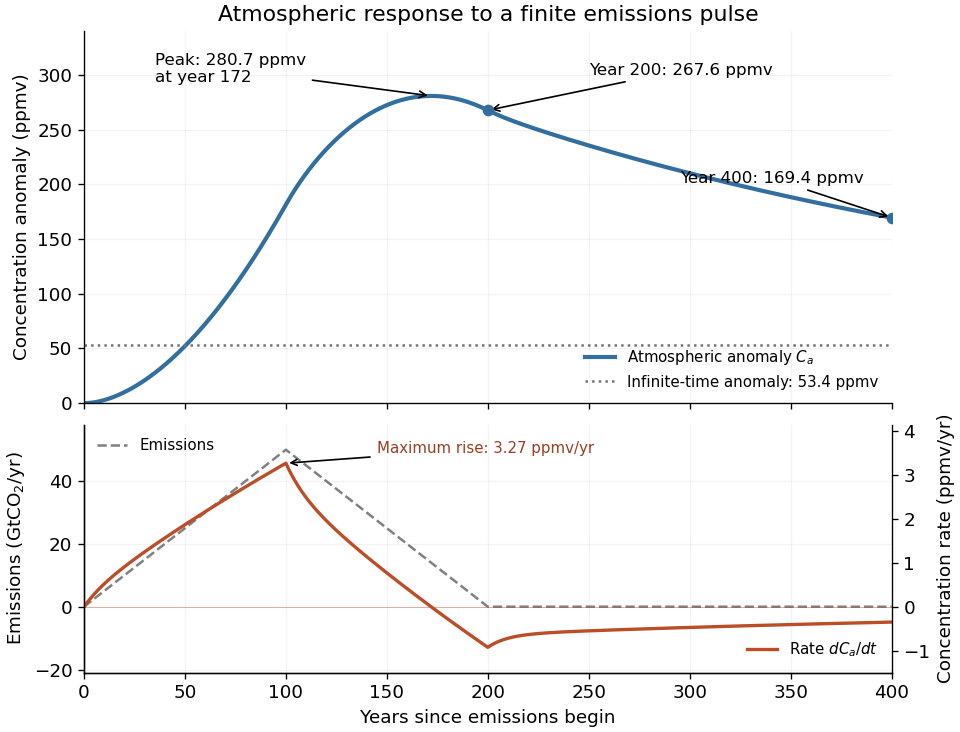

<h1 id="5/d/solution">Solution</h1>

↑ **Parent:** [D](../d.md)

Here $R=7.8$, $R_d=78$, $r=0.4$, and $s=0.04$, in the stated reservoir units. The exact characteristic coefficients are $P=0.10820513\,\mathrm{yr}^{-1}$ and $Q=0.000315582\,\mathrm{yr}^{-2}$, giving

$$
\boxed{\tau_1=9.51\,\mathrm{yr},\qquad\tau_2=333.4\,\mathrm{yr},\qquad\tau_3=\infty.}
$$

The leading separation estimates give $9.75$ yr and $325$ yr if finite $R_d$ is retained, or $390$ yr if $R_d/R$ is also sent to infinity. Thus $\tau_1\ll100\,\mathrm{yr}<\tau_2$; a ratio of ten warrants using the exact values for the requested sketch.

Assume initially zero anomalies in all reservoirs. The atmospheric impulse response, obtained by decomposing $e^{Jt}$ into the three [normal modes](../../../../normal-mode.md), is

$$
G(t)=w_0+w_1e^{-t/\tau_1}+w_2e^{-t/\tau_2},\qquad t\geq0,
$$

with $w_0=1/93.6=0.01068376$, $w_1=0.06087812$, and $w_2=0.05664324$, in ppmv/GtCO$_2$. The checks $w_0+w_1+w_2=1/R_a$ and $w_1/\tau_1+w_2/\tau_2=r/R_a^2$ fix the instantaneous injection response and its initial decay.

The concentration is the [convolution](../../../../convolution.md) $C_a(t)=\int_0^tG(t-t')E(t')\,dt'$. To evaluate it transparently, define $H_0(q)=q^2/2$ for $q>0$, and

$$
H_i(q)=\tau_iq-\tau_i^2(1-e^{-q/\tau_i}),\qquad q>0,\quad i=1,2,
$$

setting every $H_i(q)=0$ when $q\leq0$. Expressing the triangular emission history as $E(t)=0.5[t_+-2(t-100)_++(t-200)_+]$ gives

$$
C_a(t)=\frac12\sum_{i=0}^2w_i[H_i(t)-2H_i(t-100)+H_i(t-200)].
$$

Here times are in years and $0.5$ has the corresponding emission-ramp units. Differentiating or evaluating the [convolution](../../../../convolution.md) gives

$$
\boxed{\max\dot C_a\simeq3.27\,\mathrm{ppmv/yr}\ \text{at year }100,\qquad
C_a(200)\simeq267.6\,\mathrm{ppmv},\qquad C_a(400)\simeq169.4\,\mathrm{ppmv}.}
$$

The maximum concentration occurs earlier than the end of emissions, at approximately year $172$, with $C_a\simeq280.7$ ppmv. Initially there is a short adjustment over $\tau_1$; the curve then rises, turns over as emissions fall, and continues declining after year 200 as the deep [ocean](../../../../ocean.md) takes up [carbon dioxide](../../../../carbon-dioxide.md).

The total emitted [mass](../../../../mass.md) is the area of the emission triangle, $\frac12(200)(50)=5000$ GtCO$_2$. All reservoirs eventually share one concentration, so [conservation of mass](../../../../mass-conservation.md) gives

$$
\boxed{C_a(\infty)=\frac{5000}{7.8+7.8+78}=53.4\,\mathrm{ppmv}.}
$$

**[Figure 4](#5/d/image-atmospheric-concentration-and-its-rate-of-change-under-a-triangular-emissions-pulse). Atmospheric concentration and its rate of change under a triangular emissions pulse**.

## ↑ Ancestors (12)

1. [D](../d.md)
2. [5](../../5.md)
3. [2022](../../../2022-split.md)
4. [Past exam of the physics of atmospheres and oceans course of the University of Oxford](../../../split.md)
5. [Physics of atmospheres and oceans course of the University of Oxford](../../../../physics-of-atmospheres-and-oceans-course-of-the-university-of-oxford.md)
6. [Year 4 of the physics course of the University of Oxford](../../../../year-4-of-the-physics-course-of-the-university-of-oxford.md)
7. [Physics course of the University of Oxford](../../../../physics-course-of-the-university-of-oxford.md)
8. [Undergraduate course of the University of Oxford](../../../../undergraduate-course-of-the-university-of-oxford.md)
9. [Course of the University of Oxford](../../../../course-of-the-university-of-oxford.md)
10. [University of Oxford](../../../../university-of-oxford-split.md)
11. [List of universities](../../../../list-of-universities.md)
12. [Codex Wiki](../../../../split.md)
