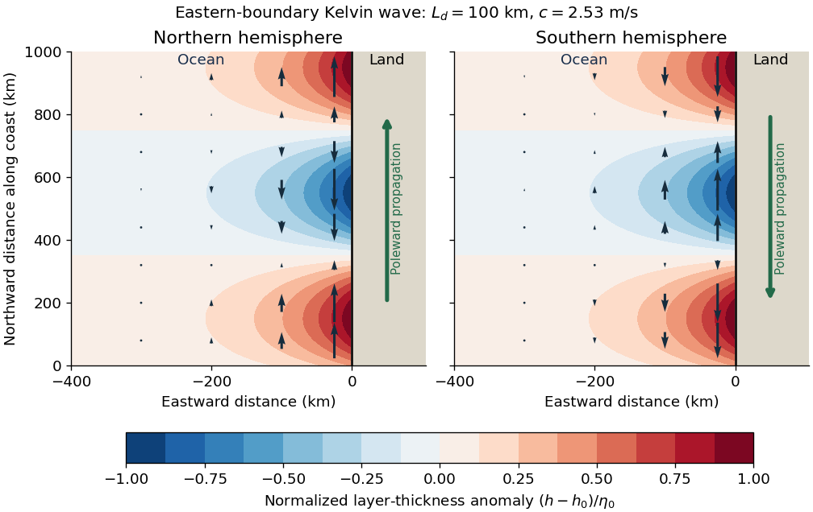

<h1 id="6/c/solution">Solution</h1>

↑ **Parent:** [C](../c.md)

Use Earth's rotation rate $\Omega=7.292\times10^{-5}\,\mathrm{s}^{-1}$ and the [Coriolis parameter](../../../../coriolis-parameter.md) $f=2\Omega\sin\phi$. At $|\phi|=10^\circ$,

$$
|f|=2.53\times10^{-5}\,\mathrm{s}^{-1},\qquad
\boxed{c=|f|L_d\simeq2.53\,\mathrm{m\,s}^{-1}.}
$$

The [Kelvin waves](../../../../kelvin-wave.md) propagate polewards along the eastern boundary: northwards at $10^\circ$ N and southwards at $10^\circ$ S. The positive [Rossby deformation radius](../../../../rossby-deformation-radius.md) uses $|f|$; the source's expression $c/f$ must be interpreted as a magnitude in the southern hemisphere.

The east-west e-folding distance is approximately $100$ km, or

$$
\Delta\lambda\simeq\frac{100\,\mathrm{km}}{R_E\cos10^\circ}
=0.0159\,\mathrm{rad}\simeq0.91^\circ
$$

of longitude. With the coast at $x=0$ and [ocean](../../../../ocean.md) at $x<0$, a northern-hemisphere snapshot can be written

$$
\eta=\eta_0e^{x/L_d}\cos[\ell_K(y-ct)],\qquad
u=0,\qquad v=\frac c{h_0}\eta.
$$

At a positive thickness crest, the [thermocline](../../../../thermocline.md) is depressed and the alongshore [velocity](../../../../velocity.md) points polewards; a negative thickness trough reverses that [velocity](../../../../velocity.md). In the southern hemisphere replace $c$ by $-c$ in the propagation and in $v/\eta$. The envelopes of both thickness and alongshore [velocity](../../../../velocity.md) decay offshore, and the cross-shore [velocity](../../../../velocity.md) vanishes.

**[Figure 5](#6/c/image-eastern-boundary-kelvin-wave-thickness-and-horizontal-velocity-in-both-hemispheres). Eastern-boundary Kelvin-wave thickness and horizontal velocity in both hemispheres**.

## ↑ Ancestors (12)

1. [C](../c.md)
2. [6](../../6.md)
3. [2022](../../../2022-split.md)
4. [Past exam of the physics of atmospheres and oceans course of the University of Oxford](../../../split.md)
5. [Physics of atmospheres and oceans course of the University of Oxford](../../../../physics-of-atmospheres-and-oceans-course-of-the-university-of-oxford.md)
6. [Year 4 of the physics course of the University of Oxford](../../../../year-4-of-the-physics-course-of-the-university-of-oxford.md)
7. [Physics course of the University of Oxford](../../../../physics-course-of-the-university-of-oxford.md)
8. [Undergraduate course of the University of Oxford](../../../../undergraduate-course-of-the-university-of-oxford.md)
9. [Course of the University of Oxford](../../../../course-of-the-university-of-oxford.md)
10. [University of Oxford](../../../../university-of-oxford-split.md)
11. [List of universities](../../../../list-of-universities.md)
12. [Codex Wiki](../../../../split.md)
