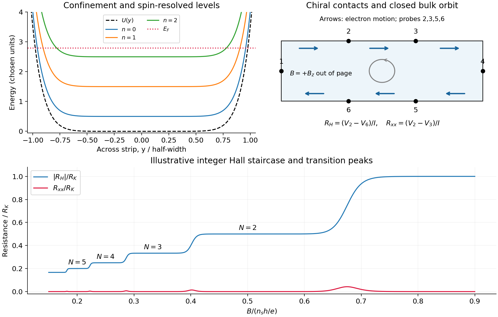
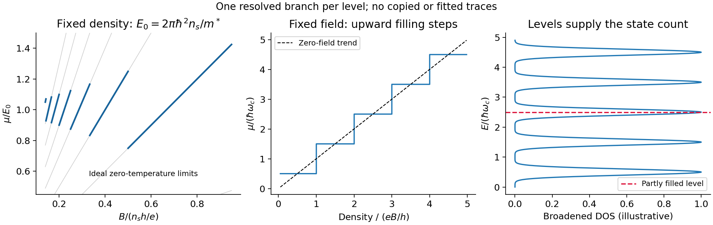
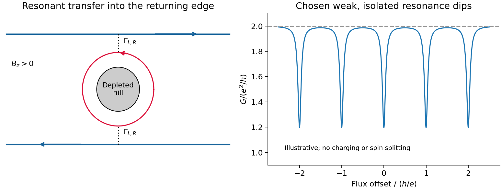
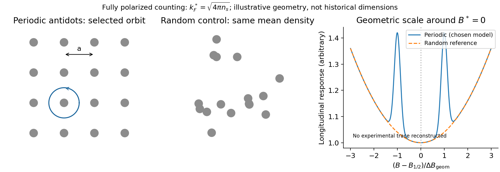
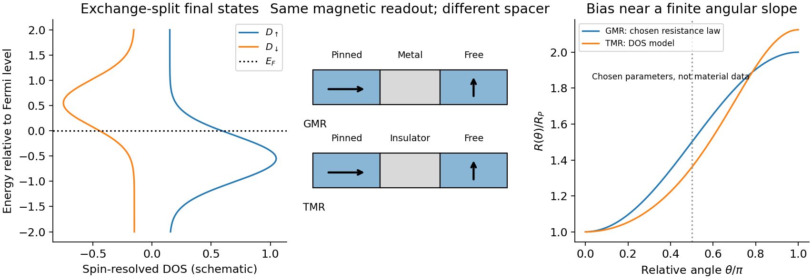
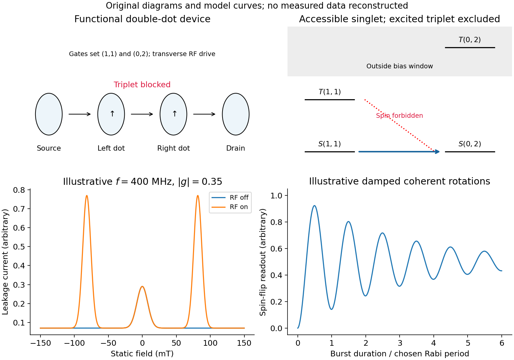

# Paper 1

↑ **Parent:** [2012](../2012.md)

Original paper: [Public original, physical PDF pages 500–501](https://www.whatdotheyknow.com/request/natural_science_tripos_physics_e_2/response/2340776/attach/2/FOI%202023%20399%20Zahid%20materials.pdf?cookie_passthrough=1#page=500).

**Table of contents**

- [1](#1)
  - [Solution](#1/solution)
- [2](#2)
  - [Solution](#2/solution)
- [3](#3)
  - [a](#3/a)
    - [Solution](#3/a/solution)
  - [b](#3/b)
    - [Solution](#3/b/solution)

## 1

↑ **Parent:** [Paper 1](paper-1.md)

<h3 id="1/solution">Solution</h3>

↑ **Parent:** [1](#1)

Take the [two-dimensional electron gas](../../quantum-ideal-gas-statistics.md#two-dimensional-electron-gas) in the $xy$ plane, the [Hall bar](../../relativistic-electromagnetism.md#hall-bar) along $x$, and $\mathbf B=B\hat{\mathbf z}$ with $B>0$ perpendicular to it. An [electron](../../physics.md#electron) has charge $-e$. The confining [electron](../../physics.md#electron) [potential energy](../../energy.md#potential-energy) $U(y)$ is approximately flat inside a wide strip and rises at either boundary; smooth [quenched disorder](../../spin-model.md#quenched-disorder) adds hills and valleys. For a slowly varying edge, each spin-resolved [Landau level](../../quantum-theory.md#landau-level) approximately follows

$$
E_{n,s}(Y)=\hbar\omega_c(n+\tfrac12)+U(Y)+s\frac{g^*\mu_BB}{2},\qquad
\omega_c=\frac{eB}{m^*},\qquad \ell_B=\sqrt{\frac{\hbar}{eB}}.
$$

Here $s=\pm1$, and $Y$ is the [guiding centre](../../electromagnetism.md#guiding-center). For $\mathbf A=(-By,0,0)$, $Y=\ell_B^2k_x$ and the edge [group velocity](../../dispersion-relation.md#group-velocity) is

$$
\boxed{v_x=\frac1\hbar\frac{\partial E}{\partial k_x}=\frac{U'(Y)}{eB}.}
$$

Thus [electrons](../../physics.md#electron) move along $+x$ at the upper edge and $-x$ at the lower edge. The [Lorentz force](../../relativistic-electromagnetism.md#lorentz-force) gives counterclockwise bulk cyclotron motion in this convention. At a hard boundary its interrupted circles become directed [skipping orbits](../../relativistic-electromagnetism.md#skipping-orbit); a smooth boundary gives the corresponding guiding-centre drift. Smooth bulk [quenched disorder](../../spin-model.md#quenched-disorder) generally gives closed drift contours around localized hills or valleys, with extended trajectories appearing near a broadened level's critical [energy](../../energy.md). Realistic [electrostatic screening](../../electrostatics.md#electrostatic-screening) can produce alternating [compressible quantum Hall edge strips](../../relativistic-electromagnetism.md#compressible-quantum-hall-edge-strip) and [incompressible quantum Hall edge strips](../../relativistic-electromagnetism.md#incompressible-quantum-hall-edge-strip), so the unscreened bending curves are an effective sketch rather than an exact self-consistent edge profile.

In the original diagram, contacts are ordered around the [electron](../../physics.md#electron) propagation direction: upper-left $1\to2\to3$, then lower-right $4\to5\to6$. Let $I_1=I$, $I_4=-I$ and the other leads be ideal [equilibrating voltage probes](../../quantum-mechanics.md#equilibrating-voltage-probe). Define $R_H=(V_2-V_6)/I$ and $R_{xx}=(V_2-V_3)/I$. These choices fix the [voltage](../../random-walk.md#voltage) sign; reversing the field reverses chirality and the Hall polarity. For spin-resolved plateau index $N$,

$$
\boxed{R_H=\frac{h}{Ne^2},\qquad R_{xx}=0.}
$$

At fixed sheet [carrier density](../../electric-charge.md#carrier-density) and increasing field, $N$ decreases, giving successively higher Hall plateaus; longitudinal peaks occur between them. Unresolved [spin](../../angular-momentum-operator.md#spin) branches can suppress odd plateaus. The sketch uses resistance magnitudes, and every integer step is not promised in an arbitrary sample.

**[Figure 1](#1/image-hall-states-and-resistance). Hall states and resistance**.

For [Fermi-energy oscillations in a two-dimensional electron gas](../../quantum-theory.md#fermi-energy-oscillations-in-a-two-dimensional-electron-gas), first distinguish fixed density from fixed reservoir [chemical potential](../../chemical-potential.md). At negligible [temperature](../../temperature.md) the former is determined by state counting. Each resolved [Landau level](../../quantum-theory.md#landau-level) contains $eB/h$ states per unit [area](../../differential-geometry.md#surface-area), so

$$
\nu=\frac{n_sh}{eB},\qquad E_n=\hbar\omega_c(n+\tfrac12).
$$

Ignoring [spin](../../angular-momentum-operator.md#spin) and broadening for the counting illustration, if $N<\nu<N+1$ then $N$ levels are full and level $N$ is partly full: $\mu=E_N$. At fixed $n_s$, increasing $B$ increases both level [energy](../../energy.md) and degeneracy. The partly filled level rises in [energy](../../energy.md) until the lower levels can contain all [electrons](../../physics.md#electron); $\mu$ then drops to the next lower level. The resulting sawtooth is periodic in $1/B$, with **$\Delta(1/B)=e/(n_sh)$ per resolved branch**. At an exactly integer filling in an ideal gap, any [chemical potential](../../chemical-potential.md) within the gap gives the same zero-temperature particle number; the plotted discontinuity denotes its limiting values.

At fixed $B$ while $n_s$ increases, the ideal [chemical potential](../../chemical-potential.md) stays at a partly occupied level and steps upward after each additional density $eB/h$. It therefore has a staircase superposed on the rising zero-field trend, not a repeated downward sawtooth. [Landau-level broadening](../../quantum-theory.md#landau-level-broadening) and finite [temperature](../../temperature.md) smooth both ideal graphs. With an externally pinned [chemical potential](../../chemical-potential.md), density changes instead; the fixed-density sawtooth cannot simultaneously be imposed. In a realistic disordered sample, the [Fermi energy](../../quantum-ideal-gas-statistics.md#fermi-energy) sweeps localized states between transport-carrying level centres. The following schematic omits [spin](../../angular-momentum-operator.md#spin) for clarity and does not attempt an interaction-corrected [density of states](../../quantum-ideal-gas-statistics.md#density-of-states).

**[Figure 2](#1/image-landau-filling-and-chemical-potential). Landau filling and chemical potential**.

For $N$ transmitted spin-resolved [quantum Hall edge states](../../relativistic-electromagnetism.md#quantum-hall-edge-state), the [Landauer-Büttiker formula](../../quantum-mechanics.md#landauer-buttiker-formula) reduces, in that contact order, to

$$
I_i=\frac{Ne^2}{h}(V_i-V_{i-1}),\qquad V_0\equiv V_6.
$$

Zero probe currents imply $V_2=V_3=V_1$ and $V_5=V_6=V_4$. Hence $I=(Ne^2/h)(V_1-V_4)$ and the boxed resistance results follow. The [spin-resolved conductance quantum](../../quantum-mechanics.md#spin-resolved-conductance-quantum) arises because the one-dimensional [density of states](../../quantum-ideal-gas-statistics.md#density-of-states) times velocity is $1/h$ per unit [energy](../../energy.md); a reservoir imbalance supplies $e^2\Delta V/h$ per channel. Its value does not depend on edge slope or sample width.

On a plateau, opposite-moving edge channels are separated by a wide bulk with a [mobility gap](../../wave.md#mobility-gap). Ordinary [elastic scattering](../../quantum-scattering.md#elastic-scattering) on one edge has no counterpropagating channel into which to reflect; closed bulk orbits do not connect the contacts. Changing $B$ or $n_s$ can alter the occupancy of localized states without changing the number of transmitting edge channels. This accounts for the **finite plateau width**, which an entirely clean set of sharp levels would not explain. Accuracy requires negligible backscattering between opposite edges, low enough current to avoid breakdown, equilibrating contacts and negligible probe loading. The finite-width plateau and the precision of its quantized value are related but distinct observations.

An [antidot](../../relativistic-electromagnetism.md#quantum-hall-antidot) is a depleted potential hill, not a potential well. Its closed edge circulates oppositely to the outer boundary. In a constriction, tunnelling through an antidot orbit can transfer an [electron](../../physics.md#electron) from a forward edge into the returning edge: [resonant antidot backscattering](../../relativistic-electromagnetism.md#resonant-antidot-backscattering) produces conductance dips. For $N$ otherwise open spin-resolved channels and one active [resonance](../../dynamical-systems.md#resonance),

$$
G=\frac{e^2}{h}\bigl[N-\mathcal R(E_F)\bigr],\qquad
\mathcal R(E)=\frac{\Gamma_L\Gamma_R}{(E-\epsilon_m)^2+(\Gamma_L+\Gamma_R)^2/4}.
$$

At symmetric coupling a single [resonance](../../dynamical-systems.md#resonance) can remove $e^2/h$; asymmetry or thermal averaging reduces its depth. If the background constriction is closed and the resonant route instead supplies forward transmission, peaks occur. The lead connectivity must therefore accompany the conductance sketch. In the fixed-area single-particle limit, successive alignments change enclosed flux by $\Phi_0=h/e$, giving the [Aharonov-Bohm antidot period](../../relativistic-electromagnetism.md#aharonov-bohm-antidot-period)

$$
\boxed{\Delta B\simeq\frac{h}{eA_{\rm eff}}.}
$$

The effective orbit [area](../../differential-geometry.md#surface-area), not merely the etched island [area](../../differential-geometry.md#surface-area), enters. Charging, screening and [spin](../../angular-momentum-operator.md#spin) can modify this simple sequence; two coupled [spin](../../angular-momentum-operator.md#spin) branches can yield a near-$h/(2e)$ pattern without changing the elementary flux quantum.[2000 author abstract: charging model and two resonances per $h/e$ flux cycle](../../physics-bibliography.md#coulomb-blockade-of-tunnelling-through-compressible-rings-formed-around-an-antidot-by-m-kataoka-and-others)

**[Figure 3](#1/image-antidot-resonant-backscattering). Antidot resonant backscattering**.

## 2

↑ **Parent:** [Paper 1](paper-1.md)

<h3 id="2/solution">Solution</h3>

↑ **Parent:** [2](#2)

A [Landau quasiparticle](../../fermi-liquid.md#landau-quasiparticle) is an electron-like excitation dressed by the interacting medium. Adiabatic continuity connects low-energy states of an ordinary [Fermi liquid](../../fermi-liquid.md) to those of a free [Fermi gas](../../quantum-ideal-gas-statistics.md#fermi-gas) without changing their particle statistics or conserved quantum numbers. The excitation has a renormalized dispersion, [effective mass](../../bloch-s-theorem.md#band-effective-mass), magnetic response and finite lifetime. [Pauli exclusion principle](../../tensor-product-of-quantum-systems.md#pauli-exclusion-principle) restricts collisions near the [Fermi surface](../../fermi-liquid.md#fermi-surface); in a regular three-dimensional [Fermi liquid](../../fermi-liquid.md),

$$
\frac{\hbar}{\tau}\sim\frac{(\epsilon-\mu)^2+(\pi k_BT)^2}{E_*}.
$$

Thus the width is small compared with excitation [energy](../../energy.md) sufficiently near the surface at low [temperature](../../temperature.md). This permits particle-like counting and transport even when microscopic interactions are strong. It does not make every interaction disappear: the [Landau quasiparticle energy functional](../../fermi-liquid.md#landau-quasiparticle-energy-functional) contains residual interactions,

$$
\delta E=\sum_a\epsilon_a\delta n_a+\frac1{2\mathcal V}\sum_{ab}f_{ab}\delta n_a\delta n_b.
$$

Specific heats and magnetic susceptibilities need not equal their bare-gas values. Logarithmic corrections can modify the lifetime scale in two dimensions, and a [Luttinger liquid](../../statistical-physics.md#luttinger-liquid) or a fractional Hall fluid is not an ordinary weakly perturbed [electron](../../physics.md#electron) gas.

An electron-like excitation in a normal metal and a neutral fermionic excitation in normal [helium-3](../../chemical-substance.md#helium-3) are [Landau quasiparticles](../../fermi-liquid.md#landau-quasiparticle). More generally, [phonons](../../quantum-ideal-gas-statistics.md#phonon), [magnons](../../critical-phenomenon.md#magnon) and [excitons](../../quantum-mechanics.md#exciton) are particle-like collective excitations, with their own statistics and quantum numbers; they are not all [Landau quasiparticles](../../fermi-liquid.md#landau-quasiparticle). [composite fermions](../../relativistic-electromagnetism.md#composite-fermion) are another emergent description, reorganizing correlations in a partly occupied [Landau level](../../quantum-theory.md#landau-level) rather than simply replacing the [electron](../../physics.md#electron) mass in an ordinary band.

Attach two statistical flux quanta $\Phi_0=h/e$ to each [electron](../../physics.md#electron). Even attachment preserves fermionic exchange statistics, while the average statistical field opposes the applied field:

$$
B^*=B-2n_s\Phi_0,\qquad \nu=\frac{n_s\Phi_0}{B},\qquad
\nu^*=\frac{n_s\Phi_0}{B^*}=\frac{\nu}{1-2\nu}.
$$

This is an effective description of correlations, not literal flux tubes produced by small solenoids. An integer number of filled effective levels can give an incompressible electronic fractional Hall state. This is the correspondence between integer Hall quantization of [composite fermions](../../relativistic-electromagnetism.md#composite-fermion) and selected fractional Hall states of [electrons](../../physics.md#electron).[1989 publisher abstract: fractional Hall states as integer states after even flux attachment](../../physics-bibliography.md#composite-fermion-approach-for-the-fractional-quantum-hall-effect-by-j-k-jain)

Setting the signed effective filling to integer $p$ gives

$$
p(1-2\nu)=\nu,\qquad\boxed{\nu=\frac{p}{2p+1}.}
$$

Positive $p$ gives $1/3,2/5,3/7,\ldots$ below $1/2$. Negative $p=-q$, $q>0$, gives $q/(2q-1)$ above it, including $2/3,3/5,4/7,\ldots$. The sign records reversed $B^*$. At $\nu=1/2$, the mean effective field vanishes, so the simplest description is a compressible composite-fermion sea rather than another member with finite integer $p$. Fractional charged excitations of gapped Hall states and the charge used in this semiclassical composite-fermion orbit description should not be conflated.

A direct probe away from the incompressible fractions is [composite-fermion geometric resonance](../../relativistic-electromagnetism.md#composite-fermion-geometric-resonance). One implementation patterned a high-mobility GaAs/AlGaAs [Hall bar](../../relativistic-electromagnetism.md#hall-bar) into periodic and random antidot arrays. [electron beam lithography](../../engineering.md#electron-beam-lithography) followed by an approximately $130\,\mathrm{nm}$ reactive-ion etch made arrays with periods $400$–$700\,\mathrm{nm}$. Four-terminal low-current measurements swept a perpendicular [magnetic field](../../magnetic-field.md) at low [temperature](../../temperature.md); red-light illumination varied density and the modulation. Periodic arrays showed commensurability structure near half filling and a Hall anomaly; matched random arrays did not. Unpatterned sections supplied another reference.[pp.3598–3600, fabrication, measurement method and Figs.1–3](../../physics-bibliography.md#composite-fermions-in-periodic-and-random-antidot-lattices-by-j-h-smet-and-others)

The semiclassical explanation uses, for a fully spin-polarized sea,

$$
k_F^*=\sqrt{4\pi n_s},\qquad R_c^*=\frac{\hbar k_F^*}{e|B-B_{1/2}|},\qquad
B_{1/2}=\frac{2hn_s}{e}.
$$

The mass cancels from the orbit [radius](../../topology.md#radius). A selected orbit fits the lattice when $2R_c^*\simeq C a$, with a geometry-dependent constant $C$ of order unity. Pinned orbits around antidots then alter longitudinal transport, producing features near

$$
\boxed{|B-B_{1/2}|\simeq\frac{2\hbar\sqrt{4\pi n_s}}{eCa}.}
$$

The simplest single-antidot scale has $C\simeq1$; detailed peak positions require the actual potential and orbit family. The two field directions bend orbits oppositely. The diagnostic is an orbit scale controlled by the small residual $B^*$, rather than the much larger applied $B$. At the same density the fully polarized $k_F^*$ is $\sqrt2$ times the zero-field spin-degenerate [electron](../../physics.md#electron) value; this is an independent counting test.

Calibrate density from independent Hall/filling measurements and compare several lattice periods. Use small excitation and [temperature](../../temperature.md) sweeps, and check periodic, random and unpatterned regions. Density variation changes both $B_{1/2}$ and the orbit scale, so simply plotting against uncorrected field can mislead. [mean free path](../../ideal-gas.md#mean-free-path) and density inhomogeneity limit resolution; illumination can soften or substantially change the imposed potential, so it cannot automatically be treated as density adjustment alone. These qualifications are part of the inference from geometry to emergent particles, rather than a claim that every feature near half filling is a new fractional plateau.

**[Figure 4](#2/image-composite-fermion-orbit-test). Composite-fermion orbit test**.

## 3

↑ **Parent:** [Paper 1](paper-1.md)

<h3 id="3/a">a</h3>

↑ **Parent:** [3](#3)

<h4 id="3/a/solution">Solution</h4>

↑ **Parent:** [A](#3/a)

Exchange-split bands in a [ferromagnet](../../electromagnetism.md#ferromagnet) generally give a different spin-resolved [density of states](../../quantum-ideal-gas-statistics.md#density-of-states) for each [spin](../../angular-momentum-operator.md#spin) branch, $D_\uparrow(E_F)$ and $D_\downarrow(E_F)$. If [spin](../../angular-momentum-operator.md#spin) is approximately conserved across a multilayer, its two [spin](../../angular-momentum-operator.md#spin) channels conduct in parallel. A [spin valve](../../electric-charge.md#spin-valve) combines a comparatively fixed reference-layer [magnetization](../../electromagnetism.md#magnetization) with a soft free layer that rotates in a small applied field. Its readout depends on the relative angle, not simply the absolute [spin](../../angular-momentum-operator.md#spin) population. Biasing the layers near a perpendicular alignment gives a useful [linear response](../../statistical-physics.md#linear-response-theory) instead of operating at the flat parallel/antiparallel extrema.

In [giant magnetoresistance](../../electric-charge.md#giant-magnetoresistance), a metallic spacer separates ferromagnetic layers. Spin-dependent bulk and interface scattering make their channel resistances unequal. The density of available final $d$ states influences scattering of more mobile states; however, a large total [density of states](../../quantum-ideal-gas-statistics.md#density-of-states) does not by itself guarantee a large conductivity. The [scattering-weighted spin-channel asymmetry](../../electric-charge.md#scattering-weighted-spin-channel-asymmetry) also involves velocity and scattering matrix elements. In the elementary identical-layer [two-current resistor model](../../electric-charge.md#two-current-resistor-model), let each magnetic layer have resistances $a,b$ in the two [spin](../../angular-momentum-operator.md#spin) channels and neglect spacer resistance. Parallel moments give channels $2a$ and $2b$, while antiparallel moments give $a+b$ in each channel. Therefore

$$
R_P=\frac{2ab}{a+b},\qquad R_{AP}=\frac{a+b}{2},\qquad
\boxed{\frac{R_{AP}-R_P}{R_P}=\frac{(a-b)^2}{4ab}.}
$$

One favorable [spin](../../angular-momentum-operator.md#spin) channel traverses both aligned layers efficiently; reversal removes that common easy path. A conducting spacer adds resistance, and [spin](../../angular-momentum-operator.md#spin) mixing weakens the separate-channel approximation. The channel asymmetry is material/interface dependent, so positive magnetoresistance is not a theorem for every pair of different [ferromagnets](../../electromagnetism.md#ferromagnet).[§§2.1–2.2, pp.947–948, spin-dependent scattering and two-current construction](../../physics-bibliography.md#spin-dependent-transport-gmr-and-tmr-by-alain-schuhl-and-daniel-lacour)

In [tunnelling magnetoresistance](../../electric-charge.md#tunnelling-magnetoresistance), the spacer is an ultrathin insulator and current flows across a [magnetic tunnel junction](../../electric-charge.md#magnetic-tunnel-junction). In the simple spin-conserving [density-of-states tunnelling magnetoresistance model](../../electric-charge.md#density-of-states-tunnelling-magnetoresistance-model), assume spin-independent matrix elements and low [voltage](../../random-walk.md#voltage). Available initial and final states give

$$
G_P=C(D_{1\uparrow}D_{2\uparrow}+D_{1\downarrow}D_{2\downarrow}),\qquad
G_{AP}=C(D_{1\uparrow}D_{2\downarrow}+D_{1\downarrow}D_{2\uparrow}).
$$

Writing $P_i=(D_{i\uparrow}-D_{i\downarrow})/(D_{i\uparrow}+D_{i\downarrow})$ and $G_0=CD_1D_2/2$, these become $G_P=G_0(1+P_1P_2)$ and $G_{AP}=G_0(1-P_1P_2)$. Thus

$$
\boxed{\mathrm{TMR}\equiv\frac{R_{AP}-R_P}{R_P}=\frac{2P_1P_2}{1-P_1P_2}.}
$$

The effective tunnelling polarization can depend on the barrier and orbital symmetry, not just a bulk density-of-states sketch. Crystalline MgO junctions exploit symmetry-selective transmission, so the elementary product model is not a quantitative universal formula for them.[2004 publisher abstract, crystalline MgO junctions and large room-temperature response](../../physics-bibliography.md#giant-room-temperature-magnetoresistance-in-fe-mgo-fe-junctions-by-shinji-yuasa-and-others)

Both devices convert a free-layer rotation into an electrical change. A useful approximate GMR interpolation is $R(\theta)=R_P+\Delta R(1-\cos\theta)/2$; the elementary tunnelling model instead gives $G(\theta)=G_0(1+P_1P_2\cos\theta)$. The [spin-valve small-field sensitivity](../../electric-charge.md#spin-valve-small-field-sensitivity) is a chain rule,

$$
\boxed{\frac{dR}{dB}=\frac{dR}{d\theta}\frac{d\theta}{dB},\qquad
\delta V=I_{\rm bias}\frac{dR}{dB}\,\delta B.}
$$

[magnetic anisotropy](../../electromagnetism.md#magnetic-anisotropy), biasing and pinning set the rotation susceptibility. Conducting-spacer GMR usually offers low resistance and supports current-in-plane or current-perpendicular geometries. [TMR](../../electric-charge.md#tunnelling-magnetoresistance) uses perpendicular tunnelling, often offers a larger fractional signal and a larger resistance-area product, but demands uniform, stable barriers and has bias dependence and breakdown limits. Neither is automatically the better small-field sensor: heating, Johnson and low-frequency noise, domain switching, hysteresis and stability set the detectable field. Reverse sweep direction, vary current and [temperature](../../temperature.md), and independently test reference-layer pinning to distinguish a reproducible magnetic signal from drift or heating.

**[Figure 5](#3/a/image-spin-dependent-sensor-response). Spin-dependent sensor response**.

<h3 id="3/b">b</h3>

↑ **Parent:** [3](#3)

<h4 id="3/b/solution">Solution</h4>

↑ **Parent:** [B](#3/b)

For a [double quantum dot](../../semiconductor.md#double-quantum-dot), write $(n_L,n_R)$ for occupation. Tune a bias window allowing the cycle $(0,1)\to(1,1)\to(0,2)\to(0,1)$. Two [electrons](../../physics.md#electron) in the same lowest orbital must form a [singlet state](../../angular-momentum-operator.md#singlet-state) by the [Pauli exclusion principle](../../tensor-product-of-quantum-systems.md#pauli-exclusion-principle). The $(0,2)$ triplet requires an excited orbital, with an [energy](../../energy.md) cost $\Delta_{ST}$ above the accessible window. Approximately spin-conserving tunnelling transfers $S(1,1)$ into $S(0,2)$, but cannot transfer $T(1,1)$ into that singlet. Once a triplet loads, transport stops until [spin relaxation](../../angular-momentum-operator.md#spin-relaxation) or mixing occurs: this is [Pauli spin blockade](../../semiconductor.md#pauli-spin-blockade). The reverse bias can avoid trapping in this sequence, producing rectification. Coulomb charging sets the allowed occupancies, but the extra blockade is a spin-selection restriction, not merely an energetically forbidden charge state.

[magnetically driven spin-blockade lifting](../../semiconductor.md#magnetically-driven-spin-blockade-lifting) uses [electron paramagnetic resonance](../../physics.md#electron-paramagnetic-resonance). A transverse oscillating [magnetic field](../../magnetic-field.md) drives [spin](../../angular-momentum-operator.md#spin) transitions at

$$
\boxed{hf=|g^*|\mu_B|B_0|.}
$$

Flipping one [spin](../../angular-momentum-operator.md#spin) in $|\uparrow\uparrow\rangle$ gives $|\downarrow\uparrow\rangle=(|T_0\rangle-|S\rangle)/\sqrt2$, which has a singlet component and can resume charge transfer. A perfectly uniform simultaneous rotation of two identical [spins](../../angular-momentum-operator.md#spin) preserves their triplet character; effective relative rotation needs unequal local [resonance](../../dynamical-systems.md#resonance) conditions or another singlet–triplet mixing mechanism. In a real GaAs double dot, inhomogeneous nuclear fields can supply that difference. Hyperfine mixing, spin-orbit effects, [cotunnelling](../../quantum-mechanics.md#cotunnelling) and ordinary relaxation also produce leakage and must be distinguished from driven [resonance](../../dynamical-systems.md#resonance).

A demonstrated device used surface Ti/Au gates to define two dots in a GaAs/AlGaAs [electron](../../physics.md#electron) gas $90\,\mathrm{nm}$ below the surface. An insulated on-chip gold coplanar stripline supplied the oscillating [magnetic field](../../magnetic-field.md). With the dots biased in [spin](../../angular-momentum-operator.md#spin) blockade, RF excitation produced current peaks at the two field polarities satisfying [resonance](../../dynamical-systems.md#resonance). Peak positions varied linearly with [frequency](../../wave.md#frequency), giving $|g^*|=0.35\pm0.01$. RF applied to a side gate instead gave negligible response, testing magnetic rather than electric excitation. Gate pulses and RF bursts further produced coherent spin-rotation oscillations in the charge readout.[author preprint, pp.3–5 and Figs.1–4: device, magnetic-control comparison, resonance slope and pulsed rotations](../../physics-bibliography.md#driven-coherent-oscillations-of-a-single-electron-spin-in-a-quantum-dot-by-f-h-l-koppens-and-others)

An ideal isolated resonant [spin](../../angular-momentum-operator.md#spin) has [Rabi oscillation](../../quantum-system.md#rabi-cycle) [probability](../../probability-theory.md#probability) $P_{\rm flip}(t)=\sin^2(\Omega_Rt/2)$. For a linearly oscillating field of peak [amplitude](../../wave.md#wave-amplitude) $B_{\rm ac}$, the rotating-wave convention is $\Omega_R=|g^*|\mu_BB_{\rm ac}/(2\hbar)$. Repeated initialization, isolated manipulation and blockade-sensitive readout can therefore map a damped oscillatory singlet yield into an average current. Nuclear fluctuations, readout rates and [dephasing](../../quantum-information-theory.md#dephasing-channel) change the envelope and contrast; an ideal sine squared is not a reconstruction of experimental data. Compare RF on/off, [resonance](../../dynamical-systems.md#resonance) tracking with [frequency](../../wave.md#frequency), drive-amplitude dependence and detuning controls. Current enhancement alone does not prove coherent rotations; the pulse-duration oscillations provide the further time-domain test.

**[Figure 6](#3/b/image-spin-blockade-and-magnetic-resonance). Spin blockade and magnetic resonance**.

## ↑ Ancestors (11)

1. [2012](../2012.md)
2. [Past exam of the physics of Nanoelectronic Systems course of the University of Cambridge](../../past-exam-of-the-physics-of-nanoelectronic-systems-course-of-the-university-of-cambridge.md)
3. [Physics of Nanoelectronic Systems course of the University of Cambridge](../../university-of-cambridge.md#physics-of-nanoelectronic-systems-course-of-the-university-of-cambridge)
4. [Physics course of the year 4 of the natural sciences course of the University of Cambridge](../../university-of-cambridge.md#physics-course-of-the-year-4-of-the-natural-sciences-course-of-the-university-of-cambridge)
5. [Year 4 of the natural sciences course of the University of Cambridge](../../university-of-cambridge.md#year-4-of-the-natural-sciences-course-of-the-university-of-cambridge)
6. [Year of the natural sciences course of the University of Cambridge](../../university-of-cambridge.md#year-of-the-natural-sciences-course-of-the-university-of-cambridge)
7. [Natural sciences course of the University of Cambridge](../../university-of-cambridge.md#natural-sciences-course-of-the-university-of-cambridge)
8. [Course of the University of Cambridge](../../university-of-cambridge.md#course-of-the-university-of-cambridge)
9. [University of Cambridge](../../university-of-cambridge.md)
10. [List of universities](../../README.md#list-of-universities)
11. [Codex Wiki](../../README.md)
