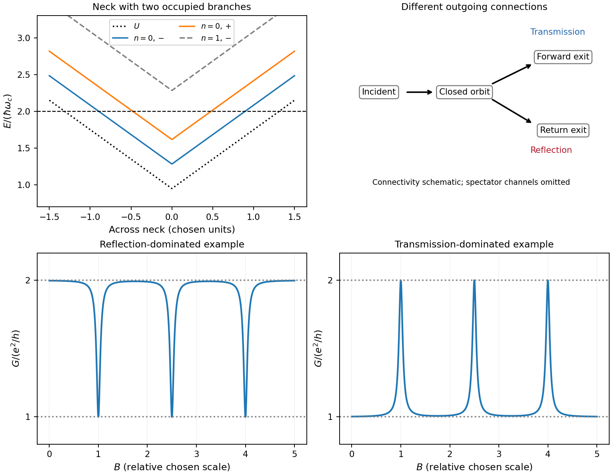
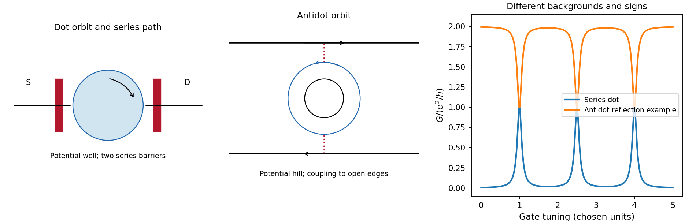
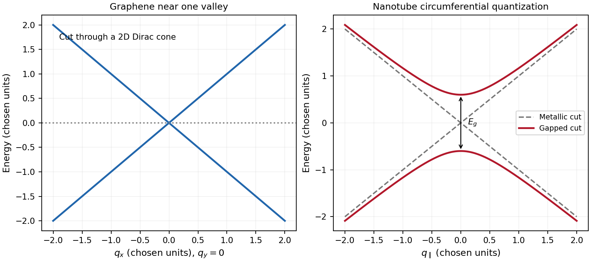

# Paper 1

↑ **Parent:** [2013](../2013.md)

Original paper: [Public original, physical PDF pages 598–600](https://www.whatdotheyknow.com/request/natural_science_tripos_physics_e_2/response/2340776/attach/2/FOI%202023%20399%20Zahid%20materials.pdf?cookie_passthrough=1#page=598).

**Table of contents**

- [1](#1)
  - [a](#1/a)
    - [Solution](#1/a/solution)
  - [b](#1/b)
    - [Solution](#1/b/solution)
  - [Solution](#1/solution)
- [2](#2)
  - [Solution](#2/solution)
- [3](#3)
  - [a](#3/a)
    - [Solution](#3/a/solution)
  - [b](#3/b)
    - [Solution](#3/b/solution)

## 1

↑ **Parent:** [Paper 1](paper-1.md)

<h3 id="1/a">a</h3>

↑ **Parent:** [1](#1)

<h4 id="1/a/solution">Solution</h4>

↑ **Parent:** [A](#1/a)

Use $e>0$, $B>0$ along $+z$, and $U(y)$ for the [electron](../../physics.md#electron)'s [confinement](../../standard-model.md#confinement) [potential energy](../../energy.md#potential-energy). The spin-resolved [Landau level](../../quantum-theory.md#landau-level) branches in the smooth-edge approximation are

$$
\boxed{E_{n,\pm}(y)=\hbar\omega_c(n+\tfrac12)\pm\tfrac12E_Z+U(y),\qquad
\omega_c=eB/m^*.}
$$

The [spin](../../angular-momentum-operator.md#spin) labels denote upper and lower energies; the sign of a material's effective $g$ factor is not inferred from the stated positive splitting. In units of $\hbar\omega_c$, the four occupied bulk energies are $1/3,2/3,4/3,5/3$. A [chemical potential](../../chemical-potential.md) in $(5/3,7/3)$ therefore gives [filling factor](../../quantum-theory.md#filling-factor-quantum-hall-effect) four. The branches rise at both confining edges and cross the common [Fermi energy](../../quantum-ideal-gas-statistics.md#fermi-energy) once at each edge. Each crossing is one spin-resolved [quantum Hall edge state](../../relativistic-electromagnetism.md#quantum-hall-edge-state); there are four on either side. The two [spin](../../angular-momentum-operator.md#spin) branches within an orbital level are separated by $\hbar\omega_c/3$, while the intervening gap to the next orbital pair is $2\hbar\omega_c/3$.

**[Figure 1](#1/a/image-original-normalized-edge-spectrum-with-four-occupied-spin-resolved-bulk-branches). Original normalized edge spectrum with four occupied spin-resolved bulk branches**.

<h3 id="1/b">b</h3>

↑ **Parent:** [1](#1)

<h4 id="1/b/solution">Solution</h4>

↑ **Parent:** [B](#1/b)

In [Landau gauge for a uniform magnetic field](../../quantum-theory.md#landau-gauge-for-a-uniform-magnetic-field) $\mathbf A=(-By,0,0)$, the [guiding centre](../../electromagnetism.md#guiding-center) is $Y=\hbar k_x/(eB)$. The [group velocity](../../dispersion-relation.md#group-velocity) is

$$
\boxed{v_x=\frac1\hbar\frac{dE}{dk_x}=\frac{U'(Y)}{eB}.}
$$

Thus the upper edge in the original trajectory diagram carries [electrons](../../physics.md#electron) to the right and the lower edge to the left. Reversing the [magnetic field](../../magnetic-field.md) reverses both arrows. Semiclassically these are skipping trajectories; quantum mechanically the [guiding centres](../../electromagnetism.md#guiding-center) label propagating [quantum Hall edge states](../../relativistic-electromagnetism.md#quantum-hall-edge-state). The larger orbital-plus-spin [energy](../../energy.md) crosses the [Fermi energy](../../quantum-ideal-gas-statistics.md#fermi-energy) farther toward the interior, because less [confinement](../../standard-model.md#confinement) [energy](../../energy.md) is needed. Opposite [spins](../../angular-momentum-operator.md#spin) in one orbital branch are therefore spatially separated.

In a clean bulk with the [Fermi energy](../../quantum-ideal-gas-statistics.md#fermi-energy) between [Landau levels](../../quantum-theory.md#landau-level), there are no extended bulk states at that [energy](../../energy.md). Occupied bulk cyclotron orbits lie below it; one must not draw them as extra conducting Fermi-level channels. Smooth disorder can instead produce localized bulk contours without adding a direct source-to-drain channel.

**[Figure 2](#1/b/image-original-guiding-centre-trajectories-for-the-four-fermi-level-channels-on-each-boundary). Original guiding-centre trajectories for the four Fermi-level channels on each boundary**.

<h3 id="1/solution">Solution</h3>

↑ **Parent:** [1](#1)

For the [spin separation at a smooth quantum Hall edge](../../relativistic-electromagnetism.md#spin-separation-at-a-smooth-quantum-hall-edge), linearize the [confinement](../../standard-model.md#confinement) [energy](../../energy.md) at a crossing. Compensating a [spin](../../angular-momentum-operator.md#spin) [energy](../../energy.md) difference by a potential-energy change gives

$$
\boxed{\Delta y\simeq\frac{E_Z}{|V'|}
=\frac{\hbar\omega_c}{3|V'|}.}
$$

Here $V'$ is interpreted as the specified slope of [electron](../../physics.md#electron) [potential energy](../../energy.md#potential-energy). If it denotes electrostatic [voltage](../../random-walk.md#voltage) per [length](../../physics.md#length) instead, the denominator is $e|V'|$. The two edges of a neck and the two sides of an [antidot](../../relativistic-electromagnetism.md#quantum-hall-antidot) have oppositely directed slopes; the formula is a positive local separation on any one edge. For local filling two, only the $n=0$ [spin](../../angular-momentum-operator.md#spin) pair is occupied at the neck minimum: $E_{0,+}+U_{\min}<E_F<E_{1,-}+U_{\min}$. Raising both branches with the [confinement](../../standard-model.md#confinement) produces two crossings on each side, as shown in the original neck sketch. This fixed-slope estimate precedes self-consistent [electrostatic screening](../../electrostatics.md#electrostatic-screening).

An [antidot](../../relativistic-electromagnetism.md#quantum-hall-antidot) is a depleted potential hill. [guiding centres](../../electromagnetism.md#guiding-center) circulate around its closed equipotentials, with chirality opposite to the outer sample edge. A phase-coherent round trip contributes magnetic phase $2\pi BS/\Phi_0$, with $\Phi_0=h/e$. A localized orbit resonant with the incident [energy](../../energy.md) can transfer an [electron](../../physics.md#electron) between extended channels. If the outgoing channel returns toward the injecting reservoir, the process is resonant reflection and reduces [electrical conductance](../../electric-charge.md#electrical-conductance). If coupling instead connects an otherwise blocked incident channel to the far reservoir, it is resonant transmission and adds [electrical conductance](../../electric-charge.md#electrical-conductance). Transmission peaks require that forward connectivity; a closed orbit by itself does not guarantee them. Interchannel scattering can change which orbit participates.[section I and section III.C, especially Fig. 7: localized states, interchannel scattering and resonant transmission](../../physics-bibliography.md#electron-electron-interactions-in-antidot-based-aharonov-bohm-interferometers-by-s-ihnatsenka-and-others)

For the [antidot resonance conductance bounds](../../relativistic-electromagnetism.md#antidot-resonance-conductance-bounds) with one active spin-resolved resonance, write

$$
\mathcal L(E)=\frac{\Gamma_L\Gamma_R}{(E-\epsilon_d)^2+(\Gamma_L+\Gamma_R)^2/4},\qquad
0\leq\mathcal L\leq1.
$$

Here $\Gamma_L,\Gamma_R$ are energy broadenings; the corresponding escape rates are $\Gamma_L/\hbar,\Gamma_R/\hbar$. In a reflection-dominated configuration with two otherwise transmitted channels, $G=(e^2/h)(2-\mathcal L)$: a $2e^2/h$ background can dip to $e^2/h$. In a transmission-dominated configuration with one spectator channel and the second otherwise blocked, $G=(e^2/h)(1+\mathcal L)$: peaks rise from $e^2/h$ toward $2e^2/h$. These are the two ideal channel-count examples plotted below. More generally, $G=(e^2/h)(N_{\rm open}-R)$ or $(e^2/h)(N_{\rm dir}+T)$; a different spectator count changes the integer offset. The constriction filling alone does not specify every tunnel coupling or resonance height. Equal couplings permit unit resonant transfer in the isolated-level model; asymmetry, [temperature](../../temperature.md) and [dephasing](../../quantum-information-theory.md#dephasing-channel) reduce the contrast. Holding the effective orbit [area](../../differential-geometry.md#surface-area) approximately fixed gives $\Delta B\simeq h/(eS)$ for one branch, not a universal charging-corrected [period](../../mathematics.md#period-of-a-function).

**[Figure 3](#1/image-original-neck-spectrum-alternative-channel-connectivities-and-illustrative-antidot-conductance-dips-and-peaks). Original neck spectrum, alternative channel connectivities and illustrative antidot conductance dips and peaks**.

In [quantum-dot versus antidot resonance topology](../../relativistic-electromagnetism.md#quantum-dot-versus-antidot-resonance-topology), a [quantum dot](../../semiconductor.md#quantum-dot) is a potential well holding a finite [electron](../../physics.md#electron) island. Its closed guiding-centre circulation is reversed relative to an [antidot](../../relativistic-electromagnetism.md#quantum-hall-antidot) at the same field. With two barriers in series, current follows source $\to$ dot $\to$ drain; off resonance there need not be a direct conducting path. A gate shifts a level or an addition electrochemical potential into alignment with the reservoirs and produces a [electrical conductance](../../electric-charge.md#electrical-conductance) peak. For an isolated coherent spin-resolved level, the zero-temperature peak is at most $e^2/h$ and reaches it only for equal couplings; unresolved noninteracting [spin degeneracy](../../statistical-physics.md#spin-degeneracy) doubles this bound. In weak [sequential tunnelling](../../quantum-mechanics.md#sequential-tunnelling), peak height depends on rates and [temperature](../../temperature.md) rather than being quantized. Charging produces [Coulomb blockade](../../quantum-mechanics.md#coulomb-blockade) peaks with spacing set by [addition energy](../../semiconductor.md#addition-energy) and gate lever arm. An [antidot](../../relativistic-electromagnetism.md#quantum-hall-antidot) also supports discrete orbit/charging resonances, but can be side-coupled to already open channels and produce dips. Gate [voltage](../../random-walk.md#voltage) changes both orbit [area](../../differential-geometry.md#surface-area) and [confinement](../../standard-model.md#confinement), whereas a magnetic sweep directly changes enclosed [flux](../../mathematical-physics.md#flux).

**[Figure 4](#1/image-original-series-dot-paths-and-gate-resonances-compared-with-a-side-coupled-antidot). Original series-dot paths and gate resonances compared with a side-coupled antidot**.

[Coulomb interactions](../../electrostatics.md#coulomb-interaction) require a self-consistent [confinement](../../standard-model.md#confinement) potential. A gradual decrease in [electron](../../physics.md#electron) [density](../../fluid-mechanics.md#density) cannot leave arbitrary uncompensated donor charge at no cost. Partly occupied [Landau levels](../../quantum-theory.md#landau-level) have a large charge response: [electrostatic screening](../../electrostatics.md#electrostatic-screening) flattens their effective [energy](../../energy.md) near the [Fermi energy](../../quantum-ideal-gas-statistics.md#fermi-energy) over [compressible quantum Hall edge strips](../../relativistic-electromagnetism.md#compressible-quantum-hall-edge-strip). Between them, integer-filled [incompressible quantum Hall edge strips](../../relativistic-electromagnetism.md#incompressible-quantum-hall-edge-strip) have a gap, weak [density](../../fluid-mechanics.md#density) response and most of the potential variation. In an idealized cross-section the effective branch thus alternates between flat, partially occupied portions and rising portions crossing a gap; its [carrier density](../../electric-charge.md#carrier-density) varies oppositely. The bare levels still have [Landau level](../../quantum-theory.md#landau-level) and [spin](../../angular-momentum-operator.md#spin) splittings locally, but the common electrostatic potential is no longer an imposed straight slope. [exchange interaction](../../electromagnetism.md#exchange-interaction) can additionally renormalize [spin](../../angular-momentum-operator.md#spin) gaps. Widths must follow electrostatics and the [density](../../fluid-mechanics.md#density) gradient, so the unscreened $E_Z/|V'|$ separation is not a quantitative screened-strip width.[abstract: steplike self-consistent potential and alternating compressible and incompressible strips](../../physics-bibliography.md#electrostatics-of-edge-channels-by-d-b-chklovskii-and-others)

## 2

↑ **Parent:** [Paper 1](paper-1.md)

<h3 id="2/solution">Solution</h3>

↑ **Parent:** [2](#2)

A [modulation-doped GaAs-AlGaAs electron gas](../../semiconductor.md#modulation-doped-gaas-algaas-electron-gas) is confined on the [GaAs](../../chemical-substance.md#gallium-arsenide) side of the interface. The larger-gap [AlGaAs](../../chemical-substance.md#aluminium-gallium-arsenide) supplies a conduction-band barrier; charge transfer from remote donors and the resulting [electric field](../../electric-field.md) bend the bands into an approximately triangular well. [transverse electronic mode](../../quantum-mechanics.md#transverse-electronic-mode) wavefunctions are confined normal to the interface but free in its plane. [electrons](../../physics.md#electron) settle into the well until their electrochemical potential agrees with the donor/contact environment. An undoped spacer separates mobile [electrons](../../physics.md#electron) from ionized donors, reducing impurity scattering. Equilibrium has one [Fermi level](../../quantum-ideal-gas-statistics.md#fermi-level) across the structure; the conduction-band edge is not flat. Surface depletion and the cap also affect the profile. The original drawing illustrates one occupied [confinement](../../standard-model.md#confinement) [transverse electronic mode](../../quantum-mechanics.md#transverse-electronic-mode); a single spatial [electron](../../physics.md#electron) gas need not in general imply only one occupied vertical [transverse electronic mode](../../quantum-mechanics.md#transverse-electronic-mode).

[molecular beam epitaxy](../../engineering.md#molecular-beam-epitaxy) can grow a clean [GaAs](../../chemical-substance.md#gallium-arsenide) buffer/channel, an undoped [AlGaAs](../../chemical-substance.md#aluminium-gallium-arsenide) spacer, a Si-doped [AlGaAs](../../chemical-substance.md#aluminium-gallium-arsenide) supply region and a protective [GaAs](../../chemical-substance.md#gallium-arsenide) cap on a suitable substrate. Control composition, interface quality and background impurities during growth; placing dopants directly in the channel defeats the principal mobility advantage. Define a mesa or isolation region, fabricate low-resistance [ohmic contacts](../../semiconductor.md#ohmic-contact) to the buried gas, and pattern fine [metal](../../chemical-substance.md#metal) [split gates](../../quantum-ideal-gas-statistics.md#split-gate) by [electron beam lithography](../../engineering.md#electron-beam-lithography) and the [lift-off process](../../engineering.md#lift-off-process). Negative gate bias depletes the underlying gas, leaving a narrow channel between the gates. Check contact resistance, leakage, [carrier density](../../electric-charge.md#carrier-density) and mobility; operation with [ballistic electron transport](../../electric-charge.md#ballistic-electron-transport) requires channel [length](../../physics.md#length) shorter than the relevant scattering [lengths](../../physics.md#length) and smooth [confinement](../../standard-model.md#confinement) on the wavelength scale. The lithographic gap does not equal the electrical width because of lateral depletion.

**[Figure 5](#2/image-original-qualitative-conduction-band-profile-epitaxial-layer-order-and-electrostatic-split-gate-channel). Original qualitative conduction-band profile, epitaxial layer order and electrostatic split-gate channel**.

For a long uniform channel supporting [ballistic electron transport](../../electric-charge.md#ballistic-electron-transport), transverse [confinement](../../standard-model.md#confinement) creates thresholds $E_n$ with continuous longitudinal propagation above each threshold. One directed [spin](../../angular-momentum-operator.md#spin) branch of a [transverse electronic mode](../../quantum-mechanics.md#transverse-electronic-mode) has states per [length](../../physics.md#length) $dk/(2\pi)$ and [group velocity](../../dispersion-relation.md#group-velocity) $v=\hbar^{-1}dE/dk$. Hence $v\,dk/(2\pi)=dE/h$: [velocity](../../classical-mechanics.md#velocity) cancels the one-dimensional [density of states](../../quantum-ideal-gas-statistics.md#density-of-states). Including two unresolved [spin](../../angular-momentum-operator.md#spin) states,

$$
I=\frac{2e}{h}\sum_n\int T_n(E)[f_S(E)-f_D(E)]\,dE.
$$

For low [temperature](../../temperature.md) and small bias, a fully open [transverse electronic mode](../../quantum-mechanics.md#transverse-electronic-mode) has $T_n(E_F)=1$, giving

$$
\boxed{G=\frac{2e^2}{h}N.}
$$

The assumptions are ideal reservoirs/contacts, negligible reflection and interactions that would invalidate the independent-subband description, and unresolved [spin](../../angular-momentum-operator.md#spin) splitting. A resolved [spin](../../angular-momentum-operator.md#spin) branch contributes $e^2/h$. The finite two-terminal [electrical resistance](../../electric-charge.md#electrical-resistance) is a contact/mode-injection effect, despite the absence of dissipative scattering inside the ideal channel.

For [voltage partition in a ballistic constriction](../../quantum-ideal-gas-statistics.md#voltage-partition-in-a-ballistic-constriction), a short saddle has strong local electric-field and [electrostatic screening](../../electrostatics.md#electrostatic-screening) variation near its entrances and barrier, rather than the uniform Ohmic [voltage](../../random-walk.md#voltage) gradient of a diffusive wire. Right-moving incident states inherit the source distribution and left-moving states the drain distribution; there is no unique local equilibrium [chemical potential](../../chemical-potential.md) inside an ideal ballistic saddle. The electrostatic potential must be determined self-consistently. In a symmetric rigid-barrier approximation, the barrier follows the mean lead potential and half the electrochemical bias lies on each side. This is a stated approximation, not a universal spatial [voltage](../../random-walk.md#voltage) profile.

For a saddle $U=U_0-m^*\omega_x^2x^2/2+m^*\omega_y^2y^2/2$, [transverse electronic mode](../../quantum-mechanics.md#transverse-electronic-mode) thresholds are $E_n=U_0+\hbar\omega_y(n+1/2)$. The smooth-barrier transmission is $T_n(E)=[1+\exp(-2\pi(E-E_n)/(\hbar\omega_x))]^{-1}$, approaching a step for a sharp threshold on the bias/thermal scale.[Phys. Rev. B 41, 7906–7909, 1990: saddle transmission model](../../physics-bibliography.md#quantized-transmission-of-a-saddle-point-constriction-by-m-buttiker)

Let $\mu_{S,D}=E_F\pm eV/2$ and assume no additional bias dependence of $T_n$. At zero [temperature](../../temperature.md),

$$
I=\frac{2e}{h}\sum_n\int_{\mu_D}^{\mu_S}T_n(E)\,dE,\qquad
\boxed{\frac{dI}{dV}=\frac{e^2}{h}\sum_n[T_n(\mu_S)+T_n(\mu_D)].}
$$

When the source and drain sample $N+1$ and $N$ thresholds, the differential [electrical conductance](../../electric-charge.md#electrical-conductance) is $(N+1/2)2e^2/h$. These half plateaus arise from the two ends of the bias window, not fractional carriers. The dc ratio $I/V$ need not share their plateau values. Heating, [spin](../../angular-momentum-operator.md#spin) splitting and interaction-induced features must be distinguished experimentally.

In [bias spectroscopy of one-dimensional subbands](../../quantum-ideal-gas-statistics.md#bias-spectroscopy-of-one-dimensional-subbands), plot differential [electrical conductance](../../electric-charge.md#electrical-conductance) or its gate derivative against gate bias and source-drain bias. Threshold branches occur where $E_n(V_g)=\mu_S$ or $\mu_D$. When one bias-window edge meets $E_n$ and the other $E_{n+1}$,

$$
\boxed{\Delta E_n=e|V|.}
$$

Thus the intersections of adjacent threshold branches calibrate the one-dimensional spacing directly in [energy](../../energy.md). A gate lever arm $\alpha=-e^{-1}\partial E_n/\partial V_g$ can then convert gate intervals to [energy](../../energy.md); it should be measured rather than guessed. Asymmetric bias partition, a moving barrier or a gate-dependent spacing modifies slopes and plateau weights, requiring the corresponding self-consistent bias model.

**[Figure 6](#2/image-original-rigid-saddle-bias-spectroscopy-and-differential-half-plateaus). Original rigid-saddle bias spectroscopy and differential half plateaus**.

## 3

↑ **Parent:** [Paper 1](paper-1.md)

<h3 id="3/a">a</h3>

↑ **Parent:** [3](#3)

<h4 id="3/a/solution">Solution</h4>

↑ **Parent:** [A](#3/a)

A single gate-defined dot can trap one [electron](../../physics.md#electron) whose lower and upper Zeeman states define $|0\rangle,|1\rangle$. Initialize by energy-selective loading or relaxation, coherently rotate the [spin](../../angular-momentum-operator.md#spin) with a resonant magnetic drive or electrically generated spin-dependent drive, and use neighbouring-dot [exchange interaction](../../electromagnetism.md#exchange-interaction) for two-qubit operations. The dot supplies [confinement](../../standard-model.md#confinement); a full [qubit](../../quantum-system.md#qubit) also requires control, coherence and calibrated readout. A nearby [quantum point contact](../../quantum-ideal-gas-statistics.md#quantum-point-contact) or [single-electron transistor](../../semiconductor.md#single-electron-transistor) detects charge capacitively, so [spin-to-charge conversion](../../semiconductor.md#spin-to-charge-conversion) is needed.

In [energy-selective spin readout](../../semiconductor.md#energy-selective-spin-readout), set the reservoir [chemical potential](../../chemical-potential.md) between the two spin-dependent removal energies. The upper state can tunnel out; the lower remains. Reloading can create a temporary empty-dot signal that a time-resolved charge detector records. Resolving this window requires sufficiently small electron-temperature broadening and stable level alignment. The escape should be faster than [spin relaxation](../../angular-momentum-operator.md#spin-relaxation), but the empty interval must remain long enough for detection. Useful controls include known-state preparation, sensor-noise measurement, varied waiting time and readout pulses, and checks for missed events or thermally activated false escape.[main-text readout pulse sequence and spin-to-charge conversion, Fig. 1](../../physics-bibliography.md#single-shot-read-out-of-an-individual-electron-spin-in-a-quantum-dot-by-j-m-elzerman-and-others)

[tunnel-rate-selective spin readout](../../semiconductor.md#tunnel-rate-selective-spin-readout) instead places both candidate removal energies on the allowed side of the reservoir and uses different escape rates $\Gamma_f\gg\Gamma_s$. After a window $\tau$ with $\Gamma_f^{-1}\ll\tau\ll\Gamma_s^{-1}$, the fast state has usually changed charge while the slow state has not. It does not require the reservoir Fermi edge to resolve the state splitting, although it still requires controlled charge occupation, substantial rate contrast and relaxation slower than the mapping. The contrast must have a physical origin. A demonstrated single-dot implementation uses two-electron singlet and [triplet states](../../angular-momentum-operator.md#spin-one-half-triplet-state): Pauli symmetry puts the triplet's second [electron](../../physics.md#electron) in a higher orbital with stronger lead coupling. Nearly degenerate states can then be distinguished by rate rather than by their [energy](../../energy.md) difference.[pp. 1–2, Figs. 1–2: rate-selective mapping and two-electron orbital mechanism; Fig. 4: nearly degenerate states](../../physics-bibliography.md#single-shot-readout-of-electron-spin-states-in-a-quantum-dot-using-spin-dependent-tunnel-rates-by-r-hanson-and-others)

For a bare one-electron Zeeman pair in the same orbital with an unpolarized lead, different tunnel rates are not automatic. A spin-selective barrier/reservoir or another spin-dependent mechanism is needed. The two-electron singlet/triplet example is a different state encoding/readout arrangement, not evidence that the bare single-electron pair already has useful rate contrast.

For the [optimal tunnel-rate readout time](../../semiconductor.md#optimal-tunnel-rate-readout-time), assume no relaxation and equal prior [probabilities](../../probability-theory.md#probability). The fast-state missed-event [probability](../../probability-theory.md#probability) is $e^{-\Gamma_f\tau}$ and the slow-state false-event [probability](../../probability-theory.md#probability) is $1-e^{-\Gamma_s\tau}$. Their average is minimized at

$$
\boxed{\tau_* =\frac{\ln(\Gamma_f/\Gamma_s)}{\Gamma_f-\Gamma_s}.}
$$

Finite detector bandwidth, preparation errors, state relaxation and unwanted reloading alter this optimum. [energy](../../energy.md) selection is direct for a resolved single-electron [spin](../../angular-momentum-operator.md#spin) but sensitive to the narrow alignment window; rate selection has a wider [energy](../../energy.md) operating window but requires engineered rate contrast and a carefully timed charge measurement. Neither method is an ideal nondestructive [spin](../../angular-momentum-operator.md#spin) measurement merely because the charge sensor itself is noninvasive.

**[Figure 7](#3/a/image-original-energy-window-and-tunnel-rate-readout-models-with-an-illustrative-timing-error-curve). Original energy-window and tunnel-rate readout models with an illustrative timing-error curve**.

<h3 id="3/b">b</h3>

↑ **Parent:** [3](#3)

<h4 id="3/b/solution">Solution</h4>

↑ **Parent:** [B](#3/b)

[graphene](../../chemical-substance.md#graphene) is a two-dimensional honeycomb lattice with two sublattices. Nearest-neighbour hopping gives two bands $E_\pm(\mathbf k)=\pm t|\sum_{j=1}^3e^{i\mathbf k\cdot\boldsymbol\delta_j}|$. They touch at two inequivalent valleys. Expanding near valley $\tau=\pm1$ gives

$$
\boxed{H_\tau=\hbar v_F(\tau q_x\sigma_x+q_y\sigma_y),\qquad
E_\pm=\pm\hbar v_F|\mathbf q|.}
$$

The two-component spinor describes sublattice amplitudes, not real [spin](../../angular-momentum-operator.md#spin). This is a massless two-dimensional [Dirac Hamiltonian](../../relativistic-quantum-field.md#dirac-hamiltonian) with material [velocity](../../classical-mechanics.md#velocity) $v_F$ in place of $c$. The emergent band [quasiparticles](../../quantum-mechanics.md#quasiparticle) are relativistic in this mathematical sense; the [electron](../../physics.md#electron)'s vacuum rest mass is not set to zero. Real [spin](../../angular-momentum-operator.md#spin) and valley each contribute a degeneracy of two in the ideal low-energy model.

A [single-walled carbon nanotube](../../chemical-substance.md#single-walled-carbon-nanotube) is a rolled [graphene](../../chemical-substance.md#graphene) sheet with [carbon nanotube chiral vector](../../chemical-substance.md#carbon-nanotube-chiral-vector) $\mathbf C_h=n\mathbf a_1+m\mathbf a_2$. Periodicity requires $\mathbf k\cdot\mathbf C_h=2\pi\ell$, selecting lines through [graphene](../../chemical-substance.md#graphene) momentum space and producing one-dimensional [transverse electronic modes](../../quantum-mechanics.md#transverse-electronic-mode). Near a valley,

$$
\boxed{E_\pm(q_\parallel)=\pm\hbar v_F\sqrt{q_\parallel^2+q_\perp^2}.}
$$

A quantization line through one of the [Dirac valleys in graphene](../../chemical-substance.md#dirac-valleys-in-graphene) gives a metallic branch; ideal [nanotube zone folding](../../chemical-substance.md#nanotube-zone-folding) gives the criterion $n-m\equiv0\pmod3$. Otherwise the nearest line misses the valley and opens $E_g=2\hbar v_F|q_\perp|$. The transverse momentum gives a [carbon-nanotube Dirac mass](../../chemical-substance.md#carbon-nanotube-dirac-mass), with $m_{\rm eff}=\hbar|q_\perp|/v_F$. For a large-radius ideal semiconducting tube, $|q_\perp|\simeq2/(3d)$ and $E_g\simeq4\hbar v_F/(3d)$, showing the inverse-diameter gap. Curvature, strain, [spin-orbit coupling](../../atomic-physics.md#spin-orbit-interaction) and interactions can change the simple classification; nominally metallic non-armchair tubes can acquire small gaps. One-dimensional [transverse electronic mode](../../quantum-mechanics.md#transverse-electronic-mode) thresholds give [Van Hove singularities](../../quantum-ideal-gas-statistics.md#van-hove-singularity), unlike [graphene](../../chemical-substance.md#graphene)'s low-energy [density of states](../../quantum-ideal-gas-statistics.md#density-of-states) proportional to $|E|$.

A gate changes occupation and the [Fermi level](../../quantum-ideal-gas-statistics.md#fermi-level) in both systems. Ideal monolayer [graphene](../../chemical-substance.md#graphene) can be tuned through [charge neutrality](../../electric-charge.md#charge-neutrality) from [holes](../../quantum-mechanics.md#electron-hole) to [electrons](../../physics.md#electron), but an ordinary scalar gate does not open a bulk [band gap](../../bloch-s-theorem.md#band-gap). Including [spin](../../angular-momentum-operator.md#spin) and valley,

$$
n=\operatorname{sgn}(E_F)\frac{E_F^2}{\pi(\hbar v_F)^2},\qquad
D(E)=\frac{2|E|}{\pi(\hbar v_F)^2}.
$$

The gate relation includes geometric and [quantum capacitances](../../electromagnetism.md#quantum-capacitance), so one should not equate gate [voltage](../../random-walk.md#voltage) to [Fermi energy](../../quantum-ideal-gas-statistics.md#fermi-energy) without the [capacitance](../../electromagnetism.md#capacitance) model. A [semiconducting carbon nanotube](../../chemical-substance.md#semiconducting-carbon-nanotube) can instead be depleted when its [Fermi level](../../quantum-ideal-gas-statistics.md#fermi-level) lies in a gap and turned on in [electron](../../physics.md#electron) or [hole](../../quantum-mechanics.md#electron-hole) bands. Contact [Schottky barriers](../../semiconductor.md#schottky-barrier) can strongly influence the observed nanotube field effect. A truly gapless ideal metallic tube cannot be switched off simply by moving the [Fermi level](../../quantum-ideal-gas-statistics.md#fermi-level) through its band crossing. These gate responses reflect band structure and contacts, not a change of wrapping indices.

**[Figure 8](#3/b/image-original-low-energy-graphene-cut-and-metallic-or-gapped-nanotube-subbands). Original low-energy graphene cut and metallic or gapped nanotube subbands**.

## ↑ Ancestors (11)

1. [2013](../2013.md)
2. [Past exam of the physics of Nanoelectronic Systems course of the University of Cambridge](../../past-exam-of-the-physics-of-nanoelectronic-systems-course-of-the-university-of-cambridge.md)
3. [Physics of Nanoelectronic Systems course of the University of Cambridge](../../university-of-cambridge.md#physics-of-nanoelectronic-systems-course-of-the-university-of-cambridge)
4. [Physics course of the year 4 of the natural sciences course of the University of Cambridge](../../university-of-cambridge.md#physics-course-of-the-year-4-of-the-natural-sciences-course-of-the-university-of-cambridge)
5. [Year 4 of the natural sciences course of the University of Cambridge](../../university-of-cambridge.md#year-4-of-the-natural-sciences-course-of-the-university-of-cambridge)
6. [Year of the natural sciences course of the University of Cambridge](../../university-of-cambridge.md#year-of-the-natural-sciences-course-of-the-university-of-cambridge)
7. [Natural sciences course of the University of Cambridge](../../university-of-cambridge.md#natural-sciences-course-of-the-university-of-cambridge)
8. [Course of the University of Cambridge](../../university-of-cambridge.md#course-of-the-university-of-cambridge)
9. [University of Cambridge](../../university-of-cambridge.md)
10. [List of universities](../../README.md#list-of-universities)
11. [Codex Wiki](../../README.md)
