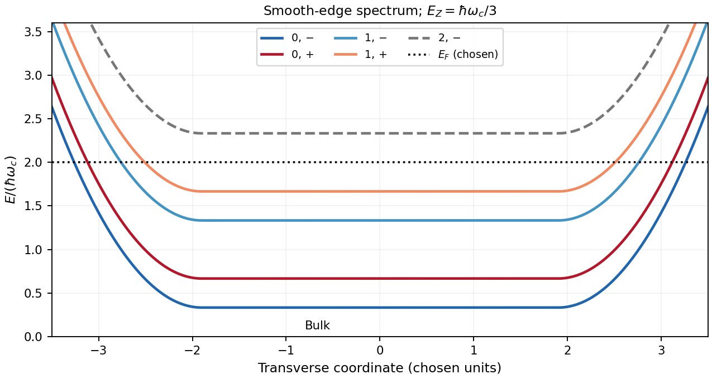

<h1 id="1/a/solution">Solution</h1>

↑ **Parent:** [A](../a.md)

Use $e>0$, $B>0$ along $+z$, and $U(y)$ for the [electron](../../../../../electron.md)'s [confinement](../../../../../confinement.md) [potential energy](../../../../../potential-energy.md). The spin-resolved [Landau level](../../../../../landau-level.md) branches in the smooth-edge approximation are

$$
\boxed{E_{n,\pm}(y)=\hbar\omega_c(n+\tfrac12)\pm\tfrac12E_Z+U(y),\qquad
\omega_c=eB/m^*.}
$$

The [spin](../../../../../spin.md) labels denote upper and lower energies; the sign of a material's effective $g$ factor is not inferred from the stated positive splitting. In units of $\hbar\omega_c$, the four occupied bulk energies are $1/3,2/3,4/3,5/3$. A [chemical potential](../../../../../chemical-potential-split.md) in $(5/3,7/3)$ therefore gives [filling factor](../../../../../filling-factor-quantum-hall-effect.md) four. The branches rise at both confining edges and cross the common [Fermi energy](../../../../../fermi-energy.md) once at each edge. Each crossing is one spin-resolved [quantum Hall edge state](../../../../../quantum-hall-edge-state.md); there are four on either side. The two [spin](../../../../../spin.md) branches within an orbital level are separated by $\hbar\omega_c/3$, while the intervening gap to the next orbital pair is $2\hbar\omega_c/3$.

**[Figure 1](#1/a/image-original-normalized-edge-spectrum-with-four-occupied-spin-resolved-bulk-branches). Original normalized edge spectrum with four occupied spin-resolved bulk branches**.

## ↑ Ancestors (14)

1. [A](../a.md)
2. [1](../../1.md)
3. [Paper 1](../../../paper-1-split.md)
4. [2013](../../../split.md)
5. [Past exam of the physics of Nanoelectronic Systems course of the University of Cambridge](../../../../split.md)
6. [Physics of Nanoelectronic Systems course of the University of Cambridge](../../../../../physics-of-nanoelectronic-systems-course-of-the-university-of-cambridge.md)
7. [Physics course of the year 4 of the natural sciences course of the University of Cambridge](../../../../../physics-course-of-the-year-4-of-the-natural-sciences-course-of-the-university-of-cambridge.md)
8. [Year 4 of the natural sciences course of the University of Cambridge](../../../../../year-4-of-the-natural-sciences-course-of-the-university-of-cambridge.md)
9. [Year of the natural sciences course of the University of Cambridge](../../../../../year-of-the-natural-sciences-course-of-the-university-of-cambridge.md)
10. [Natural sciences course of the University of Cambridge](../../../../../natural-sciences-course-of-the-university-of-cambridge.md)
11. [Course of the University of Cambridge](../../../../../course-of-the-university-of-cambridge.md)
12. [University of Cambridge](../../../../../university-of-cambridge-split.md)
13. [List of universities](../../../../../list-of-universities.md)
14. [Codex Wiki](../../../../../split.md)
