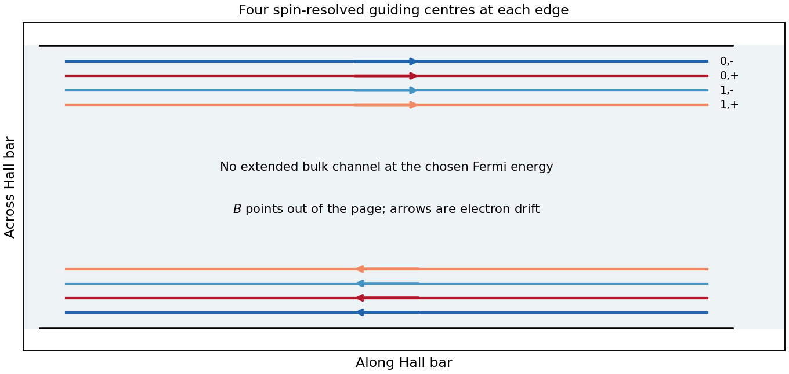

<h1 id="1/b/solution">Solution</h1>

↑ **Parent:** [B](../b.md)

In [Landau gauge for a uniform magnetic field](../../../../../landau-gauge-for-a-uniform-magnetic-field.md) $\mathbf A=(-By,0,0)$, the [guiding centre](../../../../../guiding-center.md) is $Y=\hbar k_x/(eB)$. The [group velocity](../../../../../group-velocity.md) is

$$
\boxed{v_x=\frac1\hbar\frac{dE}{dk_x}=\frac{U'(Y)}{eB}.}
$$

Thus the upper edge in the original trajectory diagram carries [electrons](../../../../../electron.md) to the right and the lower edge to the left. Reversing the [magnetic field](../../../../../magnetic-field-split.md) reverses both arrows. Semiclassically these are skipping trajectories; quantum mechanically the [guiding centres](../../../../../guiding-center.md) label propagating [quantum Hall edge states](../../../../../quantum-hall-edge-state.md). The larger orbital-plus-spin [energy](../../../../../energy-split.md) crosses the [Fermi energy](../../../../../fermi-energy.md) farther toward the interior, because less [confinement](../../../../../confinement.md) [energy](../../../../../energy-split.md) is needed. Opposite [spins](../../../../../spin.md) in one orbital branch are therefore spatially separated.

In a clean bulk with the [Fermi energy](../../../../../fermi-energy.md) between [Landau levels](../../../../../landau-level.md), there are no extended bulk states at that [energy](../../../../../energy-split.md). Occupied bulk cyclotron orbits lie below it; one must not draw them as extra conducting Fermi-level channels. Smooth disorder can instead produce localized bulk contours without adding a direct source-to-drain channel.

**[Figure 2](#1/b/image-original-guiding-centre-trajectories-for-the-four-fermi-level-channels-on-each-boundary). Original guiding-centre trajectories for the four Fermi-level channels on each boundary**.

## ↑ Ancestors (14)

1. [B](../b.md)
2. [1](../../1.md)
3. [Paper 1](../../../paper-1-split.md)
4. [2013](../../../split.md)
5. [Past exam of the physics of Nanoelectronic Systems course of the University of Cambridge](../../../../split.md)
6. [Physics of Nanoelectronic Systems course of the University of Cambridge](../../../../../physics-of-nanoelectronic-systems-course-of-the-university-of-cambridge.md)
7. [Physics course of the year 4 of the natural sciences course of the University of Cambridge](../../../../../physics-course-of-the-year-4-of-the-natural-sciences-course-of-the-university-of-cambridge.md)
8. [Year 4 of the natural sciences course of the University of Cambridge](../../../../../year-4-of-the-natural-sciences-course-of-the-university-of-cambridge.md)
9. [Year of the natural sciences course of the University of Cambridge](../../../../../year-of-the-natural-sciences-course-of-the-university-of-cambridge.md)
10. [Natural sciences course of the University of Cambridge](../../../../../natural-sciences-course-of-the-university-of-cambridge.md)
11. [Course of the University of Cambridge](../../../../../course-of-the-university-of-cambridge.md)
12. [University of Cambridge](../../../../../university-of-cambridge-split.md)
13. [List of universities](../../../../../list-of-universities.md)
14. [Codex Wiki](../../../../../split.md)
