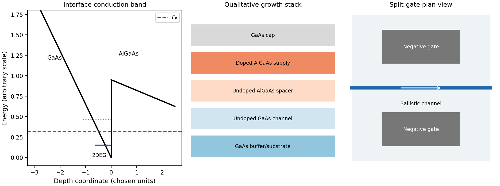
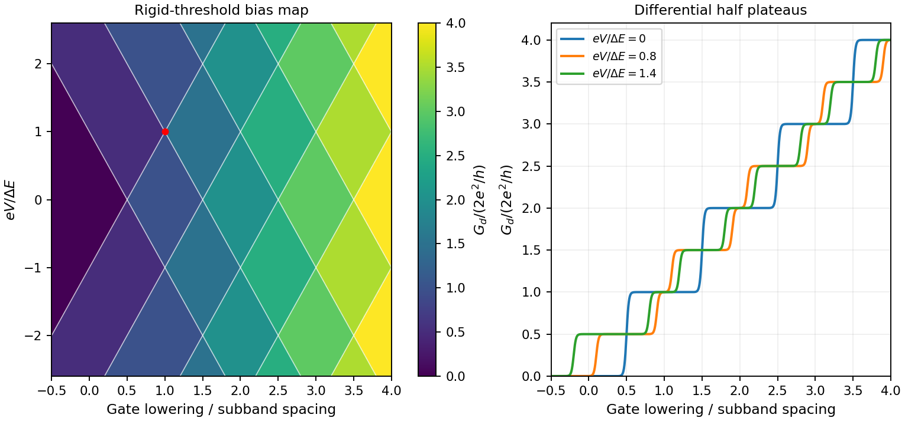

<h1 id="2/solution">Solution</h1>

↑ **Parent:** [2](../2.md)

A [modulation-doped GaAs-AlGaAs electron gas](../../../../modulation-doped-gaas-algaas-electron-gas.md) is confined on the [GaAs](../../../../gallium-arsenide.md) side of the interface. The larger-gap [AlGaAs](../../../../aluminium-gallium-arsenide.md) supplies a conduction-band barrier; charge transfer from remote donors and the resulting [electric field](../../../../electric-field-split.md) bend the bands into an approximately triangular well. [transverse electronic mode](../../../../transverse-electronic-mode.md) wavefunctions are confined normal to the interface but free in its plane. [electrons](../../../../electron.md) settle into the well until their electrochemical potential agrees with the donor/contact environment. An undoped spacer separates mobile [electrons](../../../../electron.md) from ionized donors, reducing impurity scattering. Equilibrium has one [Fermi level](../../../../fermi-level.md) across the structure; the conduction-band edge is not flat. Surface depletion and the cap also affect the profile. The original drawing illustrates one occupied [confinement](../../../../confinement.md) [transverse electronic mode](../../../../transverse-electronic-mode.md); a single spatial [electron](../../../../electron.md) gas need not in general imply only one occupied vertical [transverse electronic mode](../../../../transverse-electronic-mode.md).

[molecular beam epitaxy](../../../../molecular-beam-epitaxy.md) can grow a clean [GaAs](../../../../gallium-arsenide.md) buffer/channel, an undoped [AlGaAs](../../../../aluminium-gallium-arsenide.md) spacer, a Si-doped [AlGaAs](../../../../aluminium-gallium-arsenide.md) supply region and a protective [GaAs](../../../../gallium-arsenide.md) cap on a suitable substrate. Control composition, interface quality and background impurities during growth; placing dopants directly in the channel defeats the principal mobility advantage. Define a mesa or isolation region, fabricate low-resistance [ohmic contacts](../../../../ohmic-contact.md) to the buried gas, and pattern fine [metal](../../../../metal.md) [split gates](../../../../split-gate.md) by [electron beam lithography](../../../../electron-beam-lithography.md) and the [lift-off process](../../../../lift-off-process.md). Negative gate bias depletes the underlying gas, leaving a narrow channel between the gates. Check contact resistance, leakage, [carrier density](../../../../carrier-density.md) and mobility; operation with [ballistic electron transport](../../../../ballistic-electron-transport.md) requires channel [length](../../../../length.md) shorter than the relevant scattering [lengths](../../../../length.md) and smooth [confinement](../../../../confinement.md) on the wavelength scale. The lithographic gap does not equal the electrical width because of lateral depletion.

**[Figure 5](#2/image-original-qualitative-conduction-band-profile-epitaxial-layer-order-and-electrostatic-split-gate-channel). Original qualitative conduction-band profile, epitaxial layer order and electrostatic split-gate channel**.

For a long uniform channel supporting [ballistic electron transport](../../../../ballistic-electron-transport.md), transverse [confinement](../../../../confinement.md) creates thresholds $E_n$ with continuous longitudinal propagation above each threshold. One directed [spin](../../../../spin.md) branch of a [transverse electronic mode](../../../../transverse-electronic-mode.md) has states per [length](../../../../length.md) $dk/(2\pi)$ and [group velocity](../../../../group-velocity.md) $v=\hbar^{-1}dE/dk$. Hence $v\,dk/(2\pi)=dE/h$: [velocity](../../../../velocity.md) cancels the one-dimensional [density of states](../../../../density-of-states.md). Including two unresolved [spin](../../../../spin.md) states,

$$
I=\frac{2e}{h}\sum_n\int T_n(E)[f_S(E)-f_D(E)]\,dE.
$$

For low [temperature](../../../../temperature-split.md) and small bias, a fully open [transverse electronic mode](../../../../transverse-electronic-mode.md) has $T_n(E_F)=1$, giving

$$
\boxed{G=\frac{2e^2}{h}N.}
$$

The assumptions are ideal reservoirs/contacts, negligible reflection and interactions that would invalidate the independent-subband description, and unresolved [spin](../../../../spin.md) splitting. A resolved [spin](../../../../spin.md) branch contributes $e^2/h$. The finite two-terminal [electrical resistance](../../../../electrical-resistance.md) is a contact/mode-injection effect, despite the absence of dissipative scattering inside the ideal channel.

For [voltage partition in a ballistic constriction](../../../../voltage-partition-in-a-ballistic-constriction.md), a short saddle has strong local electric-field and [electrostatic screening](../../../../electrostatic-screening.md) variation near its entrances and barrier, rather than the uniform Ohmic [voltage](../../../../voltage.md) gradient of a diffusive wire. Right-moving incident states inherit the source distribution and left-moving states the drain distribution; there is no unique local equilibrium [chemical potential](../../../../chemical-potential-split.md) inside an ideal ballistic saddle. The electrostatic potential must be determined self-consistently. In a symmetric rigid-barrier approximation, the barrier follows the mean lead potential and half the electrochemical bias lies on each side. This is a stated approximation, not a universal spatial [voltage](../../../../voltage.md) profile.

For a saddle $U=U_0-m^*\omega_x^2x^2/2+m^*\omega_y^2y^2/2$, [transverse electronic mode](../../../../transverse-electronic-mode.md) thresholds are $E_n=U_0+\hbar\omega_y(n+1/2)$. The smooth-barrier transmission is $T_n(E)=[1+\exp(-2\pi(E-E_n)/(\hbar\omega_x))]^{-1}$, approaching a step for a sharp threshold on the bias/thermal scale.[Phys. Rev. B 41, 7906–7909, 1990: saddle transmission model](../../../../quantized-transmission-of-a-saddle-point-constriction-by-m-buttiker.md)

Let $\mu_{S,D}=E_F\pm eV/2$ and assume no additional bias dependence of $T_n$. At zero [temperature](../../../../temperature-split.md),

$$
I=\frac{2e}{h}\sum_n\int_{\mu_D}^{\mu_S}T_n(E)\,dE,\qquad
\boxed{\frac{dI}{dV}=\frac{e^2}{h}\sum_n[T_n(\mu_S)+T_n(\mu_D)].}
$$

When the source and drain sample $N+1$ and $N$ thresholds, the differential [electrical conductance](../../../../electrical-conductance.md) is $(N+1/2)2e^2/h$. These half plateaus arise from the two ends of the bias window, not fractional carriers. The dc ratio $I/V$ need not share their plateau values. Heating, [spin](../../../../spin.md) splitting and interaction-induced features must be distinguished experimentally.

In [bias spectroscopy of one-dimensional subbands](../../../../bias-spectroscopy-of-one-dimensional-subbands.md), plot differential [electrical conductance](../../../../electrical-conductance.md) or its gate derivative against gate bias and source-drain bias. Threshold branches occur where $E_n(V_g)=\mu_S$ or $\mu_D$. When one bias-window edge meets $E_n$ and the other $E_{n+1}$,

$$
\boxed{\Delta E_n=e|V|.}
$$

Thus the intersections of adjacent threshold branches calibrate the one-dimensional spacing directly in [energy](../../../../energy-split.md). A gate lever arm $\alpha=-e^{-1}\partial E_n/\partial V_g$ can then convert gate intervals to [energy](../../../../energy-split.md); it should be measured rather than guessed. Asymmetric bias partition, a moving barrier or a gate-dependent spacing modifies slopes and plateau weights, requiring the corresponding self-consistent bias model.

**[Figure 6](#2/image-original-rigid-saddle-bias-spectroscopy-and-differential-half-plateaus). Original rigid-saddle bias spectroscopy and differential half plateaus**.

## ↑ Ancestors (13)

1. [2](../2.md)
2. [Paper 1](../../paper-1-split.md)
3. [2013](../../split.md)
4. [Past exam of the physics of Nanoelectronic Systems course of the University of Cambridge](../../../split.md)
5. [Physics of Nanoelectronic Systems course of the University of Cambridge](../../../../physics-of-nanoelectronic-systems-course-of-the-university-of-cambridge.md)
6. [Physics course of the year 4 of the natural sciences course of the University of Cambridge](../../../../physics-course-of-the-year-4-of-the-natural-sciences-course-of-the-university-of-cambridge.md)
7. [Year 4 of the natural sciences course of the University of Cambridge](../../../../year-4-of-the-natural-sciences-course-of-the-university-of-cambridge.md)
8. [Year of the natural sciences course of the University of Cambridge](../../../../year-of-the-natural-sciences-course-of-the-university-of-cambridge.md)
9. [Natural sciences course of the University of Cambridge](../../../../natural-sciences-course-of-the-university-of-cambridge.md)
10. [Course of the University of Cambridge](../../../../course-of-the-university-of-cambridge.md)
11. [University of Cambridge](../../../../university-of-cambridge-split.md)
12. [List of universities](../../../../list-of-universities.md)
13. [Codex Wiki](../../../../split.md)
