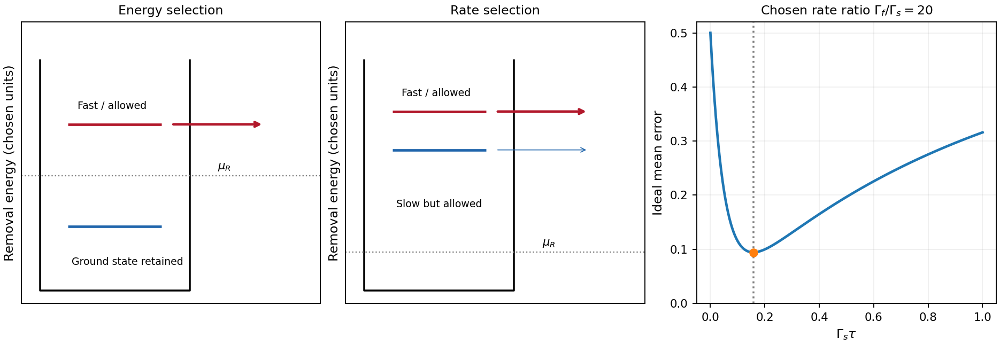

<h1 id="3/a/solution">Solution</h1>

↑ **Parent:** [A](../a.md)

A single gate-defined dot can trap one [electron](../../../../../electron.md) whose lower and upper Zeeman states define $|0\rangle,|1\rangle$. Initialize by energy-selective loading or relaxation, coherently rotate the [spin](../../../../../spin.md) with a resonant magnetic drive or electrically generated spin-dependent drive, and use neighbouring-dot [exchange interaction](../../../../../exchange-interaction.md) for two-qubit operations. The dot supplies [confinement](../../../../../confinement.md); a full [qubit](../../../../../qubit.md) also requires control, coherence and calibrated readout. A nearby [quantum point contact](../../../../../quantum-point-contact.md) or [single-electron transistor](../../../../../single-electron-transistor.md) detects charge capacitively, so [spin-to-charge conversion](../../../../../spin-to-charge-conversion.md) is needed.

In [energy-selective spin readout](../../../../../energy-selective-spin-readout.md), set the reservoir [chemical potential](../../../../../chemical-potential-split.md) between the two spin-dependent removal energies. The upper state can tunnel out; the lower remains. Reloading can create a temporary empty-dot signal that a time-resolved charge detector records. Resolving this window requires sufficiently small electron-temperature broadening and stable level alignment. The escape should be faster than [spin relaxation](../../../../../spin-relaxation.md), but the empty interval must remain long enough for detection. Useful controls include known-state preparation, sensor-noise measurement, varied waiting time and readout pulses, and checks for missed events or thermally activated false escape.[main-text readout pulse sequence and spin-to-charge conversion, Fig. 1](../../../../../single-shot-read-out-of-an-individual-electron-spin-in-a-quantum-dot-by-j-m-elzerman-and-others.md)

[tunnel-rate-selective spin readout](../../../../../tunnel-rate-selective-spin-readout.md) instead places both candidate removal energies on the allowed side of the reservoir and uses different escape rates $\Gamma_f\gg\Gamma_s$. After a window $\tau$ with $\Gamma_f^{-1}\ll\tau\ll\Gamma_s^{-1}$, the fast state has usually changed charge while the slow state has not. It does not require the reservoir Fermi edge to resolve the state splitting, although it still requires controlled charge occupation, substantial rate contrast and relaxation slower than the mapping. The contrast must have a physical origin. A demonstrated single-dot implementation uses two-electron singlet and [triplet states](../../../../../spin-one-half-triplet-state.md): Pauli symmetry puts the triplet's second [electron](../../../../../electron.md) in a higher orbital with stronger lead coupling. Nearly degenerate states can then be distinguished by rate rather than by their [energy](../../../../../energy-split.md) difference.[pp. 1–2, Figs. 1–2: rate-selective mapping and two-electron orbital mechanism; Fig. 4: nearly degenerate states](../../../../../single-shot-readout-of-electron-spin-states-in-a-quantum-dot-using-spin-dependent-tunnel-rates-by-r-hanson-and-others.md)

For a bare one-electron Zeeman pair in the same orbital with an unpolarized lead, different tunnel rates are not automatic. A spin-selective barrier/reservoir or another spin-dependent mechanism is needed. The two-electron singlet/triplet example is a different state encoding/readout arrangement, not evidence that the bare single-electron pair already has useful rate contrast.

For the [optimal tunnel-rate readout time](../../../../../optimal-tunnel-rate-readout-time.md), assume no relaxation and equal prior [probabilities](../../../../../probability.md). The fast-state missed-event [probability](../../../../../probability.md) is $e^{-\Gamma_f\tau}$ and the slow-state false-event [probability](../../../../../probability.md) is $1-e^{-\Gamma_s\tau}$. Their average is minimized at

$$
\boxed{\tau_* =\frac{\ln(\Gamma_f/\Gamma_s)}{\Gamma_f-\Gamma_s}.}
$$

Finite detector bandwidth, preparation errors, state relaxation and unwanted reloading alter this optimum. [energy](../../../../../energy-split.md) selection is direct for a resolved single-electron [spin](../../../../../spin.md) but sensitive to the narrow alignment window; rate selection has a wider [energy](../../../../../energy-split.md) operating window but requires engineered rate contrast and a carefully timed charge measurement. Neither method is an ideal nondestructive [spin](../../../../../spin.md) measurement merely because the charge sensor itself is noninvasive.

**[Figure 7](#3/a/image-original-energy-window-and-tunnel-rate-readout-models-with-an-illustrative-timing-error-curve). Original energy-window and tunnel-rate readout models with an illustrative timing-error curve**.

## ↑ Ancestors (14)

1. [A](../a.md)
2. [3](../../3.md)
3. [Paper 1](../../../paper-1-split.md)
4. [2013](../../../split.md)
5. [Past exam of the physics of Nanoelectronic Systems course of the University of Cambridge](../../../../split.md)
6. [Physics of Nanoelectronic Systems course of the University of Cambridge](../../../../../physics-of-nanoelectronic-systems-course-of-the-university-of-cambridge.md)
7. [Physics course of the year 4 of the natural sciences course of the University of Cambridge](../../../../../physics-course-of-the-year-4-of-the-natural-sciences-course-of-the-university-of-cambridge.md)
8. [Year 4 of the natural sciences course of the University of Cambridge](../../../../../year-4-of-the-natural-sciences-course-of-the-university-of-cambridge.md)
9. [Year of the natural sciences course of the University of Cambridge](../../../../../year-of-the-natural-sciences-course-of-the-university-of-cambridge.md)
10. [Natural sciences course of the University of Cambridge](../../../../../natural-sciences-course-of-the-university-of-cambridge.md)
11. [Course of the University of Cambridge](../../../../../course-of-the-university-of-cambridge.md)
12. [University of Cambridge](../../../../../university-of-cambridge-split.md)
13. [List of universities](../../../../../list-of-universities.md)
14. [Codex Wiki](../../../../../split.md)
