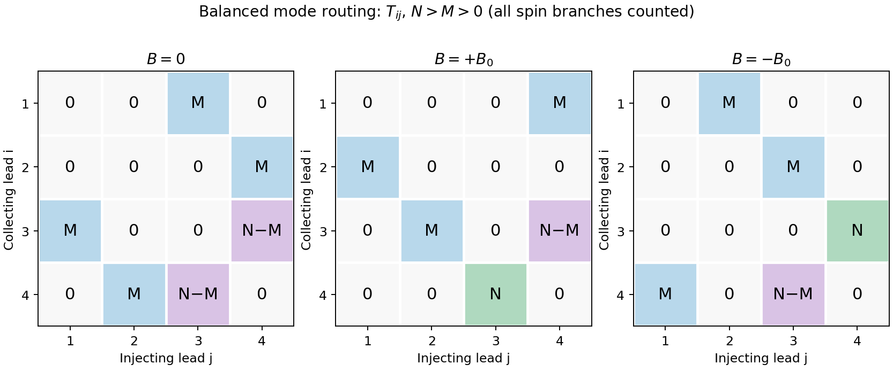
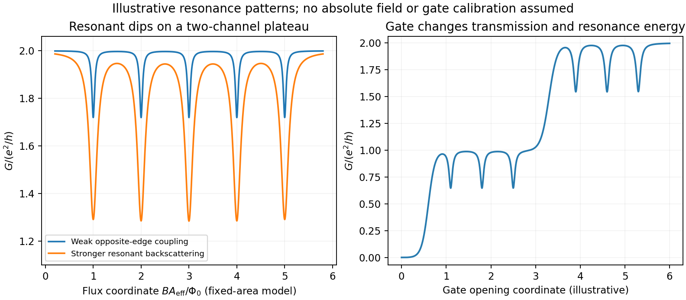

# Paper 1

↑ **Parent:** [2015](../2015.md)

Original paper: [Public original PDF, physical pages 758–760; questions on pages 759–760](https://www.whatdotheyknow.com/request/natural_science_tripos_physics_e_2/response/2340776/attach/2/FOI%202023%20399%20Zahid%20materials.pdf?cookie_passthrough=1#page=758).

**Table of contents**

- [1](#1)
  - [Solution](#1/solution)
- [2](#2)
  - [Solution](#2/solution)
- [3](#3)
  - [a](#3/a)
    - [Solution](#3/a/solution)
  - [b](#3/b)
    - [Solution](#3/b/solution)
  - [c](#3/c)
    - [Solution](#3/c/solution)

## 1

↑ **Parent:** [Paper 1](paper-1.md)

<h3 id="1/solution">Solution</h3>

↑ **Parent:** [1](#1)

**A trajectory-resolving ballistic experiment.** Use a high-mobility modulation-doped GaAs-AlGaAs heterostructure with a [two-dimensional electron gas](../../quantum-ideal-gas-statistics.md#two-dimensional-electron-gas). Grow the layers by molecular-beam epitaxy, separate the donor layer from the conducting interface with an undoped spacer, and pattern an isolated mesa with ohmic reservoir contacts. Electron-beam lithography defines metal [split gates](../../quantum-ideal-gas-statistics.md#split-gate); negative gate [voltage](../../random-walk.md#voltage) depletes the underlying [electron](../../physics.md#electron) gas, leaving narrow adjustable injector and collector [quantum point contacts](../../quantum-ideal-gas-statistics.md#quantum-point-contact) along an edge. Keep the relevant path shorter than the momentum-relaxation [mean free path](../../ideal-gas.md#mean-free-path), cool to suppress [phonon scattering](../../quantum-ideal-gas-statistics.md#phonon-scattering) and thermal smearing, and use a small excitation to avoid heating.

Inject a low-frequency current through one contact to a distant drain and measure the collector's open-circuit [voltage](../../random-walk.md#voltage) with a high-input-impedance amplifier. Sweep perpendicular [magnetic field](../../magnetic-field.md) and gate settings. The [cyclotron radius](../../relativistic-electromagnetism.md#cyclotron-radius) is $r_c=\hbar k_F/(e|B|)$, with $k_F=\sqrt{2\pi n_s}$ for a spin-degenerate single-valley gas. For contact separation $L$, semicircular or skipping trajectories focus into the collector when

$$
\boxed{L=2jr_c,\qquad |B_j|=\frac{2j\hbar k_F}{eL},\quad j=1,2,\ldots.}
$$

The appropriate field sign bends carriers toward the collector; the opposite sign suppresses the peaks. Density-dependent focusing positions, suppression with increased scattering and reproducible gate control distinguish directional ballistic propagation from an ordinary diffusive [voltage](../../random-walk.md#voltage). [Quantum interference](../../quantum-system.md#quantum-interference) may add fine structure, but the basic focusing signal does not require phase coherence over every path. Split-gate injection and collection in a two-dimensional gas were directly demonstrated in the original focusing experiment.[1989 primary publication, institutional abstract: split Schottky gates, injector/collector, skipping orbits and field-dependent focusing](../../physics-bibliography.md#coherent-electron-focusing-with-quantum-point-contacts-in-a-two-dimensional-electron-gas-by-h-van-houten-and-others)

**Multi-probe current bookkeeping.** For one directed spin-resolved [mode](../../probability-and-statistics.md#mode-statistics), velocity times one-dimensional [density of states](../../quantum-ideal-gas-statistics.md#density-of-states) gives a particle flux $dE/h$. A small reservoir electrochemical-energy shift $\mu_j$ therefore supplies excess flux $\mu_j/h$. Let $N_i$ be the number of propagating [modes](../../probability-and-statistics.md#mode-statistics) at lead $i$, $R_{ii}$ their summed return probability, and $T_{ij}$ the total transmission from reservoir $j$ into lead $i$. Multiplying outgoing-minus-incoming [electron](../../physics.md#electron) flux by charge $-e$ gives the source's convention,

$$
\boxed{I_i=-\frac eh(N_i-R_{ii})\mu_i
+\frac eh\sum_{j\ne i}T_{ij}\mu_j.}
$$

The reservoirs equilibrate arriving carriers; an ideal [voltage](../../random-walk.md#voltage) probe adjusts its [chemical potential](../../chemical-potential.md) until its net current vanishes. Here $\mu_i$ is an energy, not a [voltage](../../random-walk.md#voltage). Choose the lead-voltage convention $\mu_i=-eV_i$ and positive [conventional current](../../electric-charge.md#conventional-current) injected into the junction. The working equation is then

$$
\boxed{I_i=g_0\left[(N_i-R_{ii})V_i-\sum_{j\ne i}T_{ij}V_j\right],\qquad g_0=e^2/h.}
$$

Conservation of scattering probability and [gauge invariance](../../relativistic-quantum-field.md#gauge-invariance) require both column and row balance: every outgoing channel is accounted for and equal [voltages](../../random-walk.md#voltage) give zero current. The counts $M,N$ below include every occupied internal channel; an extra factor of two must not be inserted if [spin](../../angular-momentum-operator.md#spin) is already counted. If one instead counts orbital channels with unresolved [spin degeneracy](../../statistical-physics.md#spin-degeneracy), double all transmission counts consistently.

**Zero-field routing.** The original diagram labels lead 1 at the left, 2 above, 3 at the right and 4 below. With columns denoting injectors and rows collectors, straight-through ballistic routing and the stipulated excess-wide-channel rule give

$$
\mathsf T_0=\begin{pmatrix}
0&0&M&0\\
0&0&0&M\\
M&0&0&N-M\\
0&M&N-M&0
\end{pmatrix},\qquad (N_1,N_2,N_3,N_4)=(M,M,N,N).
$$

There is no reflection in this ideal routing model. Set $V_4=0$, $I_2=I_3=0$, and $I_1=I=-I_4$. The two probe equations give

$$
V_2=0,\qquad V_3=\frac MN V_1,
\qquad I=g_0M\left(1-\frac MN\right)V_1.
$$

Thus

$$
\boxed{R_{14,23}(0)=\frac{V_2-V_3}{I}=-\frac{h}{e^2(N-M)}.}
$$

The derivation assumes $N>M>0$. At $N=M$, the ideal network splits into two disconnected opposite-lead pairs and cannot carry the imposed 1-to-4 current at finite [voltage](../../random-walk.md#voltage); the divergence diagnoses failure of that limiting transport configuration, not an infinite dissipative resistance of each channel. Negative [bend resistance](../../electric-charge.md#bend-resistance) is a nonlocal [voltage](../../random-walk.md#voltage) sign, compatible with positive total dissipated power.

**Positive field.** At $+B_0$, left-deflected incoming carriers go $1\to2$, $2\to3$, $3\to4$. Lead 4 supplies $M$ [modes](../../probability-and-statistics.md#mode-statistics) to narrow lead 1; the remaining $N-M$ enter wide lead 3. The balanced transmission matrix is

$$
\mathsf T_+=\begin{pmatrix}
0&0&0&M\\
M&0&0&0\\
0&M&0&N-M\\
0&0&N&0
\end{pmatrix}.
$$

Therefore $V_2=V_1$, $V_3=MV_1/N$ and $I=g_0MV_1$, giving

$$
\boxed{R_{14,23}(+B_0)=\frac h{e^2}\frac{N-M}{MN}
=\frac h{e^2}\left(\frac1M-\frac1N\right)>0.}
$$

**Negative field.** Reversing the chirality gives $\mathsf T_-=\mathsf T_+^{\mathsf T}$, as expected from reciprocity for this spin-independent routing model. With $V_4=0$, the zero-current conditions become $V_3=V_4=0$ and $V_2=V_3=0$. Thus

$$
\boxed{R_{14,23}(-B_0)=0.}
$$

This does not contradict reciprocity: the general relation interchanges the current and [voltage](../../random-walk.md#voltage) lead pairs when reversing field; it does not require the same fixed-contact four-terminal resistance to be even in $B$.

**[Figure 1](#1/image-original-transmission-matrix-bookkeeping-for-the-three-ideal-field-limits-rows-collect-modes-injected-by-columns). Original transmission-matrix bookkeeping for the three ideal field limits; rows collect modes injected by columns**.

**Comparison with the measured trace.** The PDF shows a negative region around zero field, approximately zero signal at sufficiently negative field, and a positive rising resistance near $+0.4\ {\rm T}$ and above. These signs match the three routing limits. Near zero field the depth is roughly a few tenths of a kilohm; the graph does not supply $M,N$, so there is no justified exact amplitude fit. Rounded corners, collimation and finite [cyclotron radius](../../relativistic-electromagnetism.md#cyclotron-radius) continuously change which outgoing lead is reached between the ideal limits. Skipping trajectories and geometrical focusing can produce shoulders or resonances. At larger positive fields magnetic depopulation and [spin](../../angular-momentum-operator.md#spin) resolution can change the [mode](../../probability-and-statistics.md#mode-statistics) counts, increasing the positive resistance or producing structure; disorder, incomplete equilibration and finite temperature round ideal features. These are candidate mechanisms, not uniquely established assignments of every small feature from one trace.

## 2

↑ **Parent:** [Paper 1](paper-1.md)

<h3 id="2/solution">Solution</h3>

↑ **Parent:** [2](#2)

**Integer Hall transport and filling.** A clean [two-dimensional electron gas](../../quantum-ideal-gas-statistics.md#two-dimensional-electron-gas) at low temperature in a strong perpendicular [magnetic field](../../magnetic-field.md) forms [Landau levels](../../quantum-theory.md#landau-level) with orbital spacing $\hbar\omega_c$, where $\omega_c=e|B|/m^*$. Examples include semiconductor heterojunctions and inversion layers. On integer plateaus,

$$
\boxed{|\sigma_{xy}|=\nu\frac{e^2}{h},\qquad\sigma_{xx}\simeq0,
\qquad |R_{xy}|=\frac h{\nu e^2},\qquad R_{xx}\simeq0,}
$$

with integer plateau index $\nu$. The [density of states](../../quantum-ideal-gas-statistics.md#density-of-states) in one resolved Landau branch is $e|B|/h$ per unit area, so the actual [filling factor](../../quantum-theory.md#filling-factor-quantum-hall-effect) is

$$
\boxed{\nu_{\rm fill}=\frac{n_sh}{e|B|}.}
$$

It varies continuously with density and field. Within a disorder-broadened plateau, localized states can change occupation without changing the integer number of transporting edge branches; the filling need not equal the plateau integer at every point in that interval.

At a boundary, the confining potential bends the Landau energies through the [Fermi energy](../../quantum-ideal-gas-statistics.md#fermi-energy), giving chiral edge states, interpreted semiclassically as skipping orbits. Opposite edges carry opposite propagation directions. An ideal spin-resolved transmitted edge channel contributes $e^2/h$; $\nu$ such channels give $I=\nu(e^2/h)(V_S-V_D)$. Chirality and suppressed backscattering between well-separated edges explain vanishing longitudinal [voltage](../../random-walk.md#voltage). Ideal reservoirs and appropriate probe equilibration are part of this edge-state transport model.

**A gated [antidot](../../relativistic-electromagnetism.md#quantum-hall-antidot).** A local repulsive gate potential depletes an island inside the [Hall bar](../../relativistic-electromagnetism.md#hall-bar). Edge states circulate around its boundary as closed [antidot](../../relativistic-electromagnetism.md#quantum-hall-antidot) orbits. When a localized orbit is weakly coupled to extended channels on opposite sides, resonance at the reservoir [electrochemical potential](../../chemical-potential.md#electrochemical-potential) permits backscattering and produces conductance dips on an otherwise quantized transmitting plateau. If the path instead adds a transmission route between otherwise disconnected channels, resonant peaks can occur: the sign depends on the device's tunnel connectivity and what conductance is measured. An isolated [antidot](../../relativistic-electromagnetism.md#quantum-hall-antidot) too far from every conducting edge has negligible transport signature.

For the simplest opposite-edge backscattering picture with one active branch,

$$
G(B,V_g)\simeq\frac{e^2}{h}[f-\mathcal R_{\rm res}(B,V_g)],\qquad
0\le\mathcal R_{\rm res}\le1,
$$

where $f$ branches would otherwise transmit. A gate moves the resonance through the [Fermi energy](../../quantum-ideal-gas-statistics.md#fermi-energy) by changing both confinement and orbit area. Stronger depletion of the constrictions also changes $f$, producing broad conductance plateaus or pinch-off, with narrow resonances superposed where coupling is finite. Low temperature resolves individual resonances; thermal and [tunnel broadening](../../quantum-mechanics.md#tunnel-broadening) can merge them.

For a fixed-area single-electron orbit, a phase change of $2\pi$ corresponds to

$$
\boxed{\Delta B\simeq\frac{\Phi_0}{A_{\rm eff}},\qquad\Phi_0=\frac he.}
$$

Sweeping gate [voltage](../../random-walk.md#voltage) at fixed field shifts enclosed area and level energy, giving oscillatory resonance tracks. This period is not automatically set by the lithographic gate area. [Charging energy](../../quantum-mechanics.md#charging-energy), self-consistent screening and [spin](../../angular-momentum-operator.md#spin) branches modify spacings; in particular coupled [spin](../../angular-momentum-operator.md#spin) branches in a charging model can generate two resonances per $h/e$ cycle without changing the [electron](../../physics.md#electron) flux quantum.[Primary abstract: charging model, two spin branches and two outer-edge resonances per h/e cycle](../../physics-bibliography.md#coulomb-blockade-of-tunnelling-through-compressible-rings-formed-around-an-antidot-by-m-kataoka-and-others)

**[Figure 2](#2/image-original-schematic-antidot-resonances-on-transmitting-plateaus-varied-coupling-and-gate-controlled-channel-opening-illustrative-coordinates-rather-than-experimental-data). Original schematic antidot resonances on transmitting plateaus: varied coupling and gate-controlled channel opening; illustrative coordinates rather than experimental data**.

No [antidot](../../relativistic-electromagnetism.md#quantum-hall-antidot) dimensions, [capacitances](../../electromagnetism.md#capacitance), lever arms or measured spectrum are supplied, so absolute periods and resonance [voltages](../../random-walk.md#voltage) cannot be extracted. The sketch illustrates the mechanisms and regimes requested, rather than inventing a numerical device data set.

**Improving the bare edge potential.** A picture of noninteracting [Landau levels](../../quantum-theory.md#landau-level) simply intersecting a prescribed smooth confinement ignores the redistribution and screening of [electron](../../physics.md#electron) charge. A self-consistent electrostatic calculation combines gate and donor potentials, [electron](../../physics.md#electron) density and Coulomb interactions. Where a partially occupied [Landau level](../../quantum-theory.md#landau-level) has a large density response, [electrons](../../physics.md#electron) screen strongly and create a compressible strip with nearly pinned level energy. Regions with the [chemical potential](../../chemical-potential.md) in a gap are incompressible and support much of the potential change. Consequently the screened edge alternates between compressible and incompressible strips, rather than preserving an arbitrary externally drawn slope. Finite temperature, disorder, exchange and edge reconstruction can require refinements beyond the simplest electrostatic model.[Physical Review B46,4026(1992), primary abstract: self-consistent confinement and alternating compressible/incompressible strips](../../physics-bibliography.md#electrostatics-of-edge-channels-by-d-b-chklovskii-and-others)

**Fractional states and [composite fermions](../../relativistic-electromagnetism.md#composite-fermion).** Very clean two-dimensional systems show plateaus at selected fractional fillings, with small longitudinal resistance and a many-electron excitation gap. Electron-electron correlations are essential; partial filling of a noninteracting [Landau level](../../quantum-theory.md#landau-level) is not enough. The simplest [composite fermion](../../relativistic-electromagnetism.md#composite-fermion) binds two statistical flux quanta to each [electron](../../physics.md#electron). This is a representation of correlated [electron](../../physics.md#electron) motion, not a physical solenoid attached to a particle. With $B>0$, $\Phi_0=h/e$, and density $n_s$, the mean effective field is

$$
B^*=B-2n_s\Phi_0=B(1-2\nu),\qquad
\nu=\frac{n_s\Phi_0}{B}.
$$

Define a signed effective filling $\nu^*=n_s\Phi_0/B^*$. Then

$$
\boxed{\nu^*=\frac{\nu}{1-2\nu},\qquad
\nu=\frac{\nu^*}{2\nu^*+1}.}
$$

For $\nu^*=p>0$, filled composite-fermion levels produce $\nu=p/(2p+1)=1/3,2/5,3/7,\ldots$. For reversed effective field write $\nu^*=-p$, giving $\nu=p/(2p-1)=1,2/3,3/5,\ldots$; the nontrivial fractional upper sequence starts with $p=2$. If effective filling is defined as nonnegative using $|B^*|$, retain these as separate field-direction branches instead of using the signed expression blindly. At $\nu=1/2$ the mean $B^*$ vanishes and the effective filling diverges, so it is not an integer composite-fermion Hall plateau in this simplest construction. Attaching two flux quanta preserves fermionic statistics; the emergent integer-like gaps organize a prominent sequence of fractional electronic states.[Physical Review Letters63,199(1989), abstract: even-flux composite objects and fractional states as effective integer Hall states](../../physics-bibliography.md#composite-fermion-approach-for-the-fractional-quantum-hall-effect-by-j-k-jain)

## 3

↑ **Parent:** [Paper 1](paper-1.md)

<h3 id="3/a">a</h3>

↑ **Parent:** [3](#3)

<h4 id="3/a/solution">Solution</h4>

↑ **Parent:** [A](#3/a)

Transverse confinement in a short clean channel gives subband dispersions

$$
E_n(k)=E_n^\perp+\frac{\hbar^2k^2}{2m^*}.
$$

A gate varies the subband thresholds and channel width. If elastic backscattering is negligible and [spin](../../angular-momentum-operator.md#spin) is degenerate, the two-terminal linear conductance is

$$
\boxed{G=\frac{2e^2}{h}\sum_n T_n(E_F).}
$$

A fully open subband has $T_n\simeq1$, producing conductance steps in units $2e^2/h$. Magnetic [spin](../../angular-momentum-operator.md#spin) splitting can resolve $e^2/h$ steps. A finite two-terminal resistance remains in a perfect ballistic channel because reservoirs supply and absorb a finite number of transport [modes](../../probability-and-statistics.md#mode-statistics); it does not prove momentum-randomizing scattering inside the constriction.

At finite source-drain bias the two reservoir distributions differ over an energy window rather than at one [Fermi energy](../../quantum-ideal-gas-statistics.md#fermi-energy). Choose $\mu_S-\mu_D=eV_{\rm sd}$ and take positive current from source to drain. For spin-degenerate channels,

$$
\boxed{I=\frac{2e}{h}\sum_n\int T_n(E;V_{\rm sd})[f_S(E)-f_D(E)]\,dE.}
$$

At zero temperature with a rigid transmission spectrum, $I=(2e/h)\sum_n\int_{\mu_D}^{\mu_S}T_n(E)dE$. For symmetric bias $\mu_{S,D}=E_F\pm eV_{\rm sd}/2$ and neglecting an explicit bias response of $T_n$,

$$
\boxed{\frac{dI}{dV_{\rm sd}}=\frac{e^2}{h}\sum_n
[T_n(\mu_S)+T_n(\mu_D)].}
$$

If the two window edges lie above different numbers of subbands, the differential conductance can lie at half-integer values in units $2e^2/h$. For example, two open subbands at one edge and one at the other give $3e^2/h$. This is a bias-window effect, not fractional charge or a fractional Hall state.

**[Figure 3](#3/a/image-original-ideal-one-dimensional-subbands-sampled-by-a-symmetric-bias-window-with-integer-and-half-integer-differential-conductance-plateaus). Original ideal one-dimensional subbands sampled by a symmetric bias window, with integer and half-integer differential-conductance plateaus**.

Mapping transconductance versus gate [voltage](../../random-walk.md#voltage) and source-drain bias reveals boundaries where a reservoir [chemical potential](../../chemical-potential.md) crosses a subband bottom, enabling energy-spacing spectroscopy under a specified lever arm and bias division. Finite temperature rounds thresholds over $k_BT$; reflection, disorder, series resistance and a saddle-shaped barrier reduce or smooth plateaus. Large bias can alter the electrostatic potential, heat carriers or produce [inelastic scattering](../../quantum-scattering.md#inelastic-scattering), so the rigid-transmission differential formula is not generally valid without its assumptions. One-dimensional interaction effects can add anomalies beyond this independent-channel model.

<h3 id="3/b">b</h3>

↑ **Parent:** [3](#3)

<h4 id="3/b/solution">Solution</h4>

↑ **Parent:** [B](#3/b)

A [gated quantum dot](../../semiconductor.md#electrostatically-defined-quantum-dot) is an [electron](../../physics.md#electron) island confined in all spatial directions, weakly coupled by tunnel barriers to source and drain and tuned by a plunger gate. Small [capacitance](../../electromagnetism.md#capacitance) makes charge addition costly, while confinement resolves orbital levels. In the constant-interaction model,

$$
U(N)=\sum_{j=1}^N\epsilon_j+\frac{(Ne-Q_g)^2}{2C_\Sigma},\qquad
\mu_N=U(N)-U(N-1).
$$

The charging contribution to successive addition potentials is $e^2/C_\Sigma$; the often used charging-energy scale $E_C=e^2/(2C_\Sigma)$ differs by a factor of two. Orbital spacing and [spin](../../angular-momentum-operator.md#spin) filling add further structure.

For weak coupling, $k_BT$ and lifetime broadening must be smaller than the relevant addition energies to see [Coulomb blockade](../../quantum-mechanics.md#coulomb-blockade). [Sequential tunnelling](../../quantum-mechanics.md#sequential-tunnelling) proceeds when an addition level is inside the source-drain bias window and the appropriate charge states are accessible. A gate sweep gives conductance peaks near charge degeneracies and low conductance between them. A bias-versus-gate map shows [Coulomb diamonds](../../quantum-mechanics.md#coulomb-diamond), with excited-state lines when additional levels enter the window. Their slopes and sizes depend on source, drain and gate [capacitances](../../electromagnetism.md#capacitance) and the bias convention. [Cotunnelling](../../quantum-mechanics.md#cotunnelling) gives higher-order transport inside nominally blocked regions; stronger coupling and many-body effects can invalidate the simple sequential picture.

**Coherent dot states as a [qubit](../../quantum-system.md#qubit).** A single-electron [spin](../../angular-momentum-operator.md#spin) has basis $|0\rangle=|\uparrow\rangle$, $|1\rangle=|\downarrow\rangle$ in a [magnetic field](../../magnetic-field.md), split by $E_Z=|g^*|\mu_B B$. A [qubit](../../quantum-system.md#qubit) is a controllable coherent state $a|\uparrow\rangle+b|\downarrow\rangle$, not just a pair of classical current levels. Initialize through spin-selective loading or relaxation; resonant magnetic or spin-orbit-assisted electrical driving produces rotations. Adjacent occupied dots can couple through a gate-controlled exchange interaction. In the weak-tunnel symmetric Hubbard limit,

$$
\boxed{H_{\rm ex}=\frac J4\boldsymbol\sigma_1\cdot\boldsymbol\sigma_2,
\qquad J\simeq\frac{4t_c^2}{U}.}
$$

Local [spin](../../angular-momentum-operator.md#spin) rotations combined with a suitable exchange entangling operation provide universal control in the ideal spin-qubit proposal. Gate pulses must avoid unwanted orbital excitation and leakage, and complete coherent operations before [dephasing](../../quantum-information-theory.md#dephasing-channel) destroys the information.[Section II, coupled-dot spin encoding and electrically controlled exchange; arXiv:cond-mat/9701055](../../physics-bibliography.md#quantum-computation-with-quantum-dots-by-daniel-loss-and-david-p-divincenzo)

For measurement, place the reservoir [electrochemical potential](../../chemical-potential.md#electrochemical-potential) between Zeeman levels so that only one [spin](../../angular-momentum-operator.md#spin) state can tunnel out, or use [Pauli spin blockade](../../semiconductor.md#pauli-spin-blockade) in a double dot. A nearby [quantum point contact](../../quantum-ideal-gas-statistics.md#quantum-point-contact) or [single-electron transistor](../../semiconductor.md#single-electron-transistor) detects the resulting charge change. Such [spin-to-charge conversion](../../semiconductor.md#spin-to-charge-conversion) makes transport useful for reading a [spin](../../angular-momentum-operator.md#spin) even when the stored information is not itself a net current.[Primary experiment: energy-selective tunnelling and nearby quantum-point-contact charge detection](../../physics-bibliography.md#single-shot-read-out-of-an-individual-electron-spin-in-a-quantum-dot-by-j-m-elzerman-and-others)

A double dot can alternatively encode a charge [qubit](../../quantum-system.md#qubit) in left/right occupation, with Hamiltonian $H=(\varepsilon\sigma_z+2t_c\sigma_x)/2$. It allows electrical control and charge sensing, but couples strongly to charge noise. [Spin](../../angular-momentum-operator.md#spin) [qubits](../../quantum-system.md#qubit) also suffer hyperfine, electrical and spin-orbit-related noise, as well as relaxation and readout errors. An observed [Coulomb diamond](../../quantum-mechanics.md#coulomb-diamond) alone establishes charging physics, not initialization, coherent control or a functioning [qubit](../../quantum-system.md#qubit).

<h3 id="3/c">c</h3>

↑ **Parent:** [3](#3)

<h4 id="3/c/solution">Solution</h4>

↑ **Parent:** [C](#3/c)

Carrier confinement changes both the energies and the available optical transitions of a semiconductor. A [quantum well](../../semiconductor.md#quantum-well) confines one direction and leaves two continuous momentum coordinates; a wire confines two directions and leaves one; a [quantum dot](../../semiconductor.md#quantum-dot) confines all three and has discrete ideal levels. Confinement becomes important when its level spacing is comparable with thermal, lifetime and disorder energy scales, and strong excitonic confinement involves comparison with the [exciton Bohr radius](../../quantum-mechanics.md#exciton-bohr-radius).

**Transition energies.** In a simple infinite-well effective-mass model of width $L$, a same-index electron-hole transition has threshold

$$
\boxed{E_n^{\rm opt}\simeq E_g+
\frac{\pi^2\hbar^2n^2}{2L^2}
\left(\frac1{m_e^*}+\frac1{m_h^*}\right)-E_{\rm bind}.}
$$

Thus decreasing $L$ generally blue-shifts [interband absorption](../../bloch-s-theorem.md#interband-absorption) and emission through the $L^{-2}$ confinement contribution. Finite barriers, band mixing, strain, nonparabolicity, dielectric environment and Coulomb interactions alter this elementary estimate. In dots, confinement shifts and [exciton](../../quantum-mechanics.md#exciton) binding have different size dependences, so a single inverse-square law is not an exact nanocrystal spectrum.

**Dimensional [density of states](../../quantum-ideal-gas-statistics.md#density-of-states).** For a parabolic continuum the phase-space volume below kinetic energy $E$ scales as $E^{d/2}$, hence the [density of states](../../quantum-ideal-gas-statistics.md#density-of-states) scales as $E^{d/2-1}$. Each subband threshold therefore contributes a square-root onset in three free dimensions, a constant step in two, and an inverse-square-root singularity in one. A zero-dimensional ideal dot has discrete lines rather than a continuum power law. Real temperature, disorder and lifetime broadening smooth singularities and lines. Optical absorption uses the joint electron-hole [density of states](../../quantum-ideal-gas-statistics.md#density-of-states) multiplied by transition matrix elements and occupations; a bare electronic [density of states](../../quantum-ideal-gas-statistics.md#density-of-states) is not the entire absorption spectrum.

**[Figure 4](#3/c/image-original-ideal-dimensional-joint-density-of-states-comparison-and-confinement-induced-optical-threshold-scaling-arbitrary-broadening-shown-for-dot-levels). Original ideal dimensional joint-density-of-states comparison and confinement-induced optical-threshold scaling; arbitrary broadening shown for dot levels**.

**Selection and Coulomb effects.** Envelope-function overlap and Bloch-state dipole [selection rules](../../atomic-physics.md#selection-rule) determine allowed transitions and their [polarization](../../wave.md#polarization-waves). For equal ideal infinite-well envelopes, orthogonality favors matching transverse indices; finite barriers and asymmetric fields can relax that envelope rule. Reduced dimensionality can enhance electron-hole attraction and [oscillator strength](../../quantum-mechanics.md#oscillator-strength) near an [exciton](../../quantum-mechanics.md#exciton) resonance, but the binding energy depends on the actual confinement and dielectric screening. Intersubband transitions within a [conduction band](../../quantum-mechanics.md#conduction-band) are different from interband recombination; in a [quantum well](../../semiconductor.md#quantum-well) they require an electric-field [polarization](../../wave.md#polarization-waves) component along the confinement direction.

**Devices.** [Quantum wells](../../semiconductor.md#quantum-well), wires and dots allow wavelength engineering, carrier [localization](../../commutative-algebra.md#localization-of-a-ring) and altered [optical gain](../../laser.md#optical-gain) for [LEDs](../../electrical-circuit.md#light-emitting-diode) and [semiconductor lasers](../../laser.md#semiconductor-laser). Concentrating states near selected transition energies can improve differential gain and reduce thresholds under appropriate injection and loss conditions. Dot ensembles can instead have substantial inhomogeneous broadening from size variation; nonradiative surface traps and carrier capture can limit an otherwise attractive design. Material confinement does not alone ensure high quantum efficiency.

An applied field across a [quantum well](../../semiconductor.md#quantum-well) shifts [electron](../../physics.md#electron) and hole envelopes apart, usually red-shifting the [exciton](../../quantum-mechanics.md#exciton) transition and reducing overlap: the [quantum-confined Stark effect](../../semiconductor.md#quantum-confined-stark-effect). This supports electroabsorption modulation and tuneable optical transitions. Conduction-band intersubband energies can also be engineered for infrared detectors and cascade-laser designs. Optical [waveguides](../../wave.md#waveguide) and cavities confine photons and affect [mode](../../probability-and-statistics.md#mode-statistics) overlap or spontaneous-emission rates, but that photonic confinement is distinct from the carrier quantization derived above. Both must be specified when predicting a real device's threshold, spectrum and output.

## ↑ Ancestors (11)

1. [2015](../2015.md)
2. [Past exam of the physics of Nanoelectronic Systems course of the University of Cambridge](../../past-exam-of-the-physics-of-nanoelectronic-systems-course-of-the-university-of-cambridge.md)
3. [Physics of Nanoelectronic Systems course of the University of Cambridge](../../university-of-cambridge.md#physics-of-nanoelectronic-systems-course-of-the-university-of-cambridge)
4. [Physics course of the year 4 of the natural sciences course of the University of Cambridge](../../university-of-cambridge.md#physics-course-of-the-year-4-of-the-natural-sciences-course-of-the-university-of-cambridge)
5. [Year 4 of the natural sciences course of the University of Cambridge](../../university-of-cambridge.md#year-4-of-the-natural-sciences-course-of-the-university-of-cambridge)
6. [Year of the natural sciences course of the University of Cambridge](../../university-of-cambridge.md#year-of-the-natural-sciences-course-of-the-university-of-cambridge)
7. [Natural sciences course of the University of Cambridge](../../university-of-cambridge.md#natural-sciences-course-of-the-university-of-cambridge)
8. [Course of the University of Cambridge](../../university-of-cambridge.md#course-of-the-university-of-cambridge)
9. [University of Cambridge](../../university-of-cambridge.md)
10. [List of universities](../../README.md#list-of-universities)
11. [Codex Wiki](../../README.md)
