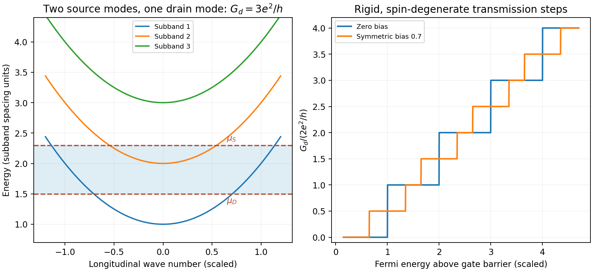

<h1 id="3/a/solution">Solution</h1>

↑ **Parent:** [A](../a.md)

Transverse confinement in a short clean channel gives subband dispersions

$$
E_n(k)=E_n^\perp+\frac{\hbar^2k^2}{2m^*}.
$$

A gate varies the subband thresholds and channel width. If elastic backscattering is negligible and [spin](../../../../../spin.md) is degenerate, the two-terminal linear conductance is

$$
\boxed{G=\frac{2e^2}{h}\sum_n T_n(E_F).}
$$

A fully open subband has $T_n\simeq1$, producing conductance steps in units $2e^2/h$. Magnetic [spin](../../../../../spin.md) splitting can resolve $e^2/h$ steps. A finite two-terminal resistance remains in a perfect ballistic channel because reservoirs supply and absorb a finite number of transport [modes](../../../../../mode-statistics.md); it does not prove momentum-randomizing scattering inside the constriction.

At finite source-drain bias the two reservoir distributions differ over an energy window rather than at one [Fermi energy](../../../../../fermi-energy.md). Choose $\mu_S-\mu_D=eV_{\rm sd}$ and take positive current from source to drain. For spin-degenerate channels,

$$
\boxed{I=\frac{2e}{h}\sum_n\int T_n(E;V_{\rm sd})[f_S(E)-f_D(E)]\,dE.}
$$

At zero temperature with a rigid transmission spectrum, $I=(2e/h)\sum_n\int_{\mu_D}^{\mu_S}T_n(E)dE$. For symmetric bias $\mu_{S,D}=E_F\pm eV_{\rm sd}/2$ and neglecting an explicit bias response of $T_n$,

$$
\boxed{\frac{dI}{dV_{\rm sd}}=\frac{e^2}{h}\sum_n
[T_n(\mu_S)+T_n(\mu_D)].}
$$

If the two window edges lie above different numbers of subbands, the differential conductance can lie at half-integer values in units $2e^2/h$. For example, two open subbands at one edge and one at the other give $3e^2/h$. This is a bias-window effect, not fractional charge or a fractional Hall state.

**[Figure 3](#3/a/image-original-ideal-one-dimensional-subbands-sampled-by-a-symmetric-bias-window-with-integer-and-half-integer-differential-conductance-plateaus). Original ideal one-dimensional subbands sampled by a symmetric bias window, with integer and half-integer differential-conductance plateaus**.

Mapping transconductance versus gate [voltage](../../../../../voltage.md) and source-drain bias reveals boundaries where a reservoir [chemical potential](../../../../../chemical-potential-split.md) crosses a subband bottom, enabling energy-spacing spectroscopy under a specified lever arm and bias division. Finite temperature rounds thresholds over $k_BT$; reflection, disorder, series resistance and a saddle-shaped barrier reduce or smooth plateaus. Large bias can alter the electrostatic potential, heat carriers or produce [inelastic scattering](../../../../../inelastic-scattering.md), so the rigid-transmission differential formula is not generally valid without its assumptions. One-dimensional interaction effects can add anomalies beyond this independent-channel model.

## ↑ Ancestors (14)

1. [A](../a.md)
2. [3](../../3.md)
3. [Paper 1](../../../paper-1-split.md)
4. [2015](../../../split.md)
5. [Past exam of the physics of Nanoelectronic Systems course of the University of Cambridge](../../../../split.md)
6. [Physics of Nanoelectronic Systems course of the University of Cambridge](../../../../../physics-of-nanoelectronic-systems-course-of-the-university-of-cambridge.md)
7. [Physics course of the year 4 of the natural sciences course of the University of Cambridge](../../../../../physics-course-of-the-year-4-of-the-natural-sciences-course-of-the-university-of-cambridge.md)
8. [Year 4 of the natural sciences course of the University of Cambridge](../../../../../year-4-of-the-natural-sciences-course-of-the-university-of-cambridge.md)
9. [Year of the natural sciences course of the University of Cambridge](../../../../../year-of-the-natural-sciences-course-of-the-university-of-cambridge.md)
10. [Natural sciences course of the University of Cambridge](../../../../../natural-sciences-course-of-the-university-of-cambridge.md)
11. [Course of the University of Cambridge](../../../../../course-of-the-university-of-cambridge.md)
12. [University of Cambridge](../../../../../university-of-cambridge-split.md)
13. [List of universities](../../../../../list-of-universities.md)
14. [Codex Wiki](../../../../../split.md)
