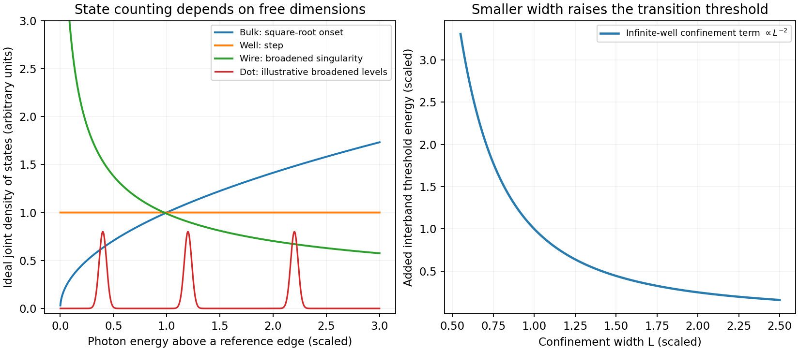

<h1 id="3/c/solution">Solution</h1>

↑ **Parent:** [C](../c.md)

Carrier confinement changes both the energies and the available optical transitions of a semiconductor. A [quantum well](../../../../../quantum-well.md) confines one direction and leaves two continuous momentum coordinates; a wire confines two directions and leaves one; a [quantum dot](../../../../../quantum-dot.md) confines all three and has discrete ideal levels. Confinement becomes important when its level spacing is comparable with thermal, lifetime and disorder energy scales, and strong excitonic confinement involves comparison with the [exciton Bohr radius](../../../../../exciton-bohr-radius.md).

**Transition energies.** In a simple infinite-well effective-mass model of width $L$, a same-index electron-hole transition has threshold

$$
\boxed{E_n^{\rm opt}\simeq E_g+
\frac{\pi^2\hbar^2n^2}{2L^2}
\left(\frac1{m_e^*}+\frac1{m_h^*}\right)-E_{\rm bind}.}
$$

Thus decreasing $L$ generally blue-shifts [interband absorption](../../../../../interband-absorption.md) and emission through the $L^{-2}$ confinement contribution. Finite barriers, band mixing, strain, nonparabolicity, dielectric environment and Coulomb interactions alter this elementary estimate. In dots, confinement shifts and [exciton](../../../../../exciton.md) binding have different size dependences, so a single inverse-square law is not an exact nanocrystal spectrum.

**Dimensional [density of states](../../../../../density-of-states.md).** For a parabolic continuum the phase-space volume below kinetic energy $E$ scales as $E^{d/2}$, hence the [density of states](../../../../../density-of-states.md) scales as $E^{d/2-1}$. Each subband threshold therefore contributes a square-root onset in three free dimensions, a constant step in two, and an inverse-square-root singularity in one. A zero-dimensional ideal dot has discrete lines rather than a continuum power law. Real temperature, disorder and lifetime broadening smooth singularities and lines. Optical absorption uses the joint electron-hole [density of states](../../../../../density-of-states.md) multiplied by transition matrix elements and occupations; a bare electronic [density of states](../../../../../density-of-states.md) is not the entire absorption spectrum.

**[Figure 4](#3/c/image-original-ideal-dimensional-joint-density-of-states-comparison-and-confinement-induced-optical-threshold-scaling-arbitrary-broadening-shown-for-dot-levels). Original ideal dimensional joint-density-of-states comparison and confinement-induced optical-threshold scaling; arbitrary broadening shown for dot levels**.

**Selection and Coulomb effects.** Envelope-function overlap and Bloch-state dipole [selection rules](../../../../../selection-rule.md) determine allowed transitions and their [polarization](../../../../../polarization-waves.md). For equal ideal infinite-well envelopes, orthogonality favors matching transverse indices; finite barriers and asymmetric fields can relax that envelope rule. Reduced dimensionality can enhance electron-hole attraction and [oscillator strength](../../../../../oscillator-strength.md) near an [exciton](../../../../../exciton.md) resonance, but the binding energy depends on the actual confinement and dielectric screening. Intersubband transitions within a [conduction band](../../../../../conduction-band.md) are different from interband recombination; in a [quantum well](../../../../../quantum-well.md) they require an electric-field [polarization](../../../../../polarization-waves.md) component along the confinement direction.

**Devices.** [Quantum wells](../../../../../quantum-well.md), wires and dots allow wavelength engineering, carrier [localization](../../../../../localization-of-a-ring.md) and altered [optical gain](../../../../../optical-gain.md) for [LEDs](../../../../../light-emitting-diode.md) and [semiconductor lasers](../../../../../semiconductor-laser.md). Concentrating states near selected transition energies can improve differential gain and reduce thresholds under appropriate injection and loss conditions. Dot ensembles can instead have substantial inhomogeneous broadening from size variation; nonradiative surface traps and carrier capture can limit an otherwise attractive design. Material confinement does not alone ensure high quantum efficiency.

An applied field across a [quantum well](../../../../../quantum-well.md) shifts [electron](../../../../../electron.md) and hole envelopes apart, usually red-shifting the [exciton](../../../../../exciton.md) transition and reducing overlap: the [quantum-confined Stark effect](../../../../../quantum-confined-stark-effect.md). This supports electroabsorption modulation and tuneable optical transitions. Conduction-band intersubband energies can also be engineered for infrared detectors and cascade-laser designs. Optical [waveguides](../../../../../waveguide.md) and cavities confine photons and affect [mode](../../../../../mode-statistics.md) overlap or spontaneous-emission rates, but that photonic confinement is distinct from the carrier quantization derived above. Both must be specified when predicting a real device's threshold, spectrum and output.

## ↑ Ancestors (14)

1. [C](../c.md)
2. [3](../../3.md)
3. [Paper 1](../../../paper-1-split.md)
4. [2015](../../../split.md)
5. [Past exam of the physics of Nanoelectronic Systems course of the University of Cambridge](../../../../split.md)
6. [Physics of Nanoelectronic Systems course of the University of Cambridge](../../../../../physics-of-nanoelectronic-systems-course-of-the-university-of-cambridge.md)
7. [Physics course of the year 4 of the natural sciences course of the University of Cambridge](../../../../../physics-course-of-the-year-4-of-the-natural-sciences-course-of-the-university-of-cambridge.md)
8. [Year 4 of the natural sciences course of the University of Cambridge](../../../../../year-4-of-the-natural-sciences-course-of-the-university-of-cambridge.md)
9. [Year of the natural sciences course of the University of Cambridge](../../../../../year-of-the-natural-sciences-course-of-the-university-of-cambridge.md)
10. [Natural sciences course of the University of Cambridge](../../../../../natural-sciences-course-of-the-university-of-cambridge.md)
11. [Course of the University of Cambridge](../../../../../course-of-the-university-of-cambridge.md)
12. [University of Cambridge](../../../../../university-of-cambridge-split.md)
13. [List of universities](../../../../../list-of-universities.md)
14. [Codex Wiki](../../../../../split.md)
