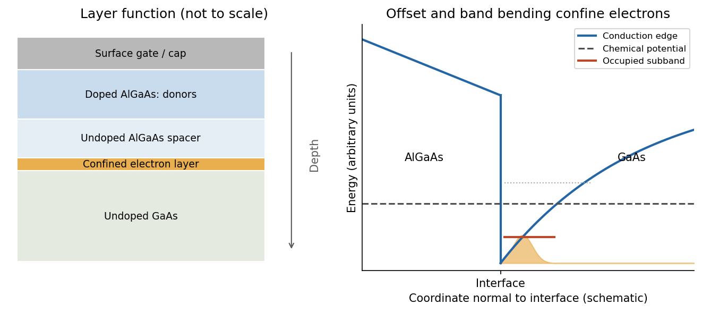
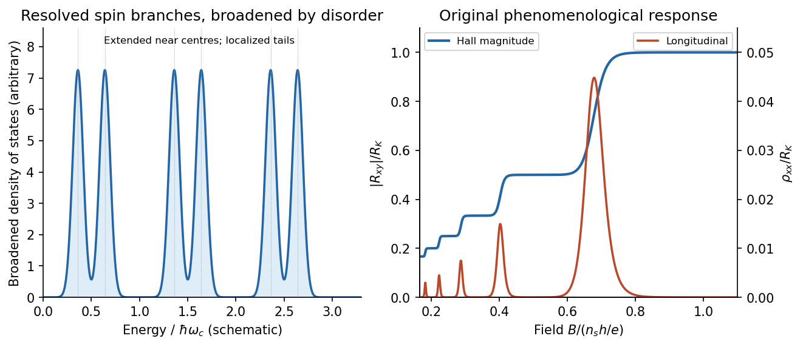
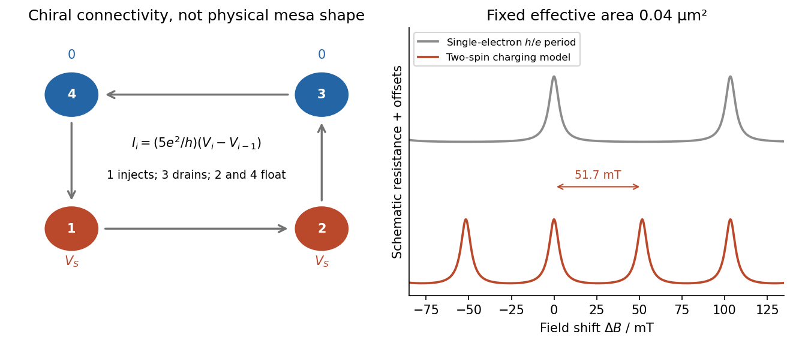

<h1 id="1/solution">Solution</h1>

↑ **Parent:** [1](../1.md)

A high-mobility [modulation-doped GaAs-AlGaAs electron gas](../../../../modulation-doped-gaas-algaas-electron-gas.md) is grown by [molecular beam epitaxy](../../../../molecular-beam-epitaxy.md) as a clean layered [semiconductor heterostructure](../../../../semiconductor-heterostructure.md). An undoped [gallium arsenide](../../../../gallium-arsenide.md) region is followed by an undoped [aluminium gallium arsenide](../../../../aluminium-gallium-arsenide.md) spacer and a donor-doped barrier region, commonly with a protective cap. The closely matched crystal structures allow a high-quality [heterojunction](../../../../heterojunction.md). The spacer supplies a crucial separation: the mobile [electrons](../../../../electron.md) reside away from the ionized donors, reducing impurity scattering compared with putting the donors directly in the conducting layer.

The larger [conduction band](../../../../conduction-band.md) energy on the [aluminium gallium arsenide](../../../../aluminium-gallium-arsenide.md) side permits donor electrons to transfer into [gallium arsenide](../../../../gallium-arsenide.md). The resulting charge separation creates [band bending](../../../../band-bending.md); together with the [band offset](../../../../band-offset.md), it forms a roughly triangular [quantum well](../../../../quantum-well.md) at the interface. The normal-direction wavefunction is confined, while motion parallel to the interface remains approximately free:

$$
E_j(k_x,k_y)=E_j+\frac{\hbar^2(k_x^2+k_y^2)}{2m^*}.
$$

When only the lowest confinement subband is occupied, this is a [two-dimensional electron gas](../../../../two-dimensional-electron-gas.md). It is the quantized normal motion, not a physically zero layer thickness, that makes the low-energy system two-dimensional.

**[Figure 1](#1/image-remote-donors-supply-a-clean-interface-channel-with-quantized-normal-motion). Remote donors supply a clean interface channel with quantized normal motion**.

At zero [magnetic field](../../../../magnetic-field-split.md), one occupied spin-degenerate parabolic subband has constant [density of states](../../../../density-of-states.md) per [area](../../../../surface-area.md) per [energy](../../../../energy-split.md), $D_0=m^*/(\pi\hbar^2)$ above its edge. A perpendicular field quantizes the in-plane orbital motion into [Landau levels](../../../../landau-level.md):

$$
E_{N,\sigma}=E_0+\hbar\omega_c\left(N+\frac12\right)
+\frac{\sigma g^*\mu_BB}{2},\qquad
\omega_c=\frac{e|B|}{m^*},\quad \sigma=\pm1.
$$

Here $g^*$ is the material's effective spin factor and $e$ is the positive [elementary charge](../../../../elementary-charge.md); no free-electron $g=2$ assumption is made for this semiconductor. Each resolved spin branch contains $e|B|/h$ states per unit [area](../../../../surface-area.md). The ideal [density of states](../../../../density-of-states.md) becomes

$$
D(E)=\frac{e|B|}{h}\sum_{N,\sigma}\delta(E-E_{N,\sigma}),
$$

with [Landau-level broadening](../../../../landau-level-broadening.md) in a real sample. The [Landau filling factor](../../../../landau-filling-factor.md)

$$
\boxed{\nu=\frac{n_sh}{e|B|}}
$$

counts the carrier density in units of one spin-resolved level's degeneracy. Two unresolved spin branches have twice that degeneracy; resolved branches must not each be counted twice.

Disorder localizes states in the broadened level tails, while extended states occur near level centres. As $B$ varies, occupation of localized states can change without changing the number of current-carrying edge channels. This produces a finite-width [quantum Hall plateau](../../../../quantum-hall-plateau.md), rather than quantization only at isolated fields. In a [mobility gap](../../../../mobility-gap.md), [longitudinal resistivity](../../../../longitudinal-sheet-resistivity.md) approaches zero and the Hall magnitude is $R_K/N=h/(Ne^2)$ for $N$ occupied transmitting branches. When the [chemical potential](../../../../chemical-potential-split.md) passes through extended states, longitudinal dissipation peaks and the Hall value changes to another plateau. A spectral [density of states](../../../../density-of-states.md) can remain nonzero where transport is localized. Very strong disorder can destroy the resolved quantum Hall regime; the statement is not that any amount of disorder improves it.

**[Figure 2](#1/image-broadened-landau-levels-and-an-illustrative-integer-hall-staircase-with-longitudinal-peaks). Broadened Landau levels and an illustrative integer Hall staircase with longitudinal peaks**.

The original plot is schematic, not fitted data. At fixed sheet density, increasing $|B|$ decreases [Landau filling factor](../../../../landau-filling-factor.md), so the Hall magnitude climbs through $R_K/N$ plateaus while longitudinal peaks separate the plateaus. The signed Hall voltage depends on carrier and probe conventions.

For the gate calculation, the target sheet density is fixed by the desired [Landau filling factor](../../../../landau-filling-factor.md):

$$
n_{\rm target}=\frac{3e(3\,\mathrm T)}h
=2.17619\times10^{15}\,\mathrm{m^{-2}},
\qquad \Delta n_s=-1.30381\times10^{15}\,\mathrm{m^{-2}}.
$$

Use [top-gate density tuning](../../../../top-gate-density-tuning.md) in the parallel-plate approximation. The geometric [capacitance](../../../../capacitance.md) per unit [area](../../../../surface-area.md) is

$$
C_A=\frac{\epsilon_0\epsilon_r}{d}=1.06250\times10^{-3}\,\mathrm{F\,m^{-2}},
\qquad \Delta V_g=\frac{e\Delta n_s}{C_A}.
$$

Therefore

$$
\boxed{\Delta V_g=-0.1966\,\mathrm V\simeq-0.20\,\mathrm V.}
$$

The gate must become more negative relative to the [electron gas](../../../../electron-gas.md), reducing its density. The voltage is the change from the gate setting associated with the stated initial density; if that setting is defined as zero, it is the required gate voltage. Work-function offsets, trapped charge and [quantum capacitance](../../../../quantum-capacitance.md) are neglected. An absolute voltage referenced to some other uncalibrated potential cannot be inferred from geometry alone. Numerical values use exact SI $h=6.62607015\times10^{-34}\,\mathrm{J\,s}$ and $e=1.602176634\times10^{-19}\,\mathrm C$, and $\epsilon_0\simeq8.8541878188\times10^{-12}\,\mathrm{F\,m^{-1}}$.[2022 CODATA listing: Planck constant, elementary charge and vacuum electric permittivity](../../../../fundamental-physical-constants-complete-listing-by-national-institute-of-standards-and-technology-and-others.md)

For the subsequently specified five-channel plateau, the [chemical potential](../../../../chemical-potential-split.md) between the fifth and sixth resolved branches means $N=5$, not ten. The physical contact order in the PDF is $1,2,3,4$ along one side of the mesa. Use ideal equilibrating [Ohmic contacts](../../../../ohmic-contact.md) and the [Landauer-Büttiker formula](../../../../landauer-buttiker-formula.md), rather than inferring a longitudinal measurement merely from the contacts being drawn on one edge.

Choose one field polarity so the chiral order is $1\to2\to3\to4\to1$. With $G_H=5e^2/h$,

$$
I_i=G_H(V_i-V_{i-1}).
$$

Contacts 2 and 4 are voltage probes, so $I_2=I_4=0$. With $V_3=0$, this gives $V_2=V_1$, $V_4=V_3=0$, and $I_1=G_HV_1$. Hence

$$
\boxed{R_{13,24}\equiv\frac{V_2-V_4}{I_1}
=\frac h{5e^2}=5.163\,\mathrm{k\Omega}}
$$

for this circulation. Reversing the field reverses the contact order and gives $R_{13,24}=-h/(5e^2)$ with the same voltage ordering. **The resistance magnitude is $5.16\,\mathrm{k\Omega}$; it is not zero.** Contact 2 samples the outgoing source potential and contact 4 the outgoing drain potential for the chosen chirality.

The [antidot](../../../../quantum-hall-antidot.md) is a depleted island supporting closed [quantum Hall edge states](../../../../quantum-hall-edge-state.md). Tunnelling between those states and opposite propagating edges can produce resonant backscattering and resistance peaks as $B$ varies. One electronic [Aharonov-Bohm phase](../../../../aharonov-bohm-effect.md) winds by $2\pi$ when flux through a fixed effective orbit [area](../../../../surface-area.md) $S$ changes by $h/e$. Using the supplied area as that effective area,

$$
S=(0.2\,\mathrm{\mu m})^2=4.0\times10^{-14}\,\mathrm{m^2},\qquad
\boxed{\Delta B_{h/e}=\frac h{eS}=0.1034\,\mathrm T.}
$$

With the two spin-split branches of the lowest orbital level occupied, the common [Coulomb-dominated antidot oscillation](../../../../coulomb-dominated-antidot-oscillation.md) model has two charge rearrangements per added $h/e$ flux. Both branches contribute to charge buildup; screening and their capacitive coupling can make tunnelling through the outer edge occur twice during the cycle. It then gives

$$
\boxed{\Delta B_{\rm two\ spin}\simeq\frac h{2eS}=51.7\,\mathrm{mT}.}
$$

This is two electron-tunnelling resonances per flux cycle, not evidence that the mobile particles have charge $2e$. The primary charging model specifically addresses this two-spin regime.[Primary abstract: two spins of the lowest Landau level and two outer-spin resonances per h/e period](../../../../coulomb-blockade-of-tunnelling-through-compressible-rings-formed-around-an-antidot-by-m-kataoka-and-others.md)

**[Figure 3](#1/image-chiral-reservoir-potentials-and-the-distinction-between-flux-period-and-two-spin-charging-resonances). Chiral reservoir potentials and the distinction between flux period and two-spin charging resonances**.

The sketch shows resistance peaks in a weak-backscattering configuration, with arbitrary height and linewidth because tunnel couplings and [temperature](../../../../temperature-split.md) are unspecified. A two-spin count alone does not force two independent noninteracting resonance series to be exactly half a flux period apart: their relative positions also depend on spin splitting and confinement. Thus $51.7\,\mathrm{mT}$ describes the stated charging-model interpretation; $103.4\,\mathrm{mT}$ is the single-electron fixed-area flux period. The actual enclosed edge-orbit area can differ from the geometrically depleted area.

For bulk filling two and total forward transmission $\mathcal T$ in spin-resolved units, ideal chiral probes give the longitudinal four-terminal resistance

$$
R_{14,23}=\frac h{e^2}\left(\frac1{\mathcal T}-\frac12\right).
$$

Resonant loss of transmission therefore gives peaks. Their size, background and detailed shape cannot be calculated from the supplied area and bulk filling alone. If the gates instead make a tunnelling path that enhances forward transmission, the resonant contrast can be reversed; the plotted peak convention is explicitly the backscattering one.

## ↑ Ancestors (13)

1. [1](../1.md)
2. [Paper 1](../../paper-1-split.md)
3. [2016](../../split.md)
4. [Past exam of the physics of Nanoelectronic Systems course of the University of Cambridge](../../../split.md)
5. [Physics of Nanoelectronic Systems course of the University of Cambridge](../../../../physics-of-nanoelectronic-systems-course-of-the-university-of-cambridge.md)
6. [Physics course of the year 4 of the natural sciences course of the University of Cambridge](../../../../physics-course-of-the-year-4-of-the-natural-sciences-course-of-the-university-of-cambridge.md)
7. [Year 4 of the natural sciences course of the University of Cambridge](../../../../year-4-of-the-natural-sciences-course-of-the-university-of-cambridge.md)
8. [Year of the natural sciences course of the University of Cambridge](../../../../year-of-the-natural-sciences-course-of-the-university-of-cambridge.md)
9. [Natural sciences course of the University of Cambridge](../../../../natural-sciences-course-of-the-university-of-cambridge.md)
10. [Course of the University of Cambridge](../../../../course-of-the-university-of-cambridge.md)
11. [University of Cambridge](../../../../university-of-cambridge-split.md)
12. [List of universities](../../../../list-of-universities.md)
13. [Codex Wiki](../../../../split.md)
