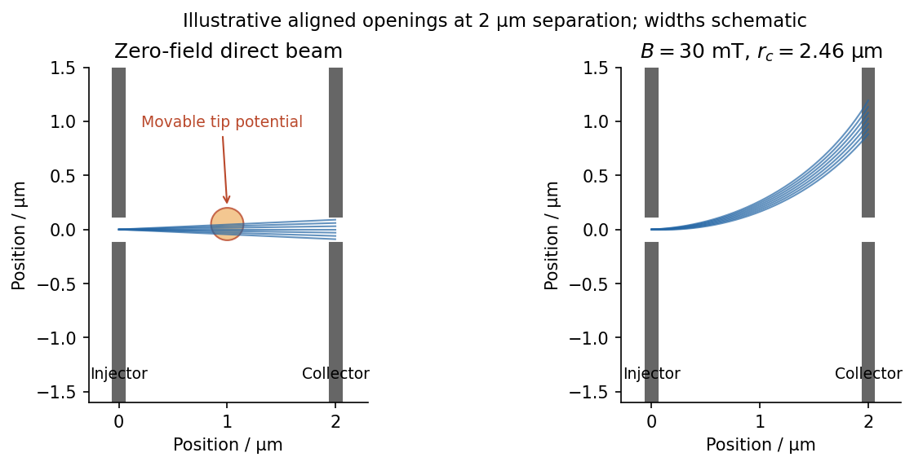

<h1 id="2/solution">Solution</h1>

↑ **Parent:** [2](../2.md)

Use two [collinear quantum point contacts](../../../../collinear-quantum-point-contacts.md) in a clean [two-dimensional electron gas](../../../../two-dimensional-electron-gas.md). Surface [split gates](../../../../split-gate.md) deplete the [electron gas](../../../../electron-gas.md) beneath them, leaving two short constrictions facing one another across an open region. The first injects a directional beam from a biased reservoir; the second collects carriers into a downstream reservoir, with [electric current](../../../../electric-current.md) flowing in the same spatial direction through both constrictions. Additional surrounding contacts can absorb carriers that miss the collector. A direct collector signal at zero [magnetic field](../../../../magnetic-field-split.md), sensitive to alignment and to obstruction of the intervening path, demonstrates [ballistic electron transport](../../../../ballistic-electron-transport.md) across the separation.

An illustrative GaAs device uses gate gaps of a few hundred nanometres and electrically tunable constriction widths of tens to a few hundred nanometres, with injector–collector separation of a few micrometres. These are typical design scales, not dimensions supplied for a particular chip in the question. The electrical width can be much smaller than the lithographic gap because depletion extends laterally. A one-mode opening has width comparable to roughly half a [Fermi wavelength](../../../../fermi-wavelength.md); it is not simply any opening below one micrometre. Low-temperature operation suppresses inelastic scattering and resolves transverse modes. The direct trajectory length should be comfortably below the relevant [transport mean free path](../../../../transport-mean-free-path.md).

Collimation is provided by the smooth exit from a constriction. In [adiabatic electron collimation](../../../../adiabatic-electron-collimation.md), transverse mode action is approximately conserved, giving $p_\perp W\simeq\mathrm{constant}$. As the channel opens from width $W_0$ to $W_{\rm out}$, $p_{\perp,\rm out}\simeq p_{\perp,0}W_0/W_{\rm out}$. At the same time the bottom of the electrostatic potential falls, increasing longitudinal kinetic energy. Thus

$$
\sin\theta_{\rm out}=\frac{p_{\perp,\rm out}}{p_{\rm out}}
\simeq\frac{W_0}{W_{\rm out}}\frac{p_{\perp,0}}{p_{\rm out}},
$$

and the angular distribution narrows. The reciprocal collector selects this forward-directed set of trajectories. A narrow abrupt aperture by itself may diffract into a broad fan; the smooth funnel and its potential profile are important. Here “focusing” refers primarily to collimation and efficient injector–collector coupling, not a claim that every emitted trajectory converges to one exact geometric point.

**[Figure 4](#2/image-aligned-quantum-point-contacts-collect-a-direct-beam-a-weak-field-bends-it-away). Aligned quantum point contacts collect a direct beam; a weak field bends it away**.

In [scanning gate microscopy](../../../../scanning-gate-microscopy.md), a conducting tip biased sufficiently negatively creates a local repulsive potential and, when strong enough, a small depleted region in the [electron gas](../../../../electron-gas.md) beneath it. Raster the tip and record the collector current or differential conductance. Placing the perturbation on a strongly contributing path deflects or backscatters electrons and changes collection, producing spatial contrast. A primary scanning-probe experiment records conductance changes as a negatively charged tip depletes and backscatters the two-dimensional gas.[2002 author abstract: tip depletion, backscattering, conductance imaging and mode-dependent angular patterns](../../../../imaging-coherent-electron-flow-by-b-j-leroy-and-others.md)

The resulting image is a map of transport sensitivity to the tip, not a literal nonperturbing photograph of an electron trajectory. Broad electrostatic gating of either constriction should be distinguished from local beam disruption. Weak smooth disorder can create branches even in a high-mobility sample. Where [electron phase coherence](../../../../electron-phase-coherence.md) is preserved, interference between alternative paths can add fringes, often with a scale comparable to half a [Fermi wavelength](../../../../fermi-wavelength.md) for a round-trip path-length change. Ballistic motion and phase-coherent interference are related but distinct requirements.

A small perpendicular [magnetic field](../../../../magnetic-field-split.md) curves the imaged paths through the [Lorentz force](../../../../lorentz-force.md), $\mathbf F=-e\mathbf v\times\mathbf B$. Reversing $B$ reverses the bending, and a fixed aligned collector generally loses the initially straight beam unless a curved path connects it. For a circular orbit at the [Fermi velocity](../../../../fermi-velocity.md),

$$
\frac{m^*v_F^2}{r_c}=ev_F|B|,\qquad
r_c=\frac{m^*v_F}{e|B|}=\frac{\hbar k_F}{e|B|}.
$$

For one valley with two nearly equally occupied spin species at small field, state counting in the Fermi disc gives $n_s=2\pi k_F^2/(2\pi)^2=k_F^2/(2\pi)$. Hence

$$
\boxed{r_c=\frac{\hbar\sqrt{2\pi n_s}}{e|B|}.}
$$

Spin polarization or extra valley degeneracy changes the density-to-wavevector relation; the stated low-field GaAs estimate uses the ordinary spin-degenerate case.

The [electron mobility](../../../../electron-mobility.md) gives the [momentum relaxation time](../../../../momentum-relaxation-time.md) in a parabolic-band [Drude model](../../../../drude-model.md), $\mu=e\tau_{\rm tr}/m^*$. Therefore

$$
\boxed{\ell_{\rm tr}=v_F\tau_{\rm tr}=\frac{\mu\hbar\sqrt{2\pi n_s}}e.}
$$

The [effective mass](../../../../band-effective-mass.md) cancels from both $\ell_{\rm tr}$ and $r_c$ when expressed in terms of density and mobility. For the supplied density,

$$
k_F=1.12100\times10^8\,\mathrm{m^{-1}},\qquad
\lambda_F=56.05\,\mathrm{nm}.
$$

With $m^*=0.067m_0$, $m_0\simeq9.1093837139\times10^{-31}\,\mathrm{kg}$, one also obtains $v_F\simeq1.937\times10^5\,\mathrm{m\,s^{-1}}$ and $\tau_{\rm tr}\simeq38.1\,\mathrm{ps}$. The requested lengths are

$$
\boxed{\ell_{\rm tr}=7.38\,\mathrm{\mu m},\qquad
r_c(30\,\mathrm{mT})=2.46\,\mathrm{\mu m}.}
$$

A useful independent ratio is $\ell_{\rm tr}/r_c=\mu|B|=3$. The standard constants used here are explicitly tabulated, rather than inferred from the sample.[2022 CODATA: electron mass, elementary charge and Planck constant](../../../../fundamental-physical-constants-complete-listing-by-national-institute-of-standards-and-technology-and-others.md)

Mobility measures momentum relaxation. Predominantly small-angle elastic scattering can occur more frequently than that transport time, and the phase-coherence time is different again. Thus the calculation supports a several-micrometre transport scale, without proving that every electron experiences literally no perturbation over that distance.

**As [temperature](../../../../temperature-split.md) rises, the directed ballistic collector signal decreases.** Increased [electron-phonon scattering](../../../../electron-phonon-scattering.md) and other inelastic processes reduce survival of the directed beam; thermal averaging broadens the mode and angular selection, and interference contrast also diminishes. A diffuse background current can remain, so disappearance of beam contrast need not mean all current through the device vanishes.

## ↑ Ancestors (13)

1. [2](../2.md)
2. [Paper 1](../../paper-1-split.md)
3. [2016](../../split.md)
4. [Past exam of the physics of Nanoelectronic Systems course of the University of Cambridge](../../../split.md)
5. [Physics of Nanoelectronic Systems course of the University of Cambridge](../../../../physics-of-nanoelectronic-systems-course-of-the-university-of-cambridge.md)
6. [Physics course of the year 4 of the natural sciences course of the University of Cambridge](../../../../physics-course-of-the-year-4-of-the-natural-sciences-course-of-the-university-of-cambridge.md)
7. [Year 4 of the natural sciences course of the University of Cambridge](../../../../year-4-of-the-natural-sciences-course-of-the-university-of-cambridge.md)
8. [Year of the natural sciences course of the University of Cambridge](../../../../year-of-the-natural-sciences-course-of-the-university-of-cambridge.md)
9. [Natural sciences course of the University of Cambridge](../../../../natural-sciences-course-of-the-university-of-cambridge.md)
10. [Course of the University of Cambridge](../../../../course-of-the-university-of-cambridge.md)
11. [University of Cambridge](../../../../university-of-cambridge-split.md)
12. [List of universities](../../../../list-of-universities.md)
13. [Codex Wiki](../../../../split.md)
