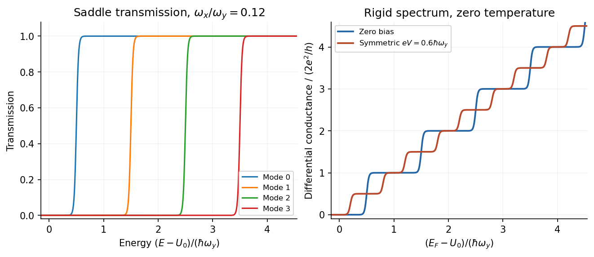

<h1 id="3/b/solution">Solution</h1>

↑ **Parent:** [B](../b.md)

A [quantum point contact](../../../../../quantum-point-contact.md) is made by using negative surface [split gates](../../../../../split-gate.md) to leave a short narrow channel in a clean [two-dimensional electron gas](../../../../../two-dimensional-electron-gas.md). Its length should be smaller than the [transport mean free path](../../../../../transport-mean-free-path.md); transverse confinement should be strong enough that subband spacing exceeds thermal and lifetime broadening. Low-resistance [Ohmic contacts](../../../../../ohmic-contact.md) connect large reservoirs. Apply a small source–drain bias, measure current and differential conductance, and sweep the gate to change the channel width or barrier height. Contact and wiring series resistance must be accounted for when comparing plateau values.

The [Landauer formula](../../../../../landauer-formula.md) explains the conductance without treating the short channel as a diffusive wire. For each propagating one-dimensional mode, the [density of states](../../../../../density-of-states.md) and group velocity cancel in the incident flux, leaving $e/h$ per spin per energy interval. The reservoir occupation difference supplies the net current:

$$
I=\frac{2e}{h}\sum_n\int T_n(E)[f_S(E)-f_D(E)]\,dE.
$$

The factor two assumes unresolved spin degeneracy. In zero-temperature [linear response](../../../../../linear-response-theory.md),

$$
\boxed{G=\frac{2e^2}{h}\sum_nT_n(E_F).}
$$

A well-transmitted channel has $T_n\simeq1$, giving steps $G=N(2e^2/h)$ as modes open. A finite two-terminal resistance persists even for a perfectly ballistic channel because reservoirs inject only a finite number of modes; it is not evidence of resistive scattering inside the channel. Gate-controlled point-contact conductance quantization was demonstrated in a two-dimensional [electron gas](../../../../../electron-gas.md).[1988, primary publication: gate-controlled quantized conductance of ballistic point contacts](../../../../../quantized-conductance-of-point-contacts-by-b-j-van-wees-and-others.md)

The [saddle-point model of a quantum point contact](../../../../../saddle-point-model-of-a-quantum-point-contact.md) resolves how modes open. Near the bottleneck, choose the channel direction as $x$ and write

$$
U(x,y)=U_0-\frac12m^*\omega_x^2x^2
+\frac12m^*\omega_y^2y^2.
$$

Transverse harmonic confinement gives barrier tops $E_n=U_0+\hbar\omega_y(n+1/2)$. Scattering through the inverted longitudinal harmonic barrier gives

$$
\boxed{T_n(E)=\left[1+\exp\!\left(-\frac{2\pi(E-E_n)}{\hbar\omega_x}\right)\right]^{-1}.}
$$

Small longitudinal curvature makes a sharp transmission threshold compared with the transverse subband spacing; finite curvature rounds each conductance step. This is the explicit smooth-barrier model developed for a saddle constriction.[1990, saddle potential and mode-resolved transmission](../../../../../quantized-transmission-of-a-saddle-point-constriction-by-m-buttiker.md)

**[Figure 5](#3/b/image-mode-thresholds-and-half-integer-differential-plateaus-in-a-stipulated-symmetric-bias-model). Mode thresholds and half-integer differential plateaus in a stipulated symmetric-bias model**.

At larger source–drain bias, the current samples a finite energy window. For a rigid transmission spectrum at zero [temperature](../../../../../temperature-split.md),

$$
I=\frac{2e}{h}\sum_n\int_{\mu_D}^{\mu_S}T_n(E)\,dE.
$$

With symmetric bias, $\mu_{S,D}=E_F\pm eV/2$, the [nonlinear conductance of a quantum point contact](../../../../../nonlinear-conductance-of-a-quantum-point-contact.md) is

$$
\boxed{\frac{dI}{dV}=\frac{e^2}{h}\sum_n
[T_n(\mu_S)+T_n(\mu_D)].}
$$

If both window edges sample $N$ open modes, the usual plateau remains. If one edge samples $N+1$ and the other $N$, differential conductance approaches $(N+1/2)(2e^2/h)$: a half-integer plateau relative to the zero-bias step. It is a bias-window effect, not half an electron spin degeneracy. Ridges in gate–bias transconductance occur when a reservoir chemical potential crosses a subband threshold; their separations can measure subband energies.

The half-plateau expression assumes symmetric bias and an approximately bias-independent barrier. An asymmetric voltage drop or self-consistent shift of $U_0$ changes the numerical relation. At still larger biases, heating and inelastic scattering can invalidate a rigid elastic saddle model. Thus **the zero-bias quantization counts transmitted modes, while nonlinear spectroscopy compares mode counts at the two ends of the bias window.**

## ↑ Ancestors (14)

1. [B](../b.md)
2. [3](../../3.md)
3. [Paper 1](../../../paper-1-split.md)
4. [2016](../../../split.md)
5. [Past exam of the physics of Nanoelectronic Systems course of the University of Cambridge](../../../../split.md)
6. [Physics of Nanoelectronic Systems course of the University of Cambridge](../../../../../physics-of-nanoelectronic-systems-course-of-the-university-of-cambridge.md)
7. [Physics course of the year 4 of the natural sciences course of the University of Cambridge](../../../../../physics-course-of-the-year-4-of-the-natural-sciences-course-of-the-university-of-cambridge.md)
8. [Year 4 of the natural sciences course of the University of Cambridge](../../../../../year-4-of-the-natural-sciences-course-of-the-university-of-cambridge.md)
9. [Year of the natural sciences course of the University of Cambridge](../../../../../year-of-the-natural-sciences-course-of-the-university-of-cambridge.md)
10. [Natural sciences course of the University of Cambridge](../../../../../natural-sciences-course-of-the-university-of-cambridge.md)
11. [Course of the University of Cambridge](../../../../../course-of-the-university-of-cambridge.md)
12. [University of Cambridge](../../../../../university-of-cambridge-split.md)
13. [List of universities](../../../../../list-of-universities.md)
14. [Codex Wiki](../../../../../split.md)
