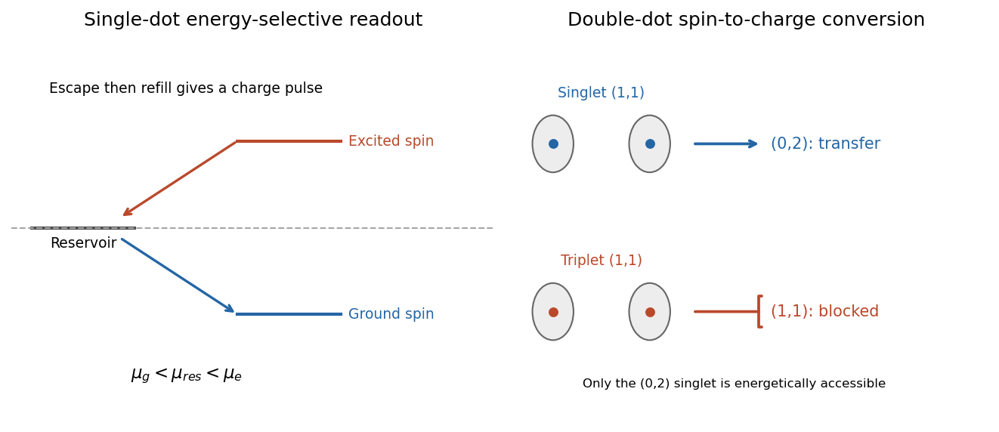

<h1 id="3/c/solution">Solution</h1>

↑ **Parent:** [C](../c.md)

An [electrostatically defined quantum dot](../../../../../electrostatically-defined-quantum-dot.md) uses depletion gates to confine a small island laterally in a [two-dimensional electron gas](../../../../../two-dimensional-electron-gas.md). Two narrow barriers allow weak tunnelling to source and drain; a plunger gate tunes the island's electrochemical levels, and additional gates can form a [double quantum dot](../../../../../double-quantum-dot.md). Adjusting the gates resolves successive charge states and eventually reaches the single-electron regime. An electrical dot is defined by confinement and tunnel coupling, not simply by the drawn metal area.

In a [constant interaction model](../../../../../constant-interaction-model.md),

$$
E(N)=\sum_{j=1}^N\epsilon_j+\frac{(Ne-Q_g)^2}{2C_\Sigma},
\qquad \mu_N=E(N)-E(N-1).
$$

Here $Q_g$ is gate-induced charge and $C_\Sigma$ total island [capacitance](../../../../../capacitance.md). Successive additions cost $E_{\rm add}=e^2/C_\Sigma+\epsilon_{N+1}-\epsilon_N$, with spin, exchange and correlations modifying the orbital term. [Coulomb blockade](../../../../../coulomb-blockade.md) appears when no allowed charge transition lies in the source–drain energy window. Gate sweeps give charge steps and transport peaks; finite-bias [Coulomb diamonds](../../../../../coulomb-diamond.md) constrain charging and orbital energies under a stated bias convention. Resolved single-electron operation requires thermal and tunnel broadening smaller than the relevant addition energies.

[Quantum-dot charge sensing](../../../../../quantum-dot-charge-sensing.md) avoids relying on a measurable current through a nearly isolated dot. A nearby [quantum point contact](../../../../../quantum-point-contact.md) biased on a sensitive conductance slope, or a [single-electron transistor](../../../../../single-electron-transistor.md), responds capacitively when one electron enters or leaves the dot. A time trace of sensor current can therefore distinguish $N$ from $N-1$ and resolve individual tunnelling events. The sensor measures charge; a spin-dependent step is needed to measure spin.

For one electron, [Zeeman splitting](../../../../../zeeman-splitting.md) gives a lower and a higher spin level separated by $E_Z=|g^*|\mu_B|B|$. In [energy-selective spin readout](../../../../../energy-selective-spin-readout.md), initialize an empty dot and pulse both levels below the reservoir chemical potential to load one electron. Then move to a readout configuration

$$
\mu_g<\mu_{\rm res}<\mu_e.
$$

An electron in the higher state can tunnel out, temporarily leaving the dot empty, after which a lower-state electron can refill it. An electron initially in the lower state remains trapped. The charge sensor records a pulse for the first outcome and no escape pulse for the second. This is [spin-to-charge conversion](../../../../../spin-to-charge-conversion.md); it measures the spin projection along the field through a state-dependent tunnelling probability. A primary single-shot experiment uses this conversion with a quantum-point-contact charge detector.[2004 author abstract: electrical single-electron spin readout, spin-to-charge conversion and nearby quantum point contact](../../../../../single-shot-read-out-of-an-individual-electron-spin-in-a-quantum-dot-by-j-m-elzerman-and-others.md)

**[Figure 6](#3/c/image-energy-selective-escape-and-singlet-triplet-conversion-turn-spin-information-into-charge). Energy-selective escape and singlet–triplet conversion turn spin information into charge**.

The readout window must be long enough to detect escape but short compared with excited-spin relaxation:

$$
\Gamma_{\rm out}^{-1}\ll\tau_{\rm read}\ll T_1,
\qquad k_BT\ll E_Z.
$$

Detector bandwidth must also resolve the empty-state dwell time before refilling. Thermal activation, relaxation before escape, missed fast events and sensor backaction cause errors. Since the excited electron can leave and be replaced, this simple sequence does not preserve an arbitrary initial spin state.

For coupled dots, label charge occupation by $(n_L,n_R)$. Gate-controlled detuning can make $(1,1)$ and $(0,2)$ accessible. Two electrons in the lowest orbital of one dot must form a [singlet state](../../../../../singlet-state.md); a [triplet state](../../../../../spin-one-half-triplet-state.md) requires a different orbital or another higher-energy configuration. Choose a measurement window where the $(0,2)$ singlet is available but the $(0,2)$ triplet is not. Then

$$
S(1,1)\longrightarrow S(0,2),\qquad
T(1,1)\not\longrightarrow S(0,2)
$$

under spin-conserving tunnelling. The second process is forbidden by spin symmetry and the [Pauli exclusion principle](../../../../../pauli-exclusion-principle.md), producing [Pauli spin blockade](../../../../../pauli-spin-blockade.md). Charge sensing distinguishes transfer from a blocked $(1,1)$ state. This measures singlet versus triplet content; without a reference spin or additional control it is not a measurement of each electron's absolute spin direction separately.

The [exchange interaction in a double quantum dot](../../../../../exchange-interaction-in-a-double-quantum-dot.md) provides control of these states. In an effective spin description,

$$
H_{\rm ex}=\frac J4\boldsymbol\sigma_L\cdot\boldsymbol\sigma_R,
\qquad E_T-E_S=J.
$$

For a symmetric weak-tunnelling two-site model with onsite charging cost $U$, $J\simeq4t_c^2/U$. Gates change tunnel coupling $t_c$ and detuning, allowing preparation and evolution followed by a charge-conversion measurement. Spin mixing from local magnetic-field differences or spin-orbit effects can lift blockade, so the sensing interval must be chosen before unwanted relaxation obscures the initial state. **Single-dot readout uses spin-dependent escape; double-dot readout can use spin-dependent charge transfer. In both cases the measurable signal is a resolved charge change.**

## ↑ Ancestors (14)

1. [C](../c.md)
2. [3](../../3.md)
3. [Paper 1](../../../paper-1-split.md)
4. [2016](../../../split.md)
5. [Past exam of the physics of Nanoelectronic Systems course of the University of Cambridge](../../../../split.md)
6. [Physics of Nanoelectronic Systems course of the University of Cambridge](../../../../../physics-of-nanoelectronic-systems-course-of-the-university-of-cambridge.md)
7. [Physics course of the year 4 of the natural sciences course of the University of Cambridge](../../../../../physics-course-of-the-year-4-of-the-natural-sciences-course-of-the-university-of-cambridge.md)
8. [Year 4 of the natural sciences course of the University of Cambridge](../../../../../year-4-of-the-natural-sciences-course-of-the-university-of-cambridge.md)
9. [Year of the natural sciences course of the University of Cambridge](../../../../../year-of-the-natural-sciences-course-of-the-university-of-cambridge.md)
10. [Natural sciences course of the University of Cambridge](../../../../../natural-sciences-course-of-the-university-of-cambridge.md)
11. [Course of the University of Cambridge](../../../../../course-of-the-university-of-cambridge.md)
12. [University of Cambridge](../../../../../university-of-cambridge-split.md)
13. [List of universities](../../../../../list-of-universities.md)
14. [Codex Wiki](../../../../../split.md)
