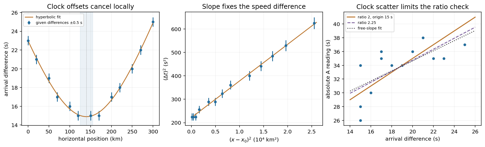
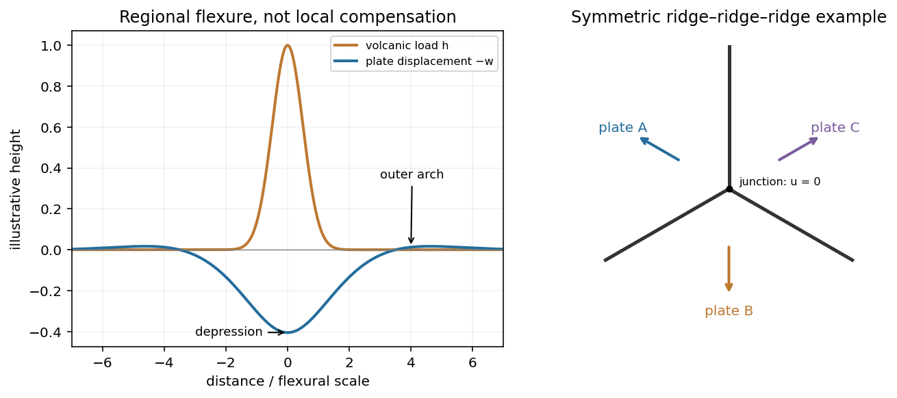
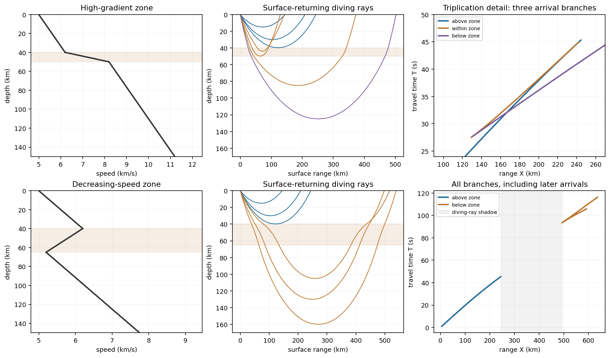

# Paper 1

↑ **Parent:** [2012](../2012.md)

Original examination: [Physical PDF pages 452–454; printed Paper 150, 18 January 2012](https://www.whatdotheyknow.com/request/natural_science_tripos_physics_e_2/response/2340776/attach/2/FOI%202023%20399%20Zahid%20materials.pdf?cookie_passthrough=1#page=452). All optional questions and both OR choices within each part of question 3 are covered.

**Table of contents**

- [1](#1)
  - [a](#1/a)
    - [Solution](#1/a/solution)
  - [b](#1/b)
    - [Solution](#1/b/solution)
  - [c](#1/c)
    - [Solution](#1/c/solution)
  - [d](#1/d)
    - [Solution](#1/d/solution)
- [2](#2)
  - [a](#2/a)
    - [Solution](#2/a/solution)
  - [b](#2/b)
    - [Solution](#2/b/solution)
  - [c](#2/c)
    - [Solution](#2/c/solution)
  - [d](#2/d)
    - [Solution](#2/d/solution)
- [3](#3)
  - [a](#3/a)
    - [Solution](#3/a/solution)
  - [b](#3/b)
    - [Solution](#3/b/solution)
    - [i](#3/b/i)
      - [Solution](#3/b/i/solution)
    - [ii](#3/b/ii)
      - [Solution](#3/b/ii/solution)

## 1

↑ **Parent:** [Paper 1](paper-1.md)

<h3 id="1/a">a</h3>

↑ **Parent:** [1](#1)

<h4 id="1/a/solution">Solution</h4>

↑ **Parent:** [A](#1/a)

Write $T_s$ for the fixed surface [temperature](../../temperature.md) and $\theta=\overline T-T_s$. The [heat capacity](../../heat.md#heat-capacity) per unit volume is $\rho_0c_p=k/\kappa$. Per unit horizontal area the layer stores [sensible heat](../../heat.md#sensible-heat) $(k/\kappa)d\theta$. Its increase equals the input less the output:

$$
\boxed{\frac{kd}{\kappa}\frac{d\overline T}{dt}=F-E(t).}
$$

The same equation holds for $\theta$ because $T_s$ is constant. It assumes the supplied constant-property, fixed-thickness layer, without internal [heat](../../heat.md) production, [latent heat](../../thermodynamic-potential.md#latent-heat), or mechanical contributions to its [heat](../../heat.md) budget. The infinite horizontal area is handled by taking the budget per unit area.

<h3 id="1/b">b</h3>

↑ **Parent:** [1](#1)

<h4 id="1/b/solution">Solution</h4>

↑ **Parent:** [B](#1/b)

Vigorous [convection](../../convection.md) keeps the interior nearly uniform, so the upper [thermal boundary layer](../../continuum-mechanics.md#thermal-boundary-layer) carries a [temperature](../../temperature.md) drop of order $\theta$. A [boundary layer](../../continuum-mechanics.md#boundary-layer) becomes unstable when its local [Rayleigh number](../../geophysics.md#rayleigh-number) reaches an order-fixed critical value $R_c$:

$$
\operatorname{Ra}_\delta=\frac{\rho_0g\alpha\theta\delta^3}{\eta\kappa}\sim R_c.
$$

This is [marginal-stability thermal boundary-layer scaling](../../geophysics.md#marginal-stability-thermal-boundary-layer-scaling) using the [Local Rayleigh-number closure](../../geophysics.md#local-rayleigh-number-closure): boundary-layer [buoyancy](../../fluid-mechanics.md#buoyancy) overcomes viscous and thermal-diffusive stabilization. Equivalently, a buoyancy-driven velocity scale $u\sim\rho_0g\alpha\theta\delta^2/\eta$ makes $u\delta/\kappa$ order $R_c$. Thus

$$
\boxed{\delta\sim\left(\frac{R_c\eta\kappa}{\rho_0g\alpha\theta}\right)^{1/3},\qquad
E(t)\sim\frac{k\theta}{\delta}=C\theta^{4/3},\quad
C=k\left(\frac{\rho_0g\alpha}{R_c\eta\kappa}\right)^{1/3}.}
$$

There is no $d$ in this closure, as required for a thin [boundary layer](../../continuum-mechanics.md#boundary-layer) controlled by its own stability. The exponent is fixed by scaling; its absolute coefficient is not. Here $R_c$ represents the geometry and [boundary conditions](../../differential-equation.md#boundary-condition), together with any order-one boundary-layer coefficient. The question supplies no numerical value for it. The assumption requires $\delta\ll d$, positive $\theta$, and properties sufficiently constant over the [temperature](../../temperature.md) contrast.

<h3 id="1/c">c</h3>

↑ **Parent:** [1](#1)

<h4 id="1/c/solution">Solution</h4>

↑ **Parent:** [C](#1/c)

For [flux-driven convective layer cooling](../../geophysics.md#flux-driven-convective-layer-cooling), use $E=C\theta^{4/3}$ with the same unspecified coefficient as in (b). The steady [heat](../../heat.md) balance gives

$$
\boxed{\overline T_*=T_s+\theta_*,\qquad
\theta_*=(F/C)^{3/4}=\left(\frac{F}{k}\right)^{3/4}\left(\frac{R_c\eta\kappa}{\rho_0g\alpha}\right)^{1/4}.}
$$

The corresponding boundary-layer thickness is

$$
\delta_*=\frac{k\theta_*}{F}=\left(\frac{kR_c\eta\kappa}{\rho_0g\alpha F}\right)^{1/4}.
$$

Set $\theta=\theta_*+\epsilon$ and expand the [heat](../../heat.md) loss to first order. Since $E'(\theta_*)=(4/3)C\theta_*^{1/3}=4F/(3\theta_*)$,

$$
\frac{kd}{\kappa}\dot\epsilon=-\frac{4F}{3\theta_*}\epsilon,
\qquad
\boxed{\epsilon(t)=\epsilon(0)e^{-t/\tau},\quad
\tau=\frac{3kd\theta_*}{4\kappa F}=\frac{3d\delta_*}{4\kappa}.}
$$

This is the _near-equilibrium_ [relaxation time](../../markov-chain.md#relaxation-time). The full equation is nonlinear, so an arbitrary large initial [temperature](../../temperature.md) departure need not decay as one exponential. Positive [heat](../../heat.md) loss [derivative](../../calculus.md#derivative) makes the [steady state](../../dynamical-systems.md#steady-state) stable. In particular, $\tau$ scales with $d\delta_*$, rather than $d^2$, because [convection](../../convection.md) shortens the effective heat-transport distance to the [boundary layer](../../continuum-mechanics.md#boundary-layer).

<h3 id="1/d">d</h3>

↑ **Parent:** [1](#1)

<h4 id="1/d/solution">Solution</h4>

↑ **Parent:** [D](#1/d)

**A persistent barrier to whole-mantle circulation adds an internal thermal bottleneck and permits the deep [mantle](../../geophysics.md#planetary-mantle) to retain a larger [temperature](../../temperature.md) excess.** In a single well-mixed layer there is one interior [temperature](../../temperature.md) and one surface heat-loss law. The [coupled thermal histories of layered mantle convection](../../geophysics.md#coupled-thermal-histories-of-layered-mantle-convection) arise because separately mixed layers can have different [temperatures](../../temperature.md), exchanging [heat](../../heat.md) through an interfacial [boundary layer](../../continuum-mechanics.md#boundary-layer) as well as losing [heat](../../heat.md) at the surface. Their thermal histories then have coupled relaxation modes rather than the single mode in (c).

For example, let $\theta_l,\theta_u$ be lower- and upper-layer [temperature](../../temperature.md) excesses, $H_l,H_u$ their [heat capacities](../../heat.md#heat-capacity) per area, and

$$
J=C_i(\theta_l-\theta_u)^{4/3},\qquad E=C_s\theta_u^{4/3}.
$$

With no internal heating the budgets are $H_l\dot\theta_l=F-J$ and $H_u\dot\theta_u=J-E$. At [steady state](../../dynamical-systems.md#steady-state),

$$
\theta_u=(F/C_s)^{3/4},\qquad
\theta_l=\theta_u+(F/C_i)^{3/4}.
$$

Thus a fixed basal flux still leaves the surface eventually with $E=F$, but the lower layer is hotter than it would be in the single-temperature model. For a given deep [temperature](../../temperature.md) instead, the extra interfacial drop reduces outward [heat transfer](../../heat.md#heat-transfer). This favours delayed loss of deep primordial [heat](../../heat.md) and distinct upper- and lower-mantle cooling histories. A numerical change in cooling time cannot be obtained from layer count alone: interface transport, layer thicknesses, temperature-dependent [viscosity](../../dynamic-viscosity.md), internal heating, and whether material can cross the interface matter. Merely replacing $d$ by $d/2$ in (c) misses the added interface and is not a model of two-layer cooling.

## 2

↑ **Parent:** [Paper 1](paper-1.md)

<h3 id="2/a">a</h3>

↑ **Parent:** [2](#2)

<h4 id="2/a/solution">Solution</h4>

↑ **Parent:** [A](#2/a)

Assume straight rays in a homogeneous medium. At horizontal distance $x-x_0$ the source distance is $R=\sqrt{(x-x_0)^2+z_0^2}$. With $v_A>v_B$,

$$
\Delta t=R\left(\frac1{v_B}-\frac1{v_A}\right),\qquad
(\Delta t)^2=M(x-x_0)^2+B,
$$

where $M=(1/v_B-1/v_A)^2$ and $B=(\Delta t_0)^2=M z_0^2$. Clock offsets cancel in a difference measured at one station. The difference curve is symmetric about the [epicentre](../../geophysics.md#epicenter) and reaches its minimum directly above the source.

The original plot uses the given numerical observations. Its broad minimum is consistent with

$$
\boxed{x_0\simeq140\pm15\,\mathrm{km},\qquad \Delta t_0\simeq15.0\pm0.5\,\mathrm{s}.}
$$

These are conservative graph-reading estimates, allowing for one-second rounding; the three equal smallest entries do not imply a flat physical minimum. A quadratic fit to squared differences refines the vertex to $x_0=140.17\,\mathrm{km}$ and $\Delta t_0=14.896\,\mathrm{s}$. These extra digits describe the fit, not the precision of an individual observation. Formal statistical errors require a model for the rounding and other measurement errors.

**[Figure 1](#2/a/image-earthquake-location-fit). Earthquake location fit**.

<h3 id="2/b">b</h3>

↑ **Parent:** [2](#2)

<h4 id="2/b/solution">Solution</h4>

↑ **Parent:** [B](#2/b)

With the stated ratio $r=v_A/v_B=2$, the time difference equals the [travel time](../../dispersion-relation.md#travel-time) of A: $\Delta t=R/v_A$. Plotting the squared differences against squared epicentral distances therefore gives a straight line of slope $M=1/v_A^2$ and intercept $B=(\Delta t_0)^2$.

Using the fitted vertex from (a), an ordinary least-squares line gives

$$
M=0.0156088\,\mathrm{s^2\,km^{-2}},\qquad B=221.904\,\mathrm{s^2}.
$$

Consequently

$$
\boxed{v_A=M^{-1/2}\simeq8.0\,\mathrm{km\,s^{-1}},\quad
v_B\simeq4.0\,\mathrm{km\,s^{-1}},\quad
z_0=\sqrt{B/M}\simeq119\,\mathrm{km}.}
$$

For graph-level uncertainties, taking $v_A=8.0\pm0.2\,\mathrm{km\,s^{-1}}$ and $\Delta t_0=15.0\pm0.5\,\mathrm{s}$ gives

$$
\delta z_0\simeq\sqrt{(v_A\delta\Delta t_0)^2+(\Delta t_0\delta v_A)^2}\simeq5\,\mathrm{km}.
$$

Thus **a defensible graphical depth estimate is $z_0\simeq120\pm5\,\mathrm{km}$**. It is not a calibrated [confidence interval](../../statistical-inference.md#confidence-interval). If each difference has independent uniform [rounding error](../../numerical-analysis.md#round-off-error) within $\pm0.5\,\mathrm{s}$, a direct nonlinear fit to the unsquared differences gives $x_0=140.23\,\mathrm{km}$, $\Delta t_0=14.896\,\mathrm{s}$, and $v_A=8.005\,\mathrm{km\,s^{-1}}$; the fitted depth is again $119.24\,\mathrm{km}$. A [covariance](../../variance.md#covariance) calculation must include [correlations](../../variance.md#pearson-correlation-coefficient) between fitted slope, intercept, and vertex, rather than treating all three as independent precise measurements. Unmodelled velocity heterogeneity would add uncertainty beyond rounding.

<h3 id="2/c">c</h3>

↑ **Parent:** [2](#2)

<h4 id="2/c/solution">Solution</h4>

↑ **Parent:** [C](#2/c)

For a general assumed speed ratio $r=v_A/v_B$,

$$
t_A=t_0+\frac{\Delta t}{r-1}.
$$

When $r=2$, each station estimates $t_0$ by $t_A-\Delta t$. Averaging gives

$$
\boxed{\widehat t_0=15.0\,\mathrm{s}.}
$$

The individual estimates have sample [standard deviation](../../variance.md#standard-deviation) $2.74\,\mathrm{s}$ and range $11$ to $19\,\mathrm{s}$. If station clock errors are independent with zero mean, the [standard error](../../statistical-inference.md#standard-error) of their mean is $2.74/\sqrt{13}=0.76\,\mathrm{s}$. Thus one may quote **$15.0\pm0.8\,\mathrm{s}$ as a conditional one-standard-error mean**, with about $\pm3\,\mathrm{s}$ scatter for an individual station. The problem does not bound a common clock bias: adding the same offset to every clock shifts this inferred origin time by that offset without changing any time difference. Therefore no unconditional absolute-time accuracy follows from the supplied data.

The speed-ratio check is an [origin-time and speed-ratio regression](../../geophysics.md#origin-time-and-speed-ratio-regression) of $t_A$ on $\Delta t$. It gives

$$
t_A\simeq20.00\,\mathrm{s}+(0.732\pm0.237)\Delta t,
$$

where the uncertainty is a residual-based [standard error](../../statistical-inference.md#standard-error) of slope. The factor-two hypothesis predicts slope $1$, about $1.13$ [standard errors](../../statistical-inference.md#standard-error) from the fitted value: **the ratio 2 is satisfactory at the accuracy allowed by these clocks, but is not precisely verified**. Formally $r=1+1/\text{slope}\simeq2.37$, with a local propagated [standard error](../../statistical-inference.md#standard-error) about $0.44$. This inference assumes clock errors have no systematic dependence on station position or time difference. With completely unrestricted station offsets, a [regression](../../statistical-modelling.md#regression-analysis) cannot identify $r$ at all.

Let $K=(1/v_B-1/v_A)=\sqrt M$. The difference curve determines $K$, $x_0$, and $z_0$, regardless of the particular value assigned to $r$. Changing the ratio to $2.25$ while refitting the individual speeds gives

$$
v_A=\frac{r-1}{K}\simeq10.01\,\mathrm{km\,s^{-1}},\qquad
v_B=\frac{r-1}{rK}\simeq4.45\,\mathrm{km\,s^{-1}}.
$$

Hence

$$
\boxed{\Delta x_0=0,\quad\Delta z_0=0,\quad
\widehat t_0(2.25)=\overline{t_A-0.8\Delta t}=18.738\,\mathrm{s},\quad
\Delta\widehat t_0=+3.738\,\mathrm{s}.}
$$

The conditional [standard error](../../statistical-inference.md#standard-error) of this new mean is $0.72\,\mathrm{s}$. Its predicted slope $0.8$ is also compatible with the [regression](../../statistical-modelling.md#regression-analysis). Holding one speed fixed while changing $r$ would alter the depth, but that adds a constraint not present in this question: here both speeds are inferred from the same difference data and chosen ratio.

<h3 id="2/d">d</h3>

↑ **Parent:** [2](#2)

<h4 id="2/d/solution">Solution</h4>

↑ **Parent:** [D](#2/d)

In the three-dimensional [Earth](../../planetary-science.md#earth), a network identifies P- and S-wave arrivals and fits source coordinates $(x_0,y_0,z_0)$ and origin time $t_0$ using a travel-time model. Time differences constrain path lengths without requiring a common absolute clock zero; calibrated absolute times then fix the origin time. Real inversions trace refracted rays through a layered or heterogeneous velocity model and use many stations, azimuths, and phases, rather than literal [circles](../../topology.md#circle) at fixed [wave speed](../../wave-equation.md#wave-speed). Residuals and the sensitivity [matrix](../../vector-space.md#matrix) quantify uncertainty and expose poor station geometry or a poor velocity model.

**Depth and origin time are often the weakest pair**, especially for a shallow event observed by distant surface stations. In the homogeneous example,

$$
t_i=t_0+\frac{\sqrt{r_i^2+z_0^2}}{v},\qquad
\delta t_i=\delta t_0+\frac{z_0}{v\sqrt{r_i^2+z_0^2}}\delta z_0.
$$

If the depth sensitivities are small or nearly alike across the network, a deeper source's longer [travel time](../../dispersion-relation.md#travel-time) can be offset by an earlier origin time. In contrast, horizontal displacement often gives opposite-sign residuals on opposite sides of an event and is better constrained by good azimuthal coverage. Nearby stations and depth-sensitive reflected phases can break the [earthquake depth–origin-time trade-off](../../geophysics.md#earthquake-depth-origin-time-trade-off); the ranking is not universal for every network or event depth.

## 3

↑ **Parent:** [Paper 1](paper-1.md)

<h3 id="3/a">a</h3>

↑ **Parent:** [3](#3)

<h4 id="3/a/solution">Solution</h4>

↑ **Parent:** [A](#3/a)

**Hawaii: short-wavelength volcanic loading and long-wavelength [mantle](../../geophysics.md#planetary-mantle) support must be distinguished.** A dense volcanic edifice replacing seawater adds mass and gives a positive [free-air gravity anomaly](../../geophysics.md#free-air-gravity-anomaly). Its load bends the [lithosphere](../../geophysics.md#lithosphere) down, producing a surrounding moat and an outer flexural arch. The associated displaced [density](../../fluid-mechanics.md#density) interfaces contribute negative and positive [gravity](../../physics.md#gravity) signals at neighbouring distances. Observed [gravity](../../physics.md#gravity) near the Hawaiian ridge includes strong positive anomalies over the ridge, negative flanks, and a broader positive belt. At much longer wavelengths, the [Hawaiian swell](../../geophysics.md#hawaiian-swell) also correlates with a positive [gravity anomaly](../../geophysics.md#gravity-anomaly), with a smaller gravity-to-topography ratio that requires compensation; the precise source of support is not determined by that [correlation](../../variance.md#pearson-correlation-coefficient) alone.[Abstract, ridge, flanking, outer-belt and long-wavelength swell anomalies](../../physics-bibliography.md#gravity-and-bathymetry-in-the-central-pacific-ocean-by-a-b-watts)

The mechanical distinction can be expressed with a simple elastic-plate model. For load height $h$, downward deflection $w$, plate rigidity $D$, loading [density](../../fluid-mechanics.md#density) contrast $\Delta\rho_l$ relative to water, and restoring [density](../../fluid-mechanics.md#density) contrast $\Delta\rho_b$ at an interface,

$$
D\nabla^4w+\Delta\rho_b g w=\Delta\rho_l g h.
$$

For a Fourier component of horizontal [wavenumber](../../wave-equation.md#wavenumber) $q$, this gives $w_q=\Delta\rho_l g h_q/(Dq^4+\Delta\rho_b g)$. The load's direct [gravity](../../physics.md#gravity) contribution competes with the negative contribution of a depressed interface at reference depth $t$. In a linear thin-interface approximation,

$$
Z(q)\equiv\frac{\delta g_q}{h_q}=2\pi G\Delta\rho_l\left[1-\frac{e^{-qt}}{1+Dq^4/(\Delta\rho_b g)}\right].
$$

At short wavelengths rigidity suppresses compensation, leaving relatively high positive [gravity](../../physics.md#gravity) admittance. At long wavelengths the plate can deflect and compensate more completely, reducing admittance. Fitting the wavelength dependence constrains [effective elastic thickness](../../geophysics.md#effective-elastic-thickness) through $D=E_Y T_e^3/[12(1-\nu^2)]$, subject to [density](../../fluid-mechanics.md#density) structure, load distribution and subsurface loading assumptions. This explains why local Airy compensation alone misses the spatially extended flexural response.

The broad swell needs a deeper explanation than the narrow volcanic pile: hot, buoyant [mantle](../../geophysics.md#planetary-mantle) and [mantle](../../geophysics.md#planetary-mantle) flow can support regional topography, while deep [density](../../fluid-mechanics.md#density) anomalies and surface elevation jointly determine its [gravity](../../physics.md#gravity). A free-air anomaly keeps the attracting mass of the topography; a Bouguer correction removes an assumed direct topographic attraction and can reveal its compensating mass deficit. **[Gravity](../../physics.md#gravity) plus topography constrain support as a function of wavelength; neither alone uniquely fixes the [mantle](../../geophysics.md#planetary-mantle) [density](../../fluid-mechanics.md#density) distribution.**

For the **OR alternative, [triple junctions](../../geophysics.md#triple-junction)** are points where three plate boundaries meet. Each boundary can be a [spreading ridge](../../geophysics.md#spreading-ridge), [subduction trench](../../geophysics.md#subduction-trench), or [transform fault](../../geophysics.md#transform-fault). The three plate velocities satisfy

$$
\mathbf v_{AB}+\mathbf v_{BC}+\mathbf v_{CA}=0.
$$

This velocity triangle is necessary but not enough: a single junction velocity $\mathbf u_J$ must also keep the meeting point on all three moving boundaries. For symmetric spreading between A and B, the ridge constraint is $[\mathbf u_J-(\mathbf v_A+\mathbf v_B)/2]\cdot\mathbf n=0$. For a transform, $\mathbf v_A\cdot\mathbf n=\mathbf v_B\cdot\mathbf n$, and the junction must have that same normal component. For a trench, its normal migration must match the adopted subduction/rollback model; a trench fixed relative to the [overriding plate](../../geophysics.md#overriding-plate) shares that plate's normal velocity.

In velocity space each boundary supplies a line of possible junction velocities. A common intersection means the junction can migrate while preserving its local configuration; incompatible constraints force boundary reorganization. This is kinematic stability, not the claim that the junction is stationary. A symmetric ridge–ridge–ridge example has three arms meeting at $120^\circ$ and a common junction velocity; unequal spreading rates do not require those equal angles. Transform and trench junctions depend on the allowed relative motions and boundary geometry. Stable and unstable evolution were formulated through plate-velocity geometry in the original triple-junction analysis.[Abstract, stable versus unstable junction configurations](../../physics-bibliography.md#evolution-of-triple-junctions-by-dan-mckenzie-and-w-j-morgan)

**[Figure 2](#3/a/image-plate-support-and-triple-junction). Plate support and triple junction**.

These original diagrams show an illustrative flexural response and a symmetric ridge-junction construction; they are not maps or measured Hawaiian profiles.

<h3 id="3/b">b</h3>

↑ **Parent:** [3](#3)

<h4 id="3/b/solution">Solution</h4>

↑ **Parent:** [B](#3/b)

For the ray sketches in (i) and (ii), take a horizontally layered isotropic medium, a surface source and receiver, depth $z$ positive downwards, and [wave speed](../../wave-equation.md#wave-speed) $v(z)$. [Snell's law](../../partial-differential-equation.md#snell-s-law) conserves $p=\sin i/v$, where $i$ is measured from the vertical. A returning diving ray turns where $pv(z_t)=1$, with

$$
X(p)=2\int_0^{z_t}\frac{pv(z)}{\sqrt{1-p^2v(z)^2}}\,dz,\qquad
T(p)=2\int_0^{z_t}\frac{dz}{v(z)\sqrt{1-p^2v(z)^2}},\qquad \frac{dT}{dX}=p.
$$

For a uniform positive [gradient](../../multivariable-calculus.md#gradient) $v=v_s+\beta z$, rays are [circular arcs](../../topology.md#circular-arc) and

$$
X=\frac2\beta\sqrt{v_t^2-v_s^2},\qquad
T=\frac2\beta\operatorname{arcosh}(v_t/v_s)
=\frac2\beta\operatorname{arsinh}\!\left(\frac{\beta X}{2v_s}\right).
$$

Thus ordinary [travel time](../../dispersion-relation.md#travel-time) increases with distance but has a decreasing slope as deeper rays sample faster material. The following two leaves discuss the labelled changes to this reference structure.

For the **OR alternative, the supplied fault-plane diagrams**, assume the usual convention that shaded quadrants are compressional first motions on a lower-hemisphere projection. Each pair of nodal planes represents a [fault plane](../../geophysics.md#fault-plane) and an auxiliary plane; first-motion polarity alone cannot choose which slipped. Geological mapping, [aftershock](../../geophysics.md#aftershock) locations or rupture observations can resolve that ambiguity.[Lower-hemisphere projection, compression shading and two possible fault planes](../../physics-bibliography.md#focal-mechanisms-or-beachballs-by-united-states-geological-survey)

**Diagram (i): [normal faulting](../../geophysics.md#normal-faulting).** The central unshaded band indicates the extensional dip-slip pattern. It is compatible with crustal extension, such as a continental rift or a spreading environment, with a hanging wall moving down relative to the footwall on the actual fault. Its two curved nodal traces are the possible fault and auxiliary planes.

**Diagram (ii): [strike-slip faulting](../../geophysics.md#strike-slip-faulting).** The two straight nodal diameters divide four alternating quadrants, as expected for two vertical candidate planes. It is compatible with a transform plate boundary or continental shear zone. One candidate is right lateral and the conjugate is left lateral; polarity alone does not select the actual plane. Without a north arrow, geographical strikes cannot be assigned.

**Diagram (iii): [oblique-slip faulting](../../geophysics.md#oblique-slip-faulting) with a reverse component.** The off-centre nodal intersection and curved traces distinguish it from pure vertical strike slip, while shading through the centre indicates the reverse component under the stated convention. It is compatible with [transpression](../../geophysics.md#transpression), such as oblique convergence at a plate margin or a compressional strike-slip bend. Both strike-slip and dip-slip components are required; it is not merely a rotated pure strike-slip pattern. Exact strike, dip, rake, and slip-plane selection cannot be recovered numerically from this uncalibrated printed sketch. Reversing the shading convention would reverse the normal/reverse interpretation, so the convention is essential.

<h4 id="3/b/i">i</h4>

↑ **Parent:** [B](#3/b)

<h5 id="3/b/i/solution">Solution</h5>

↑ **Parent:** [I](#3/b/i)

**A thin high-positive-gradient zone bends rays back rapidly, bunches their return distances, and can produce a triplicated travel-time curve.** Rays turning above it retain the ordinary branch. Rays entering and turning within it have a stronger curvature and can return at smaller distances than slightly shallower rays; deeper-turning rays below it eventually regain increasing range. The mapping from turning depth to distance can therefore fold twice. In the overlapping distance interval, three rays with different turning depths have distinct [travel times](../../dispersion-relation.md#travel-time).

The travel-time curve has two fold points, with branches joined at [caustics](../../geometrical-optics.md#wave-caustic). Its first-arrival curve is the lower envelope, changing branch where [travel times](../../dispersion-relation.md#travel-time) cross; later branches remain physically distinct arrivals. The apparent surface [slowness](../../wave-equation.md#slowness) on each branch is $dT/dX=p$, with the deeper, faster-sampling ray generally supplying a smaller slope. A finite high-gradient zone does not require a velocity jump or a separate reflected ray. Whether the branches actually triplicate, and the ranges of the [caustics](../../geometrical-optics.md#wave-caustic), depend on [gradient](../../multivariable-calculus.md#gradient) contrast and thickness, which are not numerically supplied.

**[Figure 3](#3/b/i/image-rays-and-travel-time-branches). Rays and travel-time branches**.

The original upper-row example uses a specified illustrative piecewise-linear speed profile to show the folds. The lower row is the low-velocity example in (ii). All distances and times in this illustration come from those chosen profiles, not from extra exam data.

<h4 id="3/b/ii">ii</h4>

↑ **Parent:** [B](#3/b)

<h5 id="3/b/ii/solution">Solution</h5>

↑ **Parent:** [Ii](#3/b/ii)

**In a zone with $dv/dz<0$, a descending ray bends towards the vertical instead of turning back towards the surface.** A ray cannot have its ordinary smooth diving-ray [turning point](../../energy.md#turning-point) within that decreasing-speed interval. There are rays turning above the zone and rays that penetrate it and turn deeper, after speed has increased sufficiently. The latter spend extra time traversing slower material, so their branch is delayed relative to a simple extrapolation of the original uniform-gradient curve.

Turning depths within the [low-velocity zone](../../geophysics.md#low-velocity-zone) are missing. In a piecewise-gradient example this can leave a range interval without a returning diving ray: a geometrical shadow zone between the shallow and deeper branches. The lower row of the original plot shows that situation, with the interrupted shallow branch and the delayed deeper branch. The boundaries are profile-dependent; reflected, refracted or diffracted [energy](../../energy.md) can still arrive, and smoothing an idealized velocity maximum can change the branch limits. Thus the robust signature is the interruption/reorganization of the ordinary turning-ray family, not a universal claim of zero recorded signal. The supplied description alone does not specify unique numerical [travel times](../../dispersion-relation.md#travel-time) or shadow-zone widths.

## ↑ Ancestors (11)

1. [2012](../2012.md)
2. [Past exam of the physics of the Earth as a Planet course of the University of Cambridge](../../past-exam-of-the-physics-of-the-earth-as-a-planet-course-of-the-university-of-cambridge.md)
3. [Physics of the Earth as a Planet course of the University of Cambridge](../../university-of-cambridge.md#physics-of-the-earth-as-a-planet-course-of-the-university-of-cambridge)
4. [Physics course of the year 4 of the natural sciences course of the University of Cambridge](../../university-of-cambridge.md#physics-course-of-the-year-4-of-the-natural-sciences-course-of-the-university-of-cambridge)
5. [Year 4 of the natural sciences course of the University of Cambridge](../../university-of-cambridge.md#year-4-of-the-natural-sciences-course-of-the-university-of-cambridge)
6. [Year of the natural sciences course of the University of Cambridge](../../university-of-cambridge.md#year-of-the-natural-sciences-course-of-the-university-of-cambridge)
7. [Natural sciences course of the University of Cambridge](../../university-of-cambridge.md#natural-sciences-course-of-the-university-of-cambridge)
8. [Course of the University of Cambridge](../../university-of-cambridge.md#course-of-the-university-of-cambridge)
9. [University of Cambridge](../../university-of-cambridge.md)
10. [List of universities](../../README.md#list-of-universities)
11. [Codex Wiki](../../README.md)
