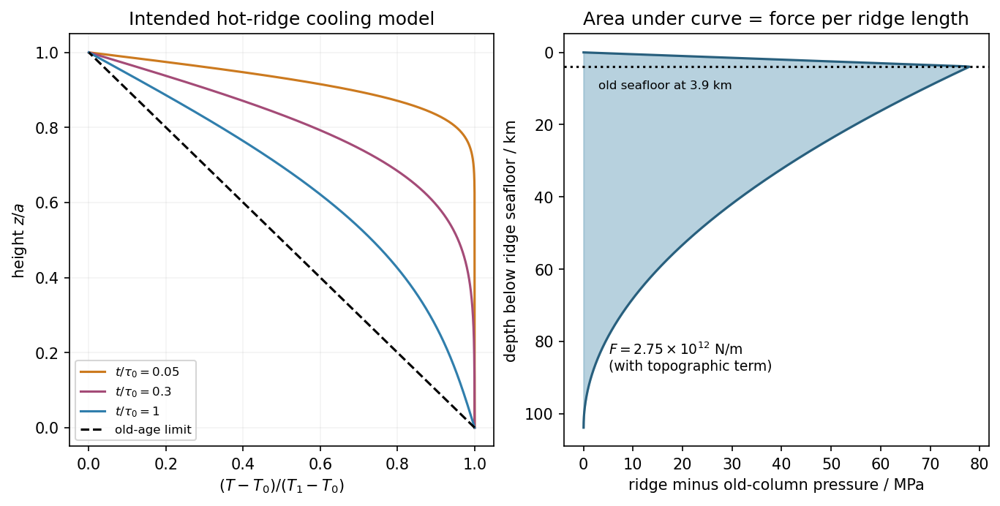
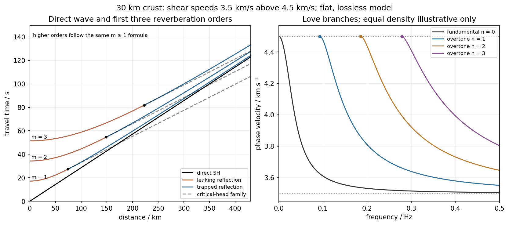

# Paper 1

↑ **Parent:** [2013](../2013.md)

[Original public PDF, physical pages 556–559; examination dated 16 January 2013; Figure 1 follows END OF PAPER](https://www.whatdotheyknow.com/request/natural_science_tripos_physics_e_2/response/2340776/attach/2/FOI%202023%20399%20Zahid%20materials.pdf?cookie_passthrough=1#page=556)

**Table of contents**

- [1](#1)
  - [a](#1/a)
    - [Solution](#1/a/solution)
    - [i](#1/a/i)
      - [Solution](#1/a/i/solution)
    - [ii](#1/a/ii)
      - [Solution](#1/a/ii/solution)
    - [iii](#1/a/iii)
      - [Solution](#1/a/iii/solution)
    - [iv](#1/a/iv)
      - [Solution](#1/a/iv/solution)
  - [b](#1/b)
    - [Solution](#1/b/solution)
  - [c](#1/c)
    - [Solution](#1/c/solution)
  - [d](#1/d)
    - [Solution](#1/d/solution)
  - [e](#1/e)
    - [Solution](#1/e/solution)
- [2](#2)
  - [a](#2/a)
    - [Solution](#2/a/solution)
  - [b](#2/b)
    - [Solution](#2/b/solution)
- [3](#3)
  - [a](#3/a)
    - [Solution](#3/a/solution)
  - [b](#3/b)
    - [Solution](#3/b/solution)
  - [c](#3/c)
    - [Solution](#3/c/solution)
  - [d](#3/d)
    - [Solution](#3/d/solution)

## 1

↑ **Parent:** [Paper 1](paper-1.md)

<h3 id="1/a">a</h3>

↑ **Parent:** [1](#1)

<h4 id="1/a/solution">Solution</h4>

↑ **Parent:** [A](#1/a)

In the [oceanic plate cooling model](../../geophysics.md#oceanic-plate-cooling-model), $T$ is [temperature](../../temperature.md), $z$ height above the plate base, $a$ plate thickness, and $t$ age since formation at the spreading axis. With [half-spreading rate](../../geophysics.md#half-spreading-rate) $v$, a parcel at distance $x$ has $t=x/v$. The surface and basal [temperatures](../../temperature.md) are $T_0$ and $T_1$ respectively. The positive integer $n$ labels a sine [diffusion](../../thermodynamics.md#diffusion) mode. For constant [thermal diffusivity](../../heat.md#thermal-diffusivity) $\kappa$,

$$
\boxed{\tau_0=\frac{a^2}{\pi^2\kappa}.}
$$

Substituting one sine mode into $T_t=\kappa T_{zz}$ fixes this normalization; $a^2/\kappa$ itself is the [diffusion](../../thermodynamics.md#diffusion) timescale before the factor $\pi^2$.

**Source qualification.** The printed transient coefficients have the wrong sign for the intended initially hot plate. Indeed, in the interior,

$$
\sum_{n\geq1}\frac{2(-1)^n}{n\pi}\sin\frac{n\pi z}{a}=-\frac za.
$$

Thus the literal zero-age profile is $T_0+\Delta T(1-2z/a)$, where $\Delta T=T_1-T_0$, rather than $T_1$. It would even approach $T_0-\Delta T$ from inside the upper boundary. The intended hot-ridge cooling solution reverses the transient sign, using $2(-1)^{n+1}/(n\pi)$. Both versions have the same boundary [temperatures](../../temperature.md) and old-age limit. Part (b) gives both surface-flux expressions; the physical ridge-elevation and ridge-push calculations explicitly use the hot initial plate. This sign is present in the original PDF as well as the held transcription.

<h4 id="1/a/i">i</h4>

↑ **Parent:** [A](#1/a)

<h5 id="1/a/i/solution">Solution</h5>

↑ **Parent:** [I](#1/a/i)

At the top, **$T(a,t)=T_0$**. Ocean water provides a cold [thermal reservoir](../../thermal-equilibrium.md#heat-bath) relative to [mantle](../../geophysics.md#planetary-mantle) [temperatures](../../temperature.md), so a fixed surface [temperature](../../temperature.md) is a useful idealization. The model does not resolve near-axis hydrothermal circulation or spatially variable bottom-water [temperatures](../../temperature.md).

<h4 id="1/a/ii">ii</h4>

↑ **Parent:** [A](#1/a)

<h5 id="1/a/ii/solution">Solution</h5>

↑ **Parent:** [Ii](#1/a/ii)

At the ridge axis, **$T(z,0)=T_1$ for $0<z<a$** in the intended cooling model. Upwelling and magmatic [heat](../../heat.md) supply continually bring hot material into the newly formed plate. The abrupt meeting of this hot interior with the cold upper boundary is an idealized corner discontinuity, resolved diffusively for $t>0$. The printed series fails this [initial condition](../../differential-equation.md#initial-condition), as shown in the parent Solution.

<h4 id="1/a/iii">iii</h4>

↑ **Parent:** [A](#1/a)

<h5 id="1/a/iii/solution">Solution</h5>

↑ **Parent:** [Iii](#1/a/iii)

At the bottom, **$T(0,t)=T_1$**. Convecting [mantle](../../geophysics.md#planetary-mantle) is treated as maintaining the basal [temperature](../../temperature.md) and supplying [heat](../../heat.md) to the plate. This is a prescribed thermal boundary at fixed thickness, not a claim that the real mechanical base is an impermeable material interface.

<h4 id="1/a/iv">iv</h4>

↑ **Parent:** [A](#1/a)

<h5 id="1/a/iv/solution">Solution</h5>

↑ **Parent:** [Iv](#1/a/iv)

Far from the ridge, **$T(z,\infty)=T_0+\Delta T(1-z/a)$**. Transients have decayed and the [heat equation](../../diffusion-equation.md#heat-equation) reduces to $T_{zz}=0$. A finite basal [heat](../../heat.md) supply sustains this [gradient](../../multivariable-calculus.md#gradient). Thermal thickness, seafloor depth and surface [heat](../../heat.md) flux therefore approach finite limits rather than continuing the laws of the [half-space cooling model](../../geophysics.md#half-space-cooling-model) indefinitely.

<h3 id="1/b">b</h3>

↑ **Parent:** [1](#1)

<h4 id="1/b/solution">Solution</h4>

↑ **Parent:** [B](#1/b)

Take positive [heat](../../heat.md) flux upwards, along increasing $z$, and denote [thermal conductivity](../../heat.md#thermal-conductivity) by $k$. [Fourier's law](../../heat.md#fourier-s-law) gives $q_s=-kT_z|_{z=a}$. Since $\cos(n\pi)=(-1)^n$, [differentiation](../../calculus.md#differentiation) of the literal printed expression gives

$$
\boxed{q_{s,\rm printed}(t)=\frac{k\Delta T}{a}
\left[1-2\sum_{n=1}^\infty e^{-n^2t/\tau_0}\right].}
$$

Its negative young-age flux is another sign of the unphysical initial profile. For the explicitly corrected hot initial plate, the [surface heat flux of a cooling plate](../../geophysics.md#surface-heat-flux-of-a-cooling-plate) is instead

$$
\boxed{q_s(t)=\frac{k\Delta T}{a}
\left[1+2\sum_{n=1}^\infty e^{-n^2t/\tau_0}\right].}
$$

The old-age limit is $k\Delta T/a$. For $t\ll\tau_0$, replacing the Gaussian sum by its leading [integral](../../integral.md) gives $q_s\sim k\Delta T/\sqrt{\pi\kappa t}$, recovering the [half-space cooling model](../../geophysics.md#half-space-cooling-model). Neither $k$ nor $\kappa$ is numerically specified, so the age-dependent flux remains symbolic as requested.

<h3 id="1/c">c</h3>

↑ **Parent:** [1](#1)

<h4 id="1/c/solution">Solution</h4>

↑ **Parent:** [C](#1/c)

Use the intended hot-ridge state and a linear law of [thermal expansion](../../thermodynamics.md#thermal-expansion) about [mantle](../../geophysics.md#planetary-mantle) [density](../../fluid-mechanics.md#density) $\rho_m$ at $T_1$. Let $s$ be depth below the old seafloor. Its excess [density](../../fluid-mechanics.md#density) is

$$
\delta\rho(s)=\rho_m\alpha\Delta T(1-s/a),\qquad 0<s<a,
$$

and its excess column [mass](../../classical-mechanics.md#mass) is $\int_0^a\delta\rho\,ds=\rho_m\alpha\Delta T a/2$. [Isostasy](../../geophysics.md#isostasy) requires equal [pressure](../../pressure.md) at a compensation depth below both columns. Lowering the old seafloor by $h$ replaces rock by water, reducing column [mass](../../classical-mechanics.md#mass) by $(\rho_m-\rho_w)h$. Therefore the [isostatic ridge elevation in a plate model](../../geophysics.md#isostatic-ridge-elevation-in-a-plate-model) is

$$
\boxed{h=\frac{\rho_m\alpha\Delta T a}{2(\rho_m-\rho_w)}
=3.90\times10^3\,\mathrm m=3.9\,\mathrm{km}.}
$$

Here $\alpha\Delta T=0.052$; the result is a first-order estimate and neglects sediments, crustal-composition differences and flexural support. If one instead insists on the literal printed zero-age profile, its column is denser than the old plate and the formal relative elevation reverses sign, $-3.9\,\mathrm{km}$ to this order. **That profile cannot describe the elevated hot ridge posited by the question.**

<h3 id="1/d">d</h3>

↑ **Parent:** [1](#1)

<h4 id="1/d/solution">Solution</h4>

↑ **Parent:** [D](#1/d)

[Ridge push](../../geophysics.md#ridge-push) is a horizontal [pressure](../../pressure.md) [force](../../force.md) integrated with depth, equivalently a difference in gravitational [potential energy](../../energy.md#potential-energy) per horizontal [area](../../differential-geometry.md#surface-area). It is not the weight of a slab multiplied by the surface slope at one chosen point.

For an explicit compensated-column derivation, let $y$ measure depth below the ridge seafloor; the old seafloor is at $y=h$. Set $b=\rho_m\alpha\Delta T$. The hot column has greater [pressure](../../pressure.md). Its [pressure](../../pressure.md) excess over the old column is

$$
\Delta p(y)=\begin{cases}
g(\rho_m-\rho_w)y,&0<y<h,\\
\dfrac{gb}{2a}(a-s)^2,&y=h+s,\quad0<s<a,\\
0,&y>h+a.
\end{cases}
$$

The second line follows by integrating $\delta\rho(s)=b(1-s/a)$ upwards from the compensation level. The two expressions agree at $y=h$ because $(\rho_m-\rho_w)h=ba/2$. Integrating this positive [pressure](../../pressure.md) excess gives the [ridge-push force in a plate model](../../geophysics.md#ridge-push-force-in-a-plate-model), directed away from the ridge:

$$
F=\int\Delta p\,dy
=\frac{\rho_mg\alpha\Delta T a^2}{6}
+\frac{g(\rho_m-\rho_w)h^2}{2}.
$$

Consistently retaining only first order in [thermal expansion](../../thermodynamics.md#thermal-expansion) gives

$$
\boxed{F\simeq2.60\times10^{12}\,\mathrm{N\,m^{-1}}.}
$$

If the topographic term is retained within the same linear-density column model, it adds $1.52\times10^{11}\,\mathrm{N\,m^{-1}}$, giving **$F\simeq2.75\times10^{12}\,\mathrm{N\,m^{-1}}$**. This is a useful small correction, not a claim that all other second-order material effects have been included. Both values use the intended hot initial plate, not the inconsistent printed zero-age profile.

**[Figure 1](#1/d/image-hot-ridge-and-old-plate-columns-and-their-compensated-pressure-difference-in-the-intended-cooling-model). Hot-ridge and old-plate columns, and their compensated pressure difference in the intended cooling model**.

<h3 id="1/e">e</h3>

↑ **Parent:** [1](#1)

<h4 id="1/e/solution">Solution</h4>

↑ **Parent:** [E](#1/e)

The depth-averaged added horizontal compressive [stress](../../continuum-mechanics.md#stress) is $\bar\sigma=F/a$. Resolving its [traction](../../continuum-mechanics.md#traction) on a plane dipping at angle $\delta$ gives the [fault shear stress from a plate-integrated force](../../viscous-fluid-flow.md#fault-shear-stress-from-a-plate-integrated-force),

$$
\bar\tau=\bar\sigma\sin\delta\cos\delta,
\qquad
\boxed{|\bar\tau|=\frac{F}{2a}\simeq1.30\times10^7\,\mathrm{Pa}=13\,\mathrm{MPa}
\quad(\delta=45^\circ).}
$$

Keeping the previous topographic correction gives about $13.8\,\mathrm{MPa}$. This is the mean additional shear from [ridge push](../../geophysics.md#ridge-push), assuming the [force](../../force.md) is transmitted through thickness $a$ and resolving the nonisotropic [stress](../../continuum-mechanics.md#stress) increment. An isotropic lithostatic [pressure](../../pressure.md) adds normal [traction](../../continuum-mechanics.md#traction) but no shear. The [force](../../force.md) [integral](../../integral.md) alone does not specify the local [stress](../../continuum-mechanics.md#stress) at each point on the [fault](../../geophysics.md#geological-fault) or establish failure.

## 2

↑ **Parent:** [Paper 1](paper-1.md)

<h3 id="2/a">a</h3>

↑ **Parent:** [2](#2)

<h4 id="2/a/solution">Solution</h4>

↑ **Parent:** [A](#2/a)

**Oceanic [magnetic anomalies](../../geophysics.md#magnetic-anomaly).** Newly formed oceanic [crust](../../geophysics.md#planetary-crust) contains magnetic minerals. As it cools through their [magnetic blocking temperatures](../../electromagnetism.md#magnetic-blocking-temperature), it acquires [thermoremanent magnetization](../../geophysics.md#thermoremanent-magnetization) recording the ambient field polarity. Continuing [seafloor spreading](../../geophysics.md#seafloor-spreading) carries that record away from the ridge. [Geomagnetic reversals](../../planetary-science.md#geomagnetic-reversal) therefore generate approximately paired [marine magnetic stripes](../../geophysics.md#marine-magnetic-stripe) parallel to the ridge, with older [crust](../../geophysics.md#planetary-crust) farther from its axis. A [magnetometer](../../electromagnetism.md#magnetometer) measures the superposed field above this magnetized material; subtracting a reference field reveals [magnetic anomalies](../../geophysics.md#magnetic-anomaly). The anomaly sign and shape depend on [magnetization](../../electromagnetism.md#magnetization) direction, latitude, source depth and geometry, so a positive measured anomaly is not universally identical to normal rock polarity.[Sections Magnetic striping and polar reversals, and Seafloor spreading and recycling of oceanic crust](../../physics-bibliography.md#developing-the-theory-by-united-states-geological-survey)

Matching a sequence of stripes to an independently dated reversal chronology gives plate ages and spreading histories. A stripe of width $w$ formed over interval $\Delta t$ implies [half-spreading rate](../../geophysics.md#half-spreading-rate) $v=w/\Delta t$ under steady symmetric spreading; full separation [speed](../../classical-mechanics.md#speed) is $2v$. Unequal widths on opposite flanks can reflect asymmetric spreading or later deformation. Alteration, remagnetization and overlapping magnetic sources complicate inversion. **The sequence correlation is stronger evidence than an isolated stripe or a field-strength peak.**

**[Rayleigh-Bénard convection](../../viscous-fluid-flow.md#rayleigh-benard-convection).** Consider a horizontal fluid layer of thickness $d$, hotter below by $\Delta T>0$. The conductive state is motionless with a linear [temperature](../../temperature.md) [gradient](../../multivariable-calculus.md#gradient). A rising warm parcel is buoyant, but [viscosity](../../dynamic-viscosity.md) resists its motion and thermal [diffusion](../../thermodynamics.md#diffusion) erases its [temperature](../../temperature.md) anomaly. In the [Boussinesq approximation](../../geophysical-fluid-dynamics.md#boussinesq-approximation), [density](../../fluid-mechanics.md#density) variations are retained in [buoyancy](../../fluid-mechanics.md#buoyancy) while the flow is otherwise incompressible. The competing effects are measured by the [Rayleigh number](../../geophysics.md#rayleigh-number) and [Prandtl number](../../heat.md#prandtl-number),

$$
\operatorname{Ra}=\frac{g\alpha\Delta T d^3}{\nu\kappa},\qquad
\operatorname{Pr}=\frac\nu\kappa.
$$

For stress-free impermeable, fixed-temperature boundaries, linear stationary disturbances with horizontal [wavenumber](../../wave-equation.md#wavenumber) $q/d$ give

$$
\operatorname{Ra}(q)=\frac{(q^2+\pi^2)^3}{q^2}.
$$

Minimizing gives $q_c=\pi/\sqrt2$ and the [critical Rayleigh number for an isothermal layer](../../viscous-fluid-flow.md#critical-rayleigh-number-for-an-isothermal-layer), $\operatorname{Ra}_c=27\pi^4/4\simeq657.5$. Two rigid no-slip, fixed-temperature boundaries instead give approximately $1708$; the critical value is not independent of [boundary conditions](../../differential-equation.md#boundary-condition).[Chapter 20, §20.4, critical value for two rigid isothermal plates](../../physics-bibliography.md#boundary-layer-turbulence-by-massachusetts-institute-of-technology)

Above onset, [buoyancy](../../fluid-mechanics.md#buoyancy) can sustain overturning rolls and [heat](../../heat.md) transfer exceeds pure conduction, with [Nusselt number](../../heat.md#nusselt-number) $\operatorname{Nu}>1$. Nonlinear advection eventually limits the disturbance; larger driving can produce time-dependent or turbulent states. The ideal Boussinesq problem does not require hexagonal cells: planform selection depends on boundaries and non-Boussinesq effects. [Convection](../../convection.md) driven by [surface tension](../../surface-tension.md) at a [free surface](../../fluid-mechanics.md#free-surface) is a distinct mechanism. **An adverse [temperature](../../temperature.md) [gradient](../../multivariable-calculus.md#gradient) supplies driving, but overcoming [diffusion](../../thermodynamics.md#diffusion) and [viscosity](../../dynamic-viscosity.md) requires a finite threshold.**

<h3 id="2/b">b</h3>

↑ **Parent:** [2](#2)

<h4 id="2/b/solution">Solution</h4>

↑ **Parent:** [B](#2/b)

**[Earthquake](../../geophysics.md#earthquake) location.** The [hypocentre](../../geophysics.md#hypocenter) is rupture initiation; its surface projection is the [epicentre](../../geophysics.md#epicenter). Record calibrated arrival times at stations of known coordinates, identify [P wave](../../wave-equation.md#p-wave) and [S wave](../../wave-equation.md#s-wave) phases, and predict their [travel times](../../dispersion-relation.md#travel-time) through a stated [velocity](../../classical-mechanics.md#velocity) model. [Earthquake location by arrival times](../../geophysics.md#earthquake-location-by-arrival-times) fits

$$
t_i=t_0+T_i(\mathbf x),
$$

for the three source coordinates and origin time $t_0$. [Linearization](../../algebra.md#linearization) supplies residual equations $\delta t_i=\delta t_0+\nabla T_i\cdot\delta\mathbf x$. A grid search or iterative [weighted least squares](../../normal-linear-model.md#weighted-least-squares) inversion can use pick uncertainties, while station geometry controls whether those parameters are well constrained. Four independent arrival constraints are the minimum for four unknowns, not a guarantee of a reliable solution.

In a homogeneous medium, an arrival-time difference between an [S wave](../../wave-equation.md#s-wave) and a [P wave](../../wave-equation.md#p-wave) cancels origin time and estimates source-to-station distance,

$$
r=\frac{t_S-t_P}{1/v_S-1/v_P}.
$$

Several distances intersect to locate the event; real layered or three-dimensional [Earth](../../planetary-science.md#earth) structure requires curved-ray [travel times](../../dispersion-relation.md#travel-time). Nearby stations and diverse takeoff angles help resolve depth. Clock errors, phase misidentification, poor azimuthal coverage and incorrect [velocities](../../classical-mechanics.md#velocity) introduce uncertainty or systematic bias. Closely spaced [earthquakes](../../geophysics.md#earthquake) can be relocated precisely relative to each other because common-path errors partly cancel, even when their absolute locations remain uncertain. **Report a location uncertainty and model assumptions, not merely a best-fit point.**

**[H. F. Reid](../../geophysics.md#h-f-reid)'s earthquake-cycle model.** A [fault](../../geophysics.md#geological-fault) can remain locked while long-term tectonic motion slowly deforms the surrounding rocks. Elastic [strain](../../continuum-mechanics.md#strain) [energy](../../energy.md) and [shear stress](../../viscous-fluid-flow.md#shear-stress) accumulate. When resistance is overcome, rapid [fault slip](../../geophysics.md#fault-slip) releases part of that stored [energy](../../energy.md) as seismic waves, frictional [heat](../../heat.md) and other irreversible [work](../../energy.md#work). The adjoining rocks partly recover their elastic distortion while retaining a permanent displacement discontinuity across the [fault](../../geophysics.md#geological-fault): this is [elastic rebound](../../geophysics.md#elastic-rebound-model). Surface markers initially crossing the [fault](../../geophysics.md#geological-fault) become bent during loading and offset after slip.[Explanation of gradual strain accumulation, sudden release and the displaced fence; cites Reid's 1910 report, especially pp. 16–28](../../physics-bibliography.md#reid-s-elastic-rebound-theory-by-united-states-geological-survey)

A simple sketch is a slow rise of [stress](../../continuum-mechanics.md#stress) followed by a rapid [stress](../../continuum-mechanics.md#stress) drop, then renewed loading; the plate displacement continues throughout. Geodetic deformation, observed [fault](../../geophysics.md#geological-fault) offsets and [earthquake](../../geophysics.md#earthquake) [stress](../../continuum-mechanics.md#stress) changes can test the picture. Actual cycles need not repeat with identical slips or times: creep, afterslip, [stress](../../continuum-mechanics.md#stress) transfer and heterogeneous [friction](../../newtonian-mechanics.md#friction) complicate the idealization. The release need not remove all pre-existing [stress](../../continuum-mechanics.md#stress). **[Elastic rebound](../../geophysics.md#elastic-rebound-model) explains storage and release; it is not a deterministic [earthquake](../../geophysics.md#earthquake) clock.**

**[Figure 2](#2/b/image-schematic-magnetic-stripes-convection-rolls-arrival-distance-constraints-and-elastic-loading-release-cycle-no-measured-data). Schematic magnetic stripes, convection rolls, arrival-distance constraints and elastic loading–release cycle; no measured data**.

## 3

↑ **Parent:** [Paper 1](paper-1.md)

<h3 id="3/a">a</h3>

↑ **Parent:** [3](#3)

<h4 id="3/a/solution">Solution</h4>

↑ **Parent:** [A](#3/a)

For [group velocity from a period-dependent phase velocity](../../dispersion-relation.md#group-velocity-from-a-period-dependent-phase-velocity), start with $k=\omega/c_n(\omega)$ rather than equating [group velocity](../../dispersion-relation.md#group-velocity) to [phase velocity](../../dispersion-relation.md#phase-velocity). Differentiating,

$$
\frac1{u_n}=\frac{dk}{d\omega}=\frac1{c_n}-\frac{\omega}{c_n^2}\frac{dc_n}{d\omega}.
$$

For the stated inverse-frequency term, $dc_n/d\omega=-a/\omega^2$, so

$$
\boxed{\frac{u_n}{c_n}=\frac1{1+a/(\omega c_n)}
=\frac{c_n}{c_n+a/\omega},\qquad
u_n=\frac{c_n^2}{c_n+a/\omega}<c_n.}
$$

The inequality assumes positive [frequency](../../wave.md#frequency) and physical positive [phase velocity](../../dispersion-relation.md#phase-velocity), with $a>0$. The symbol $a$ here has units of acceleration and is unrelated to the plate thickness in Question 1.

<h3 id="3/b">b</h3>

↑ **Parent:** [3](#3)

<h4 id="3/b/solution">Solution</h4>

↑ **Parent:** [B](#3/b)

Write the oscillation [period](../../mathematics.md#period-of-a-function) as $P=2\pi/\omega$, so locally $c_n=c_o+(a/2\pi)P$. The [first overtone](../../wave-equation.md#first-overtone) is the lowest curve above the fundamental, not the [fundamental mode](../../wave-equation.md#fundamental-mode) itself. Near $P=50\,\mathrm s$, Figure 1 gives approximately $c_1=5.13\,\mathrm{km\,s^{-1}}$. Representative nearby readings are about $4.96\,\mathrm{km\,s^{-1}}$ at $40\,\mathrm s$ and $5.30\,\mathrm{km\,s^{-1}}$ at $60\,\mathrm s$. Thus

$$
\left.\frac{dc_1}{dP}\right|_{50\,\mathrm s}\simeq0.017\,\mathrm{km\,s^{-2}},\qquad
\boxed{a\simeq2\pi(0.017)\simeq0.11\,\mathrm{km\,s^{-2}}
\simeq1.1\times10^2\,\mathrm{m\,s^{-2}}.}
$$

The local group-velocity estimate is

$$
\boxed{u_1\simeq\frac{5.13}{1+50(0.017)/5.13}
\simeq4.4\,\mathrm{km\,s^{-1}}.}
$$

These are graphical estimates, roughly $a=0.11\pm0.02\,\mathrm{km\,s^{-2}}$ and $u_1=4.4\pm0.1\,\mathrm{km\,s^{-1}}$, rather than high-precision fitted constants. The nearby straight-line approximation need not describe that mode over the whole plotted [period](../../mathematics.md#period-of-a-function) range. No source curve is reproduced here.

<h3 id="3/c">c</h3>

↑ **Parent:** [3](#3)

<h4 id="3/c/solution">Solution</h4>

↑ **Parent:** [C](#3/c)

The [phase velocity](../../dispersion-relation.md#phase-velocity) in Figure 1 is measured along the [Earth](../../planetary-science.md#earth)'s surface. Spherical geometry makes the local horizontal phase [speed](../../classical-mechanics.md#speed) at radius $r$ equal to $cr/R_E$. In the ray approximation, squared radial shear [wavenumber](../../wave-equation.md#wavenumber) is

$$
q_r^2=\omega^2\left[\frac1{\beta(r)^2}-\frac{R_E^2}{c^2r^2}\right].
$$

The [spherical surface-wave evanescence threshold](../../geophysics.md#spherical-surface-wave-evanescence-threshold) immediately below the discontinuity is therefore

$$
\boxed{c<5.08\frac{6371}{6371-410}
\simeq5.43\,\mathrm{km\,s^{-1}}.}
$$

Equality is the grazing limit. Using $5.08\,\mathrm{km\,s^{-1}}$ directly would omit the requested spherical correction. Immediately above the discontinuity the corresponding boundary is $4.87(6371/5961)\simeq5.20\,\mathrm{km\,s^{-1}}$. Hence the interval $5.20<c<5.43\,\mathrm{km\,s^{-1}}$ specifically describes propagation just above the jump and evanescence just below it. Slower modes can already be evanescent above $410\,\mathrm{km}$.

Intersecting the plotted branches with $5.43\,\mathrm{km\,s^{-1}}$ gives the following approximate upper [periods](../../mathematics.md#period-of-a-function). Below each upper [period](../../mathematics.md#period-of-a-function), that branch is evanescent immediately beneath the discontinuity:

- [fundamental mode](../../wave-equation.md#fundamental-mode): throughout the displayed $10$–$100\,\mathrm s$ range;
- first and second [overtones](../../wave-equation.md#overtone): approximately $67$ and $38\,\mathrm s$;
- successive higher curves: approximately $27$, $21$, $18$, $15$, $13$ and $11\,\mathrm s$.

For these [overtones](../../wave-equation.md#overtone) the displayed ranges thus start near $10\,\mathrm s$ and end at their respective crossings. Any still higher curve already above the threshold at the lower plotted [period](../../mathematics.md#period-of-a-function) has no evanescent interval within the displayed range. Readings of the closely spaced higher curves are only accurate to about a second, and the plot does not establish their continuation to unshown [periods](../../mathematics.md#period-of-a-function). Nor does the local inequality prove that a mode remains evanescent at every greater depth in an unspecified [Earth](../../planetary-science.md#earth) model.

<h3 id="3/d">d</h3>

↑ **Parent:** [3](#3)

<h4 id="3/d/solution">Solution</h4>

↑ **Parent:** [D](#3/d)

Use the flat two-layer model, with thickness $h=30\,\mathrm{km}$, crustal shear [speed](../../classical-mechanics.md#speed) $\beta_1=3.5\,\mathrm{km\,s^{-1}}$ and [mantle](../../geophysics.md#planetary-mantle) [speed](../../classical-mechanics.md#speed) $\beta_2=4.5\,\mathrm{km\,s^{-1}}$. For [SH-wave travel times in a crustal waveguide](../../wave-equation.md#sh-wave-travel-times-in-a-crustal-waveguide), unfolding each reflected path gives all [reflection](../../linear-algebra.md#reflection-mathematics) orders at once:

$$
\boxed{t_D=\frac x{3.5},\qquad
t_m=\frac{\sqrt{x^2+(60m)^2}}{3.5},\quad m=1,2,\ldots,}
$$

with $x$ in kilometres and times in seconds. The direct wave begins at the origin; reflected orders have intercepts $60m/3.5=17.14m\,\mathrm s$ and approach the direct-wave slope at large distance.

The critical angle, measured from the vertical, is $i_c=\arcsin(3.5/4.5)\simeq51.1^\circ$. Associated critical [refraction](../../optics.md#refraction) and its multiples give

$$
\boxed{t_{H,m}=\frac x{4.5}+2mh\sqrt{\beta_1^{-2}-\beta_2^{-2}}
=\frac x{4.5}+10.77m,\qquad
x\geq x_{c,m}=2mh\tan i_c\simeq74.25m\,\mathrm{km}.}
$$

Each head-wave line is tangent to its [reflection](../../linear-algebra.md#reflection-mathematics) curve at the critical distance. In particular the primary head wave exists before it becomes the first arrival; it overtakes the direct wave only around $170\,\mathrm{km}$.

The slope of a reflected travel-time curve is $p=dt_m/dx=\sin i/\beta_1$. For $x<x_{c,m}$, $p<1/\beta_2$, so the [mantle](../../geophysics.md#planetary-mantle) supports outgoing shear radiation and successive reverberations leak [energy](../../energy.md). For $x>x_{c,m}$, $1/\beta_2<p<1/\beta_1$: the [mantle](../../geophysics.md#planetary-mantle) field is evanescent and ideal interface [reflection](../../linear-algebra.md#reflection-mathematics) is total. These [leaking and trapped SH-wave reverberations](../../wave-equation.md#leaking-and-trapped-sh-wave-reverberations) explain the annotations in the original travel-time drawing below. A reflected ray is not itself a separate Love mode: constructive interference of the trapped contributions, including [reflection](../../linear-algebra.md#reflection-mathematics) phase, selects the [normal modes](../../wave-equation.md#normal-mode).

For a horizontally propagating mode with $\beta_1<c<\beta_2$, define vertical [wavenumbers](../../wave-equation.md#wavenumber)

$$
q=\omega\sqrt{\beta_1^{-2}-c^{-2}},\qquad
s=\omega\sqrt{c^{-2}-\beta_2^{-2}}.
$$

The free upper surface and welded interface impose the Love-wave [dispersion](../../dispersion-relation.md#wave-dispersion) condition

$$
\tan(qh)=\frac{\mu_2s}{\mu_1q},\qquad
qh=n\pi+\arctan\frac{\mu_2s}{\mu_1q},\quad n=0,1,2,\ldots,
$$

where $\mu_j=\rho_j\beta_j^2$ are shear moduli. Each phase-velocity branch falls towards $3.5\,\mathrm{km\,s^{-1}}$ with increasing [frequency](../../wave.md#frequency). Higher branches join $4.5\,\mathrm{km\,s^{-1}}$ at their low-frequency cutoffs. At cutoff $s\to0$, so

$$
\boxed{f_{c,n}=\frac{n}{2h\sqrt{\beta_1^{-2}-\beta_2^{-2}}}
\simeq0.0928n\,\mathrm{Hz}.}
$$

Thus the first three [overtones](../../wave-equation.md#overtone) have maximum [periods](../../mathematics.md#period-of-a-function) about $10.77$, $5.39$ and $3.59\,\mathrm s$. The [fundamental mode](../../wave-equation.md#fundamental-mode) has $n=0$ and **no positive-frequency cutoff in this flat layer-over-half-space model**: it approaches $c=\beta_2$ as $f\to0$, with ever-deeper penetration. The phase-velocity sketch uses an explicitly illustrative equal-density choice, because the question gives [speeds](../../classical-mechanics.md#speed) but no [density](../../fluid-mechanics.md#density) or rigidity ratio. That missing ratio changes detailed branch curvature, not the cutoff values or the requested branch topology.

For the actual finite spherical [Earth](../../planetary-science.md#earth), the very-long-period continuation must instead be described by discrete toroidal [normal modes](../../wave-equation.md#normal-mode), not a flat infinite [waveguide](../../wave.md#waveguide) at arbitrary [wavelength](../../wave-equation.md#wavelength). The flat-model answer therefore does not assert a continuum of arbitrarily low-frequency global nonrigid oscillations. A global lowest oscillation [frequency](../../wave.md#frequency) cannot be computed from the supplied crust-and-half-space data alone.[§4.18, Love-wave trapping; §4.23, finite spherical Earth and discrete normal modes, especially printed pp. 184–187](../../physics-bibliography.md#essentials-of-geophysics-seismology-by-r-d-van-der-hilst)

**[Figure 3](#3/d/image-accurate-direct-reflected-and-critical-head-travel-times-with-illustrative-fundamental-and-first-three-overtone-love-wave-branches). Accurate direct, reflected and critical-head travel times, with illustrative fundamental and first three overtone Love-wave branches**.

## ↑ Ancestors (11)

1. [2013](../2013.md)
2. [Past exam of the physics of the Earth as a Planet course of the University of Cambridge](../../past-exam-of-the-physics-of-the-earth-as-a-planet-course-of-the-university-of-cambridge.md)
3. [Physics of the Earth as a Planet course of the University of Cambridge](../../university-of-cambridge.md#physics-of-the-earth-as-a-planet-course-of-the-university-of-cambridge)
4. [Physics course of the year 4 of the natural sciences course of the University of Cambridge](../../university-of-cambridge.md#physics-course-of-the-year-4-of-the-natural-sciences-course-of-the-university-of-cambridge)
5. [Year 4 of the natural sciences course of the University of Cambridge](../../university-of-cambridge.md#year-4-of-the-natural-sciences-course-of-the-university-of-cambridge)
6. [Year of the natural sciences course of the University of Cambridge](../../university-of-cambridge.md#year-of-the-natural-sciences-course-of-the-university-of-cambridge)
7. [Natural sciences course of the University of Cambridge](../../university-of-cambridge.md#natural-sciences-course-of-the-university-of-cambridge)
8. [Course of the University of Cambridge](../../university-of-cambridge.md#course-of-the-university-of-cambridge)
9. [University of Cambridge](../../university-of-cambridge.md)
10. [List of universities](../../README.md#list-of-universities)
11. [Codex Wiki](../../README.md)
