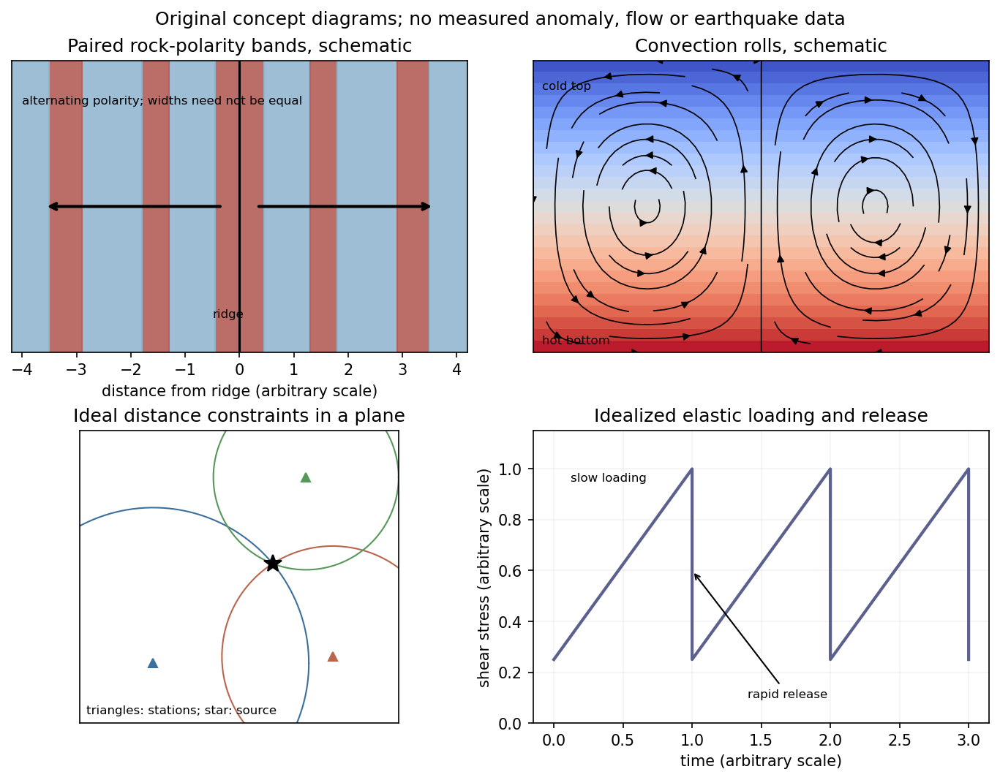

<h1 id="2/b/solution">Solution</h1>

↑ **Parent:** [B](../b.md)

**[Earthquake](../../../../../earthquake.md) location.** The [hypocentre](../../../../../hypocenter.md) is rupture initiation; its surface projection is the [epicentre](../../../../../epicenter.md). Record calibrated arrival times at stations of known coordinates, identify [P wave](../../../../../p-wave.md) and [S wave](../../../../../s-wave.md) phases, and predict their [travel times](../../../../../travel-time.md) through a stated [velocity](../../../../../velocity.md) model. [Earthquake location by arrival times](../../../../../earthquake-location-by-arrival-times.md) fits

$$
t_i=t_0+T_i(\mathbf x),
$$

for the three source coordinates and origin time $t_0$. [Linearization](../../../../../linearization.md) supplies residual equations $\delta t_i=\delta t_0+\nabla T_i\cdot\delta\mathbf x$. A grid search or iterative [weighted least squares](../../../../../weighted-least-squares.md) inversion can use pick uncertainties, while station geometry controls whether those parameters are well constrained. Four independent arrival constraints are the minimum for four unknowns, not a guarantee of a reliable solution.

In a homogeneous medium, an arrival-time difference between an [S wave](../../../../../s-wave.md) and a [P wave](../../../../../p-wave.md) cancels origin time and estimates source-to-station distance,

$$
r=\frac{t_S-t_P}{1/v_S-1/v_P}.
$$

Several distances intersect to locate the event; real layered or three-dimensional [Earth](../../../../../earth.md) structure requires curved-ray [travel times](../../../../../travel-time.md). Nearby stations and diverse takeoff angles help resolve depth. Clock errors, phase misidentification, poor azimuthal coverage and incorrect [velocities](../../../../../velocity.md) introduce uncertainty or systematic bias. Closely spaced [earthquakes](../../../../../earthquake.md) can be relocated precisely relative to each other because common-path errors partly cancel, even when their absolute locations remain uncertain. **Report a location uncertainty and model assumptions, not merely a best-fit point.**

**[H. F. Reid](../../../../../h-f-reid.md)'s earthquake-cycle model.** A [fault](../../../../../geological-fault.md) can remain locked while long-term tectonic motion slowly deforms the surrounding rocks. Elastic [strain](../../../../../strain.md) [energy](../../../../../energy-split.md) and [shear stress](../../../../../shear-stress.md) accumulate. When resistance is overcome, rapid [fault slip](../../../../../fault-slip.md) releases part of that stored [energy](../../../../../energy-split.md) as seismic waves, frictional [heat](../../../../../heat-split.md) and other irreversible [work](../../../../../work.md). The adjoining rocks partly recover their elastic distortion while retaining a permanent displacement discontinuity across the [fault](../../../../../geological-fault.md): this is [elastic rebound](../../../../../elastic-rebound-model.md). Surface markers initially crossing the [fault](../../../../../geological-fault.md) become bent during loading and offset after slip.[Explanation of gradual strain accumulation, sudden release and the displaced fence; cites Reid's 1910 report, especially pp. 16–28](../../../../../reid-s-elastic-rebound-theory-by-united-states-geological-survey.md)

A simple sketch is a slow rise of [stress](../../../../../stress.md) followed by a rapid [stress](../../../../../stress.md) drop, then renewed loading; the plate displacement continues throughout. Geodetic deformation, observed [fault](../../../../../geological-fault.md) offsets and [earthquake](../../../../../earthquake.md) [stress](../../../../../stress.md) changes can test the picture. Actual cycles need not repeat with identical slips or times: creep, afterslip, [stress](../../../../../stress.md) transfer and heterogeneous [friction](../../../../../friction.md) complicate the idealization. The release need not remove all pre-existing [stress](../../../../../stress.md). **[Elastic rebound](../../../../../elastic-rebound-model.md) explains storage and release; it is not a deterministic [earthquake](../../../../../earthquake.md) clock.**

**[Figure 2](#2/b/image-schematic-magnetic-stripes-convection-rolls-arrival-distance-constraints-and-elastic-loading-release-cycle-no-measured-data). Schematic magnetic stripes, convection rolls, arrival-distance constraints and elastic loading–release cycle; no measured data**.

## ↑ Ancestors (14)

1. [B](../b.md)
2. [2](../../2.md)
3. [Paper 1](../../../paper-1-split.md)
4. [2013](../../../split.md)
5. [Past exam of the physics of the Earth as a Planet course of the University of Cambridge](../../../../split.md)
6. [Physics of the Earth as a Planet course of the University of Cambridge](../../../../../physics-of-the-earth-as-a-planet-course-of-the-university-of-cambridge.md)
7. [Physics course of the year 4 of the natural sciences course of the University of Cambridge](../../../../../physics-course-of-the-year-4-of-the-natural-sciences-course-of-the-university-of-cambridge.md)
8. [Year 4 of the natural sciences course of the University of Cambridge](../../../../../year-4-of-the-natural-sciences-course-of-the-university-of-cambridge.md)
9. [Year of the natural sciences course of the University of Cambridge](../../../../../year-of-the-natural-sciences-course-of-the-university-of-cambridge.md)
10. [Natural sciences course of the University of Cambridge](../../../../../natural-sciences-course-of-the-university-of-cambridge.md)
11. [Course of the University of Cambridge](../../../../../course-of-the-university-of-cambridge.md)
12. [University of Cambridge](../../../../../university-of-cambridge-split.md)
13. [List of universities](../../../../../list-of-universities.md)
14. [Codex Wiki](../../../../../split.md)
