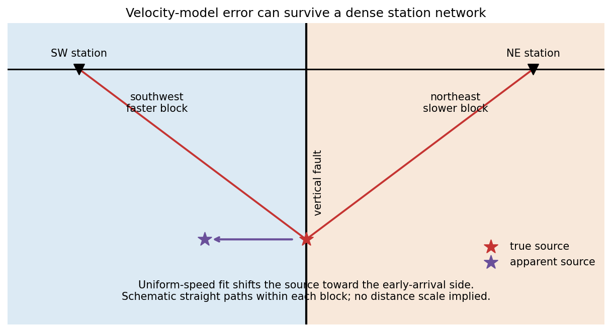

<h1 id="1/g/solution">Solution</h1>

↑ **Parent:** [G](../g.md)

A dense array does not correct an incorrect [velocity](../../../../../velocity.md) model. The faster southwest block permits shorter [travel times](../../../../../travel-time.md) than an assumed uniform medium, with [refraction](../../../../../refraction.md) favouring paths through fast rock. First arrivals may include refracted or [seismic head wave](../../../../../seismic-head-wave.md) paths rather than the assumed direct straight paths. Fitting those arrivals with one constant [speed](../../../../../speed.md) can make an [earthquake](../../../../../earthquake.md) on the fault appear closer to southwest stations and farther from northeast stations.

The sign follows even from a two-station [linearization](../../../../../linearization.md). Put southwest and northeast stations at $x=-L,+L$, and the true event at $x=0$ with depth $h$. In a constant-speed model,

$$
\delta(t_{\rm SW}-t_{\rm NE})
\simeq\frac{2L}{v\sqrt{L^2+h^2}}\,\delta x.
$$

A negative observed differential residual therefore produces **$\delta x<0$, an apparent southwest displacement**. A common origin-time adjustment cannot remove this directional residual. The stated kilometre-scale offset is a model bias, not proof that the fault dips towards the apparent [epicentres](../../../../../epicenter.md). Its exact magnitude cannot be predicted without the actual velocities and station geometry; the question supplies that magnitude as an observation.

The relevant contrast is independently documented at Parkfield: higher velocities lie southwest of the fault, with lower velocities northeast.[Velocity-structure discussion, higher speeds southwest and lower speeds northeast](../../../../../scientific-advances-at-parkfield-by-united-states-geological-survey.md) Account for the lateral structure and correct phases, then relocate and test whether the bias remains.

**[Figure 1](#1/g/image-illustrative-velocity-contrast-and-the-direction-of-a-constant-speed-location-bias). Illustrative velocity contrast and the direction of a constant-speed location bias**.

## ↑ Ancestors (14)

1. [G](../g.md)
2. [1](../../1.md)
3. [Paper 1](../../../paper-1-split.md)
4. [2014](../../../split.md)
5. [Past exam of the physics of the Earth as a Planet course of the University of Cambridge](../../../../split.md)
6. [Physics of the Earth as a Planet course of the University of Cambridge](../../../../../physics-of-the-earth-as-a-planet-course-of-the-university-of-cambridge.md)
7. [Physics course of the year 4 of the natural sciences course of the University of Cambridge](../../../../../physics-course-of-the-year-4-of-the-natural-sciences-course-of-the-university-of-cambridge.md)
8. [Year 4 of the natural sciences course of the University of Cambridge](../../../../../year-4-of-the-natural-sciences-course-of-the-university-of-cambridge.md)
9. [Year of the natural sciences course of the University of Cambridge](../../../../../year-of-the-natural-sciences-course-of-the-university-of-cambridge.md)
10. [Natural sciences course of the University of Cambridge](../../../../../natural-sciences-course-of-the-university-of-cambridge.md)
11. [Course of the University of Cambridge](../../../../../course-of-the-university-of-cambridge.md)
12. [University of Cambridge](../../../../../university-of-cambridge-split.md)
13. [List of universities](../../../../../list-of-universities.md)
14. [Codex Wiki](../../../../../split.md)
