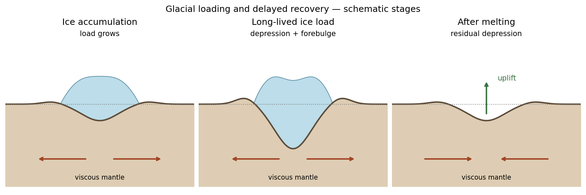

<h1 id="2/solution">Solution</h1>

↑ **Parent:** [2](../2.md)

Ice accumulation adds a load that produces an immediate elastic response and slower viscous displacement of the [mantle](../../../../planetary-mantle.md) away from the loaded region. The depressed interior may be accompanied by a peripheral forebulge. A long-lived load approaches an approximately compensated state. Melting removes the load, giving rapid elastic recovery followed by [mantle](../../../../planetary-mantle.md) return flow and gradual uplift. The forebulge can subside while the formerly loaded centre rises.

**[Postglacial rebound](../../../../postglacial-rebound.md) can continue long after the ice disappears**, because [mantle](../../../../planetary-mantle.md) relaxation is slow. Raised shorelines, changing relative sea level, vertical geodetic motion and [gravity](../../../../gravity.md) changes record [glacial isostatic adjustment](../../../../glacial-isostatic-adjustment.md). Present motion depends on the whole loading and melting history, [mantle](../../../../planetary-mantle.md) rheology and lithospheric stiffness, not only the current absence of ice.

**[Figure 2](#2/image-ice-loading-mantle-displacement-and-continuing-rebound-after-melting-schematic-stages). Ice loading, mantle displacement and continuing rebound after melting; schematic stages**.

## ↑ Ancestors (13)

1. [2](../2.md)
2. [Paper 1](../../paper-1-split.md)
3. [2014](../../split.md)
4. [Past exam of the physics of the Earth as a Planet course of the University of Cambridge](../../../split.md)
5. [Physics of the Earth as a Planet course of the University of Cambridge](../../../../physics-of-the-earth-as-a-planet-course-of-the-university-of-cambridge.md)
6. [Physics course of the year 4 of the natural sciences course of the University of Cambridge](../../../../physics-course-of-the-year-4-of-the-natural-sciences-course-of-the-university-of-cambridge.md)
7. [Year 4 of the natural sciences course of the University of Cambridge](../../../../year-4-of-the-natural-sciences-course-of-the-university-of-cambridge.md)
8. [Year of the natural sciences course of the University of Cambridge](../../../../year-of-the-natural-sciences-course-of-the-university-of-cambridge.md)
9. [Natural sciences course of the University of Cambridge](../../../../natural-sciences-course-of-the-university-of-cambridge.md)
10. [Course of the University of Cambridge](../../../../course-of-the-university-of-cambridge.md)
11. [University of Cambridge](../../../../university-of-cambridge-split.md)
12. [List of universities](../../../../list-of-universities.md)
13. [Codex Wiki](../../../../split.md)
