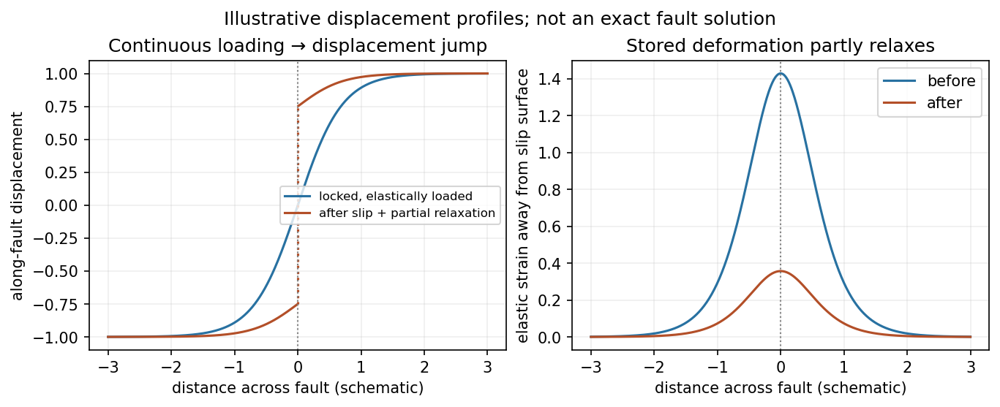
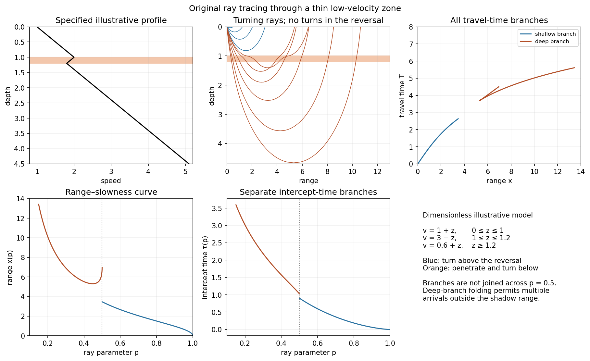

<h1 id="3/a/solution">Solution</h1>

↑ **Parent:** [A](../a.md)

**[Elastic rebound](../../../../../elastic-rebound-model.md).** Tectonic motion loads a fault whose shallow portion is locked. Rock on either side deforms and stores elastic [strain](../../../../../strain.md) [energy](../../../../../energy-split.md) while slip is inhibited. When failure permits rapid slip, part of the stored [energy](../../../../../energy-split.md) becomes seismic radiation and part is dissipated in [friction](../../../../../friction.md) and damage. The adjacent rock partly relaxes, while a permanent displacement remains across the fault. Geodetic [strain](../../../../../strain.md) accumulation and coseismic offsets support this loading–release picture.[Explanation of accumulated elastic strain, release and permanent fault offset](../../../../../reid-s-elastic-rebound-theory-by-united-states-geological-survey.md)

The model is useful for brittle crustal faulting but is not a prediction of precise recurrence, rupture size or frictional evolution. Aseismic creep can release deformation without a large sudden event. Viscoelastic flow, afterslip, fluid-pressure changes and interacting fault segments complicate a simple locked-fault cycle. Deep-focus [earthquakes](../../../../../earthquake.md) and non-shear source components require additional physics; not every [earthquake](../../../../../earthquake.md) source is adequately described by a shallow brittle double couple. Rebound also need not release all the pre-existing [stress](../../../../../stress.md).

**[Figure 3](#3/a/image-original-displacement-profile-schematic-of-locked-loading-and-permanent-slip-after-relaxation). Original displacement-profile schematic of locked loading and permanent slip after relaxation**.

**A thin negative-gradient [velocity](../../../../../velocity.md) zone.** In horizontal layering, use the [seismic ray parameter](../../../../../seismic-ray-parameter-in-horizontal-layering.md) $p=\sin i/v$, the conserved horizontal [slowness](../../../../../slowness.md). A ray turns when $pv=1$. Downward passage through decreasing [speed](../../../../../speed.md) makes $pv$ smaller, so a surface ray cannot turn in the negative-gradient interior. Rays either turn above the zone or penetrate it and turn below where [speed](../../../../../speed.md) has recovered sufficiently. This produces missing turning depths and a [seismic shadow range from a low-velocity zone](../../../../../seismic-shadow-range-from-a-low-velocity-zone.md) in the ideal ray model.

Retain all branches using

$$
x(p)=2\int_0^{z_t}\frac{pv(z)}{\sqrt{1-p^2v(z)^2}}\,dz,
\qquad
T(p)=2\int_0^{z_t}\frac{dz}{v(z)\sqrt{1-p^2v(z)^2}}.
$$

The travel-time slope is $dT/dx=p$. Just below the critical value that permits passage beyond the upper [speed](../../../../../speed.md) maximum, the ray makes a finite extra excursion through the low-velocity region. Range can jump, and the deep branch can fold back before resuming its normal trend, giving multiple arrivals outside the shadow. A first-arrival curve alone hides some of these branches. Define the [seismic intercept time](../../../../../seismic-intercept-time.md) by

$$
\boxed{\tau(p)=T(p)-px(p),\qquad\frac{d\tau}{dp}=-x(p).}
$$

The $x$–$p$ representation displays the gap and fold; the $\tau$–$p$ representation has separate shallow and deep branches and a branch jump at the critical ray parameter for the piecewise-linear cusp model. Do not join them by invented turning rays. [Diffraction](../../../../../diffraction.md) and finite-frequency [energy](../../../../../energy-split.md) soften a purely geometrical shadow.

The figures use an explicit illustrative profile, not measured [Earth](../../../../../earth.md) parameters: [speed](../../../../../speed.md) rises from 1 to 2 over depths 0 to 1, falls to 1.8 by depth 1.2, then rises with its original [gradient](../../../../../gradient.md). The [asthenosphere](../../../../../asthenosphere.md) beneath oceanic [lithosphere](../../../../../lithosphere.md) is an important setting for a [low-velocity zone](../../../../../low-velocity-zone.md). A major P-wave [speed](../../../../../speed.md) reduction also occurs at the boundary between the [mantle](../../../../../planetary-mantle.md) and the [outer core of the Earth](../../../../../outer-core-of-the-earth.md); [S waves](../../../../../s-wave.md) do not propagate through the liquid [outer core of the Earth](../../../../../outer-core-of-the-earth.md).[Chapter 4, printed pages 169–170, low-velocity-zone rays, shadow range and Earth examples](../../../../../essentials-of-geophysics-seismology-by-r-d-van-der-hilst.md)

**[Figure 4](#3/a/image-analytically-traced-illustrative-velocity-reversal-rays-travel-times-range-slowness-and-intercept-time). Analytically traced illustrative velocity reversal: rays, travel times, range–slowness and intercept time**.

## ↑ Ancestors (14)

1. [A](../a.md)
2. [3](../../3.md)
3. [Paper 1](../../../paper-1-split.md)
4. [2014](../../../split.md)
5. [Past exam of the physics of the Earth as a Planet course of the University of Cambridge](../../../../split.md)
6. [Physics of the Earth as a Planet course of the University of Cambridge](../../../../../physics-of-the-earth-as-a-planet-course-of-the-university-of-cambridge.md)
7. [Physics course of the year 4 of the natural sciences course of the University of Cambridge](../../../../../physics-course-of-the-year-4-of-the-natural-sciences-course-of-the-university-of-cambridge.md)
8. [Year 4 of the natural sciences course of the University of Cambridge](../../../../../year-4-of-the-natural-sciences-course-of-the-university-of-cambridge.md)
9. [Year of the natural sciences course of the University of Cambridge](../../../../../year-of-the-natural-sciences-course-of-the-university-of-cambridge.md)
10. [Natural sciences course of the University of Cambridge](../../../../../natural-sciences-course-of-the-university-of-cambridge.md)
11. [Course of the University of Cambridge](../../../../../course-of-the-university-of-cambridge.md)
12. [University of Cambridge](../../../../../university-of-cambridge-split.md)
13. [List of universities](../../../../../list-of-universities.md)
14. [Codex Wiki](../../../../../split.md)
