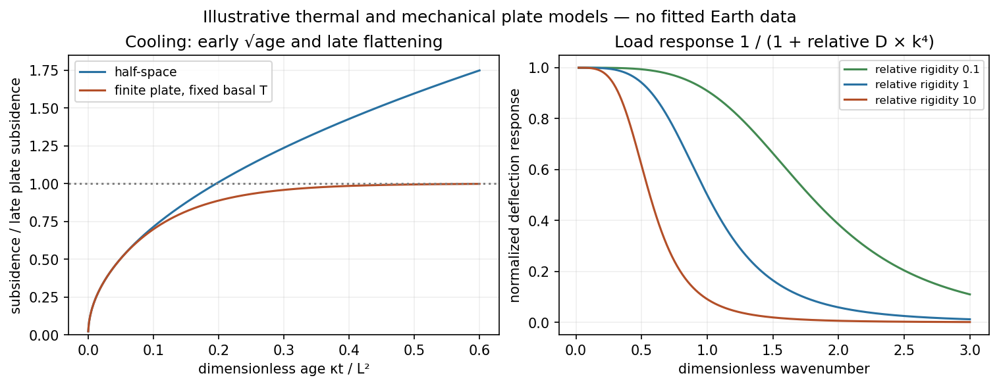

<h1 id="3/b/solution">Solution</h1>

↑ **Parent:** [B](../b.md)

**[Oceanic thermal subsidence](../../../../../oceanic-thermal-subsidence.md).** Newly formed oceanic [lithosphere](../../../../../lithosphere.md) is hot and buoyant. Cooling increases its column [density](../../../../../density.md), causing subsidence by [isostasy](../../../../../isostasy.md) as it moves away from a ridge. The [half-space cooling model](../../../../../half-space-cooling-model.md) has profile is

$$
T(z,t)=T_s+(T_m-T_s)\operatorname{erf}\left(\frac{z}{2\sqrt{\kappa t}}\right).
$$

With volumetric [thermal expansion](../../../../../thermal-expansion.md) coefficient $\alpha$, the excess column [mass](../../../../../mass.md) relative to hot [mantle](../../../../../planetary-mantle.md) is

$$
\Delta\Sigma\simeq\rho_m\alpha\int_0^\infty(T_m-T)\,dz
=2\rho_m\alpha(T_m-T_s)\sqrt{\frac{\kappa t}{\pi}}.
$$

Compensation with seawater [density](../../../../../density.md) $\rho_w$ gives

$$
\boxed{d(t)=d_r+
\frac{2\rho_m\alpha(T_m-T_s)}{\rho_m-\rho_w}
\sqrt{\frac{\kappa t}{\pi}}.}
$$

Thus young-to-intermediate-age seafloor generally deepens approximately as the square root of age. At old ages, finite thermal-plate thickness and basal [heat](../../../../../heat-split.md) supply flatten this trend; indefinite half-space deepening is inappropriate. Sediments, variable [crust](../../../../../planetary-crust.md), volcanic swells and [dynamic topography](../../../../../dynamic-topography.md) also perturb bathymetry. Ocean-floor depth and [heat](../../../../../heat-split.md) flow jointly constrain cooling models.[1977, half-space cooling, bathymetric age trend and finite-plate alternative](../../../../../an-analysis-of-the-variation-of-ocean-floor-bathymetry-and-heat-flow-with-age-by-barry-parsons-and-john-g-sclater.md)

**[Effective elastic thickness](../../../../../effective-elastic-thickness.md).** This is the thickness of a homogeneous elastic plate with the observed effective [flexural rigidity](../../../../../bending-stiffness.md), not necessarily the crustal or thermal lithospheric thickness:

$$
\boxed{D=\frac{ET_e^3}{12(1-\nu^2)}.}
$$

Infer it by modelling deflection around known loads, such as seamounts or trenches, or fitting [gravity-topography admittance](../../../../../gravity-topography-admittance.md) and [gravity-topography coherence](../../../../../gravity-topography-coherence.md) across wavelengths. A simple Fourier balance is $(Dk^4+\Delta\rho g)w_k=q_k$ for a signed transverse load. The transition from buoyancy-dominated to bending-dominated behaviour constrains $D$; then assumed [Young's modulus](../../../../../young-s-modulus.md) $E$ and [Poisson's ratio](../../../../../poisson-s-ratio.md) $\nu$ give $T_e$.

Good inference includes load geometry and [density](../../../../../density.md), buried interfaces, sediment and internal loading, [boundary conditions](../../../../../boundary-condition.md) and data resolution. These can trade off with rigidity. Plastic yielding, faulting, mechanical layering and creep make $T_e$ an effective, timescale- and stress-dependent quantity. Older, colder [lithosphere](../../../../../lithosphere.md) is often stronger, but age at loading and subsequent relaxation matter; a single universal age-to-$T_e$ conversion is unjustified.

**[Figure 5](#3/b/image-square-root-cooling-versus-finite-plate-saturation-and-stiffness-sensitivity-of-the-flexural-response). Square-root cooling versus finite-plate saturation, and stiffness sensitivity of the flexural response**.

## ↑ Ancestors (14)

1. [B](../b.md)
2. [3](../../3.md)
3. [Paper 1](../../../paper-1-split.md)
4. [2014](../../../split.md)
5. [Past exam of the physics of the Earth as a Planet course of the University of Cambridge](../../../../split.md)
6. [Physics of the Earth as a Planet course of the University of Cambridge](../../../../../physics-of-the-earth-as-a-planet-course-of-the-university-of-cambridge.md)
7. [Physics course of the year 4 of the natural sciences course of the University of Cambridge](../../../../../physics-course-of-the-year-4-of-the-natural-sciences-course-of-the-university-of-cambridge.md)
8. [Year 4 of the natural sciences course of the University of Cambridge](../../../../../year-4-of-the-natural-sciences-course-of-the-university-of-cambridge.md)
9. [Year of the natural sciences course of the University of Cambridge](../../../../../year-of-the-natural-sciences-course-of-the-university-of-cambridge.md)
10. [Natural sciences course of the University of Cambridge](../../../../../natural-sciences-course-of-the-university-of-cambridge.md)
11. [Course of the University of Cambridge](../../../../../course-of-the-university-of-cambridge.md)
12. [University of Cambridge](../../../../../university-of-cambridge-split.md)
13. [List of universities](../../../../../list-of-universities.md)
14. [Codex Wiki](../../../../../split.md)
