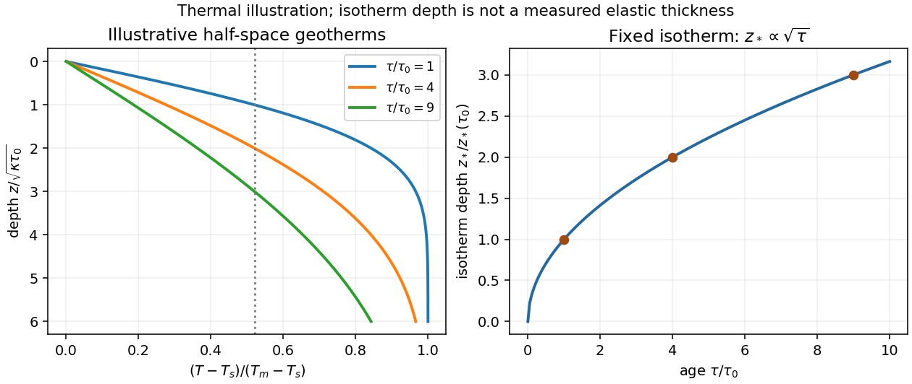

# Paper 1

↑ **Parent:** [2015](../2015.md)

[Original public PDF, physical pages 717–719; examination dated 14 January 2015](https://www.whatdotheyknow.com/request/natural_science_tripos_physics_e_2/response/2340776/attach/2/FOI%202023%20399%20Zahid%20materials.pdf?cookie_passthrough=1#page=717)

**Table of contents**

- [1](#1)
  - [a](#1/a)
    - [Solution](#1/a/solution)
  - [b](#1/b)
    - [i](#1/b/i)
      - [Solution](#1/b/i/solution)
    - [ii](#1/b/ii)
      - [Solution](#1/b/ii/solution)
  - [c](#1/c)
    - [Solution](#1/c/solution)
- [2](#2)
  - [a](#2/a)
    - [Solution](#2/a/solution)
  - [b](#2/b)
    - [Solution](#2/b/solution)
  - [c](#2/c)
    - [Solution](#2/c/solution)
  - [d](#2/d)
    - [Solution](#2/d/solution)
- [3](#3)
  - [a](#3/a)
    - [Solution](#3/a/solution)
  - [b](#3/b)
    - [Solution](#3/b/solution)

## 1

↑ **Parent:** [Paper 1](paper-1.md)

<h3 id="1/a">a</h3>

↑ **Parent:** [1](#1)

<h4 id="1/a/solution">Solution</h4>

↑ **Parent:** [A](#1/a)

A [fault plane](../../geophysics.md#fault-plane) represents the surface across which the two sides of a fault slip. A real fault need not be perfectly planar; these angles can describe a local planar segment. Its [fault strike](../../geophysics.md#fault-strike) is the azimuth, measured clockwise from north, of its horizontal intersection. The line itself has a $180^\circ$ ambiguity; choose the direction for which the fault dips to the right. Its [fault dip](../../geophysics.md#fault-dip), $\delta$, is the angle below horizontal measured perpendicular to that [fault strike](../../geophysics.md#fault-strike), from $0^\circ$ for horizontal to $90^\circ$ for vertical.

The [fault rake](../../geophysics.md#fault-rake), $\lambda$, is the angle of the relative slip [vector](../../vector-space.md#vector) within the [fault plane](../../geophysics.md#fault-plane). State the sign convention: if $\mathbf s$ is the chosen strike direction and $\mathbf d$ points down dip, use

$$
\boxed{\mathbf b=b(\cos\lambda\,\mathbf s-\sin\lambda\,\mathbf d).}
$$

Thus $\lambda=0$ is slip along $\mathbf s$, $+90^\circ$ is up-dip slip and $-90^\circ$ is down-dip slip. This distinguishes the direction in which the fault is tilted from the direction in which it actually moves.

The [hypocentre](../../geophysics.md#hypocenter) is the point where rupture begins within the [Earth](../../planetary-science.md#earth). The [epicentre](../../geophysics.md#epicenter) is the point on the surface directly above it. The [hypocentre](../../geophysics.md#hypocenter) need not coincide with the centroid of the final rupture. **Orientation uses strike and dip; motion additionally needs rake; [epicentre](../../geophysics.md#epicenter) and [hypocentre](../../geophysics.md#hypocenter) locate the rupture's start.**[Entries “fault plane”, “strike”, “dip”, “hypocenter” and “epicenter”](../../physics-bibliography.md#earthquake-hazards-program-glossary-by-united-states-geological-survey)

**[Figure 1](#1/a/image-fault-orientation-source-location-and-an-explicitly-signed-rake-convention). Fault orientation, source location and an explicitly signed rake convention**.

<h3 id="1/b">b</h3>

↑ **Parent:** [1](#1)

<h4 id="1/b/i">i</h4>

↑ **Parent:** [B](#1/b)

<h5 id="1/b/i/solution">Solution</h5>

↑ **Parent:** [I](#1/b/i)

Assume a stable, lossless elastic body with the usual symmetry of the [elasticity tensor](../../elasticity-physics.md#elasticity-tensor) and [boundary conditions](../../differential-equation.md#boundary-condition) that eliminate the surface terms in [integration by parts](../../calculus.md#integration-by-parts), such as a traction-free outer surface. Its elastic stiffness operator is then self-adjoint. When [density](../../fluid-mechanics.md#density) varies spatially, the precise eigenproblem is generalized:

$$
\hat H\mathbf u_\alpha=\rho\omega_\alpha^2\mathbf u_\alpha,
\qquad
\langle\mathbf u_\alpha,\mathbf u_\beta\rangle_\rho
=\int_\Omega\rho\,\mathbf u_\alpha^*\cdot\mathbf u_\beta\,dV
=\delta_{\alpha\beta}.
$$

Here $\alpha$ abbreviates the pair of mode labels. Equivalently, $\rho^{-1}\hat H$ is a [self-adjoint operator](../../linear-operator-theory.md#self-adjoint-operator) in the mass [inner product](../../inner-product.md). Stability makes $\omega_\alpha^2$ real and nonnegative. Modes at different [eigenvalues](../../linear-operator-theory.md#eigenvalue) are orthogonal, and an [orthonormal basis](../../inner-product.md#orthonormal-basis) can be selected within each degenerate eigenspace. Completeness permits expansion of a suitable [displacement field](../../elasticity-physics.md#displacement-field-mechanics) in these [mass-weighted elastic normal modes](../../wave-equation.md#mass-weighted-elastic-normal-modes).

Insert the expansion and project onto $\mathbf u_\alpha^*$. Mass normalization diagonalizes both the [acceleration](../../classical-mechanics.md#acceleration) term and the restoring term. For a symmetric [stress glut tensor](../../wave-equation.md#stress-glut-tensor) supported away from the boundary,

$$
\int_\Omega\mathbf u_\alpha^*\cdot(-\nabla\cdot\boldsymbol\Gamma)\,dV
=\int_\Omega\boldsymbol\Gamma:\nabla\mathbf u_\alpha^*\,dV
=\int_\Omega\boldsymbol\Gamma:\mathbf e_\alpha^*\,dV.
$$

The symmetry of the [stress glut tensor](../../wave-equation.md#stress-glut-tensor) removes the antisymmetric part of the displacement gradient, leaving the [strain](../../continuum-mechanics.md#strain). The result is **one independent forced oscillator per mode**, with the stated excitation integral. If the modes instead have mass norm $N_\alpha$, that integral is divided by $N_\alpha$. A source touching the boundary requires the corresponding surface forcing to be retained rather than silently dropping it.

Rigid translations and rotations can be zero-frequency modes of a free body. Their [strain](../../continuum-mechanics.md#strain) vanishes, so an internal symmetric [seismic moment tensor](../../wave-equation.md#seismic-moment-tensor) does not excite them through this coupling. Attenuation, radiative boundaries or other non-self-adjoint effects require modifications of the simple conservative expansion.

<h4 id="1/b/ii">ii</h4>

↑ **Parent:** [B](#1/b)

<h5 id="1/b/ii/solution">Solution</h5>

↑ **Parent:** [Ii](#1/b/ii)

For a mode of positive [frequency](../../wave.md#frequency), differentiation of the causal [convolution](../../fourier-analysis.md#convolution) gives

$$
\dot a(t)=\int_0^t\cos[\omega(t-s)]f(s)\,ds,
$$

$$
\ddot a(t)=f(t)-\omega\int_0^t\sin[\omega(t-s)]f(s)\,ds
=f(t)-\omega^2a(t).
$$

The first boundary term vanishes because $\sin0=0$; the second supplies $f(t)$ because $\cos0=1$. Both initial values vanish. This verifies the forced-oscillator equation and its [initial conditions](../../differential-equation.md#initial-condition), including a step source in the piecewise or distributional sense.

The spatial [Dirac delta function](../../distribution-theory.md#dirac-delta-function) reduces the excitation to

$$
f_\alpha(t)=C_\alpha H(t-t_s),\qquad
C_\alpha=\mathbf M:\mathbf e_\alpha^*(\mathbf x_s).
$$

For an event at $t_s\ge0$, put $\tau=t-t_s$. Integrating the oscillator kernel from $t_s$ to $t$ gives the [normal-mode response to a step seismic moment](../../wave-equation.md#normal-mode-response-to-a-step-seismic-moment):

$$
a_\alpha(t)=\frac{C_\alpha}{\omega_\alpha^2}
[1-\cos(\omega_\alpha\tau)]H(\tau),
$$

$$
\boxed{\mathbf u(\mathbf x,t)=H(\tau)\sum_\alpha
\mathbf u_\alpha(\mathbf x)
\frac{\mathbf M:\mathbf e_\alpha^*(\mathbf x_s)}{\omega_\alpha^2}
[1-\cos(\omega_\alpha\tau)].}
$$

Non-unit mass normalization introduces the same factor $1/N_\alpha$ as above. Complex modes must be combined with their conjugate partners to produce a real displacement. The formal $\omega\to0$ limit is $a=C\tau^2H(\tau)/2$; for rigid-body modes here, $C=0$ because their [strain](../../continuum-mechanics.md#strain) is zero.

The step produces a static component plus continuing oscillations in this lossless model. It does not predict physical damping. **A point source is appropriate when rupture dimensions are small compared with the [wavelengths](../../wave-equation.md#wavelength) being analysed and rupture duration is short compared with their [periods](../../mathematics.md#period-of-a-function).** Long-period observations of a relatively small [earthquake](../../geophysics.md#earthquake) can meet these conditions; high-frequency finite-fault directivity generally cannot. A finite source-time function replaces the ideal instantaneous step when its duration matters.

<h3 id="1/c">c</h3>

↑ **Parent:** [1](#1)

<h4 id="1/c/solution">Solution</h4>

↑ **Parent:** [C](#1/c)

For [seismic source inversion](../../inverse-problem.md#seismic-source-inversion), collect calibrated, consistently filtered samples from all available stations and components into a data [vector](../../vector-space.md#vector) $\mathbf d$. For each trial source position and origin time, compute the corresponding [elastodynamic Green tensor](../../wave-equation.md#elastodynamic-green-tensor) in an [Earth](../../planetary-science.md#earth) model, including the instrument response used for the data. Write the symmetric [seismic moment tensor](../../wave-equation.md#seismic-moment-tensor) in six independent symmetric basis [tensors](../../multilinear-algebra.md#tensor):

$$
\mathbf M=\sum_{j=1}^6m_j\mathbf B_j,
\qquad
\mathbf d=\mathbf G(\mathbf q)\mathbf m+\boldsymbol\epsilon,
\qquad \mathbf q=(x_s,y_s,z_s,t_s).
$$

Each column of $\mathbf G$ is the synthetic [seismogram](../../geophysics.md#seismogram) for one basis [tensor](../../multilinear-algebra.md#tensor). An off-diagonal basis [tensor](../../multilinear-algebra.md#tensor) contains both symmetric entries, so the double contraction and its factors of two remain consistent.

A suitable objective is

$$
\chi^2(\mathbf q,\mathbf m)
=[\mathbf d-\mathbf G(\mathbf q)\mathbf m]^T
\mathbf C_d^{-1}[\mathbf d-\mathbf G(\mathbf q)\mathbf m],
$$

with noise [covariance](../../variance.md#covariance) $\mathbf C_d$; a justified penalty can be added for [regularization](../../statistical-learning.md#regularization). At fixed $\mathbf q$, solve for the six entries of $\mathbf m$ by [weighted least squares](../../normal-linear-model.md#weighted-least-squares), preferably using a [QR decomposition](../../inner-product.md#qr-decomposition) or [singular value decomposition](../../linear-algebra.md#singular-value-decomposition) rather than explicitly inverting the matrix of the normal equations. Then search over the four nonlinear parameters using a coarse location/time grid followed by local refinement. **This [variable projection](../../normal-linear-model.md#variable-projection) reduces a ten-parameter search to a four-parameter nonlinear search with an inner six-parameter [linear](../../vector-space.md#linearity) fit.** Merely having more than ten data samples does not ensure identifiability: the [design matrix](../../linear-regression.md#design-matrix) must have adequate rank and the network must resolve the source's radiation patterns.

Potential errors include inaccurate [velocity](../../classical-mechanics.md#velocity), [density](../../fluid-mechanics.md#density), anisotropy and attenuation in the assumed [Earth](../../planetary-science.md#earth) model; neglected finite rupture and source-time effects; timing, instrument calibration or component-orientation errors; correlated noise; uneven station coverage; and tradeoffs between depth, origin time and the moment [tensor](../../multilinear-algebra.md#tensor). Imposing a [double-couple seismic source](../../wave-equation.md#double-couple-seismic-source) mechanism without evidence can hide genuine non-double-couple components. [Regularization](../../statistical-learning.md#regularization) also changes the recovered source and should be reported.

Inspect residuals, singular values, recovery of synthetic sources and uncertainty under resampling or noise perturbations. Linearized [covariance](../../variance.md#covariance) or a [posterior distribution](../../bayesian-statistics.md#bayesian-posterior) can quantify uncertainty within the assumed forward model, but does not automatically account for errors in that model. A good waveform fit alone is insufficient evidence that all ten parameters are uniquely recovered.

## 2

↑ **Parent:** [Paper 1](paper-1.md)

<h3 id="2/a">a</h3>

↑ **Parent:** [2](#2)

<h4 id="2/a/solution">Solution</h4>

↑ **Parent:** [A](#2/a)

Take upward deflection as positive, use $k>0$, and write $\Delta\rho=\rho_m-\rho_c>0$. A positive added load depresses the plate, so $w$ is negative beneath it. Because bending moves the original surface while the load adds thickness, the final topography is **$e=s+w$**. For the cosine mode the horizontal biharmonic operator multiplies $w$ by $k^4$, giving

$$
(Dk^4+g\rho_m)w=-g\rho_cs.
$$

Eliminate $s=e-w$ to obtain

$$
\boxed{e=-\frac{Dk^4+g\Delta\rho}{g\rho_c}\,w.}
$$

The original loading equation contains $\rho_m$, whereas the relation after eliminating the added thickness contains $\Delta\rho$. These must not be interchanged prematurely.

At first order in the relief, represent a displaced [density](../../fluid-mechanics.md#density) interface by a sinusoidal mass sheet. A sheet of surface-density [amplitude](../../wave.md#wave-amplitude) $\Sigma$ at depth $z$ produces a downward gravity [amplitude](../../wave.md#wave-amplitude) $2\pi G\Sigma e^{-kz}$ at the datum. This follows by solving the Fourier-transformed gravitational [Poisson equation](../../partial-differential-equation.md#poisson-s-equation) above and below the sheet: the decaying potential has [amplitude](../../wave.md#wave-amplitude) $-2\pi G\Sigma e^{-k|z-z_0|}/k$, with the normal derivative jump fixed by the sheet mass.

The top interface contributes $\rho_ce$; the displaced [crust](../../geophysics.md#planetary-crust)–[mantle](../../geophysics.md#planetary-mantle) interface contributes $\Delta\rho\,w$ at depth $t$. Thus

$$
\Delta g=2\pi G[\rho_ce+\Delta\rho\,w e^{-kt}].
$$

The second term is negative beneath a positive load: depression replaces denser [mantle](../../geophysics.md#planetary-mantle) material by lighter [crust](../../geophysics.md#planetary-crust). Substituting the deflection-to-topography ratio yields

$$
\boxed{\Delta g=Z(k)e,\qquad
Z(k)=2\pi G\rho_c\left[1-
\frac{e^{-kt}}{1+Dk^4/(g\Delta\rho)}\right].}
$$

This [flexural gravity admittance](../../geophysics.md#flexural-gravity-admittance) combines mechanical compensation and attenuation of the buried interface's gravitational signal. It assumes small relief, a flat uniform thin plate, uniform [density](../../fluid-mechanics.md#density) layers and the stated surface loading, without additional internal [density](../../fluid-mechanics.md#density) anomalies. Here $t$ is the depth of the [crust](../../geophysics.md#planetary-crust)–[mantle](../../geophysics.md#planetary-mantle) interface. It is not automatically the [effective elastic thickness](../../geophysics.md#effective-elastic-thickness) $T_e$; the latter enters through $D=ET_e^3/[12(1-\nu^2)]$.

<h3 id="2/b">b</h3>

↑ **Parent:** [2](#2)

<h4 id="2/b/solution">Solution</h4>

↑ **Parent:** [B](#2/b)

Define $C=2\pi G\rho_c$ and $\ell_f=[D/(g\Delta\rho)]^{1/4}$. Then

$$
\frac{Z}{C}=1-\frac{e^{-kt}}{1+(k\ell_f)^4}.
$$

At long [wavelength](../../wave-equation.md#wavelength), the mass deficit at the lower interface nearly cancels the surface excess, and the gravity field does not resolve their vertical separation. For $t>0$,

$$
\boxed{Z\sim Ckt\longrightarrow0\quad(k\to0).}
$$

The first mechanical contribution is fourth order in $k$, although the exponential also contributes terms at second and third order. If the ideal interface depth were zero, the leading term would instead be $C(k\ell_f)^4$.

At short [wavelength](../../wave-equation.md#wavelength), bending resists the interface's deflection, and any remaining buried signal is attenuated. Consequently

$$
\boxed{Z\longrightarrow C=2\pi G\rho_c\quad(k\to\infty).}
$$

This is the uncompensated surface-sheet value. For nonnegative $D,t$ the approach is from below. With $\beta=D/(g\Delta\rho)$,

$$
\frac1C\frac{dZ}{dk}
=e^{-kt}\left[\frac{t}{1+\beta k^4}
+\frac{4\beta k^3}{(1+\beta k^4)^2}\right]\ge0.
$$

The scales $kt\sim1$ and $k\ell_f\sim1$ respectively mark gravitational depth filtering and flexural resistance; which appears first depends on $t/\ell_f$. Admittance has dimensions of inverse time squared. The formal $k\to\infty$ limit describes this model, not an assertion that thin-plate theory remains accurate at arbitrarily short [wavelength](../../wave-equation.md#wavelength).

**[Figure 2](#2/b/image-compensated-long-wavelengths-flexural-transition-and-the-uncompensated-gravity-limit). Compensated long wavelengths, flexural transition and the uncompensated gravity limit**.

<h3 id="2/c">c</h3>

↑ **Parent:** [2](#2)

<h4 id="2/c/solution">Solution</h4>

↑ **Parent:** [C](#2/c)

New oceanic [lithosphere](../../geophysics.md#lithosphere) is hot and mechanically weak. As it cools, the depth over which rock can sustain elastic [stress](../../continuum-mechanics.md#stress) on the loading timescale generally increases, so **[effective elastic thickness](../../geophysics.md#effective-elastic-thickness) tends to increase with plate age at the time of loading**. It is this mechanical state when the load is emplaced, together with subsequent relaxation, that matters; the present age alone is insufficient for an ancient load.

The [half-space cooling model](../../geophysics.md#half-space-cooling-model) illustrates the thermal dependence. With age $\tau$, surface [temperature](../../temperature.md) $T_s$, initial interior [temperature](../../temperature.md) $T_m$ and constant [thermal diffusivity](../../heat.md#thermal-diffusivity) $\kappa$,

$$
T(z,\tau)=T_s+(T_m-T_s)
\operatorname{erf}\left(\frac{z}{2\sqrt{\kappa\tau}}\right).
$$

A chosen [temperature](../../temperature.md) $T_*$ lies at

$$
\boxed{z_*=2\sqrt{\kappa\tau}\,
\operatorname{erf}^{-1}\left(\frac{T_*-T_s}{T_m-T_s}\right)
\ \propto\sqrt\tau.}
$$

If the base of the mechanically strong layer approximately follows such an isotherm, $T_e$ initially follows a similar age trend. Cooling models constrained by ocean-floor depth and heat flow provide the thermal motivation; their fitted thermal thickness must not be mistaken for measured [elastic thickness](../../geophysics.md#effective-elastic-thickness).[1977, pages 803–806 and discussion of half-space versus finite-plate cooling](../../physics-bibliography.md#an-analysis-of-the-variation-of-ocean-floor-bathymetry-and-heat-flow-with-age-by-barry-parsons-and-john-g-sclater)

In practice $T_e$ is an effective bending thickness rather than the depth of one universal [temperature](../../temperature.md). Stress-dependent yielding, [grain size](../../thermodynamics.md#grain-size), water content, composition, loading duration and reheating can alter it. Finite-plate cooling and basal heat input also limit indefinite square-root growth at old ages. Nor should $T_e$ be identified with either the thickness of the [crust](../../geophysics.md#planetary-crust) or the full seismically defined [lithosphere](../../geophysics.md#lithosphere).

**[Figure 3](#2/c/image-cooling-deepens-a-fixed-isotherm-as-the-square-root-of-age-in-the-half-space-model). Cooling deepens a fixed isotherm as the square root of age in the half-space model**.

<h3 id="2/d">d</h3>

↑ **Parent:** [2](#2)

<h4 id="2/d/solution">Solution</h4>

↑ **Parent:** [D](#2/d)

Use the supplied surface [temperature](../../temperature.md), $420^\circ\mathrm C\simeq693\,\mathrm K$, as the premise. With otherwise comparable material and [geothermal gradient](../../geophysics.md#geothermal-gradient), this hotter boundary increases thermally activated [material creep](../../engineering.md#creep-deformation) at shallow depth and places a chosen mechanical cutoff [temperature](../../temperature.md) closer to the surface. That effect alone would favour a thinner elastic layer than in a cool terrestrial oceanic plate.

[Water weakening of rocks](../../engineering.md#water-weakening-of-rocks) makes dryness act in the opposite direction. Water can enhance [material creep](../../engineering.md#creep-deformation); sufficiently dry material can remain strong at temperatures at which its wet equivalent relaxes. Experiments on dry diabase provide a concrete basis for a strong dry [crust](../../geophysics.md#planetary-crust) and possible mechanical coupling between [crust](../../geophysics.md#planetary-crust) and [mantle](../../geophysics.md#planetary-mantle), rather than requiring a weak crustal layer solely because the surface is hot.[1996, printed pages 793–794, dry strength and implications for crustal coupling](../../physics-bibliography.md#high-temperature-deformation-of-dry-diabase-with-application-to-crustal-deformation-on-venus-by-s-j-mackwell-and-others)

For an illustrative steady conductive geotherm with [thermal conductivity](../../heat.md#thermal-conductivity) $k_T$ and [heat flux](../../heat.md#heat-flux-density) $q$, a fixed strength cutoff gives

$$
T_e\sim\frac{k_T(T_*-T_s)}q.
$$

Therefore the comparison would scale as

$$
\frac{T_{e,V}}{T_{e,E}}\sim
\frac{k_{T,V}}{k_{T,E}}\frac{q_E}{q_V}
\frac{T_{*,V}-T_{s,V}}{T_{*,E}-T_{s,E}},
$$

where all temperatures are compared consistently and a dry rheology may have a higher effective cutoff $T_{*,V}$. This is a conditional strength-layer estimate, not a universal definition of $T_e$.

**[Venus](../../planetary-science.md#venus) can retain appreciable [elastic thickness](../../geophysics.md#effective-elastic-thickness) despite its hot surface; [temperature](../../temperature.md) favours thinning, while dryness favours strengthening. The supplied facts alone determine neither a numerical $T_e$ nor a definite ordering relative to [Earth](../../planetary-science.md#earth)'s oceanic plates.** The comparison requires heat flow, subsurface thermal history, material rheology, interior water content and loading timescale. Little atmospheric water is evidence relevant to the hypothesis of dry rocks, not a direct measurement of deep water activity.

## 3

↑ **Parent:** [Paper 1](paper-1.md)

<h3 id="3/a">a</h3>

↑ **Parent:** [3](#3)

<h4 id="3/a/solution">Solution</h4>

↑ **Parent:** [A](#3/a)

**[Seismic surface-wave dispersion](../../geophysics.md#seismic-surface-wave-dispersion).** [Rayleigh waves](../../wave-equation.md#rayleigh-wave) combine vertical and longitudinal motion in the vertical plane of propagation; [Love waves](../../wave-equation.md#love-wave) have horizontal transverse motion and can be guided by a low-shear-speed surface layer. A homogeneous elastic half-space supports a [Rayleigh wave](../../wave-equation.md#rayleigh-wave) with a frequency-independent speed in the ideal elastic limit, but depth-dependent [Earth](../../planetary-science.md#earth) structure makes the surface-wave [eigenfunctions](../../linear-operator-theory.md#eigenfunction) and their propagation speeds depend on [frequency](../../wave.md#frequency). This structural [dispersion](../../dispersion-relation.md#wave-dispersion) can occur even when each constituent material is itself nondispersive.

Distinguish [phase velocity](../../dispersion-relation.md#phase-velocity) $c=\omega/k$ from [group velocity](../../dispersion-relation.md#group-velocity) $U=d\omega/dk$, which controls a narrow-band envelope in the appropriate weakly attenuating limit. Longer [periods](../../mathematics.md#period-of-a-function) generally have deeper sensitivity, while shorter [periods](../../mathematics.md#period-of-a-function) emphasize shallower structure. In a profile whose shear speed increases with depth this often makes long-period waves faster, but low-velocity zones, anisotropy and higher modes can change that trend. [Frequency](../../wave.md#frequency) dependence need not be monotonic in every [Earth](../../planetary-science.md#earth) model.

Measure phase delays or wave-packet arrival times across known source–receiver paths for many [periods](../../mathematics.md#period-of-a-function), accounting for source phase, cycle ambiguity, multipathing and mode identification. Compute predicted [dispersion](../../dispersion-relation.md#wave-dispersion) from trial elastic profiles and compare with observations. Linearization expresses the sensitivity schematically as

$$
\frac{\delta c(\omega)}{c(\omega)}=
\int\left[K_\beta(z,\omega)\frac{\delta\beta}{\beta}
+K_\alpha(z,\omega)\frac{\delta\alpha}{\alpha}
+K_\rho(z,\omega)\frac{\delta\rho}{\rho}\right]dz,
$$

where $\alpha,\beta$ are compressional and shear speeds. A regularized [inverse problem](../../inverse-problem.md) then estimates depth structure; many crossing paths additionally provide [surface-wave tomography](../../inverse-problem.md#surface-wave-tomography). Joint [Love wave](../../wave-equation.md#love-wave) and [Rayleigh wave](../../wave-equation.md#rayleigh-wave) measurements help distinguish shear-wave polarizations and constrain radial [seismic anisotropy](../../geophysics.md#seismic-anisotropy). Finite bandwidth, depth averaging and correlated sensitivities mean that one [dispersion](../../dispersion-relation.md#wave-dispersion) curve does not uniquely determine a detailed [Earth](../../planetary-science.md#earth) profile.

**[Seismic ray theory](../../geophysics.md#seismic-ray-theory), the [eikonal equation](../../elasticity-physics.md#eikonal-equation) and [Fermat's principle](../../mathematical-physics.md#fermat-principle).** In a smoothly varying isotropic medium, insert a high-frequency ansatz $u=A(\mathbf x)e^{i\omega[T(\mathbf x)-t]}$ into the scalar [wave equation](../../wave-equation.md). The leading powers of [frequency](../../wave.md#frequency) give

$$
\boxed{|\nabla T|^2=\frac1{c(\mathbf x)^2}.}
$$

The travel-time surfaces are [wavefronts](../../physical-optics.md#wavefront) and rays are their normal trajectories, with [slowness](../../wave-equation.md#slowness) [vector](../../vector-space.md#vector) $\mathbf p=\nabla T$. The next-order equation transports [amplitude](../../wave.md#wave-amplitude), including geometrical spreading; attenuation is an additional material effect.

[Fermat's principle](../../mathematical-physics.md#fermat-principle) says that the ray makes $\int ds/c$ stationary under path variations with fixed endpoints. Stationarity, rather than always the global minimum, permits multiple arrivals. Its Euler–Lagrange equation, with arclength $s$ and unit tangent $\hat{\mathbf t}$, is

$$
\frac{d}{ds}\left(\frac{\hat{\mathbf t}}c\right)
=\nabla\left(\frac1c\right).
$$

For horizontal layering, the horizontal [slowness](../../wave-equation.md#slowness) $p_h=\sin i/c$ is conserved, giving [Snell's law](../../partial-differential-equation.md#snell-s-law) at interfaces and smooth refraction between them. Here $i$ is measured from vertical. A turning point satisfies $p_hc(z)=1$; increasing speed with depth bends a downgoing ray back upwards. Travel-time tomography uses these ray integrals to infer spatial [slowness](../../wave-equation.md#slowness) variations.

The approximation requires [wavelength](../../wave-equation.md#wavelength) to be small compared with structural variation scales. Caustics, turning-point [amplitudes](../../wave.md#wave-amplitude), diffraction, scattering and finite-frequency sensitivity require wave-based corrections. Thus [seismic ray theory](../../geophysics.md#seismic-ray-theory) gives an economical geometric description and useful travel times, while surface-wave [dispersion](../../dispersion-relation.md#wave-dispersion) retains essential interference and boundary-mode physics.

**[Figure 4](#3/a/image-original-illustrative-love-wave-dispersion-and-depth-sensitivity-alongside-a-turning-ray). Original illustrative Love-wave dispersion and depth sensitivity, alongside a turning ray**.

<h3 id="3/b">b</h3>

↑ **Parent:** [3](#3)

<h4 id="3/b/solution">Solution</h4>

↑ **Parent:** [B](#3/b)

**[Homologous temperature](../../engineering.md#homologous-temperature) and deformation.** [Homologous temperature](../../engineering.md#homologous-temperature) is $\Theta=T/T_m$, with both temperatures in [kelvin](../../temperature.md#kelvin) and $T_m$ the appropriate pressure- and composition-dependent melting [temperature](../../temperature.md). It measures proximity to melting more meaningfully than an absolute [temperature](../../temperature.md) alone. Pressure, composition and water can alter both $T_m$ and the flow law, so equal $\Theta$ does not imply identical rheology.

A useful thermally activated [material creep](../../engineering.md#creep-deformation) law is

$$
\dot\epsilon=A\sigma^n d^{-p}
\exp\left[-\frac{E^*+PV^*}{RT}\right],
$$

with [stress](../../continuum-mechanics.md#stress) $\sigma$, [grain size](../../thermodynamics.md#grain-size) $d$, [activation energy](../../chemical-kinetics.md#activation-energy) $E^*$ and [activation volume](../../chemical-kinetics.md#activation-volume) $V^*$. Water activity can add another factor. Increasing [temperature](../../temperature.md) raises the rate at fixed [stress](../../continuum-mechanics.md#stress) when the activation enthalpy is positive, greatly lowering effective [viscosity](../../dynamic-viscosity.md). Solid material can therefore flow on geological timescales well below melting.

[Diffusion creep](../../engineering.md#diffusion-creep) is approximately [linear](../../vector-space.md#linearity) in [stress](../../continuum-mechanics.md#stress): bulk-diffusion [Nabarro-Herring creep](../../engineering.md#nabarro-herring-creep) has grain-size scaling $d^{-2}$, while grain-boundary [Coble creep](../../engineering.md#coble-creep) has $d^{-3}$ in their ideal regimes. [Dislocation creep](../../engineering.md#dislocation-creep) usually has a [stress](../../continuum-mechanics.md#stress) exponent greater than one and weaker grain-size dependence. Its effective [viscosity](../../dynamic-viscosity.md) scales as $\eta_{\rm eff}\propto\sigma^{1-n}$ at fixed [temperature](../../temperature.md), so stronger forcing changes the apparent [viscosity](../../dynamic-viscosity.md). At lower [homologous temperature](../../engineering.md#homologous-temperature), brittle/frictional deformation or high-stress dislocation mechanisms can become important. The dominant process also depends on pressure and confinement; low [temperature](../../temperature.md) is not by itself a guarantee of brittle failure deep in a planet.

A [deformation mechanism map](../../engineering.md#deformation-mechanism-map) compares the competing rates or strengths as functions of [stress](../../continuum-mechanics.md#stress) and [homologous temperature](../../engineering.md#homologous-temperature) at specified [grain size](../../thermodynamics.md#grain-size), pressure and composition. Fine grains favour [diffusion creep](../../engineering.md#diffusion-creep); larger [stress](../../continuum-mechanics.md#stress) favours nonlinear [dislocation creep](../../engineering.md#dislocation-creep). There is no universal [temperature](../../temperature.md) dividing all these regimes. This sensitivity helps explain a strong outer [lithosphere](../../geophysics.md#lithosphere) above a slowly flowing solid [mantle](../../geophysics.md#planetary-mantle) and why modest thermal or water variations can reorganize deformation.

**Determining the actual planform of [mantle convection](../../geophysics.md#mantle-convection).** The task is to infer the geometry of upwellings, downwellings and connecting flow in the present [Earth](../../planetary-science.md#earth), rather than to draw a preferred laboratory convection cell. Plate velocities and the distribution of subduction zones directly constrain surface motion and likely cold downwellings. Ridges, volcanism and hotspots provide further clues, but a ridge need not mark the centre of a deep plume, nor is every hotspot uniquely explained by one plume geometry.

[Seismic tomography](../../inverse-problem.md#seismic-tomography) supplies three-dimensional [velocity](../../classical-mechanics.md#velocity) structure from body-wave travel times, waveforms and surface-wave [dispersion](../../dispersion-relation.md#wave-dispersion). Fast slab-like structures can often be traced beneath subduction zones into the lower [mantle](../../geophysics.md#planetary-mantle). The 1997 global P-wave study reported long narrow lower-mantle structures connected with convergence and interpreted some slab segments as reaching the deepest [mantle](../../geophysics.md#planetary-mantle); that is evidence for deep circulation, not proof that every slab follows one route.[Nature 386, pages 578–584; abstract on lower-mantle structures and mantle-wide flow](../../physics-bibliography.md#evidence-for-deep-mantle-circulation-from-global-tomography-by-r-d-van-der-hilst-and-others) [Temperature](../../temperature.md) affects seismic speed, but composition, phase changes, water and anisotropy also matter, so [velocity](../../classical-mechanics.md#velocity) is not itself a flow map.

Gravity and the [geoid](../../geophysics.md#geoid) constrain the spatially integrated [density](../../fluid-mechanics.md#density) field and its induced boundary deformation. [Dynamic topography](../../geophysics.md#dynamic-topography) supplies information about vertical stresses, after separating crustal structure, isostatic loads and thermal subsidence. [Seismic anisotropy](../../geophysics.md#seismic-anisotropy) can constrain deformation and fabric orientations, subject to a mineral-physics relation between fabric and flow. Discontinuity topography and the [mantle](../../geophysics.md#planetary-mantle)'s heat budget provide further tests. Each observation has a different sensitivity to [density](../../fluid-mechanics.md#density), [temperature](../../temperature.md) and [viscosity](../../dynamic-viscosity.md), making their combination more useful than any one image.

Compare these observations with three-dimensional geodynamic models that solve creeping-flow force balance, mass conservation and thermal transport, including buoyancy from [temperature](../../temperature.md) and composition, realistic plate motions, [viscosity](../../dynamic-viscosity.md) structure and phase boundaries. Predict seismic observables, gravity, [geoid](../../geophysics.md#geoid) and [dynamic topography](../../geophysics.md#dynamic-topography) from the same model, and assess data coverage and resolution before interpreting a feature. Whole-mantle exchange, impeded or deflected slabs near transition zones, and broad deep anomalies can coexist; the evidence does not require identical stacked or single-layer cells everywhere. **The actual planform is constrained by joint seismic, gravitational, surface-kinematic and thermal evidence, with substantial nonuniqueness in its detailed flow and history.**

## ↑ Ancestors (11)

1. [2015](../2015.md)
2. [Past exam of the physics of the Earth as a Planet course of the University of Cambridge](../../past-exam-of-the-physics-of-the-earth-as-a-planet-course-of-the-university-of-cambridge.md)
3. [Physics of the Earth as a Planet course of the University of Cambridge](../../university-of-cambridge.md#physics-of-the-earth-as-a-planet-course-of-the-university-of-cambridge)
4. [Physics course of the year 4 of the natural sciences course of the University of Cambridge](../../university-of-cambridge.md#physics-course-of-the-year-4-of-the-natural-sciences-course-of-the-university-of-cambridge)
5. [Year 4 of the natural sciences course of the University of Cambridge](../../university-of-cambridge.md#year-4-of-the-natural-sciences-course-of-the-university-of-cambridge)
6. [Year of the natural sciences course of the University of Cambridge](../../university-of-cambridge.md#year-of-the-natural-sciences-course-of-the-university-of-cambridge)
7. [Natural sciences course of the University of Cambridge](../../university-of-cambridge.md#natural-sciences-course-of-the-university-of-cambridge)
8. [Course of the University of Cambridge](../../university-of-cambridge.md#course-of-the-university-of-cambridge)
9. [University of Cambridge](../../university-of-cambridge.md)
10. [List of universities](../../README.md#list-of-universities)
11. [Codex Wiki](../../README.md)
