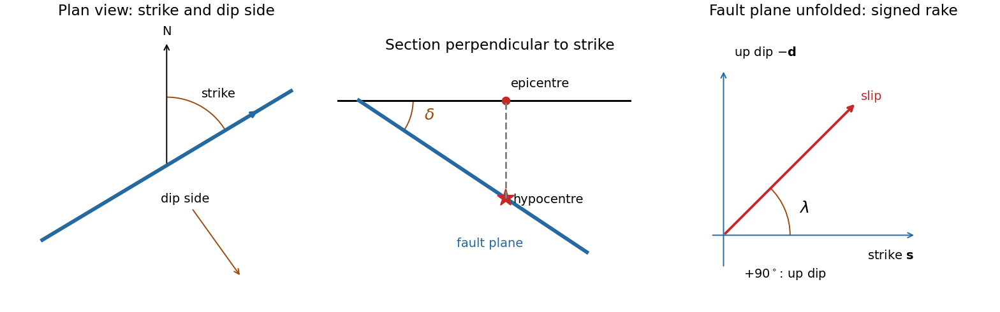

<h1 id="1/a/solution">Solution</h1>

↑ **Parent:** [A](../a.md)

A [fault plane](../../../../../fault-plane.md) represents the surface across which the two sides of a fault slip. A real fault need not be perfectly planar; these angles can describe a local planar segment. Its [fault strike](../../../../../fault-strike.md) is the azimuth, measured clockwise from north, of its horizontal intersection. The line itself has a $180^\circ$ ambiguity; choose the direction for which the fault dips to the right. Its [fault dip](../../../../../fault-dip.md), $\delta$, is the angle below horizontal measured perpendicular to that [fault strike](../../../../../fault-strike.md), from $0^\circ$ for horizontal to $90^\circ$ for vertical.

The [fault rake](../../../../../fault-rake.md), $\lambda$, is the angle of the relative slip [vector](../../../../../vector.md) within the [fault plane](../../../../../fault-plane.md). State the sign convention: if $\mathbf s$ is the chosen strike direction and $\mathbf d$ points down dip, use

$$
\boxed{\mathbf b=b(\cos\lambda\,\mathbf s-\sin\lambda\,\mathbf d).}
$$

Thus $\lambda=0$ is slip along $\mathbf s$, $+90^\circ$ is up-dip slip and $-90^\circ$ is down-dip slip. This distinguishes the direction in which the fault is tilted from the direction in which it actually moves.

The [hypocentre](../../../../../hypocenter.md) is the point where rupture begins within the [Earth](../../../../../earth.md). The [epicentre](../../../../../epicenter.md) is the point on the surface directly above it. The [hypocentre](../../../../../hypocenter.md) need not coincide with the centroid of the final rupture. **Orientation uses strike and dip; motion additionally needs rake; [epicentre](../../../../../epicenter.md) and [hypocentre](../../../../../hypocenter.md) locate the rupture's start.**[Entries “fault plane”, “strike”, “dip”, “hypocenter” and “epicenter”](../../../../../earthquake-hazards-program-glossary-by-united-states-geological-survey.md)

**[Figure 1](#1/a/image-fault-orientation-source-location-and-an-explicitly-signed-rake-convention). Fault orientation, source location and an explicitly signed rake convention**.

## ↑ Ancestors (14)

1. [A](../a.md)
2. [1](../../1.md)
3. [Paper 1](../../../paper-1-split.md)
4. [2015](../../../split.md)
5. [Past exam of the physics of the Earth as a Planet course of the University of Cambridge](../../../../split.md)
6. [Physics of the Earth as a Planet course of the University of Cambridge](../../../../../physics-of-the-earth-as-a-planet-course-of-the-university-of-cambridge.md)
7. [Physics course of the year 4 of the natural sciences course of the University of Cambridge](../../../../../physics-course-of-the-year-4-of-the-natural-sciences-course-of-the-university-of-cambridge.md)
8. [Year 4 of the natural sciences course of the University of Cambridge](../../../../../year-4-of-the-natural-sciences-course-of-the-university-of-cambridge.md)
9. [Year of the natural sciences course of the University of Cambridge](../../../../../year-of-the-natural-sciences-course-of-the-university-of-cambridge.md)
10. [Natural sciences course of the University of Cambridge](../../../../../natural-sciences-course-of-the-university-of-cambridge.md)
11. [Course of the University of Cambridge](../../../../../course-of-the-university-of-cambridge.md)
12. [University of Cambridge](../../../../../university-of-cambridge-split.md)
13. [List of universities](../../../../../list-of-universities.md)
14. [Codex Wiki](../../../../../split.md)
