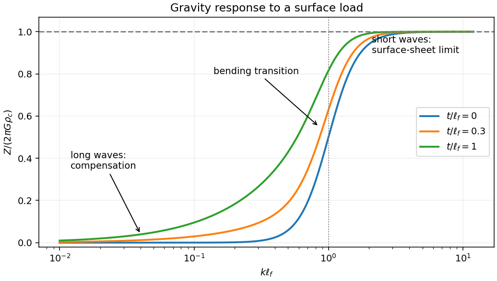

<h1 id="2/b/solution">Solution</h1>

↑ **Parent:** [B](../b.md)

Define $C=2\pi G\rho_c$ and $\ell_f=[D/(g\Delta\rho)]^{1/4}$. Then

$$
\frac{Z}{C}=1-\frac{e^{-kt}}{1+(k\ell_f)^4}.
$$

At long [wavelength](../../../../../wavelength.md), the mass deficit at the lower interface nearly cancels the surface excess, and the gravity field does not resolve their vertical separation. For $t>0$,

$$
\boxed{Z\sim Ckt\longrightarrow0\quad(k\to0).}
$$

The first mechanical contribution is fourth order in $k$, although the exponential also contributes terms at second and third order. If the ideal interface depth were zero, the leading term would instead be $C(k\ell_f)^4$.

At short [wavelength](../../../../../wavelength.md), bending resists the interface's deflection, and any remaining buried signal is attenuated. Consequently

$$
\boxed{Z\longrightarrow C=2\pi G\rho_c\quad(k\to\infty).}
$$

This is the uncompensated surface-sheet value. For nonnegative $D,t$ the approach is from below. With $\beta=D/(g\Delta\rho)$,

$$
\frac1C\frac{dZ}{dk}
=e^{-kt}\left[\frac{t}{1+\beta k^4}
+\frac{4\beta k^3}{(1+\beta k^4)^2}\right]\ge0.
$$

The scales $kt\sim1$ and $k\ell_f\sim1$ respectively mark gravitational depth filtering and flexural resistance; which appears first depends on $t/\ell_f$. Admittance has dimensions of inverse time squared. The formal $k\to\infty$ limit describes this model, not an assertion that thin-plate theory remains accurate at arbitrarily short [wavelength](../../../../../wavelength.md).

**[Figure 2](#2/b/image-compensated-long-wavelengths-flexural-transition-and-the-uncompensated-gravity-limit). Compensated long wavelengths, flexural transition and the uncompensated gravity limit**.

## ↑ Ancestors (14)

1. [B](../b.md)
2. [2](../../2.md)
3. [Paper 1](../../../paper-1-split.md)
4. [2015](../../../split.md)
5. [Past exam of the physics of the Earth as a Planet course of the University of Cambridge](../../../../split.md)
6. [Physics of the Earth as a Planet course of the University of Cambridge](../../../../../physics-of-the-earth-as-a-planet-course-of-the-university-of-cambridge.md)
7. [Physics course of the year 4 of the natural sciences course of the University of Cambridge](../../../../../physics-course-of-the-year-4-of-the-natural-sciences-course-of-the-university-of-cambridge.md)
8. [Year 4 of the natural sciences course of the University of Cambridge](../../../../../year-4-of-the-natural-sciences-course-of-the-university-of-cambridge.md)
9. [Year of the natural sciences course of the University of Cambridge](../../../../../year-of-the-natural-sciences-course-of-the-university-of-cambridge.md)
10. [Natural sciences course of the University of Cambridge](../../../../../natural-sciences-course-of-the-university-of-cambridge.md)
11. [Course of the University of Cambridge](../../../../../course-of-the-university-of-cambridge.md)
12. [University of Cambridge](../../../../../university-of-cambridge-split.md)
13. [List of universities](../../../../../list-of-universities.md)
14. [Codex Wiki](../../../../../split.md)
