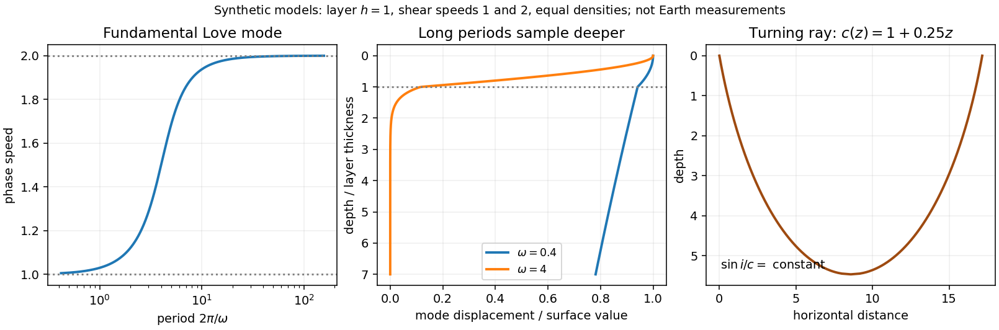

<h1 id="3/a/solution">Solution</h1>

↑ **Parent:** [A](../a.md)

**[Seismic surface-wave dispersion](../../../../../seismic-surface-wave-dispersion.md).** [Rayleigh waves](../../../../../rayleigh-wave.md) combine vertical and longitudinal motion in the vertical plane of propagation; [Love waves](../../../../../love-wave.md) have horizontal transverse motion and can be guided by a low-shear-speed surface layer. A homogeneous elastic half-space supports a [Rayleigh wave](../../../../../rayleigh-wave.md) with a frequency-independent speed in the ideal elastic limit, but depth-dependent [Earth](../../../../../earth.md) structure makes the surface-wave [eigenfunctions](../../../../../eigenfunction.md) and their propagation speeds depend on [frequency](../../../../../frequency.md). This structural [dispersion](../../../../../wave-dispersion.md) can occur even when each constituent material is itself nondispersive.

Distinguish [phase velocity](../../../../../phase-velocity.md) $c=\omega/k$ from [group velocity](../../../../../group-velocity.md) $U=d\omega/dk$, which controls a narrow-band envelope in the appropriate weakly attenuating limit. Longer [periods](../../../../../period-of-a-function.md) generally have deeper sensitivity, while shorter [periods](../../../../../period-of-a-function.md) emphasize shallower structure. In a profile whose shear speed increases with depth this often makes long-period waves faster, but low-velocity zones, anisotropy and higher modes can change that trend. [Frequency](../../../../../frequency.md) dependence need not be monotonic in every [Earth](../../../../../earth.md) model.

Measure phase delays or wave-packet arrival times across known source–receiver paths for many [periods](../../../../../period-of-a-function.md), accounting for source phase, cycle ambiguity, multipathing and mode identification. Compute predicted [dispersion](../../../../../wave-dispersion.md) from trial elastic profiles and compare with observations. Linearization expresses the sensitivity schematically as

$$
\frac{\delta c(\omega)}{c(\omega)}=
\int\left[K_\beta(z,\omega)\frac{\delta\beta}{\beta}
+K_\alpha(z,\omega)\frac{\delta\alpha}{\alpha}
+K_\rho(z,\omega)\frac{\delta\rho}{\rho}\right]dz,
$$

where $\alpha,\beta$ are compressional and shear speeds. A regularized [inverse problem](../../../../../inverse-problem-split.md) then estimates depth structure; many crossing paths additionally provide [surface-wave tomography](../../../../../surface-wave-tomography.md). Joint [Love wave](../../../../../love-wave.md) and [Rayleigh wave](../../../../../rayleigh-wave.md) measurements help distinguish shear-wave polarizations and constrain radial [seismic anisotropy](../../../../../seismic-anisotropy.md). Finite bandwidth, depth averaging and correlated sensitivities mean that one [dispersion](../../../../../wave-dispersion.md) curve does not uniquely determine a detailed [Earth](../../../../../earth.md) profile.

**[Seismic ray theory](../../../../../seismic-ray-theory.md), the [eikonal equation](../../../../../eikonal-equation.md) and [Fermat's principle](../../../../../fermat-principle.md).** In a smoothly varying isotropic medium, insert a high-frequency ansatz $u=A(\mathbf x)e^{i\omega[T(\mathbf x)-t]}$ into the scalar [wave equation](../../../../../wave-equation-split.md). The leading powers of [frequency](../../../../../frequency.md) give

$$
\boxed{|\nabla T|^2=\frac1{c(\mathbf x)^2}.}
$$

The travel-time surfaces are [wavefronts](../../../../../wavefront.md) and rays are their normal trajectories, with [slowness](../../../../../slowness.md) [vector](../../../../../vector.md) $\mathbf p=\nabla T$. The next-order equation transports [amplitude](../../../../../wave-amplitude.md), including geometrical spreading; attenuation is an additional material effect.

[Fermat's principle](../../../../../fermat-principle.md) says that the ray makes $\int ds/c$ stationary under path variations with fixed endpoints. Stationarity, rather than always the global minimum, permits multiple arrivals. Its Euler–Lagrange equation, with arclength $s$ and unit tangent $\hat{\mathbf t}$, is

$$
\frac{d}{ds}\left(\frac{\hat{\mathbf t}}c\right)
=\nabla\left(\frac1c\right).
$$

For horizontal layering, the horizontal [slowness](../../../../../slowness.md) $p_h=\sin i/c$ is conserved, giving [Snell's law](../../../../../snell-s-law.md) at interfaces and smooth refraction between them. Here $i$ is measured from vertical. A turning point satisfies $p_hc(z)=1$; increasing speed with depth bends a downgoing ray back upwards. Travel-time tomography uses these ray integrals to infer spatial [slowness](../../../../../slowness.md) variations.

The approximation requires [wavelength](../../../../../wavelength.md) to be small compared with structural variation scales. Caustics, turning-point [amplitudes](../../../../../wave-amplitude.md), diffraction, scattering and finite-frequency sensitivity require wave-based corrections. Thus [seismic ray theory](../../../../../seismic-ray-theory.md) gives an economical geometric description and useful travel times, while surface-wave [dispersion](../../../../../wave-dispersion.md) retains essential interference and boundary-mode physics.

**[Figure 4](#3/a/image-original-illustrative-love-wave-dispersion-and-depth-sensitivity-alongside-a-turning-ray). Original illustrative Love-wave dispersion and depth sensitivity, alongside a turning ray**.

## ↑ Ancestors (14)

1. [A](../a.md)
2. [3](../../3.md)
3. [Paper 1](../../../paper-1-split.md)
4. [2015](../../../split.md)
5. [Past exam of the physics of the Earth as a Planet course of the University of Cambridge](../../../../split.md)
6. [Physics of the Earth as a Planet course of the University of Cambridge](../../../../../physics-of-the-earth-as-a-planet-course-of-the-university-of-cambridge.md)
7. [Physics course of the year 4 of the natural sciences course of the University of Cambridge](../../../../../physics-course-of-the-year-4-of-the-natural-sciences-course-of-the-university-of-cambridge.md)
8. [Year 4 of the natural sciences course of the University of Cambridge](../../../../../year-4-of-the-natural-sciences-course-of-the-university-of-cambridge.md)
9. [Year of the natural sciences course of the University of Cambridge](../../../../../year-of-the-natural-sciences-course-of-the-university-of-cambridge.md)
10. [Natural sciences course of the University of Cambridge](../../../../../natural-sciences-course-of-the-university-of-cambridge.md)
11. [Course of the University of Cambridge](../../../../../course-of-the-university-of-cambridge.md)
12. [University of Cambridge](../../../../../university-of-cambridge-split.md)
13. [List of universities](../../../../../list-of-universities.md)
14. [Codex Wiki](../../../../../split.md)
