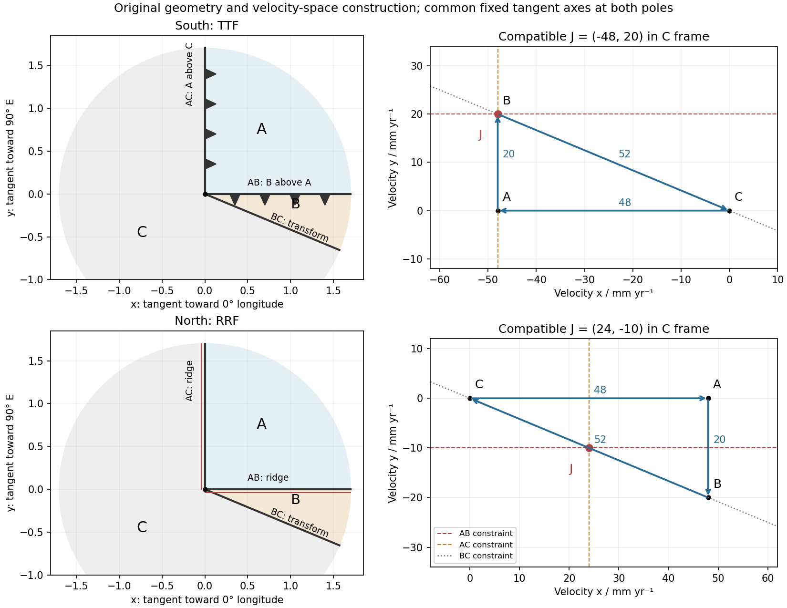

<h1 id="1/c/solution">Solution</h1>

↑ **Parent:** [C](../c.md)

At the south pole $\mathbf r=-R\hat z$. Choose plate C as the instantaneous [reference frame](../../../../../reference-frame.md). Since $R=4\times10^9$ mm, the two components of relative angular [speed](../../../../../speed.md) give 20 and 48 mm/year. The plate [velocities](../../../../../velocity.md) in the fixed tangent-plane axes are

$$
\mathbf v_C=(0,0),\qquad\mathbf v_A=(-48,0),\qquad\mathbf v_B=(-48,20)\quad\mathrm{mm\,yr^{-1}}.
$$

The [plate velocity triangle](../../../../../plate-velocity-triangle.md) therefore has sides

$$
\boxed{|\mathbf v_B-\mathbf v_A|=20,\quad|\mathbf v_A-\mathbf v_C|=48,\quad|\mathbf v_B-\mathbf v_C|=52\quad\mathrm{mm\,yr^{-1}}.}
$$

The physical boundary rays point along $+x$ for AB, $+y$ for AC and $(12,-5)$ for BC. Plate A occupies the quadrant between the first two rays, B the narrow wedge between AB and BC, and C the remainder. The stated overriding relations make AB and AC [subduction trenches](../../../../../subduction-trench.md), while BC remains a [transform fault](../../../../../transform-fault.md): this is a [trench-trench-transform triple junction](../../../../../trench-trench-transform-triple-junction.md). Put the [subduction](../../../../../subduction.md) teeth on B's side of AB and A's side of AC, identifying B above A and A above C.

For kinematic stability there must be a single junction [velocity](../../../../../velocity.md) $\mathbf U$ compatible with all three boundary-normal motions. Use the standard idealization that each trench's normal [velocity](../../../../../velocity.md) is that of its [overriding plate](../../../../../overriding-plate.md), with no independent rollback. AB is parallel to $x$, so $U_y=v_{B,y}=20$. AC is parallel to $y$, so $U_x=v_{A,x}=-48$. The transform requires $\mathbf U-\mathbf v_C$ to be parallel to $(12,-5)$, which is true for this intersection. Hence

$$
\boxed{\mathbf U_S=(-48,20)\,\mathrm{mm\,yr^{-1}}=\mathbf v_B\quad\text{in the C frame}.}
$$

**The southern [triple junction](../../../../../triple-junction.md) is instantaneously kinematically stable.** It is stationary relative to B, migrates along AB relative to A, and migrates along BC relative to C. This compatibility result does not promise long-term stability if plate [rotations](../../../../../rotation-mathematics.md) or trench rollback change. Notice that the three relative [velocities](../../../../../velocity.md) close even though the overriding order is not a statement that all three plates move toward one common stationary point.

**[Figure 1](#1/c/image-original-polar-boundary-geometry-and-plate-velocity-triangles-dashed-velocity-space-constraints-locate-compatible-south-and-north-junction-velocities). Original polar boundary geometry and plate velocity triangles; dashed velocity-space constraints locate compatible south and north junction velocities**.

## ↑ Ancestors (14)

1. [C](../c.md)
2. [1](../../1.md)
3. [Paper 1](../../../paper-1-split.md)
4. [2016](../../../split.md)
5. [Past exam of the physics of the Earth as a Planet course of the University of Cambridge](../../../../split.md)
6. [Physics of the Earth as a Planet course of the University of Cambridge](../../../../../physics-of-the-earth-as-a-planet-course-of-the-university-of-cambridge.md)
7. [Physics course of the year 4 of the natural sciences course of the University of Cambridge](../../../../../physics-course-of-the-year-4-of-the-natural-sciences-course-of-the-university-of-cambridge.md)
8. [Year 4 of the natural sciences course of the University of Cambridge](../../../../../year-4-of-the-natural-sciences-course-of-the-university-of-cambridge.md)
9. [Year of the natural sciences course of the University of Cambridge](../../../../../year-of-the-natural-sciences-course-of-the-university-of-cambridge.md)
10. [Natural sciences course of the University of Cambridge](../../../../../natural-sciences-course-of-the-university-of-cambridge.md)
11. [Course of the University of Cambridge](../../../../../course-of-the-university-of-cambridge.md)
12. [University of Cambridge](../../../../../university-of-cambridge-split.md)
13. [List of universities](../../../../../list-of-universities.md)
14. [Codex Wiki](../../../../../split.md)
