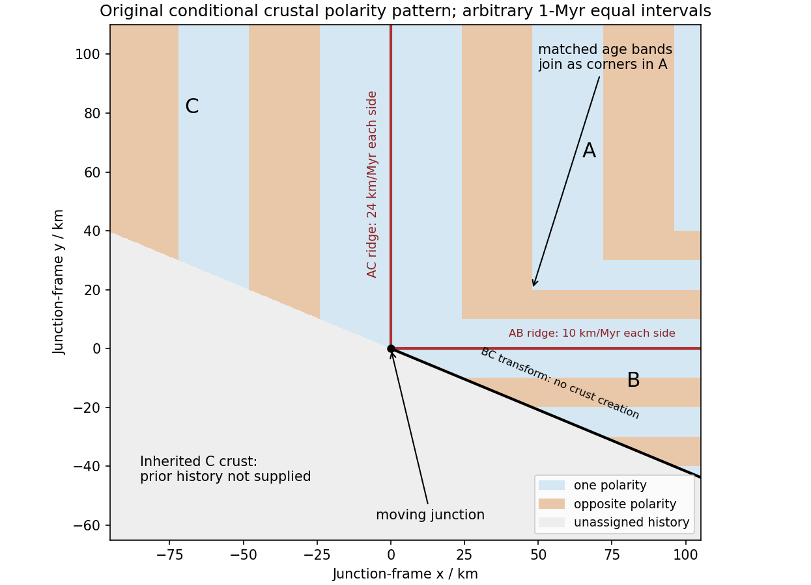

<h1 id="1/e/solution">Solution</h1>

↑ **Parent:** [E](../e.md)

Assume an Earth-like reversing planetary [magnetic field](../../../../../magnetic-field-split.md) and magnetizable crust that acquires [thermoremanent magnetization](../../../../../thermoremanent-magnetization.md) on cooling. Alternating polarity intervals then produce [marine magnetic stripes](../../../../../marine-magnetic-stripe.md) parallel to each [spreading ridge](../../../../../spreading-ridge.md), with matching age/polarity sequences on its two sides. AB has [half-spreading rate](../../../../../half-spreading-rate.md) 10 mm/year, whereas AC has [half-spreading rate](../../../../../half-spreading-rate.md) 24 mm/year. Thus the same polarity interval $\Delta t$ produces widths $10\Delta t$ and $24\Delta t$ mm when time is in years: the AC stripes are 2.4 times wider. Age increases away from each ridge. The transform produces no new crust; bands end or are displaced at it, rather than forming a third symmetric stripe sequence centred on BC. This is the remanent-magnetization/spreading mechanism developed from marine magnetic observations.[pp. 947–949, alternating remanent magnetization and the spreading interpretation](../../../../../magnetic-anomalies-over-oceanic-ridges-by-f-j-vine-and-d-h-matthews.md)

A more precise local sketch can be made in the northern junction frame. Let $x,y$ be distances in kilometres along the fixed tangent axes and $t$ the crustal age in Myr; numerically, mm/year equals km/Myr. Relative to the moving junction, the [velocities](../../../../../velocity.md) are $\mathbf w_A=(24,10)$, $\mathbf w_B=(24,-10)$ and $\mathbf w_C=(-24,10)$. In A the steady age field is $t_A=\min(x/24,y/10)$, since backwards advection first reaches either the AC or AB ridge. Equal-age bands therefore join as right-angle corners within A, with the corners migrating along the ray $(24,10)$. In the B wedge, $t_B=-y/10$ and the stripes meet the transform. On the C flank directly supplied from AC, $t_C=-x/24$; other parts of C carry older crust whose inherited pattern requires earlier boundary history.

**[Figure 2](#1/e/image-original-conditional-remanent-polarity-sketch-in-the-north-junction-frame-reversal-intervals-are-illustrative-and-unsupplied-older-crust-is-left-unassigned). Original conditional remanent-polarity sketch in the north-junction frame; reversal intervals are illustrative and unsupplied older crust is left unassigned**.

The sketch displays [magnetization](../../../../../magnetization.md) polarity, not a computed total-field anomaly amplitude. Actual anomalies depend on the planetary field direction, source depth, [magnetization](../../../../../magnetization.md) strength and observation geometry. The paper supplies no field history, so a numerical reversal chronology or an absolute positive/negative anomaly sequence cannot be inferred. Without field reversals, ridge accretion alone does not imply alternating polarity stripes.

## ↑ Ancestors (14)

1. [E](../e.md)
2. [1](../../1.md)
3. [Paper 1](../../../paper-1-split.md)
4. [2016](../../../split.md)
5. [Past exam of the physics of the Earth as a Planet course of the University of Cambridge](../../../../split.md)
6. [Physics of the Earth as a Planet course of the University of Cambridge](../../../../../physics-of-the-earth-as-a-planet-course-of-the-university-of-cambridge.md)
7. [Physics course of the year 4 of the natural sciences course of the University of Cambridge](../../../../../physics-course-of-the-year-4-of-the-natural-sciences-course-of-the-university-of-cambridge.md)
8. [Year 4 of the natural sciences course of the University of Cambridge](../../../../../year-4-of-the-natural-sciences-course-of-the-university-of-cambridge.md)
9. [Year of the natural sciences course of the University of Cambridge](../../../../../year-of-the-natural-sciences-course-of-the-university-of-cambridge.md)
10. [Natural sciences course of the University of Cambridge](../../../../../natural-sciences-course-of-the-university-of-cambridge.md)
11. [Course of the University of Cambridge](../../../../../course-of-the-university-of-cambridge.md)
12. [University of Cambridge](../../../../../university-of-cambridge-split.md)
13. [List of universities](../../../../../list-of-universities.md)
14. [Codex Wiki](../../../../../split.md)
