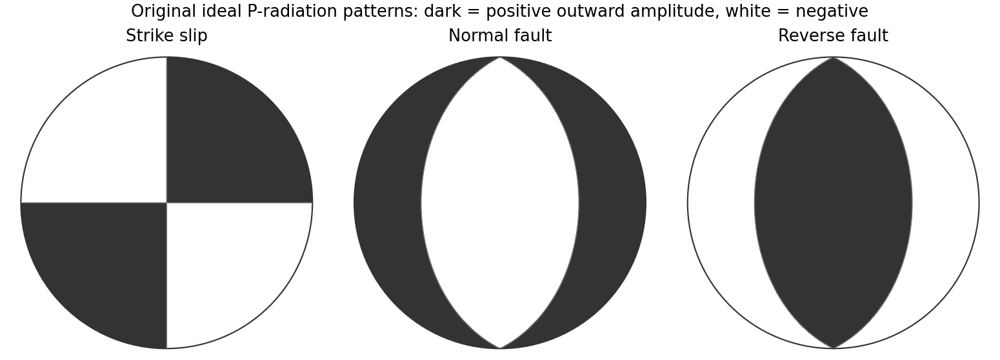

<h1 id="2/b/solution">Solution</h1>

↑ **Parent:** [B](../b.md)

**First-motion source mechanisms.** Locate an [earthquake](../../../../../earthquake.md) from arrival times and use a seismic [velocity](../../../../../velocity.md) model to calculate each station's source takeoff direction. Measure the initial direct [P wave](../../../../../p-wave.md) polarity after checking instrument sign, component orientation, timing and phase identification. An upward trace at an instrument is not automatically a source compression without the propagation and component convention. Plot the inferred source radiation signs on a [focal sphere](../../../../../focal-sphere.md), commonly using a lower-hemisphere equal-area projection, and seek nodal planes separating positive and negative observations.

For a shear dislocation with orthogonal unit slip and fault-normal [vectors](../../../../../vector.md) $\mathbf s,\mathbf n$, the [double-couple fault source](../../../../../double-couple-fault-source.md) has $M=M_0(\mathbf s\mathbf n^{\mathsf T}+\mathbf n\mathbf s^{\mathsf T})$. Its far-field P radiation sign is that of

$$
A_P(\hat{\mathbf r})\propto\hat{\mathbf r}^{\mathsf T}M\hat{\mathbf r}=2M_0(\hat{\mathbf r}\cdot\mathbf s)(\hat{\mathbf r}\cdot\mathbf n).
$$

The two zeros are orthogonal nodal planes; the four quadrants alternate between outward and inward initial radiation. Their orientations and quadrant signs determine candidate strike, dip and rake. Normal, reverse and strike-slip mechanisms give different projected patterns. The [earthquake pressure and tension axes](../../../../../earthquake-pressure-and-tension-axes.md) are the negative and positive moment-tensor principal directions, respectively; they do not by themselves measure the complete regional [stress tensor](../../../../../cauchy-stress-tensor.md).

**[Figure 3](#2/b/image-original-lower-hemisphere-equal-area-p-radiation-polarity-examples-for-ideal-strike-slip-normal-and-reverse-double-couples). Original lower-hemisphere equal-area P-radiation polarity examples for ideal strike-slip, normal and reverse double couples**.

There is a fundamental [fault-plane ambiguity](../../../../../fault-plane-ambiguity.md): exchanging $\mathbf s$ and $\mathbf n$ leaves the radiation tensor unchanged. First motions therefore give a fault plane and an auxiliary plane without saying which actually slipped. Use mapped rupture, [aftershock](../../../../../aftershock.md) geometry or independent geodetic [displacement](../../../../../displacement.md) to select the physical fault where possible. Polarity signs alone do not measure scalar seismic moment, source duration or rupture extent. A poorly sampled [focal sphere](../../../../../focal-sphere.md) or many near-nodal observations can admit several mechanisms rather than one defensible beachball.

Propagate uncertainty in event depth, [velocity](../../../../../velocity.md) gradients and takeoff angles, allow for mispicked or reversed polarities, and report the range of mechanisms consistent with the observations. A primary method did this by testing alternative locations and [velocity](../../../../../velocity.md) models and validated its uncertainty estimates using noisy synthetic data and clusters of events with similar waveforms.[pp. 2264–2266 and abstract, first-motion construction, polarity/takeoff uncertainty and independent validation tests](../../../../../a-new-method-for-determining-first-motion-focal-mechanisms-by-jeanne-l-hardebeck-and-peter-m-shearer.md) Broadband waveforms and amplitude ratios add information, especially for non-double-couple sources, but they are additional measurements rather than a way to extract amplitude information from a sign-only data set.

**Radial [density](../../../../../density.md) structure.** In an [isotropic](../../../../../isotropy.md) adiabatic material, the [seismic parameter](../../../../../seismic-parameter.md) is

$$
\Phi(r)=\frac{K_S}{\rho}=\alpha(r)^2-\frac43\beta(r)^2.
$$

For a chemically homogeneous region whose background stratification is adiabatic, $d\rho/dP=\rho/K_S=1/\Phi$. Combine this with spherical hydrostatic balance and [mass](../../../../../mass.md) conservation to obtain the [Adams-Williamson equations](../../../../../adams-williamson-equation.md)

$$
\boxed{\frac{d\rho}{dr}=-\frac{\rho g}{\Phi},\qquad\frac{dm}{dr}=4\pi r^2\rho,\qquad g=\frac{Gm}{r^2},\qquad\frac{dP}{dr}=-\rho g.}
$$

The inward [density](../../../../../density.md) increase follows [compressibility](../../../../../compressibility.md) under the increasing [pressure](../../../../../pressure-split.md). A specified starting [density](../../../../../density.md) and measured $\Phi(r)$ allow integration within a homogeneous adiabatic layer. Seismic [velocities](../../../../../velocity.md) alone, however, do not determine that [density](../../../../../density.md) normalization, since they contain ratios of moduli to [density](../../../../../density.md). Chemical boundaries, phase transitions, nonadiabatic thermal gradients and [anisotropy](../../../../../anisotropy.md) require additional modeling; a composition jump is not obtained by blindly integrating the smooth relation across it.

Use travel times and surface waves to constrain elastic [velocities](../../../../../velocity.md), reflected/converted phases to locate interfaces, and normal-mode frequencies to constrain [density](../../../../../density.md) as well as elastic structure through their sensitivity kernels. Impose independently known total [mass](../../../../../mass.md) and [moment of inertia](../../../../../moment-of-inertia.md):

$$
M=4\pi\int_0^R\rho(r)r^2\,dr,\qquad I=\frac{8\pi}{3}\int_0^R\rho(r)r^4\,dr.
$$

Because these weight depth differently, they help distinguish admissible profiles, but two integrals alone do not specify an arbitrary radial function. Laboratory equations of state and mineral physics restrict composition, [compressibility](../../../../../compressibility.md) and [density](../../../../../density.md) jumps. [pressure](../../../../../pressure-split.md) and enclosed [mass](../../../../../mass.md) are matched across interfaces, while [density](../../../../../density.md) may jump. In a liquid region $\beta=0$ and $\Phi=\alpha^2$, so the shear-wave absence constrains phase state without itself providing a direct [density](../../../../../density.md) measurement.

The [Preliminary Reference Earth Model](../../../../../preliminary-reference-earth-model.md) is a concrete joint inversion of seismic travel times, [normal modes](../../../../../normal-mode.md), [mass](../../../../../mass.md) and inertia, including [density](../../../../../density.md) and attenuation along with elastic structure. The original analysis combined these complementary data rather than deriving [density](../../../../../density.md) uniquely from [P wave](../../../../../p-wave.md) [speed](../../../../../speed.md).[abstract and pp. 297–300, data classes and coupled radial reference-model inversion](../../../../../preliminary-reference-earth-model-by-adam-m-dziewonski-and-don-l-anderson.md) **A defensible radial [density](../../../../../density.md) model combines hydrostatic/thermodynamic relations with seismic and global integral constraints, and states where homogeneity and adiabaticity fail.**

## ↑ Ancestors (14)

1. [B](../b.md)
2. [2](../../2.md)
3. [Paper 1](../../../paper-1-split.md)
4. [2016](../../../split.md)
5. [Past exam of the physics of the Earth as a Planet course of the University of Cambridge](../../../../split.md)
6. [Physics of the Earth as a Planet course of the University of Cambridge](../../../../../physics-of-the-earth-as-a-planet-course-of-the-university-of-cambridge.md)
7. [Physics course of the year 4 of the natural sciences course of the University of Cambridge](../../../../../physics-course-of-the-year-4-of-the-natural-sciences-course-of-the-university-of-cambridge.md)
8. [Year 4 of the natural sciences course of the University of Cambridge](../../../../../year-4-of-the-natural-sciences-course-of-the-university-of-cambridge.md)
9. [Year of the natural sciences course of the University of Cambridge](../../../../../year-of-the-natural-sciences-course-of-the-university-of-cambridge.md)
10. [Natural sciences course of the University of Cambridge](../../../../../natural-sciences-course-of-the-university-of-cambridge.md)
11. [Course of the University of Cambridge](../../../../../course-of-the-university-of-cambridge.md)
12. [University of Cambridge](../../../../../university-of-cambridge-split.md)
13. [List of universities](../../../../../list-of-universities.md)
14. [Codex Wiki](../../../../../split.md)
