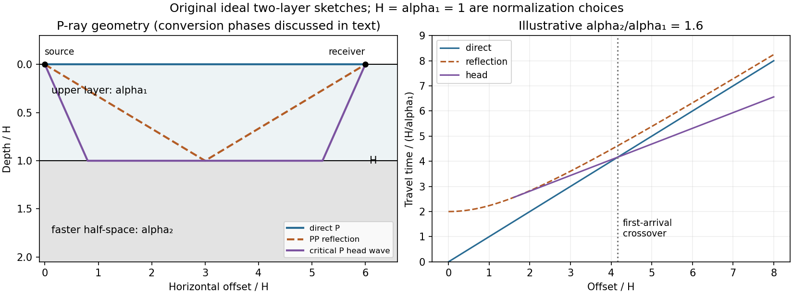

<h1 id="3/c/solution">Solution</h1>

↑ **Parent:** [C](../c.md)

Use geometric rays for body-wave arrivals and a traction-free upper surface. A compact [isotropic explosion source](../../../../../isotropic-explosion-source.md) has moment tensor proportional to $\delta_{ij}$ and produces direct P body radiation in a homogeneous [isotropic](../../../../../isotropy.md) medium. Thus the basic near-offset arrival is the direct upper-layer [P wave](../../../../../p-wave.md), with time $X/\alpha_1$. A pure explosion is not a shear fault: it does not automatically emit a direct [S wave](../../../../../s-wave.md) of comparable strength. Interfaces can nevertheless convert its P [energy](../../../../../energy-split.md) into SV motion, and the free surface can support [Rayleigh waves](../../../../../rayleigh-wave.md).

Downward P [energy](../../../../../energy-split.md) reflects from the interface to give a PP [reflection](../../../../../reflection-mathematics.md) returning to the receiver; for a horizontal interface its ray is symmetric and its time is $\sqrt{X^2+4H^2}/\alpha_1$. Other transmitted P [energy](../../../../../energy-split.md) enters the faster half-space. At $\sin i_c=\alpha_1/\alpha_2$, a critical ray travels along the interface and feeds an upgoing [seismic head wave](../../../../../seismic-head-wave.md), often labeled Pn in this simplified crustal model. Its ideal travel-time branch is

$$
t_{\rm head}=\frac{X}{\alpha_2}+\frac{2H\cos i_c}{\alpha_1}.
$$

It requires enough offset for the two inclined upper-layer legs, $X\ge2H\tan i_c$. Once $X$ exceeds the larger [first-arrival crossover distance](../../../../../first-arrival-crossover-distance.md) $X_c=2H\sqrt{(\alpha_2+\alpha_1)/(\alpha_2-\alpha_1)}$, this branch arrives before the direct upper-layer wave because it spends most of the path in faster material. A transmitted ray descending into an otherwise uniform infinite half-space does not return as a separate [reflection](../../../../../reflection-mathematics.md) without an additional reflector.

**[Figure 4](#3/c/image-original-two-layer-p-ray-sketches-and-illustrative-direct-reflected-and-critically-refracted-travel-time-branches). Original two-layer P-ray sketches and illustrative direct, reflected and critically refracted travel-time branches**.

At oblique incidence, the bonded-interface conditions couple P and SV [polarizations](../../../../../polarization-waves.md). A downgoing P ray can return as a converted SV [reflection](../../../../../reflection-mathematics.md) in the upper layer, with common horizontal slowness $p=\sin i_P/\alpha_1=\sin i_S/\beta_1$. There are transmitted P/SV branches and, after further interaction with the free surface or interface, mixed-mode [reflections](../../../../../reflection-mathematics.md) and [layer reverberations](../../../../../layer-reverberation.md). Conversion coefficients depend on [density](../../../../../density.md) and impedance as well as wave [speeds](../../../../../speed.md), and some vanish at normal incidence. The supplied inequalities do not order $\beta_2$ against $\alpha_1$, so one cannot universally draw a P-incident critical head ray travelling at the lower-layer S [speed](../../../../../speed.md): that direct conversion construction requires $\beta_2>\alpha_1$. A shear head-wave phase can be present if the appropriate SV [energy](../../../../../energy-split.md) and ray conditions are available, but is not an inevitable direct explosion arrival from the stated data alone.

At later times a shallow explosion can excite dispersive Rayleigh-wave trains, with coupled P-SV motion decaying with depth. Short wavelengths mainly sample the slow upper layer, whereas long wavelengths penetrate the lower half-space; group and phase [speeds](../../../../../speed.md) need not be equal. Multiple reflected/converted body waves can overlap this coda. The shear-speed contrast also permits Love-wave modes structurally, but SH motion is decoupled from P-SV in this flat [isotropic](../../../../../isotropy.md) model. **An ideal [isotropic](../../../../../isotropy.md) explosion does not excite [Love waves](../../../../../love-wave.md) here; appreciable SH/Love [energy](../../../../../energy-split.md) would require source asymmetry, scattering or a broken symmetry of the model.**

Exact amplitudes, resolved arrival separation and attenuation cannot be calculated without [densities](../../../../../density.md), source spectrum, damping and instrument response. The qualitative robust features are a near-offset direct P arrival, reflected and converted phases, a faster-lower-layer P head wave that can become first at long range, reverberations and P-SV surface-wave [energy](../../../../../energy-split.md). The ray diagram uses declared illustrative [speed](../../../../../speed.md) ratios solely to show the geometry; they are not additional supplied material constants.

## ↑ Ancestors (14)

1. [C](../c.md)
2. [3](../../3.md)
3. [Paper 1](../../../paper-1-split.md)
4. [2016](../../../split.md)
5. [Past exam of the physics of the Earth as a Planet course of the University of Cambridge](../../../../split.md)
6. [Physics of the Earth as a Planet course of the University of Cambridge](../../../../../physics-of-the-earth-as-a-planet-course-of-the-university-of-cambridge.md)
7. [Physics course of the year 4 of the natural sciences course of the University of Cambridge](../../../../../physics-course-of-the-year-4-of-the-natural-sciences-course-of-the-university-of-cambridge.md)
8. [Year 4 of the natural sciences course of the University of Cambridge](../../../../../year-4-of-the-natural-sciences-course-of-the-university-of-cambridge.md)
9. [Year of the natural sciences course of the University of Cambridge](../../../../../year-of-the-natural-sciences-course-of-the-university-of-cambridge.md)
10. [Natural sciences course of the University of Cambridge](../../../../../natural-sciences-course-of-the-university-of-cambridge.md)
11. [Course of the University of Cambridge](../../../../../course-of-the-university-of-cambridge.md)
12. [University of Cambridge](../../../../../university-of-cambridge-split.md)
13. [List of universities](../../../../../list-of-universities.md)
14. [Codex Wiki](../../../../../split.md)
