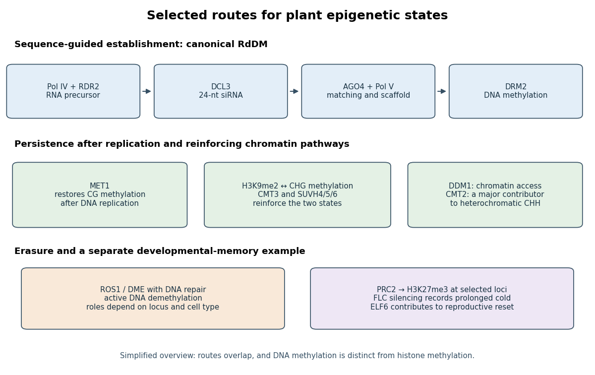

# Paper PLL1

↑ **Parent:** [2024](../2024.md)

[Original paper, released PDF pages 39–40](https://www.whatdotheyknow.com/request/natural_science_tripos_part_ii_p_2/response/3113356/attach/4/FOI%202025%20634%20Vongtanakiat%20materials.pdf?cookie_passthrough=1#page=39)

**Table of contents**

- [1](#1)
  - [Solution](#1/solution)
- [2](#2)
  - [Solution](#2/solution)
- [3](#3)
  - [Solution](#3/solution)
- [4](#4)
  - [Solution](#4/solution)
- [5](#5)
  - [Solution](#5/solution)
- [6](#6)
  - [Solution](#6/solution)

## 1

↑ **Parent:** [Paper PLL1](paper-pll1.md)

<h3 id="1/solution">Solution</h3>

↑ **Parent:** [1](#1)

**Epigenetic information affects [plant](../../organism.md#plant) [genome evolution](../../genetics.md#genome-evolution) both by regulating the behavior of DNA sequences and by supplying heritable regulatory variation on which selection can act.** It is therefore neither an alternative to genetic evolution nor merely a passive consequence of it. Changes in [DNA methylation](../../molecular-genetics.md#dna-methylation), [chromatin](../../molecular-genetics.md#chromatin) and small-RNA targeting influence which sequences transpose, recombine, mutate or remain expressed, while the DNA sequence helps determine where those [epigenetic states](../../genetics.md#epigenetic-state) are established.

An [epigenetic state](../../genetics.md#epigenetic-state) is not simply a measurement of expression at one instant. For evolutionary purposes, one must ask whether a difference persists through cell division, survives reproduction and changes a [phenotype](../../genetics.md#phenotype) relevant to reproductive success. An [epiallele](../../biology.md#epiallele) can differ in regulatory state without a change in the local nucleotide sequence, but many epigenetic differences are caused by genetic variation elsewhere. A newly inserted repeat, for example, may recruit silencing to a nearby gene. The insertion is a genetic difference, while the resulting methylation is part of its mechanism. Demonstrating an independent epigenetic contribution therefore requires more than finding different methylomes in genetically different varieties.

A major connection is control of [transposable elements](../../genetics.md#transposable-element). Mobilization can increase copy number, interrupt coding sequences, change [gene regulation](../../molecular-genetics.md#regulation-of-gene-expression) and promote rearrangements between repeated sequences. [plants](../../organism.md#plant) silence many such elements through [DNA methylation](../../molecular-genetics.md#dna-methylation), [H3K9me2](../../molecular-genetics.md#h3k9-dimethylation) and [RNA-directed DNA methylation](../../biology.md#rna-directed-dna-methylation). This protects genome integrity but also permits a genome to tolerate a reservoir of potentially mobile DNA. The physical accessibility of that DNA matters: [DDM1](../../molecular-genetics.md#ddm1) helps methyltransferases reach nucleosomal [heterochromatin](../../molecular-genetics.md#heterochromatin), showing how [chromatin organization](../../molecular-genetics.md#chromatin-organization) contributes to the containment of repetitive sequences.[experimental analysis of heterochromatic methylation and transposon regulation](../../biology-bibliography.md#the-arabidopsis-nucleosome-remodeler-ddm1-allows-dna-methyltransferases-to-access-h1-containing-heterochromatin-by-assaf-zemach-and-others)

Silencing is not permanently absolute. Failure or reprogramming of maintenance can expose an element to [transcription](../../molecular-genetics.md#transcription-biology), and a successful new insertion can create a lasting sequence change even if silencing is restored later. Reactivation in a somatic cell is not automatically evolutionarily transmitted: an insertion must reach a reproductive lineage to contribute directly to inherited genome change. In [Arabidopsis thaliana](../../biology.md#arabidopsis-thaliana) pollen, transposon reactivation in the vegetative nucleus was distinguished from the protected sperm lineage; the associated small RNAs illustrated how one cell type can contribute information relevant to silencing in another.[Summary and comparison of pollen vegetative nuclei with sperm](../../biology-bibliography.md#epigenetic-reprogramming-and-small-rna-silencing-of-transposable-elements-in-pollen-by-r-keith-slotkin-and-others) This is regulated reprogramming, not indiscriminate activation of the inherited genome.

Transposon control also changes the material available for regulatory evolution. An insertion may carry a promoter, enhancer or transcription-factor binding site, while its epigenetic silencing can repress an adjacent gene or define a [chromatin](../../molecular-genetics.md#chromatin) boundary. If selection favors part of the inserted sequence, its regulatory contribution can be retained while other element functions decay. Conversely, inappropriate spread of silencing can be harmful. The evolutionary outcome depends on insertion position, expression effects, mobility and host regulation; it is not true that all transposon activity is beneficial or that all methylation near genes is repressive. In particular, gene-body [CG methylation](../../molecular-genetics.md#cg-methylation) and promoter-associated silencing should not be treated as interchangeable states.

Epigenetic information also influences sequence evolution through mutation and recombination. [hydrolytic deamination](../../chemical-reaction.md#hydrolytic-deamination) of methylated cytosine can generate a thymine mismatch and, if unrepaired, a C-to-T substitution. A regulatory mark can thus change the [probability](../../probability-theory.md#probability) of a subsequent genetic mutation; the resulting base substitution is no longer an [epimutation](../../biology.md#epimutation). [chromatin](../../molecular-genetics.md#chromatin) state also helps organize where meiotic breaks and crossovers occur. Repeat-rich [heterochromatin](../../molecular-genetics.md#heterochromatin) often exchanges less readily than gene-rich chromosome arms, altering the degree to which selection acts on linked variants. These effects are contextual rather than a rule that every methylated cytosine or every marked region has the same evolutionary fate.

There is also a genuinely heritable state component. Mutation-accumulation lines of [Arabidopsis thaliana](../../biology.md#arabidopsis-thaliana) showed spontaneous methylation differences across generations, with individual sites more labile than many larger methylated regions and with recurrent changes at some sites.[comparison of lines descended from a common ancestor; regional stability and recurrent epimutations](../../biology-bibliography.md#spontaneous-epigenetic-variation-in-the-arabidopsis-thaliana-methylome-by-claude-becker-and-others) Thus an epigenetic variant's evolutionary importance depends jointly on its phenotypic effect, transmission [probability](../../probability-theory.md#probability) and reversion rate. A rapidly reversible state may support plasticity but fail to behave like a stable DNA allele over many generations.

Experiments with [epigenetic recombinant inbred lines](../../biology.md#epigenetic-recombinant-inbred-line) provide evidence that some methylation differences can contribute to quantitative [phenotypes](../../genetics.md#phenotype). Mapping in a comparatively uniform genetic background identified epigenetic loci associated with flowering time and root length.[epigenetic quantitative-trait mapping and selection in epiRILs](../../biology-bibliography.md#mapping-the-epigenetic-basis-of-complex-traits-by-sandra-cortijo-and-others) This establishes a possible substrate for selection, not a claim that most natural adaptation is sequence-independent. Residual sequence variation, new transposon insertions, genetic control of methylation and environment-dependent effects must still be distinguished in natural populations.

Hybridization and [allopolyploidy](../../molecular-genetics.md#allopolyploidy) create further interactions. Divergent regulatory systems and multiple parental copies must operate together, and changes in [chromatin](../../molecular-genetics.md#chromatin) can alter dosage or expression before any gene is lost. In [nucleolar dominance](../../biology.md#nucleolar-dominance), one parental set of ribosomal RNA genes is epigenetically silenced. The involvement of [HDA6](../../molecular-genetics.md#hda6), [DNA methylation](../../molecular-genetics.md#dna-methylation) and histone-state changes shows that unequal parental expression can arise without deleting the silent set.[Abstract and perturbation of parental rRNA-gene silencing](../../biology-bibliography.md#erasure-of-histone-acetylation-by-arabidopsis-hda6-mediates-large-scale-gene-silencing-in-nucleolar-dominance-by-keith-earley-and-others) Such expression differences can influence which duplicate functions remain useful, although silencing alone does not prove the later direction of gene loss or subgenome evolution.

**Epigenetic information therefore shapes [genome evolution](../../genetics.md#genome-evolution) as a regulator of genome activity, a modifier of genetic change and sometimes an inherited source of phenotypic variation.** Its effects must be analyzed together with sequence, reproduction and selection, without assuming that environmentally induced changes are necessarily adaptive or permanently inherited.

## 2

↑ **Parent:** [Paper PLL1](paper-pll1.md)

<h3 id="2/solution">Solution</h3>

↑ **Parent:** [2](#2)

**Epigenetic modification could improve a [crop](../../biology.md#crop) by selecting useful stable regulatory variants, deliberately altering a validated locus, preserving favorable states during propagation, or exploiting temporary physiological memory when permanent inheritance is unnecessary.** The appropriate strategy depends on the trait, the [crop](../../biology.md#crop)'s mode of propagation and the stability of the state. A useful methylation marker is not automatically a causal target, and a demonstration in [Arabidopsis thaliana](../../biology.md#arabidopsis-thaliana) is not yet an improved field variety.

A sensible starting point is natural variation. A breeder can relate a [phenotype](../../genetics.md#phenotype) to [differentially methylated regions](../../molecular-genetics.md#differentially-methylated-region), while measuring [genotype](../../genetics.md#genotype), expression and relevant environmental history. [epigenome-wide association studies](../../biology.md#epigenome-wide-association-study) can prioritize candidate loci, but local sequence differences, trans-acting regulators and differences in tissue composition can all produce methylation associations. Common-environment comparisons, reciprocal crosses where appropriate and evidence that changing the state changes the trait help establish causation. The desired product is a regulatory state that remains useful in the target genetic background, not simply the largest statistical methylation difference.

A concrete nutritional example is [VTE3(1)](../../biology.md#vte3-1) in [tomato](../../organism.md#tomato). Differential methylation associated with a promoter [retrotransposon](../../genetics.md#retrotransposon) affects expression of a vitamin E biosynthetic gene and fruit tocopherol accumulation. The reported [epialleles](../../biology.md#epiallele) connect a regulatory state with an agronomic quality trait, rather than merely correlating bulk methylation with vigorous growth.[Abstract; promoter methylation, expression and fruit tocopherol analyses](../../biology-bibliography.md#natural-occurring-epialleles-determine-vitamin-e-accumulation-in-tomato-fruits-by-leandro-quadrana-and-others) Selecting a favorable state could therefore complement conventional selection, provided its stability, the underlying promoter sequence and any correlated quality effects are characterized. The existence of this example does not imply that removing methylation generally raises [crop](../../biology.md#crop) quality.

A second route is to create and select broader epigenetic variation. Transient disruption of methylation maintenance can generate [epigenetic recombinant inbred lines](../../biology.md#epigenetic-recombinant-inbred-line) after the initiating genetic defect is removed. Such populations have produced selectable variation in quantitative traits in [Arabidopsis thaliana](../../biology.md#arabidopsis-thaliana).[epiRIL trait mapping and response to selection](../../biology-bibliography.md#mapping-the-epigenetic-basis-of-complex-traits-by-sandra-cortijo-and-others) They can reveal regulatory states not readily encountered in an existing breeding pool. However, broad hypomethylation can also activate transposons or destabilize development. Genome sequencing is needed to distinguish genuine state effects from new insertions or other mutations, and restoring a maintenance gene does not guarantee that every induced [epiallele](../../biology.md#epiallele) will persist.

[somaclonal variation](../../biology.md#somaclonal-variation) during tissue culture is another source of altered states, but a good [crop](../../biology.md#crop) strategy can involve preventing harmful epigenetic change rather than generating more. In [African oil palm](../../organism.md#african-oil-palm), loss of methylation at the [Karma epiallele](../../biology.md#karma-epiallele) in an intronic [retrotransposon](../../genetics.md#retrotransposon) is associated with abnormal splicing, mantled flowers and reduced yield. Methylation near the relevant splice region provided a predictor of the damaging variant.[Abstract and relation between methylation, transcript processing and fruit phenotype](../../biology-bibliography.md#loss-of-karma-transposon-methylation-underlies-the-mantled-somaclonal-variant-of-oil-palm-by-meilina-ong-abdullah-and-others) Screening propagated material for the favorable state can protect the value of elite clones; it is not evidence that arbitrary stress-induced methylation will improve yield.

More directed approaches use [epigenome editing](../../biology.md#epigenome-editing). A sequence-targeting protein such as [dCas9](../../molecular-genetics.md#dcas9) can recruit an activity that changes [DNA methylation](../../molecular-genetics.md#dna-methylation) or a [chromatin](../../molecular-genetics.md#chromatin) regulator, rather than cutting the target sequence. One can in principle tune a validated promoter's expression while retaining its coding sequence. Targeted demethylation of the [FWA](../../biology.md#fwa) locus in [Arabidopsis thaliana](../../biology.md#arabidopsis-thaliana) demonstrated that a changed methylation state can alter expression and flowering behavior, with inheritance of the state at that particular locus.[FWA-targeted demethylation, expression, flowering and inheritance tests](../../biology-bibliography.md#targeted-dna-demethylation-of-the-arabidopsis-genome-using-the-human-tet1-catalytic-domain-by-javier-gallego-bartolome-and-others) This is a proof of a mechanism, not a recommendation that delayed flowering is universally favorable or that every edited locus will retain its state after the targeting factor disappears.

The causal chain should guide target choice: a defined regulatory state changes expression in the relevant tissue, which changes a biochemical or developmental process, which improves the intended [crop](../../biology.md#crop) trait. Possible objectives include modifying flowering schedules, improving nutritional composition or reducing an unfavorable expression state during clonal propagation. Persistent effects require a mechanism for maintaining the new state. If local DNA repeats or small-RNA pathways continually restore the original state, a transient edit may be erased. Conversely, a state that is too persistent may impair later developmental transitions. Specificity also matters because broad changes to a [chromatin](../../molecular-genetics.md#chromatin) enzyme affect many loci simultaneously.

Not every useful application requires an inherited [epiallele](../../biology.md#epiallele). [Seed priming](../../biology.md#seed-priming) or a prior acclimating exposure can change later stress responses within the same [crop](../../biology.md#crop) generation. If the treatment reproducibly improves establishment under the intended conditions, it can be agronomically useful even when offspring return to the original state. Nevertheless, [stress priming](../../biology.md#stress-priming) may be mediated by stored metabolites, hormones or proteins rather than inherited [chromatin](../../molecular-genetics.md#chromatin). Benefits can disappear in another environment or be offset by reduced growth, altered maturation or shorter seed storage life. Such treatments should be evaluated as defined management interventions, rather than being advertised as proven transgenerational breeding.

Any deployment needs tests matched to how the [crop](../../biology.md#crop) is propagated. A seed-propagated line must transmit the favorable effect through reproduction; a clone must retain it through the relevant number of propagation cycles. Multi-environment trials should measure the intended endpoint and relevant costs, including fertility, developmental normality and yield stability. Comparing treated and untreated material of the same [genotype](../../genetics.md#genotype), checking independent derivations and monitoring sequence as well as [epigenetic state](../../genetics.md#epigenetic-state) reduce the risk of attributing an unrelated change to the proposed mechanism. Molecular differences alone do not establish an economic benefit.

**The strongest strategy is therefore to treat [epigenetic state](../../genetics.md#epigenetic-state) as an additional, testable breeding or management variable.** Natural [epialleles](../../biology.md#epiallele), directed editing and propagation control offer different opportunities, but none removes the need to establish causality, persistence and benefit in the actual [crop](../../biology.md#crop) and production environment.

## 3

↑ **Parent:** [Paper PLL1](paper-pll1.md)

<h3 id="3/solution">Solution</h3>

↑ **Parent:** [3](#3)

**[plants](../../organism.md#plant) establish [epigenetic states](../../genetics.md#epigenetic-state) through sequence- and context-dependent recruitment, maintain selected states through replication and regulatory feedback, and erase others when development requires a reset.** These processes protect repetitive DNA, stabilize cell identity and coordinate developmental or environmental responses. An [epigenetic state](../../genetics.md#epigenetic-state) is therefore regulated information, not simply a collection of chemical marks that always switch genes off.

[plant](../../organism.md#plant) [DNA methylation](../../molecular-genetics.md#dna-methylation) occurs in CG, CHG and CHH contexts, where H denotes A, C or T. The contexts have overlapping but distinct control mechanisms. At a methylated CG dyad, [DNA replication](../../molecular-genetics.md#dna-replication) initially produces hemimethylated daughter DNA; [MET1](../../molecular-genetics.md#met1) helps restore methylation on the new strand. This provides a direct route for maintaining an existing pattern. By contrast, asymmetric [CHH methylation](../../molecular-genetics.md#chh-methylation) cannot be retained merely by copying an equivalent methylated cytosine across a symmetric dyad: continued targeting by small-RNA or [chromatin](../../molecular-genetics.md#chromatin) pathways is required. [CHG methylation](../../molecular-genetics.md#chg-methylation) is strongly coupled to histone recognition and reinforcing [chromatin](../../molecular-genetics.md#chromatin) feedback rather than being explained by CG maintenance alone.

For establishment at many repeats, canonical [RNA-directed DNA methylation](../../biology.md#rna-directed-dna-methylation) provides sequence specificity. [Pol IV](../../molecular-genetics.md#rna-polymerase-iv) produces precursors that, with [RDR2](../../molecular-genetics.md#rdr2), generate double-stranded RNA; [DCL3](../../enzyme.md#dcl3) processes these into 24-nucleotide [small interfering RNAs](../../molecular-genetics.md#small-interfering-rna). An [Argonaute](../../protein.md#argonaute) such as [AGO4](../../protein.md#ago4) uses guide information in association with nascent scaffold transcripts made by [Pol V](../../molecular-genetics.md#rna-polymerase-v), helping recruit [DRM2](../../molecular-genetics.md#drm2) to the matching locus. [DRM2](../../molecular-genetics.md#drm2) can establish methylation in multiple cytosine contexts. Thus [transcription](../../molecular-genetics.md#transcription-biology) can paradoxically be required to establish transcriptional silencing: the scaffold supplies a locus-specific interaction surface rather than representing productive expression of the silenced gene.[Pol V scaffold transcription and its requirement alongside siRNA production](../../biology-bibliography.md#noncoding-transcription-by-rna-polymerase-pol-ivb-pol-v-mediates-transcriptional-silencing-of-overlapping-and-adjacent-genes-by-andrzej-t-wierzbicki-and-others)

Maintenance is also reinforced by interactions between DNA and histone states. [CMT3](../../molecular-genetics.md#cmt3) recognizes [H3K9me2](../../molecular-genetics.md#h3k9-dimethylation)-associated [chromatin](../../molecular-genetics.md#chromatin) and contributes to [CHG methylation](../../molecular-genetics.md#chg-methylation). Histone methyltransferases including [SUVH4](../../protein.md#suvh4), [SUVH5](../../protein.md#suvh5) and [SUVH6](../../protein.md#suvh6) couple methylated DNA to H3K9 methylation, forming a reinforcing relationship. [CMT2](../../molecular-genetics.md#cmt2) contributes strongly to [CHH methylation](../../molecular-genetics.md#chh-methylation) in heterochromatic regions, while [RdDM](../../biology.md#rna-directed-dna-methylation) is particularly important in other targeted contexts. Mutant methylomes show both specialization and redundancy, as well as dependencies linking non-CG methylation, small RNAs and H3K9 states.[methyltransferase mutants, CMT2 activity and dependencies between epigenetic pathways](../../biology-bibliography.md#non-cg-methylation-patterns-shape-the-epigenetic-landscape-in-arabidopsis-by-hume-stroud-and-others) These are interacting pathways, not three enzymes independently copying three unrelated codes.

Accessibility is an essential part of the mechanism. Dense [nucleosomes](../../molecular-genetics.md#nucleosome) and linker histones can restrict a methyltransferase even when an appropriate DNA sequence is present. [DDM1](../../molecular-genetics.md#ddm1) remodels H1-containing [heterochromatin](../../molecular-genetics.md#heterochromatin) to allow access, complementing RNA-directed targeting in different [chromatin](../../molecular-genetics.md#chromatin) environments.[heterochromatin accessibility and complementary methylation pathways](../../biology-bibliography.md#the-arabidopsis-nucleosome-remodeler-ddm1-allows-dna-methyltransferases-to-access-h1-containing-heterochromatin-by-assaf-zemach-and-others) This explains why maintenance can depend on both an enzyme that writes a modification and machinery that permits the enzyme to reach its substrate.

Histone-based developmental memory is a distinct layer. [Polycomb repressive complex 2](../../protein.md#polycomb-repressive-complex-2) deposits [H3K27me3](../../protein.md#h3k27-trimethylation) at selected developmental loci. Sequence-specific regulators, transcriptional context and environmental signals determine where recruitment occurs; recycling of parental histones and restoration of modifications help preserve selected states after replication. Yet the presence of a histone mark does not prove that the mark autonomously copies itself or is sufficient for inheritance. Recruitment, feedback, [nucleosome](../../molecular-genetics.md#nucleosome) turnover and the transcriptional state all need to be considered. H3K27-based silencing of developmental genes should also be distinguished from H3K9-associated transposon [heterochromatin](../../molecular-genetics.md#heterochromatin).

[vernalization](../../biology.md#vernalization) illustrates how a state is established for a purpose and maintained for a limited interval. In [Arabidopsis thaliana](../../biology.md#arabidopsis-thaliana), prolonged cold promotes stable repression of the floral repressor [FLC](../../biology.md#flowering-locus-c), allowing later flowering in appropriate conditions. Natural accessions differ in the cold exposure needed for stable silencing, correlated with accumulation of [H3K27me3](../../protein.md#h3k27-trimethylation).[variation in stable FLC silencing and H3K27me3 after different cold exposures](../../biology-bibliography.md#variation-in-the-epigenetic-silencing-of-flc-contributes-to-natural-variation-in-arabidopsis-vernalization-response-by-chikako-shindo-and-others) Maintaining the state after warming allows the [plant](../../organism.md#plant) to retain information about winter rather than respond only to the instantaneous temperature.

Erasure is equally important. Active [DNA demethylation](../../molecular-genetics.md#dna-demethylation) can involve DNA glycosylase/lyase activity followed by repair that replaces methylated bases. The identification of [ROS1](../../molecular-genetics.md#ros1) connected promoter demethylation to protection against inappropriate gene silencing.[ROS1 mutant phenotype and methylated-DNA glycosylase activity](../../biology-bibliography.md#ros1-a-repressor-of-transcriptional-gene-silencing-in-arabidopsis-encodes-a-dna-glycosylase-lyase-by-zhizhong-gong-and-others) Reproductive reprogramming is cell-type specific: [DEMETER](../../molecular-genetics.md#demeter) has a maternal role in imprinting and seed viability, rather than representing indiscriminate erasure in every cell.[maternal gametophyte function, imprinting and seed phenotype](../../biology-bibliography.md#demeter-a-dna-glycosylase-domain-protein-is-required-for-endosperm-gene-imprinting-and-seed-viability-in-arabidopsis-by-yeonhee-choi-and-others)

An environmentally acquired state may also need resetting between generations. The vernalized [FLC](../../biology.md#flowering-locus-c) state is normally reset during reproduction and seed development, so the offspring can require its own winter. Perturbing the histone demethylase [ELF6](../../enzyme.md#elf6) impaired resetting and allowed inheritance of a partially vernalized state.[FLC resetting and ELF6-dependent H3K27 demethylation](../../biology-bibliography.md#epigenetic-reprogramming-that-prevents-transgenerational-inheritance-of-the-vernalized-state-by-pedro-crevillen-and-others) This contrasts with loci whose methylation states remain stable through reproduction. [plants](../../organism.md#plant) cannot be described either as preserving every acquired mark or as globally erasing all epigenetic information.

**[Figure 1](#3/image-original-overview-of-dna-methylation-establishment-reinforcing-maintenance-active-demethylation-and-a-distinct-polycomb-developmental-memory-pathway). Original overview of DNA methylation establishment, reinforcing maintenance, active demethylation and a distinct Polycomb developmental-memory pathway**.

Why retain these systems? Silencing mobile and repetitive DNA limits genome damage, [chromatin](../../molecular-genetics.md#chromatin) states help cells maintain appropriate expression despite a shared genome, and developmental memory coordinates events separated in time. Selective reprogramming supports gametes and seeds, while boundaries and active demethylation prevent necessary silencing from spreading into genes that must function. Methylation within an expressed gene is not equivalent to repression at a promoter, and a transient transcriptional response is not automatically an inherited state. **[plant](../../organism.md#plant) epigenetic control is therefore a balance of targeting, faithful persistence and timely erasure, with different mechanisms serving different biological intervals and genomic contexts.**

## 4

↑ **Parent:** [Paper PLL1](paper-pll1.md)

<h3 id="4/solution">Solution</h3>

↑ **Parent:** [4](#4)

**A [crop](../../biology.md#crop)'s future performance depends on its past because development, stored resources and environmental experience change what the [plant](../../organism.md#plant) or its offspring can do next.** Some effects are transient physiological carry-over, some involve stable somatic [chromatin](../../molecular-genetics.md#chromatin) states, and a smaller set may persist through reproduction. Life-history strategy—especially annual versus perennial growth—also determines whether a response that helps now benefits later reproduction or harvest.

Development creates sequential competence. Germination, juvenile growth, reproductive transition and seed filling are not interchangeable stages: exposure to the same stress at each stage can have different consequences. Early damage can reduce leaf area or root capacity and therefore later yield even after the original stress disappears. Carbon reserves, nutrient stores, root architecture and meristem condition can all carry information about the past without requiring an epigenetic mechanism. A study claiming memory must distinguish those persistent physical consequences from a changed response to a genuinely new challenge.

A clear beneficial memory is [vernalization](../../biology.md#vernalization). In [plants](../../organism.md#plant) requiring winter cold, the past temperature sequence affects later flowering under otherwise similar warm conditions. In [Arabidopsis thaliana](../../biology.md#arabidopsis-thaliana), cold-induced repression of [FLC](../../biology.md#flowering-locus-c) can remain after warming, while different accessions require different durations of cold for reliable silencing.[accession-dependent cold requirements and stable repression after warming](../../biology-bibliography.md#variation-in-the-epigenetic-silencing-of-flc-contributes-to-natural-variation-in-arabidopsis-vernalization-response-by-chikako-shindo-and-others) The ecological value is seasonal coordination: responding to a brief warm interval without sufficient winter experience could expose reproduction to damaging conditions. In [crops](../../biology.md#crop), sowing date, cultivar requirement and local winter history consequently interact to determine flowering and the time available for grain filling.

The exact mechanism should not be generalized across all [crops](../../biology.md#crop). FLC-based regulation is a well-characterized [Arabidopsis thaliana](../../biology.md#arabidopsis-thaliana) example; cereal [vernalization](../../biology.md#vernalization) networks use different core regulators. The common functional issue is how a record of past cold is integrated with current temperature, day length and developmental competence. Nor is [vernalization](../../biology.md#vernalization) necessarily a useful inherited gift to offspring. [FLC](../../biology.md#flowering-locus-c) normally resets during reproduction, so a new generation evaluates its own season; defective [ELF6](../../enzyme.md#elf6)-dependent resetting demonstrated that failure to erase the state can permit partial inheritance.[resetting of FLC and the elf6 resetting mutant](../../biology-bibliography.md#epigenetic-reprogramming-that-prevents-transgenerational-inheritance-of-the-vernalized-state-by-pedro-crevillen-and-others) A state can be valuable within a lifetime precisely because it is not transmitted indefinitely.

[annual plants](../../organism.md#annual-plant) and [perennial plants](../../organism.md#perennial-plant) face different future demands. An annual grain [crop](../../biology.md#crop) must balance vegetative growth against completing reproduction in the current season. A perennial must also preserve meristems and resources for survival and later reproductive episodes. In the perennial [Arabis alpina](../../organism.md#arabis-alpina), [PEP1](../../biology.md#pep1), an [FLC](../../biology.md#flowering-locus-c) orthologue, is reactivated after cold and helps restrict flowering duration and preserve vegetative branches.[PEP1 seasonal expression and effects on flowering duration and vegetative growth](../../biology-bibliography.md#pep1-regulates-perennial-flowering-in-arabis-alpina-by-renhou-wang-and-others) This model-system comparison shows why an epigenetic switch optimized for one reproductive episode may be unsuitable for repeated flowering. For perennial [crops](../../biology.md#crop), current harvest can also affect next-season reserves, so one-season yield alone can misrepresent performance.

Past stress can change a later response through [stress priming](../../biology.md#stress-priming). After an initial exposure and recovery interval, a [plant](../../organism.md#plant) may retain defense-related proteins, metabolites or regulatory changes that make a subsequent response faster or stronger. In [Arabidopsis thaliana](../../biology.md#arabidopsis-thaliana) heat-memory experiments, [HSFA2](../../biology.md#hsfa2) was required for sustained transcriptional memory and associated accumulation of [H3K4 methylation](../../protein.md#h3k4-methylation) at selected loci after the initial response.[HSFA2 dependence, persistent H3K4 methylation and recurrent heat responses](../../biology-bibliography.md#a-hit-and-run-heat-shock-factor-governs-sustained-histone-methylation-and-transcriptional-stress-memory-by-jorn-lamke-and-others) This provides a mechanistic example of [somatic stress memory](../../biology.md#somatic-stress-memory), not proof that all [crop](../../biology.md#crop) stresses produce a beneficial heritable [epiallele](../../biology.md#epiallele).

The benefits depend on the future environment. Maintaining readiness costs resources and may compromise growth if the predicted stress never returns. Priming against one challenge may not protect against another; severe first exposure can cause lasting injury rather than useful preparation. The interval between exposures and the organ being measured also matter. A well-designed comparison therefore includes an initial-exposure-only group, a challenge-only group, a primed-and-challenged group and an appropriate untreated control, with performance measured after accounting for developmental differences. Improved survival alone is not equivalent to improved harvest yield.

Parental history adds another layer. The environment of a seed-producing [plant](../../organism.md#plant) can alter seed size, nutrient provisioning, hormone balance, seed coat properties and dormancy. In [Arabidopsis thaliana](../../biology.md#arabidopsis-thaliana), maternal temperature history affected progeny dormancy through regulation involving [FLOWERING LOCUS T](../../biology.md#flowering-locus-t) in fruit tissues.[Abstract; maternal temperature, fruit FT activity and progeny dormancy](../../biology-bibliography.md#maternal-temperature-history-activates-flowering-locus-t-in-fruits-to-control-progeny-dormancy-according-to-time-of-year-by-min-chen-and-others) Such a [maternal effect](../../genetics.md#maternal-effect) is biologically important even if no [chromatin](../../molecular-genetics.md#chromatin) mark passes through the embryo. In seed production, apparently identical cultivars can consequently establish differently because of conditions during seed maturation and storage.

This makes evidence for [transgenerational epigenetic inheritance](../../genetics.md#transgenerational-epigenetic-inheritance) demanding. An effect in offspring can reflect direct exposure of developing seeds, maternal provisioning, transmitted microbes or an unrecognized DNA variant. Effects must persist beyond directly exposed generations under controlled conditions, with genetic and parental alternatives addressed, before being described as inherited epigenetic memory. Reciprocal crosses and comparisons of independently propagated families can help distinguish alternatives, but a methylation difference alone does not identify the causal route.

Clonal [crop](../../biology.md#crop) propagation changes the relevant horizon. A somatic state may pass directly through cuttings, grafts or tissue culture without [meiosis](../../genetics.md#meiosis), making within-lineage persistence economically important. Tissue culture can also introduce harmful states: the methylation-associated [Karma epiallele](../../biology.md#karma-epiallele) in [African oil palm](../../organism.md#african-oil-palm) connects propagation history with later fruit abnormalities and yield loss.[somaclonal origin and methylation-associated mantled phenotype](../../biology-bibliography.md#loss-of-karma-transposon-methylation-underlies-the-mantled-somaclonal-variant-of-oil-palm-by-meilina-ong-abdullah-and-others) Conversely, a seed treatment that improves rapid emergence may reduce storage longevity, so [seed vigor](../../organism.md#seed-vigor) should be evaluated in the actual production and storage system.

**Life history thus affects future [crop](../../biology.md#crop) performance through developmental timing, persistent physiology, somatic memory and parental effects, interpreted within the [crop](../../biology.md#crop)'s reproductive strategy.** The agronomic task is to identify which past events matter, how long their effects last, and whether they improve the particular future outcome being optimized.

## 5

↑ **Parent:** [Paper PLL1](paper-pll1.md)

<h3 id="5/solution">Solution</h3>

↑ **Parent:** [5](#5)

**Crossover limitations can be addressed by changing recombination number, changing its genomic distribution, or overcoming barriers between the chromosomes being crossed.** Genetic and epigenetic approaches act on different parts of this problem and can complement each other. The breeding objective is a desired, fertile recombinant, not the largest genome-wide crossover count.

[chromosomal crossovers](../../genetics.md#chromosomal-crossover) exchange information between homologues during [meiosis](../../genetics.md#meiosis) and allow favorable alleles to be combined while reducing [linkage drag](../../biology.md#linkage-drag) from an introgressed segment. However, a chromosome's physical length does not determine where useful crossovers occur. Large repeat-rich and pericentromeric regions may recombine poorly, while many events occur in restricted gene-rich regions. Structural differences, sequence divergence and, in polyploids, partner-choice mechanisms impose further barriers. Increasing events in an already recombination-rich arm may do little for a desired allele locked in a cold region.

Mechanistically, initiating [Spo11](../../genetics.md#spo11)-dependent DNA breaks is only the first step. Many breaks are repaired without reciprocal crossover, and the designation and maturation of crossover intermediates are tightly controlled. [class I crossovers](../../genetics.md#class-i-crossover) are subject to [crossover interference](../../genetics.md#crossover-interference), whereas [class II crossovers](../../genetics.md#class-ii-crossover) provide a comparatively noninterfering route. [crossover assurance](../../genetics.md#crossover-assurance) helps maintain the connections needed for balanced homolog segregation. A modification that generates more breaks but leaves repair or chromosome pairing defective can therefore reduce fertility rather than improve breeding.

One genetic approach increases pro-crossover activity. Natural variation and dosage of the E3 ligase [HEI10](../../genetics.md#hei10) affect crossover recombination in [Arabidopsis thaliana](../../biology.md#arabidopsis-thaliana), providing an example of a trans-acting modifier rather than a local sequence hotspot.[HEI10 dosage and crossover measurements](../../biology-bibliography.md#natural-variation-and-dosage-of-the-hei10-meiotic-e3-ligase-control-arabidopsis-crossover-recombination-by-piotr-a-ziolkowski-and-others) This can increase the pool of recombinant products, but interference, local [chromatin](../../molecular-genetics.md#chromatin) and chromosome structure still constrain where events mature. A beneficial effect must be tested in the target hybrid background rather than assumed from the model species.

Another route weakens anti-crossover activities. [RECQ4](../../genetics.md#recq4), [FANCM](../../genetics.md#fancm) and [FIGL1](../../genetics.md#figl1) regulate the processing of meiotic intermediates, with different phenotypic effects across [plant](../../organism.md#plant) contexts. Disruption of [RECQ4](../../genetics.md#recq4) orthologues increased crossovers by about threefold in [rice](../../organism.md#rice), [pea](../../organism.md#pea) and [tomato](../../organism.md#tomato) hybrids in the reported experiments.[comparative RECQ4 analysis in rice, pea and tomato](../../biology-bibliography.md#unleashing-meiotic-crossovers-in-crops-by-delphine-mieulet-and-others) This is direct [crop](../../biology.md#crop) evidence for relaxing one limit. It does not establish that every anti-crossover mutation works equally well, that combinations remain fertile, or that recombination is released uniformly across the genome. Extra events can also disrupt favorable linked combinations, so later breeding selection remains essential.

Epigenetic approaches address the [chromatin](../../molecular-genetics.md#chromatin) landscape. [DNA methylation](../../molecular-genetics.md#dna-methylation), [H3K9me2](../../molecular-genetics.md#h3k9-dimethylation) and [nucleosome](../../molecular-genetics.md#nucleosome) organization influence access to meiotic break formation and the subsequent [probability](../../probability-theory.md#probability) of crossover. In [Arabidopsis thaliana](../../biology.md#arabidopsis-thaliana), disruption of H3K9 and non-CG methylation pathways, including [CMT3](../../molecular-genetics.md#cmt3) and [SUVH4](../../protein.md#suvh4), [SUVH5](../../protein.md#suvh5) and [SUVH6](../../protein.md#suvh6), increased recombination near [centromeres](../../genetics.md#centromere). The study combined break-related measurements with cytological crossover markers and genotyped recombinants, rather than inferring crossover gain from open [chromatin](../../molecular-genetics.md#chromatin) alone.[SPO11-oligonucleotide, MLH1 and recombinant-genotype analyses](../../biology-bibliography.md#epigenetic-activation-of-meiotic-recombination-near-arabidopsis-thaliana-centromeres-via-loss-of-h3k9me2-and-non-cg-dna-methylation-by-charles-j-underwood-and-others)

The distinction between redistribution and total increase is crucial. A methylation perturbation can move crossovers from one region to another without increasing their total number, and loss of [CG methylation](../../molecular-genetics.md#cg-methylation) need not have the same effect as disrupting non-CG/H3K9 pathways. More initiating breaks need not become crossovers. Moreover, repeat-rich regions and the functional [centromere](../../genetics.md#centromere) are not interchangeable: an increase in pericentromeric events does not mean that crossing over can safely be allowed everywhere. Suppression close to [centromeres](../../genetics.md#centromere) also helps preserve chromosome segregation.

For breeding, locus- or stage-specific [chromatin](../../molecular-genetics.md#chromatin) manipulation is an attractive aim because it might alter accessibility near a desired target without permanently destabilizing the rest of the genome. Nevertheless, this remains an aim to validate rather than a universal solution. Broad demethylation can derepress transposons, alter expression and affect gamete quality. A local epigenetic change may be restored by maintenance pathways before [meiosis](../../genetics.md#meiosis), and modifying a region's accessibility does not remove an inversion or create homology that is absent. Combining a crossover-promoting genetic background with a justified local [chromatin](../../molecular-genetics.md#chromatin) change is mechanistically plausible, but its value must be established by mapping actual transmitted crossovers.

Partner choice is a separate genetic limitation. In [bread wheat](../../organism.md#bread-wheat), the [Ph1 locus](../../biology.md#ph1-locus) contributes to meiotic stability and limits exchange between related homoeologous chromosomes. Relaxing this control can facilitate [homoeologous recombination](../../genetics.md#homoeologous-recombination) useful for introgressing material from relatives, but it also changes the risk of inappropriate pairing or unbalanced products.[homologue/homoeologue discrimination, synapsis and crossover outcomes](../../biology-bibliography.md#dual-effect-of-the-wheat-ph1-locus-on-chromosome-synapsis-and-crossover-by-azahara-c-martin-and-others) Structural compatibility and fertility therefore need assessment alongside the desired donor segment. In inversion heterozygotes, recovery of balanced recombinants can remain limited even if meiotic breaks become more frequent.

The practical value can be expressed in terms of the target gamete's [probability](../../probability-theory.md#probability). If two desired alleles are in repulsion, $Ab/aB$, and the interval has [recombination fraction](../../genetics.md#recombination-fraction) $r$, an idealized model gives the desired recombinant $AB$ [probability](../../probability-theory.md#probability) $p=r/2$. Among $N$ independent sampled gametes,

$$
P(\hbox{at least one }AB)=1-(1-r/2)^N.
$$

For $r=0.002$, $p=0.001$ and at least 2995 gametes are needed for a 95% chance under this model. Increasing useful recombination can therefore reduce screening costs greatly, but crossover counts elsewhere do not change this calculation. Actual progeny designs must also account for mating scheme, viability and transmission distortion.

**A successful strategy therefore measures where extra crossovers occur, whether they produce the intended haplotype and whether that haplotype is transmitted by fertile [plants](../../organism.md#plant).** Genetic pathway changes, epigenetic redistribution and partner-choice control solve related but distinct constraints; none removes the need for genotype-specific validation and selection.

## 6

↑ **Parent:** [Paper PLL1](paper-pll1.md)

<h3 id="6/solution">Solution</h3>

↑ **Parent:** [6](#6)

**Resistance-gene evolution reflects recurrent pathogen selection acting within ecological and physiological constraints, while duplication, sequence exchange and gene loss generate changing receptor repertoires.** The result is not one universal genome organization: some receptors occur in variable clusters or linked functional pairs, others are conserved or dispersed, and some lineages lose parts of an immune pathway.

The relevant genes should first be distinguished. [Pattern recognition receptors](../../biology.md#pattern-recognition-receptor) at the cell surface detect conserved microbial or damage-associated features, whereas many intracellular [nucleotide-binding leucine-rich repeat receptors](../../biology.md#nucleotide-binding-leucine-rich-repeat-receptor) detect pathogen-derived molecules or disturbances of host targets. [NLRs](../../biology.md#nucleotide-binding-leucine-rich-repeat-receptor) are a major class of [resistance genes](../../biology.md#resistance-gene), but they are not all [resistance genes](../../biology.md#resistance-gene): transport, metabolism, cell-wall properties and quantitative regulatory differences can also alter disease. Thus counts of [NLRs](../../biology.md#nucleotide-binding-leucine-rich-repeat-receptor) describe one important part of the defense system rather than a complete measure of immunity.

Pathogens impose changing selection because recognition can reduce infection while successful pathogen variants evade or suppress the recognized response. A new recognition specificity can rise when it is useful; its advantage can decline when the corresponding pathogen population changes. Spatial and temporal variation in pathogen communities, and [negative frequency-dependent selection](../../biology.md#negative-frequency-dependent-selection) under appropriate host–pathogen dynamics, can help maintain alternative resistance alleles through [balancing selection](../../biology.md#balancing-selection). These processes need not produce the same signal as repeated directional selection. Conserved signaling functions may remain under purifying constraint while recognition-associated regions diversify more rapidly.

Resistance also has costs. Constitutive or inappropriate immune activity can divert resources, damage tissues or reduce reproduction in the absence of the relevant disease. This [growth-defense trade-off](../../biology.md#growth-defense-trade-off) makes loss or reduced expression of an unused receptor potentially advantageous, and means that greater gene number is not automatically better. [Hybrid necrosis](../../biology.md#hybrid-necrosis) supplies a particularly clear constraint: combining alleles from otherwise viable parents can inappropriately activate immunity. A characterized [Arabidopsis thaliana](../../biology.md#arabidopsis-thaliana) incompatibility involved an NLR-associated immune response, illustrating how combinations beneficial or harmless in their native backgrounds can become deleterious in hybrids.[immune activation and genetic analysis of hybrid necrosis](../../biology-bibliography.md#autoimmune-response-as-a-mechanism-for-a-dobzhansky-muller-type-incompatibility-syndrome-in-plants-by-kirsten-bomblies-and-others)

The genomic raw material is generated by [gene duplication](../../molecular-genetics.md#gene-duplication), including [tandem duplication](../../molecular-genetics.md#tandem-duplication), followed by divergence, deletion or pseudogenization: [birth-and-death evolution](../../molecular-genetics.md#birth-and-death-evolution). Unequal exchange and [gene conversion](../../genetics.md#gene-conversion) can create copy-number differences and mosaic receptor sequences. A cluster therefore provides opportunities for new recognition combinations, while linked copies can also recombine into nonfunctional or incompatible products. Gene content may differ enough between accessions that a single reference genome omits relevant resistance loci altogether. Selection acts on the resulting haplotypes as well as on individual point substitutions.

Long-read, multi-accession analyses make that organization visible. The species-wide [Arabidopsis thaliana](../../biology.md#arabidopsis-thaliana) [NLR](../../biology.md#nucleotide-binding-leucine-rich-repeat-receptor) inventory found substantial [presence-absence variation](../../genetics.md#presence-absence-variation) and architectural diversity, establishing the importance of a [pan-NLRome](../../biology.md#pan-nlrome) rather than one reference receptor list.[species-wide inventory, presence-absence variation and integrated-domain diversity](../../biology-bibliography.md#a-species-wide-inventory-of-nlr-genes-and-alleles-in-arabidopsis-thaliana-by-anna-lena-van-de-weyer-and-others) Such variation is consistent with duplication, turnover and selection, but differences in assembly quality or annotation can also alter apparent counts. Comparative conclusions therefore require sufficiently complete genomes and consistent identification of intact genes and fragments.

Physical linkage can preserve a functional combination as well as generate diversity. In a [paired NLR](../../biology.md#paired-nlr) system, recognition and downstream activation can be partitioned between partners. Selection can favor inheritance and coordinated expression of a compatible pair; indiscriminate recombination is then potentially harmful. The [Arabidopsis thaliana](../../biology.md#arabidopsis-thaliana) [RRS1-RPS4 receptor pair](../../biology.md#rrs1-rps4-receptor-pair) illustrates an [integrated decoy](../../biology.md#integrated-decoy) mechanism, where a receptor-associated WRKY domain links perturbation of a target-like domain to immunity.[paired receptor function and the integrated WRKY-domain mechanism](../../biology-bibliography.md#a-receptor-pair-with-an-integrated-decoy-converts-pathogen-disabling-of-transcription-factors-to-immunity-by-clementine-le-roux-and-others) This is an explanation for one type of organization, not a rule that every cluster is a functional pair or every integrated domain has the same role.

[plant](../../organism.md#plant) lifestyle changes the selection regime. A long-lived perennial can experience many pathogen seasons, making maintenance of effective defense across time important; an annual may sometimes escape a disease through seasonal timing. These are conditional expectations, not deterministic predictions of [NLR](../../biology.md#nucleotide-binding-leucine-rich-repeat-receptor) counts. [selfing](../../biology.md#self-fertilization) changes heterozygosity and the persistence of linked combinations, while [outcrossing](../../biology.md#outcrossing) exposes alleles to new partners and can favor different balances between recombination and linkage. Clonal propagation preserves whole immune haplotypes but can also produce large areas of similar susceptible hosts. [crop](../../biology.md#crop) domestication, breeding bottlenecks and uniform deployment consequently alter the evolutionary setting relative to a diverse wild population.

Ecological adaptation can also change which components are retained. Aquatic or otherwise specialized habitats differ in microbial exposure and in the physiological demands placed on a [plant](../../organism.md#plant); symbiotic associations add selection against indiscriminate defense activation. Comparative work identified independent losses of [NLRs](../../biology.md#nucleotide-binding-leucine-rich-repeat-receptor) together with [EDS1](../../biology.md#eds1)/[PAD4](../../biology.md#pad4)-associated signaling components in several [plant](../../organism.md#plant) lineages, with links to other immune and drought-response functions.[comparative genome analyses and coordinated pathway loss](../../biology-bibliography.md#convergent-loss-of-an-eds1-pad4-signaling-pathway-in-several-plant-lineages-reveals-coevolved-components-of-plant-immunity-and-drought-response-by-erin-l-baggs-and-others) This supports pathway coevolution and rewiring. It does not prove that an aquatic lifestyle alone caused each loss, or that those species have no remaining defenses; phylogeny and additional ecological changes must be considered.

Genomic organization therefore records both opportunity and constraint. Clusters can accelerate receptor-family turnover, linked pairs can preserve coadapted functions, and distributed signaling partners can limit which new sensors are useful. Changes in receptor expression, copy number and regulation may matter as much as coding-sequence diversity. Interactions with abiotic stress and beneficial microbes make pathogen pressure only part of the fitness landscape. Testing an evolutionary explanation requires connecting a genomic pattern to [phenotype](../../genetics.md#phenotype) and ecology, rather than inferring selective benefit from a large cluster alone.

**The resulting resistance genome is a dynamic, population-level repertoire shaped by pathogen variation, the costs of immune activation and the [plant](../../organism.md#plant)'s ecological and reproductive context.** This explains simultaneous rapid diversification, retention of compatible gene combinations and repeated gene loss, and why a resistance allele that is useful in one [crop](../../biology.md#crop) background or environment may not remain useful everywhere.

## ↑ Ancestors (10)

1. [2024](../2024.md)
2. [Past exam of the plant Sciences course of the University of Cambridge](../../past-exam-of-the-plant-sciences-course-of-the-university-of-cambridge.md)
3. [Plant Sciences course of the University of Cambridge](../../university-of-cambridge.md#plant-sciences-course-of-the-university-of-cambridge)
4. [Year 3 of the natural sciences course of the University of Cambridge](../../university-of-cambridge.md#year-3-of-the-natural-sciences-course-of-the-university-of-cambridge)
5. [Year of the natural sciences course of the University of Cambridge](../../university-of-cambridge.md#year-of-the-natural-sciences-course-of-the-university-of-cambridge)
6. [Natural sciences course of the University of Cambridge](../../university-of-cambridge.md#natural-sciences-course-of-the-university-of-cambridge)
7. [Course of the University of Cambridge](../../university-of-cambridge.md#course-of-the-university-of-cambridge)
8. [University of Cambridge](../../university-of-cambridge.md)
9. [List of universities](../../README.md#list-of-universities)
10. [Codex Wiki](../../README.md)
