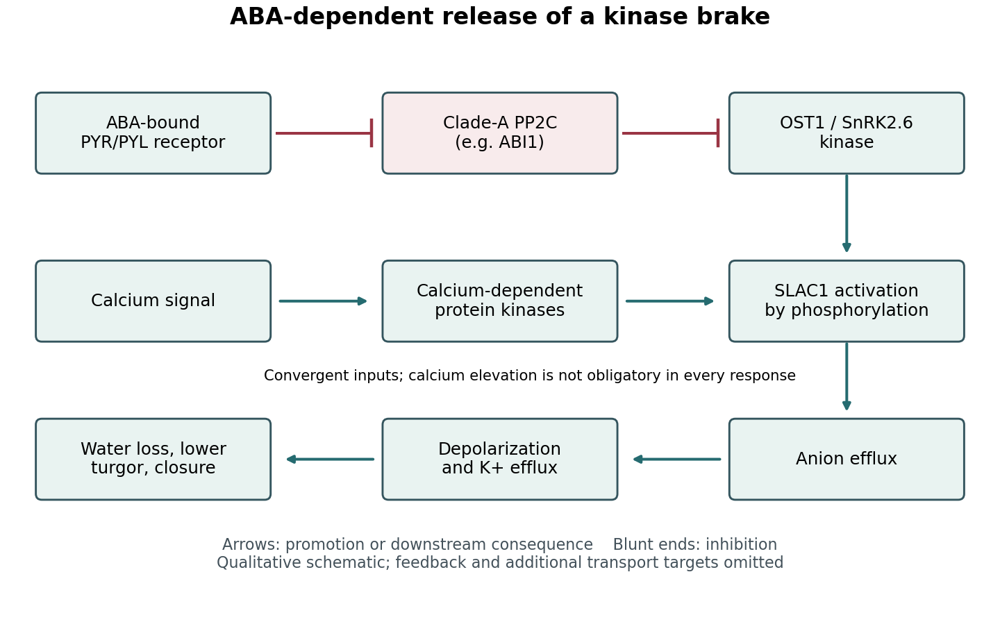
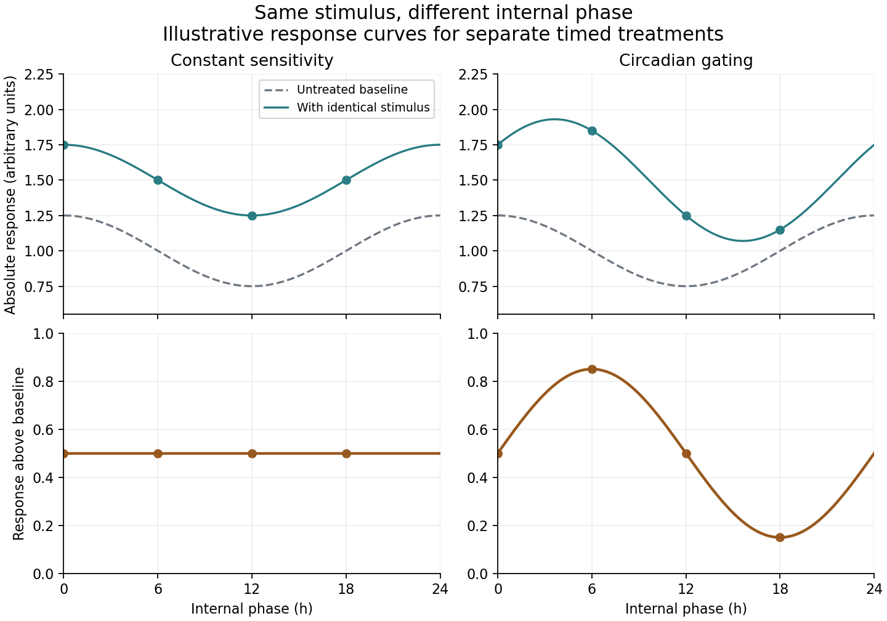
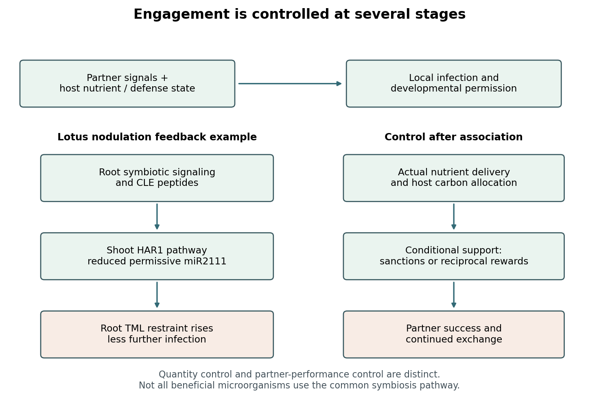

# Paper PLM1

↑ **Parent:** [2024](../2024.md)

[Original paper, released PDF pages 43–44](https://www.whatdotheyknow.com/request/natural_science_tripos_part_ii_p_2/response/3113356/attach/4/FOI%202025%20634%20Vongtanakiat%20materials.pdf?cookie_passthrough=1#page=43)

**Table of contents**

- [1](#1)
  - [Solution](#1/solution)
- [2](#2)
  - [Solution](#2/solution)
- [3](#3)
  - [Solution](#3/solution)
- [4](#4)
  - [Solution](#4/solution)
- [5](#5)
  - [Solution](#5/solution)
- [6](#6)
  - [Solution](#6/solution)

## 1

↑ **Parent:** [Paper PLM1](paper-plm1.md)

<h3 id="1/solution">Solution</h3>

↑ **Parent:** [1](#1)

**We understand several calcium sensors and downstream responses, but do not yet possess a general, predictive account of how a particular [calcium signature](../../signal-transduction.md#calcium-signature) selects a particular plant response.** The unresolved problem is the causal transformation from a multidimensional signal to an outcome in its cellular context. It is too strong to say that nothing is known about [calcium signal decoding](../../signal-transduction.md#calcium-signal-decoding).

A [calcium signature](../../signal-transduction.md#calcium-signature) includes the amplitude, duration, frequency and spatial distribution of increases in free [calcium ion](../../chemical-substance.md#calcium-ion) concentration. The nucleus, cytosol and regions close to [ion channels](../../cell-membrane.md#ion-channel) can experience different signals. A stimulus may therefore change several candidate information-bearing variables simultaneously. Two treatments producing different oscillation frequencies might also differ in pulse height, total calcium exposure or the number of responding cells. A correlation between frequency and [gene expression](../../molecular-genetics.md#gene-expression) does not establish that frequency is the variable actually decoded. Nor need each stimulus have one unique [calcium signature](../../signal-transduction.md#calcium-signature): different stimuli can recruit overlapping machinery, while the same stimulus can produce different responses in different tissues.

There are plausible molecular decoders. [Calmodulin](../../protein.md#calmodulin) changes its interactions with targets after calcium binding. A [calcium-dependent protein kinase](../../enzyme.md#calcium-dependent-protein-kinase) combines a calcium sensor with a catalytic domain, directly connecting calcium binding to target [phosphorylation](../../chemical-reaction.md#phosphorylation). [Calcineurin B-like proteins](../../signal-transduction.md#calcineurin-b-like-protein) recruit [CBL-interacting protein kinases](../../enzyme.md#cbl-interacting-protein-kinase), providing combinations of sensor, kinase and subcellular localization. In symbiotic signaling, nuclear oscillations feed into [CCaMK](../../enzyme.md#calcium-and-calmodulin-dependent-protein-kinase) and downstream developmental regulation. These mechanisms explain how calcium can influence an output; identifying one does not automatically explain discrimination among different waveforms.

[Calcium sensor kinetics](../../signal-transduction.md#calcium-sensor-kinetics) provide one possible mechanism. For a deliberately simplified sensor with active fraction $a$, free calcium concentration $C(t)$ and positive rate constants, consider

$$
\frac{da}{dt}=k_{\mathrm{on}}C(t)(1-a)-k_{\mathrm{off}}a.
$$

When calcium returns to a negligible value between pulses, $a$ decays approximately as $\exp(-k_{\mathrm{off}}t)$. Pulses separated by much less than $1/k_{\mathrm{off}}$ can therefore accumulate sensor activation; widely separated pulses allow recovery. This is an illustrative kinetic model, not a fitted description of every plant sensor. Real decoders may have several calcium-binding sites, autoinhibition, target-dependent affinity and persistent [phosphorylation](../../chemical-reaction.md#phosphorylation). Crucially, simple integration of closely spaced pulses does not by itself prove a dedicated frequency code independent of pulse amplitude and duration.

There is experimental evidence that waveform matters. Imposed guard-cell calcium patterns can produce different stomatal outcomes, including a distinction between immediate changes and a maintained response. This goes beyond merely observing that a closing [stoma](../../organism.md#stoma) has calcium oscillations. Nevertheless, it establishes a response relationship in a particular experimental system; assigning that relationship to one endogenous decoder requires additional molecular evidence.[pp. 1053–1057, imposed oscillation parameters and stomatal responses](../../biology-bibliography.md#a-defined-range-of-guard-cell-calcium-oscillation-parameters-encodes-stomatal-movements-by-g-j-allen-and-others) Likewise, an activated [CCaMK](../../enzyme.md#calcium-and-calmodulin-dependent-protein-kinase) can trigger spontaneous [nodulation](../../biology.md#nodulation), bypassing upstream requirements. Such bypass experiments place kinase activity downstream of early symbiotic signaling, but do not identify which feature of the native calcium trace the wild-type kinase reads.[pp. 1153–1156, spontaneous nodule development after kinase deregulation](../../biology-bibliography.md#deregulation-of-a-ca2-plus-calmodulin-dependent-kinase-leads-to-spontaneous-nodule-development-by-leila-tirichine-and-others)

Measurement presents a separate limitation. A [calcium reporter](../../signal-transduction.md#calcium-reporter) has its own affinity, response time and dynamic range. Slow reporters can merge brief pulses; saturation can erase amplitude differences. Probe expression can buffer calcium, and population measurements average heterogeneous cells. A calcium signal close to a channel may activate a nearby sensor without creating a large whole-cell change. Comparing different reporters or compartments without calibration can therefore create apparent biological differences that partly reflect measurement.

Finally, decoding depends on state. Sensor abundance, targets, prior [phosphorylation](../../chemical-reaction.md#phosphorylation), hormones and parallel [redox signalling](../../signal-transduction.md#redox-signalling) all modify the response to a given [calcium signature](../../signal-transduction.md#calcium-signature). Sensors can also regulate channels and calcium removal, feeding back on signal production. A mutant that changes both waveform and output has not cleanly separated encoding from decoding. A decisive study would manipulate relevant waveform features while controlling the others, measure sensor activation and physiological response in the same cells, and test whether selective loss and restoration of decoder function abolish and restore discrimination. **The central gap is thus a quantitative causal map linking local calcium dynamics, decoder kinetics and cellular state, rather than a lack of candidate calcium-binding proteins.**

## 2

↑ **Parent:** [Paper PLM1](paper-plm1.md)

<h3 id="2/solution">Solution</h3>

↑ **Parent:** [2](#2)

**[Phosphorylation](../../chemical-reaction.md#phosphorylation) converts ABA perception into regulated ion transport, coordinates calcium-dependent and calcium-independent inputs, and makes [stomatal closure](../../organism.md#stomatal-closure) reversible.** Its role is distributed across a network of kinases, phosphatases and transport targets. ABA does not close the pore by directly supplying a mechanical force.

The opening and closing machinery is a pair of [guard cells](../../biology.md#guard-cell) surrounding a [stoma](../../organism.md#stoma). Accumulation of osmotically active solutes favors water entry and increased [turgor pressure](../../biological-cell.md#turgor-pressure); solute loss favors water exit and reduced aperture. During water stress, [abscisic acid](../../signal-transduction.md#abscisic-acid) shifts the balance toward anion and potassium loss. Changes in transport can precede slower changes in [gene expression](../../molecular-genetics.md#gene-expression), allowing the existing guard-cell machinery to respond rapidly.

The core ABA switch involves inhibition of an inhibitor. Without the activating ABA signal, selected clade-A [protein phosphatase 2C](../../enzyme.md#protein-phosphatase-2c) enzymes, including [ABI1](../../enzyme.md#abi1), restrain ABA-responsive [SnRK2 kinases](../../enzyme.md#snrk2-kinase). ABA binding to a [PYR-PYL-RCAR ABA receptor](../../protein.md#pyr-pyl-rcar-aba-receptor) promotes inhibition of these phosphatases. This permits activating kinase phosphorylation to persist and supports activation of [OST1](../../enzyme.md#ost1), also called [SnRK2.6](../../enzyme.md#ost1). Thus a hormone-dependent change in phosphatase activity changes the phosphorylation state and catalytic activity of downstream signaling proteins. The effect is specific to the relevant receptor, phosphatase and kinase combinations; it is not a claim that all phosphatases inhibit closure or all phosphorylation promotes it.

Biochemical reconstitution supports this causal ordering: defined receptor, phosphatase and kinase components can reconstruct ABA-dependent regulation without requiring an intact plant. This separates a sufficient core perception-and-relay module from the many parallel processes present in a stressed cell. However, a reconstructed molecular or transcriptional readout alone does not prove that the full mechanical response of a [stoma](../../organism.md#stoma) has been rebuilt.[pp. 660–664, reconstituted ABA signaling components](../../biology-bibliography.md#in-vitro-reconstitution-of-an-abscisic-acid-signalling-pathway-by-hiroaki-fujii-and-others)

A crucial transport target is [SLAC1](../../cell-membrane.md#slac1). [OST1](../../enzyme.md#ost1)-dependent [phosphorylation](../../chemical-reaction.md#phosphorylation) activates this slow anion channel, allowing anions to leave the [guard cell](../../biology.md#guard-cell). Anion efflux depolarizes the [membrane potential](../../membrane-potential.md), favoring outward potassium current through [GORK](../../cell-membrane.md#gork). Loss of these solutes reduces the osmotic drive retaining water, so water exits and [turgor pressure](../../biological-cell.md#turgor-pressure) falls. Activation of an anion channel can therefore initiate a larger electrical and osmotic response without the kinase phosphorylating every ion that moves. Suppression of opening-associated transport further reinforces the shift toward closure.

**[Figure 1](#2/image-aba-relieves-a-phosphatase-brake-on-kinase-dependent-guard-cell-transport). ABA relieves a phosphatase brake on kinase-dependent guard-cell transport**. Original qualitative pathway schematic. Arrows indicate promotion; blunt-ended connections indicate inhibition. The core switch is separated from calcium-dependent convergence and the final electrical and osmotic consequences. It does not imply that every ABA response requires a detectable calcium elevation.

Channel activation experiments provide an important bridge between the core ABA switch and physiology. Coexpression and electrophysiology showed that [OST1](../../enzyme.md#ost1) activates [SLAC1](../../cell-membrane.md#slac1), whereas phosphatase action antagonizes activation; kinase activity and channel regulatory regions are therefore functionally important. These findings are stronger than simple colocalization. Together with guard-cell genetic and current measurements, they support a route from a phosphorylation-dependent channel change to altered aperture. A heterologous cell nevertheless lacks the complete transport and mechanical environment of a real [guard cell](../../biology.md#guard-cell).[Figures 1–4, channel currents and kinase–phosphatase regulation](../../biology-bibliography.md#activity-of-guard-cell-anion-channel-slac1-is-controlled-by-drought-stress-signaling-kinase-phosphatase-pair-by-dietmar-geiger-and-others)

Calcium-dependent signaling converges on this machinery. [Calcium-dependent protein kinases](../../enzyme.md#calcium-dependent-protein-kinase) can activate [SLAC1](../../cell-membrane.md#slac1), and different kinases have different calcium sensitivities. Consequently, [phosphorylation](../../chemical-reaction.md#phosphorylation) can combine hormone-dependent release of the phosphatase brake with a [calcium signature](../../signal-transduction.md#calcium-signature). This is a convergence network, not a mandatory linear sequence in which ABA must always cause a measurable global calcium rise before any closure can occur.[pp. 8023–8028, kinase-specific calcium dependence and anion-channel regulation](../../biology-bibliography.md#guard-cell-anion-channel-slac1-is-regulated-by-cdpk-protein-kinases-with-distinct-ca2-plus-affinities-by-dietmar-geiger-and-others) Regulation of plant [NADPH oxidases](../../enzyme.md#nadph-oxidase) and [reactive oxygen species](../../molecule.md#reactive-oxygen-species) can further couple kinase activity, [redox signalling](../../signal-transduction.md#redox-signalling) and calcium entry. The physiological contribution of these branches varies with conditions.

Reversal is as important as activation. Phosphatases, calcium clearance and renewed opening-associated transport reset the system when conditions change. Phosphorylation can alter activity, interactions and localization without waiting for protein replacement. **The outcome is a tunable balance of kinase and phosphatase activities that connects ABA-dependent sensing to solute flux, water movement and pore mechanics, while integrating additional environmental inputs.**

## 3

↑ **Parent:** [Paper PLM1](paper-plm1.md)

<h3 id="3/solution">Solution</h3>

↑ **Parent:** [3](#3)

**Plants use an entrained [circadian clock](../../physiology.md#circadian-clock) to change their sensitivity to stimuli, while also responding directly to the current light and temperature environment.** The same external stimulus can therefore have different effects at different internal phases. This [circadian gating](../../physiology.md#circadian-gating) must be distinguished from a daily rhythm caused solely by daily variation in the stimulus itself.

The [plant circadian clock](../../physiology.md#plant-circadian-clock) contains interlocking regulation of [gene expression](../../molecular-genetics.md#gene-expression), protein accumulation and protein activity. Morning-associated regulators such as [CCA1](../../physiology.md#cca1) and [LHY](../../physiology.md#lhy) interact with later-acting components, including [TOC1](../../physiology.md#toc1), to generate a sequence of phases rather than a single daily on–off switch. Light information, including inputs involving [phytochromes](../../signal-transduction.md#phytochrome) and [cryptochromes](../../biology.md#cryptochrome), and temperature cues adjust the clock through [entrainment of circadian rhythm](../../physiology.md#entrainment-of-circadian-rhythm). Under suitably constant conditions, a [free-running circadian rhythm](../../physiology.md#free-running-circadian-rhythm) persists. Anticipation of dawn or dusk is therefore possible before the corresponding environmental transition occurs.

Clock outputs can modify several points in a stimulus-response pathway. A receptor or transport protein may accumulate at a particular phase; signaling inhibitors may be removed at another. The clock can regulate hormone production, hormone inactivation, transport and sensitivity of downstream [transcription factors](../../molecular-genetics.md#transcription-factor). Post-translational regulation allows a phase-specific transcript to produce an output only under a second permissive condition. Consequently, a rhythmic hormone concentration and rhythmic responsiveness to that hormone are distinct explanations and may coexist.

[Auxin](../../signal-transduction.md#auxin) provides direct experimental evidence for sensitivity gating. Timed auxin treatments and transcriptional reporters in Arabidopsis showed that an externally supplied hormone stimulus produces phase-dependent responses; growth responses were also gated. Because the stimulus was supplied experimentally, the result cannot be explained merely by assuming that the plant normally makes more auxin at one time of day. Reporter dynamics and pretreatment baselines still require appropriate controls, and a reporter is not a direct measurement of free hormone.[Figures 4–5, auxin-response reporters, timed hormone application and growth responses](../../biology-bibliography.md#the-circadian-clock-regulates-auxin-signaling-and-responses-in-arabidopsis-by-michael-f-covington-and-others)

An illustrative local description is

$$
\Delta R(\phi,S)=g(\phi)S,
$$

where $S$ is a small standardized stimulus, $\phi$ is [circadian phase](../../physiology.md#circadian-phase) and $\Delta R$ is the response above the matched untreated baseline. A phase-dependent gain $g$ represents gating. In contrast, if $g$ is constant but the baseline response oscillates, observing different absolute values after treatment does not establish gating. Real pathways can saturate or change sign, so this equation illustrates the experimental distinction rather than defining a universal linear law.

**[Figure 2](#3/image-phase-dependent-sensitivity-differs-from-a-rhythmic-untreated-baseline). Phase-dependent sensitivity differs from a rhythmic untreated baseline**. Original stipulated model, not experimental data. Identical stimulus pulses give equal baseline-subtracted responses in the constant-sensitivity example, but unequal responses when sensitivity is gated by circadian phase. The selected amplitudes and phase have no fitted biological meaning.

[Photoperiodism](../../biology.md#photoperiodism) shows how internal time can be combined with an external cue to produce a developmental decision. In Arabidopsis, timed expression of [CONSTANS](../../biology.md#constans) interacts with light-dependent regulation of the protein. In long days, a permissive expression phase overlaps light sufficiently to support [FLOWERING LOCUS T](../../biology.md#flowering-locus-t) activation. The [external coincidence model](../../biology.md#external-coincidence-model) therefore responds to when light occurs relative to the clock, rather than merely adding up photons. Photoreceptor-dependent protein regulation provides a molecular connection between timing and the external environment.[pp. 1003–1006, light regulation of CONSTANS and photoperiodic flowering](../../biology-bibliography.md#photoreceptor-regulation-of-constans-protein-in-photoperiodic-flowering-by-federico-valverde-and-others) [FT protein](../../biology.md#flowering-locus-t) can then communicate from leaves to the shoot apex. Phloem-specific expression and grafting experiments support FT protein movement as part of this long-distance floral signal.[pp. 1030–1033, mobile FT protein and floral induction](../../biology-bibliography.md#ft-protein-movement-contributes-to-long-distance-signaling-in-floral-induction-of-arabidopsis-by-laurent-corbesier-and-others)

A convincing demonstration of [circadian gating](../../physiology.md#circadian-gating) compares matched stimuli at several internal phases under constant external conditions, with untreated controls at every phase. Plants entrained to opposite schedules can help distinguish internal phase from laboratory clock time. Clock perturbations and restoration of clock function strengthen causal interpretation, provided effects on general health and growth are considered. A phase-shifted response in constant conditions supports clock control; disappearance immediately when the environmental cycle is removed suggests direct environmental control, although weak rhythms and altered physiology can complicate that inference. [Masking of circadian rhythm](../../physiology.md#masking-of-circadian-rhythm), in which an environmental cue directly changes a measured output, can coexist with clock control.

Timing is useful because demands and risks recur. Coordinating [stomatal conductance](../../biology.md#stomatal-conductance), photosynthetic preparation and growth with expected light availability can improve resource use. Yet the optimum phase depends on temperature, water availability and day length, and a strong acute stress can override a normal daily preference. **Plants combine an internal estimate of time with current conditions, changing pathway sensitivity as well as the abundance of signals and response machinery.**

## 4

↑ **Parent:** [Paper PLM1](paper-plm1.md)

<h3 id="4/solution">Solution</h3>

↑ **Parent:** [4](#4)

**Plant [developmental plasticity](../../genetics.md#developmental-plasticity) is achieved by making growth-regulatory machinery depend jointly on environmental inputs, hormone state, spatial information and internal time.** Integration can occur through direct protein interactions, regulated protein turnover, transport of a second signal or convergence on [gene expression](../../molecular-genetics.md#gene-expression). Evidence is strongest when it identifies the shared molecular step and connects that step to an altered developmental response.

A useful starting distinction is between plasticity and genetic adaptation. A genotype can produce different root or shoot architectures in different environments without acquiring a new mutation. Such [phenotypic plasticity](../../genetics.md#phenotypic-plasticity) may be beneficial, neutral or costly. Moreover, an induced developmental decision need not be reversible after a tissue or organ forms. Integration therefore regulates the trajectory and allocation of future growth, rather than simply toggling every mature structure between two interchangeable states.

Light and [gibberellin](../../signal-transduction.md#gibberellin) provide a well-resolved example. Growth-promoting [phytochrome-interacting factors](../../molecular-genetics.md#phytochrome-interacting-factor) regulate elongation-associated genes. Active [phytochrome](../../signal-transduction.md#phytochrome) signaling can reduce the abundance or activity of these factors, restraining elongation under appropriate light conditions. Meanwhile, low gibberellin signaling permits accumulation of [DELLA proteins](../../signal-transduction.md#della-protein); gibberellin perception promotes their destruction through regulated [protein degradation](../../protein.md#protein-degradation). The two inputs meet because DELLA proteins can bind growth-regulatory PIFs, including [PIF4](../../molecular-genetics.md#pif4), and restrict their DNA-binding activity. Light-regulated PIF availability and hormone-regulated DELLA restraint jointly determine access to growth targets.

The evidence is not simply that light and gibberellin affect the same seedling phenotype. Protein-interaction and DNA-binding analyses, interpreted alongside genetic growth phenotypes, link DELLA–PIF4 association to inhibition of transcription-factor function. Removing a growth restraint can therefore increase elongation only insofar as the necessary growth-promoting machinery and resources remain available. This explains why the output of one pathway depends on the state of the other.[pp. 480–484, DELLA interaction with PIF4 and effects on DNA binding and elongation](../../biology-bibliography.md#a-molecular-framework-for-light-and-gibberellin-control-of-cell-elongation-by-miguel-de-lucas-and-others) It would be an overstatement to treat every PIF or every light response as identical: family members differ, and transcription-factor availability is only one constraint on growth.

This architecture can behave like a permissive gate. If effective PIF activity is low, removal of DELLA repression alone may produce little output; if DELLA inhibition is strong, abundant PIF may still fail to activate its targets. The biological gate is graded rather than an exact Boolean operation, because protein concentrations, binding affinities and competing interactions vary. The important point is that the joint response need not equal the sum of two independent responses. A shared physical interaction supplies a mechanism for that non-independence.

Roots illustrate integration through transport rather than only transcription-factor binding. [NRT1.1](../../biology.md#nrt1-1) connects the nutrient [nitrate](../../chemistry.md#nitrate) to [auxin](../../signal-transduction.md#auxin) distribution. At low nitrate, its auxin-transport activity can favor removal of auxin from developing [lateral roots](../../semisimple-lie-algebra.md#lateral-root), restricting their growth. Nitrate inhibits this transport activity, allowing a different local auxin distribution and a different developmental outcome. Mutant phenotypes and transport measurements connect a nutrient-responsive membrane protein to hormone transport and root architecture.[pp. 927–937, nitrate-dependent auxin transport and lateral-root responses](../../biology-bibliography.md#nitrate-regulated-auxin-transport-by-nrt1-1-defines-a-mechanism-for-nutrient-sensing-in-plants-by-gabriel-krouk-and-others) The mechanistic claim is specific: local nitrate can regulate a route affecting local auxin accumulation. It does not establish that raising nitrate indefinitely always increases branching, or that whole-plant nitrogen status is irrelevant.

Spatial organization matters because a root encounters patches rather than one uniform nutrient concentration. [Polar auxin transport](../../signal-transduction.md#polar-auxin-transport) can turn a local input into a developmental distribution of hormone, while whole-plant nutritional and carbon status constrain how much growth is affordable. A transporter can thus perform both acquisition and regulatory functions. Conversely, a transport-deficient mutant may change nutrient supply as well as signaling. Separating these effects requires measurements of transport, hormone distribution and development, rather than interpreting altered growth alone as proof of a dedicated sensor function.

Time adds another dimension. [Circadian gating](../../physiology.md#circadian-gating) of [auxin](../../signal-transduction.md#auxin) responses means that equal hormone input can have different transcriptional and growth consequences at different internal phases. This can coordinate an environmentally favorable growth opportunity with a phase when the growth machinery is permissive.[Figures 4–5, phase-dependent responses to supplied auxin](../../biology-bibliography.md#the-circadian-clock-regulates-auxin-signaling-and-responses-in-arabidopsis-by-michael-f-covington-and-others) Again, joint regulation is more informative than merely finding two pathways with overlapping lists of expressed genes.

Causal tests should ask whether disrupting the proposed connection specifically changes the interaction between inputs. A binding-defective regulator, a transport perturbation or a suitable rescue can distinguish direct integration from parallel downstream consequences. [Epistasis](../../genetics.md#epistasis) helps order requirements, but a severe growth defect can conceal an otherwise independent response. **The convincing picture is therefore a network of identifiable biochemical junctions, illustrated by DELLA–PIF interactions and nitrate-dependent auxin transport, whose spatial and temporal deployment converts environmental information into plastic development.**

## 5

↑ **Parent:** [Paper PLM1](paper-plm1.md)

<h3 id="5/solution">Solution</h3>

↑ **Parent:** [5](#5)

**Plants cope with changing light by combining rapid feedback from the photosynthetic apparatus, photoreceptor-controlled movements and slower acclimation.** The problem is to preserve reaction centers during excess excitation while recovering productive light use when the excess disappears. Changes in intensity and changes in spectral balance require overlapping but distinct responses.

A sunfleck can increase excitation faster than carbon assimilation adjusts. If electron acceptors or metabolic use become limiting, continued excitation increases the risk of damaging reactions and [reactive oxygen species](../../molecule.md#reactive-oxygen-species). Rapid [photoprotection](../../biology.md#photoprotection) therefore regulates both excitation delivery and electron flow. This is not equivalent to maximizing fluorescence quenching at every moment: energy safely dissipated during high light becomes an opportunity cost if dissipation persists after a return to shade.

An important feedback signal is acidification of the [thylakoid](../../biological-cell.md#thylakoid) lumen as photosynthetic electron transport builds a proton gradient. Proton-dependent changes involving [PsbS](../../biology.md#psbs) and antenna organization promote rapidly reversible components of [non-photochemical quenching](../../biology.md#non-photochemical-quenching). The [xanthophyll cycle](../../biology.md#xanthophyll-cycle) also contributes: conditions favoring de-epoxidation toward zeaxanthin support protective energy dissipation. Excess absorbed excitation can then be released as heat rather than entering potentially damaging photochemistry. As light falls and the proton gradient relaxes, dissipation should decrease, although different components recover on different timescales. Loss-of-function analysis of PsbS separated its quenching role from basic light capture.[pp. 391–395, PsbS requirement for regulated quenching](../../biology-bibliography.md#a-pigment-binding-protein-essential-for-regulation-of-photosynthetic-light-harvesting-by-xiao-ping-li-and-others)

The physiological importance of recovery kinetics is experimentally testable. Accelerating recovery from photoprotection in tobacco increased carbon uptake and dry-matter production under fluctuating light. The experiment supports the proposition that delayed relaxation can constrain productivity; it does not imply that eliminating protection would be beneficial or that an identical yield improvement is guaranteed in every crop and environment.[pp. 857–861, modified photoprotective recovery and tobacco productivity](../../biology-bibliography.md#improving-photosynthesis-and-crop-productivity-by-accelerating-recovery-from-photoprotection-by-johannes-kromdijk-and-others) Protection and productive capture must be optimized jointly.

Spectral imbalance creates a second problem: [photosystem I](../../biology.md#photosystem-i) and [photosystem II](../../biology.md#photosystem-ii) may receive unequal excitation. The redox state of the intersystem electron-transfer machinery can regulate [STN7 kinase](../../enzyme.md#stn7-kinase), which phosphorylates a mobile fraction of [LHCII](../../biology.md#lhcii). [Photosynthetic state transitions](../../biology.md#photosynthetic-state-transition) thereby redistribute antenna excitation between the photosystems. This reallocates excitation rather than simply dissipating it as heat. Genetic loss of STN7 disrupts state transitions, connecting a specific kinase to the adjustment.[Figure 1 and pp. 892–895, STN7-dependent state transitions](../../biology-bibliography.md#state-transitions-and-light-adaptation-require-chloroplast-thylakoid-protein-kinase-stn7-by-stephane-bellafiore-and-others) Their contribution depends on the spectral and physiological setting; state transitions should not be presented as the sole explanation of all responses to fluctuating sunlight.

Regulation also acts on electron delivery. [Cyclic electron flow around photosystem I](../../biology.md#cyclic-electron-flow-around-photosystem-i) can support proton-gradient formation without net NADPH production, helping adjust ATP supply and protective regulation. Lumen-dependent [photosynthetic control](../../biology.md#photosynthetic-control) can restrict delivery through the cytochrome b6f complex, protecting downstream acceptors against excessive reduction. The PGR5-associated route is important in this regulation; mutant evidence links it to photoprotection, while not requiring the claim that PGR5 alone is a complete electron-transfer enzyme.[pp. 361–371, electron-flow and photoprotection defects](../../biology-bibliography.md#pgr5-is-involved-in-cyclic-electron-flow-around-photosystem-i-and-is-essential-for-photoprotection-in-arabidopsis-by-yuri-munekage-and-others)

A plant also senses light before damage occurs. [Phototropins](../../biology.md#phototropin) are blue-light receptor kinases controlling responses including [chloroplast relocation](../../biology.md#chloroplast-relocation) and stomatal opening. Under weak light, positioning chloroplasts to intercept more light can aid capture; strong-light avoidance reduces direct exposure. Avoidance-defective Arabidopsis mutants identified a phototropin-related receptor as a requirement, providing evidence for a signaling mechanism rather than passive displacement by light.[pp. 2138–2141, avoidance mutants and receptor identification](../../biology-bibliography.md#arabidopsis-npl1-a-phototropin-homolog-controlling-the-chloroplast-high-light-avoidance-response-by-takatoshi-kagawa-and-others) Coordinating [stomatal conductance](../../biology.md#stomatal-conductance) with light also changes carbon dioxide supply, but carries a water-loss cost and interacts with ABA-dependent closure.

Over longer periods, [phytochrome](../../signal-transduction.md#phytochrome) and [cryptochrome](../../biology.md#cryptochrome) signaling can alter growth and leaf development, while chloroplast-derived [retrograde signaling](../../biological-cell.md#retrograde-signaling) helps coordinate nuclear responses with organelle state. [Photosynthetic acclimation](../../biology.md#photosynthetic-acclimation) changes antenna investment, electron-transfer capacity and metabolic capacity. These slower changes complement rapid regulation of existing proteins. Damage still occurs: [photosystem II repair](../../biology.md#photosystem-ii-repair), including replacement of damaged [D1 protein](../../biology.md#d1-protein), restores capacity when prevention is incomplete. Persistent [photoinhibition](../../biology.md#photoinhibition) should be distinguished from reversible protective quenching.

**The integrated solution uses several timescales: rapid lumen and redox feedback for safe operation, photoreceptors for light-dependent positioning and gas exchange, and acclimation and repair for sustained performance.** Demonstrating success requires carbon gain, growth and damage measurements under realistic fluctuations; one fluorescence parameter alone cannot identify every pathway or establish improved productivity.

## 6

↑ **Parent:** [Paper PLM1](paper-plm1.md)

<h3 id="6/solution">Solution</h3>

↑ **Parent:** [6](#6)

**Engagement with beneficial microorganisms is a regulated allocation decision: plants combine partner signals with nutrient demand, immune control and whole-plant feedback, then adjust investment according to the association's performance.** Recognition, entry, organ development and continued nutrient exchange are separate control points. A compatible signal is evidence of partner identity or capability, not a guarantee of future benefit.

Legume–rhizobial [symbiosis](../../ecology.md#symbiosis) illustrates early selectivity. Root-exuded [flavonoids](../../biology.md#flavonoid) can induce production of rhizobial [Nod factors](../../signal-transduction.md#nod-factor). Compatible plant receptors recognize these lipochitooligosaccharides and initiate signaling that permits infection and [root nodule](../../biology.md#root-nodule) development. Structural specificity of the signals and the host receptor repertoire constrain compatibility. Meanwhile, [plant immunity](../../biology.md#plant-immunity) must be coordinated with accommodation: unrestricted entry would be costly, but an indiscriminate defense response would prevent the mutualism. This is a conditional developmental program, not a complete abolition of defense.

Early symbiotic signaling includes nuclear [calcium signatures](../../signal-transduction.md#calcium-signature) and activation of [CCaMK](../../enzyme.md#calcium-and-calmodulin-dependent-protein-kinase) within the [common symbiosis signaling pathway](../../signal-transduction.md#common-symbiosis-signaling-pathway). Kinase activation connects early perception to downstream transcription and developmental responses. Deregulated CCaMK can induce spontaneous nodules, demonstrating that downstream developmental machinery can be activated without the normal upstream sequence. A spontaneous nodule is nevertheless not evidence of bacterial entry or effective [nitrogen fixation](../../ecology.md#nitrogen-fixation); the latter requires additional coordinated functions.[pp. 1153–1156, bypass of upstream requirements and spontaneous organ development](../../biology-bibliography.md#deregulation-of-a-ca2-plus-calmodulin-dependent-kinase-leads-to-spontaneous-nodule-development-by-leila-tirichine-and-others)

[Arbuscular mycorrhiza](../../ecology.md#arbuscular-mycorrhiza) uses a partly shared signaling apparatus but a different exchange structure and different partners. Plant [strigolactones](../../signal-transduction.md#strigolactone) released into the rhizosphere stimulate fungal branching, increasing the potential for contact. Isolation of a root-exuded branching factor and chemical identification as a strigolactone connected a specific plant molecule with fungal behavior.[pp. 824–827, identification of the branching factor and fungal responses](../../biology-bibliography.md#plant-sesquiterpenes-induce-hyphal-branching-in-arbuscular-mycorrhizal-fungi-by-kohki-akiyama-and-others) Subsequent recognition and intracellular accommodation depend on host signaling and cell remodeling. Sharing a calcium-linked pathway does not mean that fungi are recognized by the same Nod-factor receptors as rhizobia, or that every beneficial root bacterium uses this pathway.

Nutritional context changes the expected return. A plant with adequate available nitrogen has less reason to spend photosynthate on additional nitrogen-fixing nodules. Similarly, high phosphate availability commonly reduces investment in [arbuscular mycorrhiza](../../ecology.md#arbuscular-mycorrhiza). Hormone and nutrient pathways can alter signal release, developmental competence and allocation. Carbon availability matters as well: the plant must supply carbon to sustain the association. These controls act on potential benefit and cost rather than classifying one microorganism as beneficial under all conditions. A symbiont can be compatible yet provide little net growth advantage in a particular environment.

Local permissiveness must also be coordinated across a branched root system. [Autoregulation of nodulation](../../biology.md#autoregulation-of-nodulation) provides systemic negative feedback. Signals from an initiating symbiosis include root-produced [CLE peptides](../../signal-transduction.md#cle-peptide); shoot receptor-kinase pathways involving [HAR1](../../biology.md#har1) in Lotus japonicus contribute to limiting further engagement. A shoot-to-root arm involves [miR2111](../../polymer.md#mir2111), which represses the root negative regulator [TML](../../biology.md#tml). Reduced delivery of this permissive microRNA allows the brake to rise. Thus stopping further infection can be achieved by withdrawing repression of a repressor, rather than by sending a simple mobile toxin to all root tips. Experiments established shoot-to-root movement of miR2111 and its role in controlling infection through TML.[pp. 233–236, mobile miR2111, TML and systemic symbiotic susceptibility](../../biology-bibliography.md#systemic-control-of-legume-susceptibility-to-rhizobial-infection-by-a-mobile-microrna-by-daniela-tsikou-and-others) Particular receptor and peptide names vary among legumes; the Lotus mechanism should not be transferred gene-for-gene to every plant.

**[Figure 3](#6/image-local-partner-recognition-systemic-quantity-control-and-conditional-resource-allocation). Local partner recognition, systemic quantity control and conditional resource allocation**. Original conceptual diagram. The Lotus nodulation feedback example is distinguished from later partner-performance control. AON limits further engagement, whereas sanctions and reciprocal rewards act on resource allocation or symbiont success after association. The diagram does not imply that all beneficial microorganisms use the nodulation pathway.

Systemic quantity control is distinct from assessment of an established partner's performance. In soybean, experimentally preventing an otherwise mutualistic rhizobium from fixing nitrogen reduced its reproductive success. Nodule oxygen measurements implicated reduced oxygen supply as a possible sanction mechanism. Because cooperation was changed by removing molecular nitrogen from the atmosphere, the comparison helped separate fixation performance from unrelated differences between bacterial strains. It still does not show that every inefficient symbiont is perfectly detected or that oxygen supply is the only possible control.[pp. 78–81, especially Figures 2–3, suppressed fixation, reproductive success and oxygen relations](../../biology-bibliography.md#host-sanctions-and-the-legume-rhizobium-mutualism-by-e-toby-kiers-and-others)

In mycorrhizal exchange, resource allocation can be conditional on both sides. Experiments demonstrated increased plant carbon allocation toward more cooperative fungal partners and increased fungal nutrient allocation in response to carbon supplied. This supports [reciprocal reward in symbiosis](../../ecology.md#reciprocal-reward-in-symbiosis), rather than a model of unlimited plant command over a passive fungus.[pp. 880–882, experimental manipulation of partner cooperation and allocation](../../biology-bibliography.md#reciprocal-rewards-stabilize-cooperation-in-the-mycorrhizal-symbiosis-by-e-toby-kiers-and-others) Host sanctions, partner choice before entry and reciprocal rewards are therefore related but distinguishable routes to maintaining benefit.

**Plants regulate engagement through successive filters: compatibility and defense at entry, developmental and nutritional permission, systemic feedback on quantity, and conditional support of established partners.** Experiments should score infection, nodule or arbuscule abundance, actual nutrient transfer and host growth separately. A greater colonized area or larger nodule count alone does not prove a more beneficial association.

## ↑ Ancestors (10)

1. [2024](../2024.md)
2. [Past exam of the plant Sciences course of the University of Cambridge](../../past-exam-of-the-plant-sciences-course-of-the-university-of-cambridge.md)
3. [Plant Sciences course of the University of Cambridge](../../university-of-cambridge.md#plant-sciences-course-of-the-university-of-cambridge)
4. [Year 3 of the natural sciences course of the University of Cambridge](../../university-of-cambridge.md#year-3-of-the-natural-sciences-course-of-the-university-of-cambridge)
5. [Year of the natural sciences course of the University of Cambridge](../../university-of-cambridge.md#year-of-the-natural-sciences-course-of-the-university-of-cambridge)
6. [Natural sciences course of the University of Cambridge](../../university-of-cambridge.md#natural-sciences-course-of-the-university-of-cambridge)
7. [Course of the University of Cambridge](../../university-of-cambridge.md#course-of-the-university-of-cambridge)
8. [University of Cambridge](../../university-of-cambridge.md)
9. [List of universities](../../README.md#list-of-universities)
10. [Codex Wiki](../../README.md)
