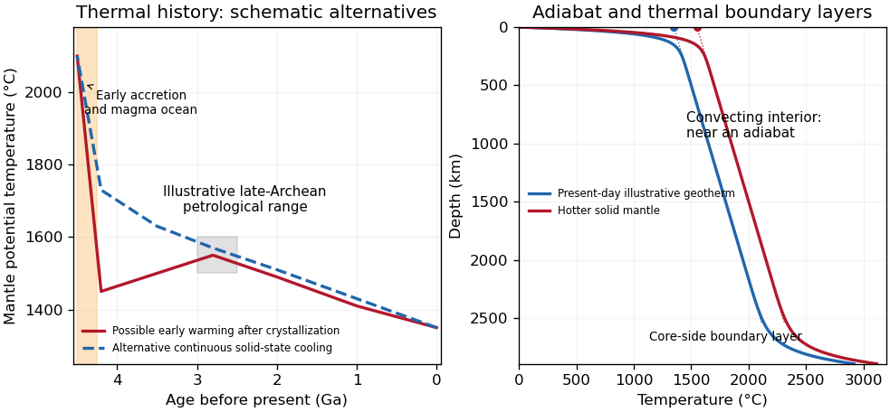
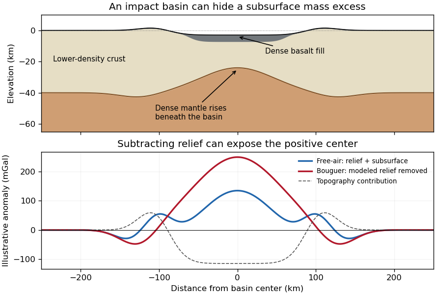
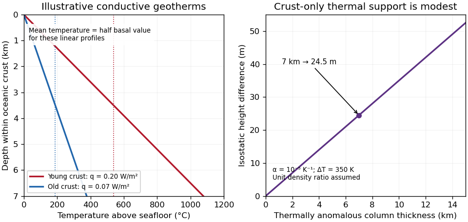

# 2022

↑ **Parent:** [Past exam of the plate tectonics course of the University of Oxford](../past-exam-of-the-plate-tectonics-course-of-the-university-of-oxford.md)

Solutions to all three questions of Oxford's third-year Plate Tectonics paper, Paper 8, held on 27 May 2022. The source's two-question examination choice does not restrict this coverage. Source release: [released examination archive](https://www.whatdotheyknow.com/request/earth_science_past_papers_and_ex/response/3419815/attach/4/Papers.zip?cookie_passthrough=1). Numerical readings from the supplied heat-flow plot are approximate; the assumptions needed to convert them into temperatures are stated explicitly.

**Table of contents**

- [1](#1)
  - [a](#1/a)
    - [Solution](#1/a/solution)
  - [b](#1/b)
    - [Solution](#1/b/solution)
  - [c](#1/c)
    - [Solution](#1/c/solution)
- [2](#2)
  - [a](#2/a)
    - [Solution](#2/a/solution)
  - [b](#2/b)
    - [Solution](#2/b/solution)
  - [c](#2/c)
    - [Solution](#2/c/solution)
- [3](#3)
  - [a](#3/a)
    - [Solution](#3/a/solution)
  - [b](#3/b)
    - [Solution](#3/b/solution)
  - [c](#3/c)
    - [Solution](#3/c/solution)
  - [d](#3/d)
    - [Solution](#3/d/solution)

## 1

↑ **Parent:** [2022](2022.md)

<h3 id="1/a">a</h3>

↑ **Parent:** [1](#1)

<h4 id="1/a/solution">Solution</h4>

↑ **Parent:** [A](#1/a)

The decisive change was from moving continents within a supposedly permanent ocean floor to moving coherent [tectonic plates](../geophysics.md#tectonic-plate) that include both continental and oceanic [lithosphere](../geophysics.md#lithosphere). Several independent observations made that change testable.

**Continental connections supplied the initial problem.** In the early twentieth century, [Alfred Wegener](../geophysics.md#alfred-wegener) assembled matching continental margins, correlatable rock belts and mountain chains, shared [fossil assemblages](../paleontology.md#fossil-assemblage), and [paleoclimate](../geophysics.md#paleoclimate) indicators into the case for [continental drift](../planetary-science.md#continental-drift). Reassembling [Gondwana](../planetary-science.md#gondwana), for example, makes geographically separated glacial deposits and striation directions compatible with one ice-sheet system. Fits at the continental shelf edge are physically more meaningful than exact fits to modern coastlines, which have been modified by erosion and sea-level change. The evidence suggested relative movement, but did not justify the proposed forces: continents cannot readily plough independently through strong oceanic rock. A convincing mechanism and independent motion measurements were missing.

**Oceanography changed the boundary conditions.** Echo-sounding surveys revealed a connected [spreading ridge](../geophysics.md#spreading-ridge) system, axial valleys, [subduction trenches](../geophysics.md#subduction-trench) and long [fracture zones](../geophysics.md#fracture-zone). [Seismic refraction surveys](../geophysics.md#seismic-refraction-survey) established systematic differences between continental and oceanic [crust](../geophysics.md#planetary-crust). Thin oceanic sediment cover, high ridge [heat flux](../heat.md#heat-flux-density) and the lack of very old exposed oceanic basement made permanent, ancient ocean basins increasingly implausible. [Harry Hammond Hess](../planetary-science.md#harry-hammond-hess) proposed creation of oceanic [lithosphere](../geophysics.md#lithosphere) at ridges and recycling at trenches: [seafloor spreading](../geophysics.md#seafloor-spreading) without requiring an expanding [Earth](../planetary-science.md#earth). Slow [mantle convection](../geophysics.md#mantle-convection) supplied a physically plausible connection between surface transport and internal heat loss. The mechanism need not have been completely quantified before its kinematic predictions could be tested.[Sections Ocean floor mapping, Seafloor spreading and recycling of oceanic crust](../planetary-science.md#developing-the-theory-in-this-dynamic-earth)

**Magnetic records supplied a clock and a speedometer.** Dated continental lavas established a sequence of [geomagnetic reversals](../planetary-science.md#geomagnetic-reversal). Marine [magnetometers](../electromagnetism.md#magnetometer) then found elongated, approximately paired [marine magnetic stripes](../geophysics.md#marine-magnetic-stripe) on either side of ridges. The 1963 interpretation by [F. J. Vine](../geophysics.md#f-j-vine) and [D. H. Matthews](../geophysics.md#d-h-matthews) combined repeated reversals with [seafloor spreading](../geophysics.md#seafloor-spreading): cooling [basalt](../planetary-science.md#basalt) locks in [remanent magnetization](../electromagnetism.md#remanent-magnetization), and continuous motion converts a time sequence into a spatial sequence. If a polarity interval lasts $\Delta t$ and occupies width $w$ on one ridge flank, its [half-spreading rate](../geophysics.md#half-spreading-rate) is $w/\Delta t$. Matching several reversals tests the predicted sequence, rather than merely fitting a single stripe.[Nature 199, pp. 947–949, magnetic striping and the spreading interpretation](../physics-bibliography.md#magnetic-anomalies-over-oceanic-ridges-by-f-j-vine-and-d-h-matthews) Different [apparent polar wander paths](../geophysics.md#apparent-polar-wander-path) for different continents also became mutually consistent after continental reconstruction, favoring relative continental motion over independent magnetic-pole histories.

**Earthquakes identified creation, translation and consumption.** Improved global [seismology](../geophysics.md#seismology) located shallow [earthquakes](../geophysics.md#earthquake) along ridges and transforms, and dipping [Wadati-Benioff zones](../geophysics.md#wadati-benioff-zone) beneath trenches. Their progressive focal depths identified cold, coherent [slabs](../geophysics.md#slab) entering the [mantle](../geophysics.md#planetary-mantle). [Focal mechanisms](../wave-equation.md#focal-mechanism) showed extension at spreading boundaries, tangential slip at transforms and convergence at trenches. In 1965, [John Tuzo Wilson](../geophysics.md#john-tuzo-wilson)'s [transform fault](../geophysics.md#transform-fault) interpretation made a particularly discriminating prediction: active slip occurs between offset ridge segments, with a sense that can be opposite to that inferred by treating the entire lineament as an ordinary offset fault. The outer [fracture zones](../geophysics.md#fracture-zone) are inherited traces, not continuing active plate boundaries. Agreement of [focal mechanisms](../wave-equation.md#focal-mechanism) with the transform prediction linked magnetic and seismic evidence.

**The late-1960s synthesis made these observations one quantitative theory.** Relative motion of rigid [tectonic plates](../geophysics.md#tectonic-plate) on a [sphere](../euclidean-geometry.md#sphere) can be described by an [Euler angular velocity vector](../geophysics.md#euler-angular-velocity-vector), with $\mathbf v=\boldsymbol\omega\times\mathbf r$. Spreading rates, transform azimuths and slip directions must fit the same rotation, and relative angular velocities must close around plate circuits. The resulting framework accounted for global boundary geometry and [earthquake](../geophysics.md#earthquake) mechanisms without moving continents separately from the seafloor. Deep-ocean drilling beginning in 1968 subsequently confirmed that basement and overlying sediments generally become older away from ridges; this was a powerful confirmation of an already emerging synthesis, not a prerequisite discovered decades earlier.[Sections Magnetic striping and polar reversals, Concentration of earthquakes, and discussion of the 1968 drilling programme](../planetary-science.md#developing-the-theory-in-this-dynamic-earth)

Thus **[plate tectonics](../geophysics.md#plate-tectonics) succeeded through agreement between geological reconstruction, magnetic chronology, ocean-floor structure, [seismology](../geophysics.md#seismology) and rigid-plate kinematics**. Modern satellite [geodesy](../geophysics.md#geodesy) verifies motions directly, but belongs to the later confirmation of the theory, not its original 1960s evidence.

<h3 id="1/b">b</h3>

↑ **Parent:** [1](#1)

<h4 id="1/b/solution">Solution</h4>

↑ **Parent:** [B](#1/b)

Distinguish the depth-dependent mantle [temperature](../temperature.md) from [mantle potential temperature](../planetary-science.md#mantle-potential-temperature) $T_p$: the latter is the temperature a parcel would have after reversible decompression in an [adiabatic process](../first-law-of-thermodynamics.md#adiabatic-process) to a chosen reference pressure. A convecting mantle is approximately adiabatic through much of its interior, with steep [thermal boundary layers](../continuum-mechanics.md#thermal-boundary-layer) near the surface and the [core-mantle boundary](../geophysics.md#core-mantle-boundary). It is neither isothermal nor wholly molten.

Early [accretion](../astrophysics.md#accretion), large impacts and gravitational [planetary differentiation](../planetary-science.md#planetary-differentiation) supplied heat; metal segregation released gravitational energy and extensive melting could produce a [magma ocean](../geophysics.md#magma-ocean). Rapid surface heat loss then crystallized much of the silicate mantle. Subsequent evolution reflects competition between [radiogenic heating](../physics.md#radiogenic-heating), heat entering from the core and heat carried out through the upper boundary. In a schematic mantle [energy balance](../mathematical-physics.md#energy-balance),

$$
C_m\frac{d\overline T}{dt}=H_m(t)+Q_{\rm cmb}(t)-Q_m(t),\qquad
H_m(t)=\sum_jH_{j,0}e^{-\lambda_j t}.
$$

Here $C_m$ is mantle [heat capacity](../heat.md#heat-capacity), $H_m$ mantle radioactive power and $Q_m$ heat leaving the mantle; continental crustal radioactive production is not included in $H_m$. The convective [Urey ratio](../geophysics.md#urey-ratio) $H_m/Q_m$ compares internal production with mantle heat loss. A value below one does not alone prove cooling, because core heat also enters; cooling requires $H_m+Q_{\rm cmb}<Q_m$. [Radioactive decay](../physics.md#radioactive-decay) reduces the heating supply, while [mantle convection](../geophysics.md#mantle-convection), [plate tectonics](../geophysics.md#plate-tectonics), melt extraction and changing [viscosity](../dynamic-viscosity.md) control the heat loss. A hotter mantle does not automatically imply proportionally faster plate motion: melting, dehydration and boundary strength can alter that relationship.

**[Figure 1](#1/b/image-original-schematic-thermal-histories-and-mantle-geotherms-curves-illustrate-alternatives-rather-than-reproduce-observations-or-fit-a-particular-thermal-model). Original schematic thermal histories and mantle geotherms; curves illustrate alternatives rather than reproduce observations or fit a particular thermal model**.

The robust long-term picture is an energetic early [Earth](../planetary-science.md#earth) followed by substantial cooling and a presently mostly solid, convecting [mantle](../geophysics.md#planetary-mantle). The shape of the solid-state history is less certain. Petrological reconstructions commonly place late-Archean ambient $T_p$ above modern values. One reconstruction infers about $1500$–$1600\,{}^{\circ}\mathrm{C}$ at $2.5$–$3$ Ga versus about $1350\,{}^{\circ}\mathrm{C}$ today, and permits warming before that late-Archean maximum after the initial magma-ocean cooling.[Abstract and discussion of the late-Archean temperature maximum, EPSL 292, pp. 79–88](../planetary-science.md#thermal-history-of-the-earth-and-its-petrological-expression-by-claude-herzberg-and-others) This is a model-dependent ambient-mantle history, not proof that the accreting [Earth](../planetary-science.md#earth) was cooler than the Archean mantle or that every mantle reservoir followed one curve. **An early molten transient, subsequent solid-state heating or cooling, and later [secular cooling](../geophysics.md#secular-cooling) must be distinguished.**

<h3 id="1/c">c</h3>

↑ **Parent:** [1](#1)

<h4 id="1/c/solution">Solution</h4>

↑ **Parent:** [C](#1/c)

The geological record is a collection of thermometers with different sampling biases, not a direct time series of the whole mantle.

**Primary melt compositions constrain melting temperatures.** Reconstruct [primary magma](../geophysics.md#primary-magma) compositions from dated, suitably unaltered [basalts](../planetary-science.md#basalt) by correcting for [fractional crystallization](../planetary-science.md#fractional-crystallization) and checking equilibrium with [olivine](../planetary-science.md#olivine). Experimental [phase equilibrium](../thermodynamics.md#phase-equilibrium) constraints and mineral–melt thermometers then constrain the pressure and temperature of melt generation. In laboratory calibrations, a candidate melt and mineral assemblage are equilibrated at controlled pressure and temperature, quenched, and their crystals and glass analyzed. Repetition across adjacent conditions brackets the relevant [phase equilibrium](../thermodynamics.md#phase-equilibrium) boundaries. Correcting for decompression and [latent heat](../thermodynamic-potential.md#latent-heat) then allows comparison as [mantle potential temperature](../planetary-science.md#mantle-potential-temperature). Age-controlled, non-arc basalt suites are especially valuable for separating changes in ambient mantle from exceptional [mantle plumes](../geophysics.md#mantle-plume). The 2010 reconstruction by [Claude Herzberg](../planetary-science.md#claude-herzberg) and colleagues combines this approach with the temporal distribution of high-Mg parental melts.[Sections on primary magma reconstruction and comparison of non-arc basalts with komatiites](../planetary-science.md#thermal-history-of-the-earth-and-its-petrological-expression-by-claude-herzberg-and-others)

**[Komatiites](../planetary-science.md#komatiite) provide evidence for unusually hot melting, with qualifications.** Many ancient high-Mg lavas, their [olivine](../planetary-science.md#olivine) compositions and [spinifex textures](../planetary-science.md#spinifex-texture) indicate large degrees of melting and high parental temperatures. Their abundance in Archean terrains and rarity in the recent record are consistent with a hotter past. However, a hot [mantle plume](../geophysics.md#mantle-plume), dissolved [water](../chemical-substance.md#water), unusual source composition or crystal accumulation can change the interpretation. A komatiite temperature is not automatically the ambient mantle temperature, and [spinifex texture](../planetary-science.md#spinifex-texture) alone is not a calibrated thermometer.

**Melting residues and crustal products provide independent checks.** Depleted [peridotite](../planetary-science.md#peridotite) [mantle xenoliths](../geophysics.md#mantle-xenolith), preserved mineral chemistry and compatible-element depletion constrain former melt fractions. More extensive melting can produce thicker mafic [crust](../geophysics.md#planetary-crust) and more refractory residual [mantle](../geophysics.md#planetary-mantle); these are predictions to compare with preserved rock packages and seismic or petrological constraints on ancient [lithosphere](../geophysics.md#lithosphere). [Metamorphic facies](../planetary-science.md#metamorphic-facies) and pressure–temperature paths provide contextual evidence about geothermal regimes, but tectonic burial, decompression and preservation can mimic temporal changes. They do not directly measure $T_p$.

The most persuasive inference is therefore **agreement between dated melt thermometry, melting residues and their predicted crustal consequences**, while separating source fertility, volatile content, [mantle plume](../geophysics.md#mantle-plume) anomalies, alteration and selective preservation. Those controls explain why hotter ancient melting is better established than one exact global cooling curve.

## 2

↑ **Parent:** [2022](2022.md)

<h3 id="2/a">a</h3>

↑ **Parent:** [2](#2)

<h4 id="2/a/solution">Solution</h4>

↑ **Parent:** [A](#2/a)

The [lunar crustal dichotomy](../planetary-science.md#lunar-crustal-dichotomy) combines several observables: the [far side of the Moon](../planetary-science.md#far-side-of-the-moon) has generally thicker, higher, feldspathic [lunar highlands](../planetary-science.md#lunar-highlands), whereas most visible [lunar maria](../planetary-science.md#lunar-mare) and the [Procellarum KREEP Terrane](../planetary-science.md#procellarum-kreep-terrane) occupy the [near side of the Moon](../planetary-science.md#near-side-of-the-moon). These need not all have been produced by a single event. The old [anorthosite](../planetary-science.md#anorthosite) crust formed mainly before the younger basaltic mare infill. Gravity-based crustal models combined with sample and seismic constraints demonstrate that crustal thickness and porosity must be considered alongside surface color.[Science 339, p. 671, crustal density, porosity and thickness constraints](../physics-bibliography.md#the-crust-of-the-moon-as-seen-by-grail-by-mark-a-wieczorek-and-colleagues)

**An early thermal and chemical asymmetry is one physically motivated option.** In a [lunar magma ocean](../planetary-science.md#lunar-magma-ocean), crystallizing, relatively buoyant [plagioclase](../planetary-science.md#plagioclase) can accumulate to form feldspathic crust. On a young [Moon](../planetary-science.md#moon) that rapidly attained [synchronous rotation](../planetary-science.md#synchronous-rotation), radiation from a still-hot nearby [Earth](../planetary-science.md#earth) would preferentially warm the nearside. The [primordial Earthshine hypothesis](../planetary-science.md#primordial-earthshine-hypothesis) proposes that this imposed a thermal gradient in the atmosphere and accreting material: crust-forming refractory constituents condensed preferentially toward the cooler farside, favoring thicker farside crust. This is more specific than simply saying that the farside cooled faster; it requires a persistent hemispheric chemical contrast.[Sections 2–4, early tidal locking, condensation gradient and survival of compositional asymmetry](../planetary-science.md#earthshine-on-a-young-moon-explaining-the-lunar-farside-highlands-by-arpita-roy-and-others)

Subsequent concentration of incompatible elements in [KREEP](../planetary-science.md#kreep)-rich late liquids can help preserve a thermal asymmetry: potassium, uranium and thorium provide [radiogenic heating](../physics.md#radiogenic-heating), supporting later melting in the nearside source region. Lower surface elevation and a thinner crust also facilitate some magma transport and pooling, although crustal thickness alone cannot specify eruption rates. **The origin of the crustal contrast and the later production and emplacement of mare basalt are separate parts of the explanation.**

The thermal option is consistent with a thick feldspathic farside crust, a hemispheric chemical contrast and the existence of an early hot Earth. It is not uniquely demonstrated by those observations. Vigorous magma-ocean mixing could erase the proposed gradient; the required irradiation must persist during the relevant condensation and crust-building interval, not merely occur at some early time. A failure to find the predicted bulk compositional contrast in demonstrably ancient deep crust, or a chronology placing the asymmetry after complete crystallization, would challenge this particular mechanism. The existence of farside mare deposits and large thin-crust basins also warns against treating thickness as an on/off volcanic switch.

**Accretion of a smaller companion is a contrasting option.** A low-speed collision of a smaller co-orbiting moon with the lunar farside could add a broad layer of relatively cold silicate material rather than excavate an ordinary deep crater. Numerical impact models demonstrate that such a depositional event can build thick highlands and displace underlying residual liquid toward the opposite hemisphere.[Nature 476, pp. 69–72, accretionary collision model](../planetary-science.md#forming-the-lunar-farside-highlands-by-accretion-of-a-companion-moon-by-martin-jutzi-and-others) Broad crustal excess and asymmetric evolved material are compatible with that mechanism, but are not unique evidence for it. The necessary companion, collision timing and impact geometry must be dynamically feasible. A predicted buried depositional interface, age discontinuity or lateral fabric should survive somewhere; their systematic absence in well-resolved, unmodified ancient crust would count against the model. Closely related bodies could have similar isotopes, so failure to find a large isotopic difference alone would not disprove accretion.

Both scenarios allow later basin impacts, [partial melting](../planetary-science.md#partial-melting) of the [lunar mantle](../planetary-science.md#lunar-mantle) and mare emplacement to modify the original contrast. **A useful explanation must reproduce crustal mass, chemistry, chronology and volcanic distribution together, and state which observations would distinguish its initial cause.**

<h3 id="2/b">b</h3>

↑ **Parent:** [2](#2)

<h4 id="2/b/solution">Solution</h4>

↑ **Parent:** [B](#2/b)

I would test whether the ancient farside crust grew locally with an early thermal/compositional gradient or acquired a substantial later accreted layer. The research programme should estimate a globally consistent crustal mass and chronology before tuning either mechanism to a single attractive map.

**First, map crustal geometry with independent density constraints.** Jointly invert [GRAIL](../geophysics.md#gravity-recovery-and-interior-laboratory) gravity and laser-altimeter [surface topography](../optics.md#surface-topography), allowing spatially varying [density](../fluid-mechanics.md#density) and [porosity](../porous-media-flow.md#porosity) rather than converting every anomaly to thickness. A new broad-band [seismic network](../geophysics.md#seismic-network) should include farside stations, long-lived polar power systems and a communications relay. Natural impacts and [moonquakes](../geophysics.md#moonquake), supplemented by calibrated active sources near landing sites, would constrain layer velocities, attenuation, crustal interfaces and the [crust-mantle boundary](../geophysics.md#mohorovicic-discontinuity). Crossing ray paths and receiver-side conversions are essential to distinguish a thick crust from an incorrect density or velocity assumption. A coherent buried layer or age-correlated discontinuity across the farside would favor addition or stacking; a gradual hemispheric compositional gradient would better support asymmetric local growth. Neither pattern is guaranteed to survive later impacts.

**Second, obtain samples that address the initial contrast.** Collect geographically distributed ancient highland rocks from both hemispheres, using basin ejecta, central peaks and drilling to sample beneath the impact-gardened [regolith](../geophysics.md#regolith). Return samples with mapped geological context. Mineral chemistry and bulk Ca–Al–Mg–Fe abundances would test a primary refractory gradient; crystallization ages would date crustal construction, while shock-reset ages would date overprinting. Isotopic and trace-element measurements could identify an accreted population, but similar isotopes are possible for material derived from the same early debris system. A young deposit draped over older crust would favor accretion; coeval flotation-related crust with a systematic chemical gradient would favor local asymmetric differentiation. Multiple sites are necessary because a single basin's ejecta can mix distant sources.

**Third, measure the thermal and volcanic consequences.** Place shielded, sufficiently deep [heat flow probes](../heat.md#heat-flow-probe) in representative highlands and mare terrains. Combine their [geothermal gradients](../geophysics.md#geothermal-gradient) and measured [thermal conductivity](../heat.md#thermal-conductivity) with orbital gamma-ray constraints on heat-producing elements. Map mare volumes and eruption ages, rather than only their exposed areas, to separate melt production from storage and eruption efficiency. A strong correlation between late volcanism, subsurface heat producers and high inferred mantle temperatures would support radiogenic amplification, while old crustal asymmetry without that correlation would show that later heating is not the entire cause.

**Finally, compare forward models against withheld observations.** Couple irradiation, vapor transport, condensation, [lunar magma ocean](../planetary-science.md#lunar-magma-ocean) mixing and crystallization for the thermal scenario; couple orbital evolution, impact deposition, mixing and later viscous relaxation for accretion. Account for later [true polar wander](../planetary-science.md#true-polar-wander) before treating present-day hemispheric orientation as the original formation geometry. Require each model to conserve [mass](../classical-mechanics.md#mass) and [energy](../energy.md) and to reproduce the independent thickness, chemistry, age and volcanic data within their uncertainties. Vary unknown initial conditions and compare predicted observables at sites not used for calibration. The discriminating outcome is a conjunction such as a coherent accreted unit with a consistent emplacement age, or an ancient chemical gradient quantitatively consistent with transport under Earth irradiation. **A lower gravity misfit alone cannot establish the historical mechanism**, because gravity is a nonunique [inverse problem](../inverse-problem.md).

<h3 id="2/c">c</h3>

↑ **Parent:** [2](#2)

<h4 id="2/c/solution">Solution</h4>

↑ **Parent:** [C](#2/c)

The positive centers in the supplied maps are examples of lunar [mascons](../geophysics.md#mascon), especially associated with large impact basins. An empty excavation by itself removes mass and would not explain a positive central anomaly. Basin formation can thin the low-density lunar [crust](../geophysics.md#planetary-crust) and raise denser [lunar mantle](../planetary-science.md#lunar-mantle) beneath the floor; impact melting, collapse and later cooling can also create dense material and lock in a mass excess. Where a basin was later flooded, dense mare [basalt](../planetary-science.md#basalt) adds another contribution. Mare infill is therefore one possible contributor, not a necessary explanation of every [mascon](../geophysics.md#mascon).[Mission-team account of impact excavation, collapse, cooling and the central mass excess, 30 May 2013](../planetary-science.md#nasa-s-grail-mission-solves-mystery-of-moon-s-surface-gravity-by-national-aeronautics-and-space-administration)

The difference between the maps is the modeled topographic contribution. On a common reference surface, write schematically

$$
\Delta g_{\rm FA}=g_{\rm topo}+g_{\rm internal},\qquad
\Delta g_{\rm B}=\Delta g_{\rm FA}-g_{\rm topo}.
$$

The [free-air gravity anomaly](../geophysics.md#free-air-gravity-anomaly) retains relief-related attraction. Rims, excavated floors and central peaks therefore contribute fine structure. The [Bouguer gravity anomaly](../geophysics.md#bouguer-gravity-anomaly) removes the attraction predicted from the measured topography at an assumed crustal [density](../fluid-mechanics.md#density), making internal density and interface structure more apparent. A low basin floor has a negative topographic contribution; subtracting it can enhance an underlying positive central anomaly. Removing a positive rim contribution can weaken a rim high. The supplied lower map is correspondingly smoother at short wavelengths and shows prominent residual basin centers and surrounding rings. This is a change of gravity reduction, not a physical change of the craters.[Sections 4.2–4.3, gravity predicted from topography and its subtraction to obtain Bouguer gravity](../planetary-science.md#grgm900c-a-degree-900-lunar-gravity-model-from-grail-primary-and-extended-mission-data-by-frank-g-lemoine-and-others)

**[Figure 2](#2/c/image-original-schematic-showing-how-dense-fill-and-mantle-uplift-can-outweigh-an-excavated-basin-s-missing-surface-mass-illustrative-curves-are-not-grail-measurements). Original schematic showing how dense fill and mantle uplift can outweigh an excavated basin's missing surface mass; illustrative curves are not GRAIL measurements**.

For scale, a [Bouguer slab](../geophysics.md#bouguer-slab) approximation gives $\Delta g\simeq2\pi G\Delta\rho\,d$. A $5$ km layer with [geophysical density contrast](../geophysics.md#geophysical-density-contrast) $300\,\mathrm{kg\,m^{-3}}$ produces about $63$ mGal above an ideal infinite slab. Actual basin geometry, burial, porosity and mantle uplift require a finite three-dimensional model. Smaller craters can have central lows, damaged porous interiors or more complex rings; **the maps do not imply that every crater has a positive anomaly or that positive anomalies measure basalt thickness uniquely**.

## 3

↑ **Parent:** [2022](2022.md)

<h3 id="3/a">a</h3>

↑ **Parent:** [3](#3)

<h4 id="3/a/solution">Solution</h4>

↑ **Parent:** [A](#3/a)

[Subduction zone segmentation](../geophysics.md#subduction-zone-segmentation) is the observation that [slab](../geophysics.md#slab) structure, fault slip and upper-plate behavior change along a margin; their boundaries need not coincide exactly. In [Cascadia](../geophysics.md#cascadia-subduction-zone), it is documented by several independent measurements.

Onshore [GNSS](../geophysics.md#gnss) velocities, coastal leveling and tide gauges constrain along-strike changes in [megathrust locking](../geophysics.md#megathrust-locking) and interseismic uplift. [Episodic tremor and slip](../geophysics.md#episodic-tremor-and-slip) has distinct recurrence and migration patterns, and its occurrence is lower in parts of central Oregon than farther north and south. Coastal geological records constrain differences in coseismic subsidence and the extents of past ruptures. Those observations sample different depths and time windows, so a present-day locking boundary should not automatically be declared a permanent earthquake rupture barrier. A 2014 analysis found persistent central-margin partial creep compatible with reduced uplift, reduced paleoseismic subsidence and lower cumulative slow slip.[Conclusions, central Cascadia approximately 43–46°N and comparison of GPS, uplift and paleoseismic observations](../planetary-science.md#central-cascadia-subduction-zone-creep-by-gina-m-schmalzle-and-others)

A physically specific hypothesis links these variations to [subslab mantle buoyancy](../geophysics.md#subslab-mantle-buoyancy). An onshore–offshore [seismic tomography](../inverse-problem.md#seismic-tomography) study imaged low-velocity asthenosphere beneath northern and southern [Cascadia](../geophysics.md#cascadia-subduction-zone), spatially associated with stronger plate locking and more tremor, with different central-margin structure. Warmer or partly molten [asthenosphere](../geophysics.md#asthenosphere) can be less dense. Its buoyant traction can push upward against the slab and change contact stresses on the [megathrust](../geophysics.md#megathrust). Hotspot-influenced material is one proposed northern source; three-dimensional deformation near the Gorda region offers a southern upwelling mechanism.[Abstract; sections 3 and 4, onshore–offshore tomography and proposed northern/southern buoyancy sources](../planetary-science.md#buoyant-asthenosphere-beneath-cascadia-influences-megathrust-segmentation-by-miles-bodmer-and-others)

There are additional controls. The [Siletzia](../geophysics.md#siletzia) basaltic basement beneath the [overriding plate](../geophysics.md#overriding-plate) varies in extent and thickness. Its permeability and stiffness can affect fluid escape and fault stresses: poorly drained material can preserve high [pore pressure](../porous-media-flow.md#pore-pressure), lower effective normal stress and promote creep. Along-strike changes in incoming plate age, [slab dip](../geophysics.md#slab-dip), fracture-zone hydration, sediment supply and plate-edge stresses can also modify the thermal and frictional environment. Central-margin creep has specifically been associated with the distribution of Siletzia and inferred fluid trapping.[Discussion and conclusions, Siletzia gravity signature and the permeability/fluid-pressure interpretation](../planetary-science.md#central-cascadia-subduction-zone-creep-by-gina-m-schmalzle-and-others)

How do we distinguish these causes? Offshore and onshore seismic arrays test the geometry of the anomalies; resolution and synthetic-recovery tests determine whether apparent segmentation could result from uneven station coverage. Seismic attenuation, anisotropy, [magnetotelluric sounding](../geophysics.md#magnetotelluric-sounding), [rock physics](../geophysics.md#rock-physics) and heat-flow data help separate [temperature](../temperature.md), melt, water and composition. [Gravity anomalies](../geophysics.md#gravity-anomaly) and seismic interfaces constrain basement and slab geometry; geodetic inversions test whether the inferred locking pattern persists across plausible fault geometries. Forward models then ask whether the measured density or pore-pressure contrasts produce stresses and slip patterns of the required size and sign.

**Segmentation is observed robustly; a unique cause is not established by spatial correlation alone.** Seismic velocity is not a direct density measurement, central creep and deep tremor are not the same phenomenon, and multiple coupled structures can reinforce one another. The buoyant-mantle and upper-plate fluid hypotheses are testable explanations rather than mutually exclusive certainties.

<h3 id="3/b">b</h3>

↑ **Parent:** [3](#3)

<h4 id="3/b/solution">Solution</h4>

↑ **Parent:** [B](#3/b)

**Yes: substantial along-strike segmentation is expected and observed in the [Andes](../planetary-science.md#andes), but its geometry and dominant controls need not match [Cascadia](../geophysics.md#cascadia-subduction-zone).** The older [Nazca Plate](../geophysics.md#nazca-plate) has a thicker cooled [lithosphere](../geophysics.md#lithosphere) and a larger thermal density excess relative to hot mantle than the young Juan de Fuca system. In a [half-space cooling model](../geophysics.md#half-space-cooling-model), thermal thickness scales as $\sqrt{\kappa t}$, so the age comparison alone gives a thickness ratio $\sqrt{50/5}=\sqrt{10}\simeq3.16$. This changes the balance of [slab buoyancy](../geophysics.md#slab-buoyancy), bending resistance and [mantle flow](../geophysics.md#mantle-flow); it does not make the margin laterally uniform.

Changes in incoming ridge and plateau buoyancy, hydration, [fracture zones](../geophysics.md#fracture-zone), convergence obliquity, upper-plate thickness and motion can all alter [slab dip](../geophysics.md#slab-dip) and coupling. The Peruvian and Pampean flat-slab regions illustrate this: long nearly horizontal slab sections contrast with steeper subduction beneath active arc sections. Suppression or displacement of a hot [mantle wedge](../geophysics.md#mantle-wedge) explains why [flat-slab subduction](../geophysics.md#flat-slab-subduction) can coincide with volcanic gaps and deformation farther inland. The steeply dipping slab beneath much of the central [Andes](../planetary-science.md#andes) should not be conflated with every Andean segment.

The [Juan Fernández Ridge](../geophysics.md#juan-fernandez-ridge) is associated with the Chilean/Pampean transition, while the [Nazca Ridge](../geophysics.md#nazca-ridge) intersects the Peruvian system. However, association is not proof that crustal thickness alone supplies all the buoyancy. Wide-angle seismic observations at the Juan Fernández system found only moderate crustal thickening and motivated consideration of hydration as well as ridge emplacement.[Abstract and introduction, seismic profiles, flat-slab association and limits of a crustal-buoyancy explanation](../planetary-science.md#seismic-investigations-of-the-o-higgins-seamount-group-and-juan-fernandez-ridge-by-heidrun-kopp-and-others) The same combination of slab imaging, geodesy, volcanic chronology and incoming-plate characterization is needed to test causes. Thus **the transferable idea is lateral variation in forces and material properties, not an identical three-segment pattern or one age-controlled mechanism**.

<h3 id="3/c">c</h3>

↑ **Parent:** [3](#3)

<h4 id="3/c/solution">Solution</h4>

↑ **Parent:** [C](#3/c)

The supplied plot gives surface [heat flux](../heat.md#heat-flux-density), not a whole-crust mean [temperature](../temperature.md). At young ages its scatter is substantial. Representative readings suitable for an order-of-magnitude conductive calculation are $q_J\simeq0.20\,\mathrm{W\,m^{-2}}$ near $5$ Ma and $q_N\simeq0.070\,\mathrm{W\,m^{-2}}$ near $50$ Ma; plausible graphical ranges are roughly $0.12$–$0.23$ and $0.06$–$0.09\,\mathrm{W\,m^{-2}}$, respectively. These are approximate choices within the plotted population, not uniquely determined statistical means or a digitization of its red curve.

Assume the same normal oceanic [crustal thickness](../geophysics.md#crustal-thickness) $h_c=7$ km, seafloor temperature $T_s\simeq0\,{}^{\circ}\mathrm{C}$, negligible internal crustal heating and a linear conductive profile. These are additional assumptions; the paper supplies conductivity but not thickness. With depth $z$ positive downward and $q$ the magnitude of the upward flux, [Fourier's law](../heat.md#fourier-s-law) gives

$$
T(z)=T_s+\frac{qz}{k},\qquad
\overline T_c=\frac1{h_c}\int_0^{h_c}T(z)\,dz
=T_s+\frac{qh_c}{2k}.
$$

This is the [crustal mean temperature from conductive heat flow](../geophysics.md#crustal-mean-temperature-from-conductive-heat-flow), not the basal temperature, which is twice the excess above $T_s$. Substitution of $k=1.3\,\mathrm{W\,m^{-1}\,K^{-1}}$ gives

$$
\overline T_J\simeq\frac{0.20\times7000}{2\times1.3}=538\,{}^{\circ}\mathrm{C},\qquad
\overline T_N\simeq\frac{0.070\times7000}{2\times1.3}=188\,{}^{\circ}\mathrm{C}.
$$

A sensible rounded answer is therefore **about $540\,{}^{\circ}\mathrm{C}$ for the young crust and $190\,{}^{\circ}\mathrm{C}$ for the old crust**, with a representative contrast **$\Delta\overline T_c\simeq350$ K**. The corresponding basal values are about $1080$ and $380\,{}^{\circ}\mathrm{C}$. The quoted graphical ranges instead yield mean temperatures about $320$–$620$ and $160$–$240\,{}^{\circ}\mathrm{C}$, at the same assumed thickness.

**[Figure 3](#3/c/image-original-conductive-temperature-estimates-and-their-crust-only-thermal-buoyancy-scaling-thickness-linear-profiles-and-representative-fluxes-are-explicit-assumptions). Original conductive temperature estimates and their crust-only thermal-buoyancy scaling; thickness, linear profiles and representative fluxes are explicit assumptions**.

The temperatures scale linearly with $h_c/k$. Hydrothermal circulation can redistribute heat, especially in young permeable crust, and measurements through sediment need not equal the purely conductive cooling-model flux everywhere. The supplied study explicitly addresses the resulting oceanic heat-flow deficit.[Abstract, hydrothermal circulation and low conductive measurements in young seafloor; examination Figure 2 supplies the filtered observations](../planetary-science.md#oceanic-heat-flow-implications-for-global-heat-loss-by-derrick-hasterok-and-others) Thus the calculation gives plausible incoming-crust averages under a stated model, not the entire plate's temperature or its later temperature at depth in the subduction zone.

<h3 id="3/d">d</h3>

↑ **Parent:** [3](#3)

<h4 id="3/d/solution">Solution</h4>

↑ **Parent:** [D](#3/d)

Using the preceding conductive estimate, warmer incoming crust is less dense. Interpret the given $\alpha=10^{-5}\,\mathrm{K^{-1}}$ as the volumetric coefficient entering $\delta\rho/\rho=-\alpha\Delta T$. The representative contrast gives

$$
\frac{|\delta\rho|}{\rho_s}=\alpha\Delta\overline T_c\simeq0.0035.
$$

For $\rho_s\simeq3000\,\mathrm{kg\,m^{-3}}$, that is only about $10.5\,\mathrm{kg\,m^{-3}}$. Let $L$ be the vertical thickness of the anomalous slab material in a compensated column. Its mass deficit per unit area is approximately $\rho_s\alpha\Delta\overline T_c L$. If uplift adds compensating column mass $\rho_{\rm ref}\Delta H$, isostatic balance gives the [thermal buoyancy support of topography](../geophysics.md#thermal-buoyancy-support-of-topography):

$$
\Delta H\simeq\frac{\rho_s}{\rho_{\rm ref}}\alpha\Delta\overline T_c L.
$$

The reference density depends on which interfaces move in the assumed column model. For approximately equal densities and a near-horizontal $7$ km crustal layer, this gives **$\Delta H\simeq25$ m**; using $\rho_s=3000$ and $\rho_{\rm ref}=3300\,\mathrm{kg\,m^{-3}}$ gives about **$22$ m**. A modest dip changes the vertical intersection to approximately $h_c/\cos\theta$ and does not change this order of magnitude. Different graphical flux choices and uncertain geometry change the number; they do not justify replacing a $7$ km crustal anomaly by a whole $100$ km lithospheric anomaly without additional information.

Thus **the crust-only thermal contrast can supply tens of metres of isostatic relief, not kilometres**. Its sign would favor greater thermal support from the warmer Juan de Fuca crust, so it cannot by itself explain why much of the central [Andes](../planetary-science.md#andes) stands higher than [Cascadia](../geophysics.md#cascadia-subduction-zone). Crustal shortening and roots, whole-slab thermal structure, phase transformations, hydration, magmatic addition and dynamic stresses can dominate. If the stated expansion coefficient instead meant a linear solid expansion coefficient, the first-order density coefficient would be about three times larger; the estimate would still be well below kilometre-scale mountain relief.

To test [isostasy](../geophysics.md#isostasy), jointly measure [surface topography](../optics.md#surface-topography), [free-air gravity anomalies](../geophysics.md#free-air-gravity-anomaly), [Bouguer gravity anomalies](../geophysics.md#bouguer-gravity-anomaly) and crustal thickness from [receiver functions](../geophysics.md#receiver-function) and [seismic refraction surveys](../geophysics.md#seismic-refraction-survey). An [Airy isostasy](../geophysics.md#airy-isostasy) interpretation predicts crustal roots beneath high terrain and a corresponding regional negative Bouguer signal; thermal or compositional compensation predicts different density structure. Compare gravity and [geoid](../geophysics.md#geoid) observations with compensated-column predictions over a range of wavelengths, and use [gravity-topography admittance](../geophysics.md#gravity-topography-admittance) to test local versus [flexural isostasy](../geophysics.md#flexural-isostasy). A small long-wavelength free-air anomaly can support compensation, but is not a sufficient test by itself. [GNSS](../geophysics.md#gnss) uplift, leveling and dated marine or river terraces constrain transient or sustained vertical motion; [seismic tomography](../inverse-problem.md#seismic-tomography) and rock-density estimates constrain deeper buoyancy. Residual relief or gravity after these corrections may require [dynamic topography](../geophysics.md#dynamic-topography) or tectonic support. **An actively deforming subduction margin need not satisfy instantaneous local isostatic equilibrium**, even if the estimate above is a useful scale comparison.

## ↑ Ancestors (9)

1. [Past exam of the plate tectonics course of the University of Oxford](../past-exam-of-the-plate-tectonics-course-of-the-university-of-oxford.md)
2. [Plate tectonics course of the University of Oxford](../university-of-oxford.md#plate-tectonics-course-of-the-university-of-oxford)
3. [Year 3 of the earth sciences (geology) course of the University of Oxford](../university-of-oxford.md#year-3-of-the-earth-sciences-geology-course-of-the-university-of-oxford)
4. [Earth sciences (geology) course of the University of Oxford](../university-of-oxford.md#earth-sciences-geology-course-of-the-university-of-oxford)
5. [Undergraduate course of the University of Oxford](../university-of-oxford.md#undergraduate-course-of-the-university-of-oxford)
6. [Course of the University of Oxford](../university-of-oxford.md#course-of-the-university-of-oxford)
7. [University of Oxford](../university-of-oxford.md)
8. [List of universities](../README.md#list-of-universities)
9. [Codex Wiki](../README.md)
