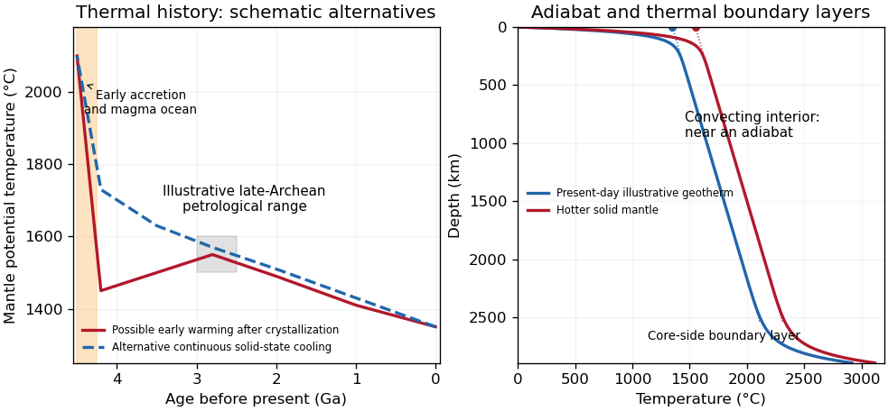

<h1 id="1/b/solution">Solution</h1>

↑ **Parent:** [B](../b.md)

Distinguish the depth-dependent mantle [temperature](../../../../temperature-split.md) from [mantle potential temperature](../../../../mantle-potential-temperature.md) $T_p$: the latter is the temperature a parcel would have after reversible decompression in an [adiabatic process](../../../../adiabatic-process.md) to a chosen reference pressure. A convecting mantle is approximately adiabatic through much of its interior, with steep [thermal boundary layers](../../../../thermal-boundary-layer.md) near the surface and the [core-mantle boundary](../../../../core-mantle-boundary.md). It is neither isothermal nor wholly molten.

Early [accretion](../../../../accretion.md), large impacts and gravitational [planetary differentiation](../../../../planetary-differentiation.md) supplied heat; metal segregation released gravitational energy and extensive melting could produce a [magma ocean](../../../../magma-ocean.md). Rapid surface heat loss then crystallized much of the silicate mantle. Subsequent evolution reflects competition between [radiogenic heating](../../../../radiogenic-heating.md), heat entering from the core and heat carried out through the upper boundary. In a schematic mantle [energy balance](../../../../energy-balance.md),

$$
C_m\frac{d\overline T}{dt}=H_m(t)+Q_{\rm cmb}(t)-Q_m(t),\qquad
H_m(t)=\sum_jH_{j,0}e^{-\lambda_j t}.
$$

Here $C_m$ is mantle [heat capacity](../../../../heat-capacity.md), $H_m$ mantle radioactive power and $Q_m$ heat leaving the mantle; continental crustal radioactive production is not included in $H_m$. The convective [Urey ratio](../../../../urey-ratio.md) $H_m/Q_m$ compares internal production with mantle heat loss. A value below one does not alone prove cooling, because core heat also enters; cooling requires $H_m+Q_{\rm cmb}<Q_m$. [Radioactive decay](../../../../radioactive-decay.md) reduces the heating supply, while [mantle convection](../../../../mantle-convection.md), [plate tectonics](../../../../plate-tectonics.md), melt extraction and changing [viscosity](../../../../dynamic-viscosity-split.md) control the heat loss. A hotter mantle does not automatically imply proportionally faster plate motion: melting, dehydration and boundary strength can alter that relationship.

**[Figure 1](#1/b/image-original-schematic-thermal-histories-and-mantle-geotherms-curves-illustrate-alternatives-rather-than-reproduce-observations-or-fit-a-particular-thermal-model). Original schematic thermal histories and mantle geotherms; curves illustrate alternatives rather than reproduce observations or fit a particular thermal model**.

The robust long-term picture is an energetic early [Earth](../../../../earth.md) followed by substantial cooling and a presently mostly solid, convecting [mantle](../../../../planetary-mantle.md). The shape of the solid-state history is less certain. Petrological reconstructions commonly place late-Archean ambient $T_p$ above modern values. One reconstruction infers about $1500$–$1600\,{}^{\circ}\mathrm{C}$ at $2.5$–$3$ Ga versus about $1350\,{}^{\circ}\mathrm{C}$ today, and permits warming before that late-Archean maximum after the initial magma-ocean cooling.[Abstract and discussion of the late-Archean temperature maximum, EPSL 292, pp. 79–88](../../../../thermal-history-of-the-earth-and-its-petrological-expression-by-claude-herzberg-and-others.md) This is a model-dependent ambient-mantle history, not proof that the accreting [Earth](../../../../earth.md) was cooler than the Archean mantle or that every mantle reservoir followed one curve. **An early molten transient, subsequent solid-state heating or cooling, and later [secular cooling](../../../../secular-cooling.md) must be distinguished.**

## ↑ Ancestors (12)

1. [B](../b.md)
2. [1](../../1.md)
3. [2022](../../../2022-split.md)
4. [Past exam of the plate tectonics course of the University of Oxford](../../../split.md)
5. [Plate tectonics course of the University of Oxford](../../../../plate-tectonics-course-of-the-university-of-oxford.md)
6. [Year 3 of the earth sciences (geology) course of the University of Oxford](../../../../year-3-of-the-earth-sciences-geology-course-of-the-university-of-oxford.md)
7. [Earth sciences (geology) course of the University of Oxford](../../../../earth-sciences-geology-course-of-the-university-of-oxford.md)
8. [Undergraduate course of the University of Oxford](../../../../undergraduate-course-of-the-university-of-oxford.md)
9. [Course of the University of Oxford](../../../../course-of-the-university-of-oxford.md)
10. [University of Oxford](../../../../university-of-oxford-split.md)
11. [List of universities](../../../../list-of-universities.md)
12. [Codex Wiki](../../../../split.md)
