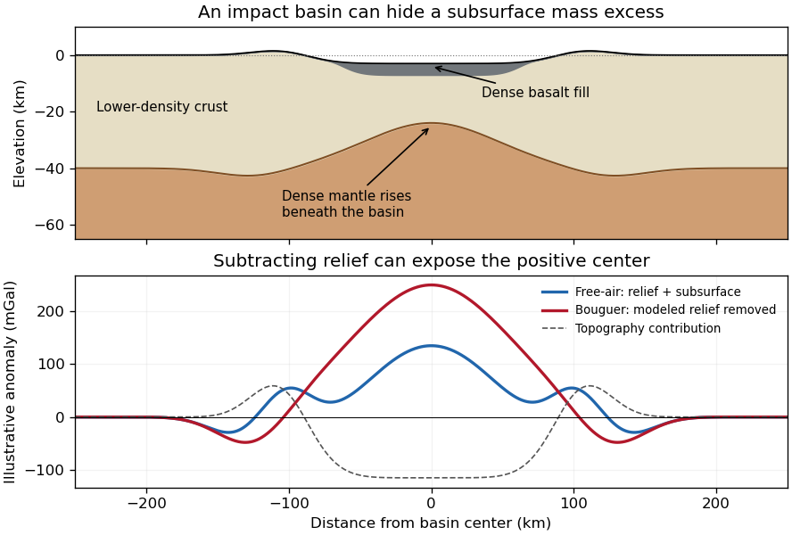

<h1 id="2/c/solution">Solution</h1>

↑ **Parent:** [C](../c.md)

The positive centers in the supplied maps are examples of lunar [mascons](../../../../mascon.md), especially associated with large impact basins. An empty excavation by itself removes mass and would not explain a positive central anomaly. Basin formation can thin the low-density lunar [crust](../../../../planetary-crust.md) and raise denser [lunar mantle](../../../../lunar-mantle.md) beneath the floor; impact melting, collapse and later cooling can also create dense material and lock in a mass excess. Where a basin was later flooded, dense mare [basalt](../../../../basalt.md) adds another contribution. Mare infill is therefore one possible contributor, not a necessary explanation of every [mascon](../../../../mascon.md).[Mission-team account of impact excavation, collapse, cooling and the central mass excess, 30 May 2013](../../../../nasa-s-grail-mission-solves-mystery-of-moon-s-surface-gravity-by-national-aeronautics-and-space-administration.md)

The difference between the maps is the modeled topographic contribution. On a common reference surface, write schematically

$$
\Delta g_{\rm FA}=g_{\rm topo}+g_{\rm internal},\qquad
\Delta g_{\rm B}=\Delta g_{\rm FA}-g_{\rm topo}.
$$

The [free-air gravity anomaly](../../../../free-air-gravity-anomaly.md) retains relief-related attraction. Rims, excavated floors and central peaks therefore contribute fine structure. The [Bouguer gravity anomaly](../../../../bouguer-gravity-anomaly.md) removes the attraction predicted from the measured topography at an assumed crustal [density](../../../../density.md), making internal density and interface structure more apparent. A low basin floor has a negative topographic contribution; subtracting it can enhance an underlying positive central anomaly. Removing a positive rim contribution can weaken a rim high. The supplied lower map is correspondingly smoother at short wavelengths and shows prominent residual basin centers and surrounding rings. This is a change of gravity reduction, not a physical change of the craters.[Sections 4.2–4.3, gravity predicted from topography and its subtraction to obtain Bouguer gravity](../../../../grgm900c-a-degree-900-lunar-gravity-model-from-grail-primary-and-extended-mission-data-by-frank-g-lemoine-and-others.md)

**[Figure 2](#2/c/image-original-schematic-showing-how-dense-fill-and-mantle-uplift-can-outweigh-an-excavated-basin-s-missing-surface-mass-illustrative-curves-are-not-grail-measurements). Original schematic showing how dense fill and mantle uplift can outweigh an excavated basin's missing surface mass; illustrative curves are not GRAIL measurements**.

For scale, a [Bouguer slab](../../../../bouguer-slab.md) approximation gives $\Delta g\simeq2\pi G\Delta\rho\,d$. A $5$ km layer with [geophysical density contrast](../../../../geophysical-density-contrast.md) $300\,\mathrm{kg\,m^{-3}}$ produces about $63$ mGal above an ideal infinite slab. Actual basin geometry, burial, porosity and mantle uplift require a finite three-dimensional model. Smaller craters can have central lows, damaged porous interiors or more complex rings; **the maps do not imply that every crater has a positive anomaly or that positive anomalies measure basalt thickness uniquely**.

## ↑ Ancestors (12)

1. [C](../c.md)
2. [2](../../2.md)
3. [2022](../../../2022-split.md)
4. [Past exam of the plate tectonics course of the University of Oxford](../../../split.md)
5. [Plate tectonics course of the University of Oxford](../../../../plate-tectonics-course-of-the-university-of-oxford.md)
6. [Year 3 of the earth sciences (geology) course of the University of Oxford](../../../../year-3-of-the-earth-sciences-geology-course-of-the-university-of-oxford.md)
7. [Earth sciences (geology) course of the University of Oxford](../../../../earth-sciences-geology-course-of-the-university-of-oxford.md)
8. [Undergraduate course of the University of Oxford](../../../../undergraduate-course-of-the-university-of-oxford.md)
9. [Course of the University of Oxford](../../../../course-of-the-university-of-oxford.md)
10. [University of Oxford](../../../../university-of-oxford-split.md)
11. [List of universities](../../../../list-of-universities.md)
12. [Codex Wiki](../../../../split.md)
