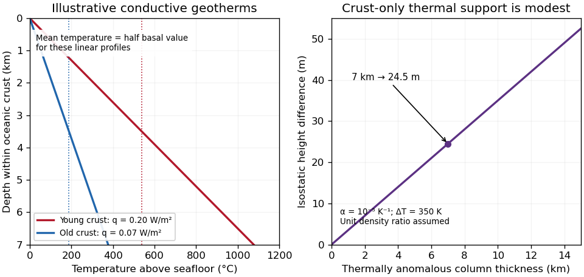

<h1 id="3/c/solution">Solution</h1>

↑ **Parent:** [C](../c.md)

The supplied plot gives surface [heat flux](../../../../heat-flux-density.md), not a whole-crust mean [temperature](../../../../temperature-split.md). At young ages its scatter is substantial. Representative readings suitable for an order-of-magnitude conductive calculation are $q_J\simeq0.20\,\mathrm{W\,m^{-2}}$ near $5$ Ma and $q_N\simeq0.070\,\mathrm{W\,m^{-2}}$ near $50$ Ma; plausible graphical ranges are roughly $0.12$–$0.23$ and $0.06$–$0.09\,\mathrm{W\,m^{-2}}$, respectively. These are approximate choices within the plotted population, not uniquely determined statistical means or a digitization of its red curve.

Assume the same normal oceanic [crustal thickness](../../../../crustal-thickness.md) $h_c=7$ km, seafloor temperature $T_s\simeq0\,{}^{\circ}\mathrm{C}$, negligible internal crustal heating and a linear conductive profile. These are additional assumptions; the paper supplies conductivity but not thickness. With depth $z$ positive downward and $q$ the magnitude of the upward flux, [Fourier's law](../../../../fourier-s-law.md) gives

$$
T(z)=T_s+\frac{qz}{k},\qquad
\overline T_c=\frac1{h_c}\int_0^{h_c}T(z)\,dz
=T_s+\frac{qh_c}{2k}.
$$

This is the [crustal mean temperature from conductive heat flow](../../../../crustal-mean-temperature-from-conductive-heat-flow.md), not the basal temperature, which is twice the excess above $T_s$. Substitution of $k=1.3\,\mathrm{W\,m^{-1}\,K^{-1}}$ gives

$$
\overline T_J\simeq\frac{0.20\times7000}{2\times1.3}=538\,{}^{\circ}\mathrm{C},\qquad
\overline T_N\simeq\frac{0.070\times7000}{2\times1.3}=188\,{}^{\circ}\mathrm{C}.
$$

A sensible rounded answer is therefore **about $540\,{}^{\circ}\mathrm{C}$ for the young crust and $190\,{}^{\circ}\mathrm{C}$ for the old crust**, with a representative contrast **$\Delta\overline T_c\simeq350$ K**. The corresponding basal values are about $1080$ and $380\,{}^{\circ}\mathrm{C}$. The quoted graphical ranges instead yield mean temperatures about $320$–$620$ and $160$–$240\,{}^{\circ}\mathrm{C}$, at the same assumed thickness.

**[Figure 3](#3/c/image-original-conductive-temperature-estimates-and-their-crust-only-thermal-buoyancy-scaling-thickness-linear-profiles-and-representative-fluxes-are-explicit-assumptions). Original conductive temperature estimates and their crust-only thermal-buoyancy scaling; thickness, linear profiles and representative fluxes are explicit assumptions**.

The temperatures scale linearly with $h_c/k$. Hydrothermal circulation can redistribute heat, especially in young permeable crust, and measurements through sediment need not equal the purely conductive cooling-model flux everywhere. The supplied study explicitly addresses the resulting oceanic heat-flow deficit.[Abstract, hydrothermal circulation and low conductive measurements in young seafloor; examination Figure 2 supplies the filtered observations](../../../../oceanic-heat-flow-implications-for-global-heat-loss-by-derrick-hasterok-and-others.md) Thus the calculation gives plausible incoming-crust averages under a stated model, not the entire plate's temperature or its later temperature at depth in the subduction zone.

## ↑ Ancestors (12)

1. [C](../c.md)
2. [3](../../3.md)
3. [2022](../../../2022-split.md)
4. [Past exam of the plate tectonics course of the University of Oxford](../../../split.md)
5. [Plate tectonics course of the University of Oxford](../../../../plate-tectonics-course-of-the-university-of-oxford.md)
6. [Year 3 of the earth sciences (geology) course of the University of Oxford](../../../../year-3-of-the-earth-sciences-geology-course-of-the-university-of-oxford.md)
7. [Earth sciences (geology) course of the University of Oxford](../../../../earth-sciences-geology-course-of-the-university-of-oxford.md)
8. [Undergraduate course of the University of Oxford](../../../../undergraduate-course-of-the-university-of-oxford.md)
9. [Course of the University of Oxford](../../../../course-of-the-university-of-oxford.md)
10. [University of Oxford](../../../../university-of-oxford-split.md)
11. [List of universities](../../../../list-of-universities.md)
12. [Codex Wiki](../../../../split.md)
