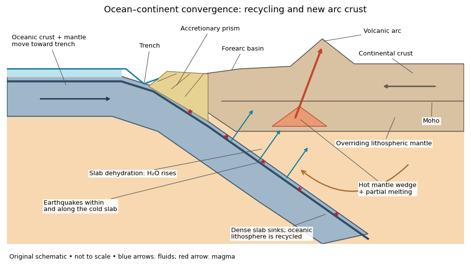
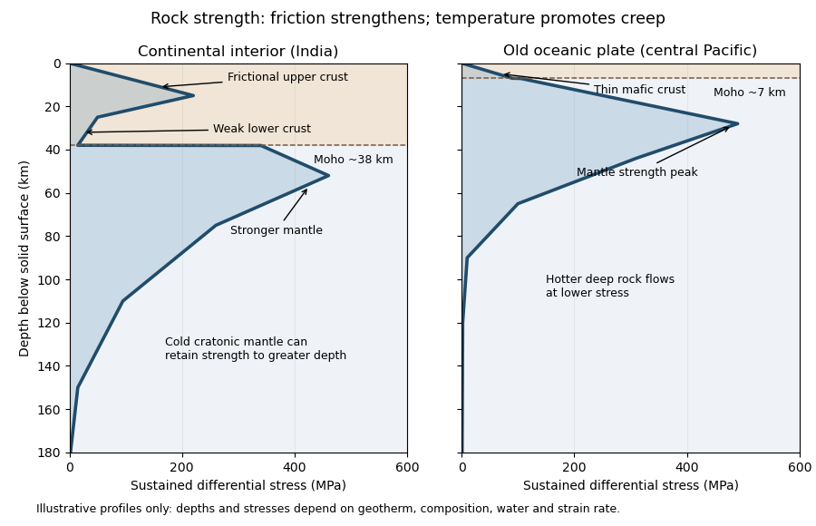
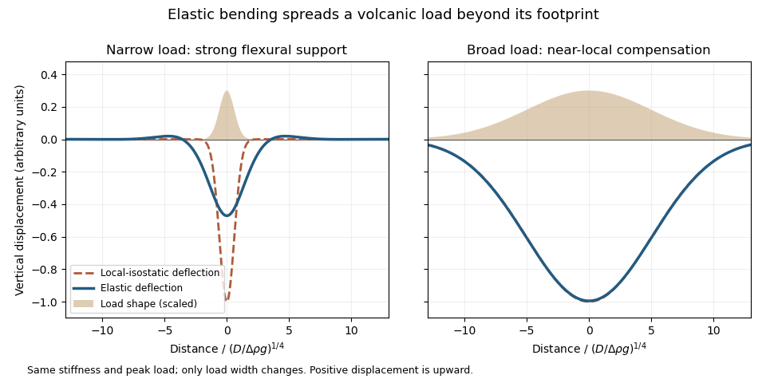

# 2023

↑ **Parent:** [Past exam of the plate tectonics course of the University of Oxford](../past-exam-of-the-plate-tectonics-course-of-the-university-of-oxford.md)

Worked solutions to the ten marked parts of the [plate tectonics](../geophysics.md#plate-tectonics) paper in the [Plate tectonics course of the University of Oxford](../university-of-oxford.md#plate-tectonics-course-of-the-university-of-oxford), third-year examination, 25 May 2023. The examination required candidates to choose two questions; all three are treated here. [Source release: Papers.zip](https://www.whatdotheyknow.com/request/earth_science_past_papers_and_ex/response/3419815/attach/4/Papers.zip?cookie_passthrough=1), member `Papers/Plate Techonics/FOI-202604-431 - Paper 8 2023.pdf`, printed code A17843W1, three pages. Question wording is not reproduced.

**Table of contents**

- [Question 1](#question-1)
  - [a](#question-1/a)
    - [Solution](#question-1/a/solution)
  - [b](#question-1/b)
    - [Solution](#question-1/b/solution)
  - [c](#question-1/c)
    - [Solution](#question-1/c/solution)
- [Question 2](#question-2)
  - [a](#question-2/a)
    - [Solution](#question-2/a/solution)
  - [b](#question-2/b)
    - [Solution](#question-2/b/solution)
  - [c](#question-2/c)
    - [Solution](#question-2/c/solution)
- [Question 3](#question-3)
  - [a](#question-3/a)
    - [Solution](#question-3/a/solution)
  - [b](#question-3/b)
    - [Solution](#question-3/b/solution)
  - [c](#question-3/c)
    - [Solution](#question-3/c/solution)
  - [d](#question-3/d)
    - [Solution](#question-3/d/solution)

## Question 1

↑ **Parent:** [2023](2023.md)

<h3 id="question-1/a">a</h3>

↑ **Parent:** [Question 1](#question-1)

<h4 id="question-1/a/solution">Solution</h4>

↑ **Parent:** [A](#question-1/a)

Choose an ocean–continent [convergent margin](../geophysics.md#convergent-margin). The essential relationship is **recycling of [oceanic lithosphere](../geophysics.md#oceanic-lithosphere) by [subduction](../geophysics.md#subduction), together with production and modification of [crust](../geophysics.md#planetary-crust) in a [volcanic arc](../geophysics.md#volcanic-arc)**.

**[Figure 1](#question-1/a/image-an-original-ocean-continent-subduction-cross-section-with-slab-recycling-fluid-release-and-arc-crust-production). An original ocean–continent subduction cross-section, with slab recycling, fluid release and arc crust production**.

The incoming [tectonic plate](../geophysics.md#tectonic-plate) consists of thin [oceanic crust](../geophysics.md#oceanic-crust), chiefly [basalt](../planetary-science.md#basalt) and [gabbro](../planetary-science.md#gabbro), above colder [lithospheric mantle](../geophysics.md#lithospheric-mantle). As that [oceanic lithosphere](../geophysics.md#oceanic-lithosphere) approaches the [subduction zone](../geophysics.md#subduction-zone), bending produces the [subduction trench](../geophysics.md#subduction-trench). Its cold interior can become denser than the surrounding [mantle](../geophysics.md#planetary-mantle); the resulting [slab pull](../geophysics.md#slab-pull) helps sustain [subduction](../geophysics.md#subduction). The descending [slab](../geophysics.md#slab) carries both [oceanic crust](../geophysics.md#oceanic-crust) and [lithospheric mantle](../geophysics.md#lithospheric-mantle) into the interior. Thus the recycled unit is an entire portion of [lithosphere](../geophysics.md#lithosphere), rather than just its [crust](../geophysics.md#planetary-crust).

At the [subduction trench](../geophysics.md#subduction-trench), some incoming [sediment](../planetary-science.md#sediment) is scraped off and stacked by [thrust faults](../geophysics.md#thrust-fault) into an [accretionary prism](../geophysics.md#accretionary-prism). Material can also be added beneath the [overriding plate](../geophysics.md#overriding-plate) by [tectonic underplating](../geophysics.md#tectonic-underplating). A [forearc basin](../geophysics.md#forearc-basin) collects [sediment](../planetary-science.md#sediment) between the [accretionary prism](../geophysics.md#accretionary-prism) and the [volcanic arc](../geophysics.md#volcanic-arc). This is an accreting example: other [convergent margins](../geophysics.md#convergent-margin) lose upper-plate material through [tectonic erosion](../geophysics.md#tectonic-erosion), so an [accretionary prism](../geophysics.md#accretionary-prism) is not universal.

The cold [slab](../geophysics.md#slab) undergoes increasing [pressure](../pressure.md) and [metamorphism](../planetary-science.md#metamorphism). Conversion of [basaltic rocks](../planetary-science.md#basaltic-rock) and [gabbro](../planetary-science.md#gabbro) towards [eclogite](../planetary-science.md#eclogite) increases their [density](../fluid-mechanics.md#density), while [slab dehydration](../geophysics.md#slab-dehydration) releases [water](../chemical-substance.md#water) from hydrated [minerals](../planetary-science.md#mineral). The rising fluid lowers the [solidus](../thermodynamic-potential.md#solidus) of hot [peridotite](../planetary-science.md#peridotite) in the [mantle wedge](../geophysics.md#mantle-wedge), causing [flux melting](../planetary-science.md#flux-melting). The usual source of [arc magma](../geophysics.md#arc-magma) is therefore the fluid-modified [mantle wedge](../geophysics.md#mantle-wedge); extensive [slab melting](../geophysics.md#slab-melting) is not required. Thermal-petrological calculations show that the depth and amount of [slab dehydration](../geophysics.md#slab-dehydration) depend on the incoming [slab](../geophysics.md#slab)'s thermal structure.[Abstract and depth-dependent water-release models.](../planetary-science.md#subduction-factory-4-depth-dependent-flux-of-h2o-from-subducting-slabs-worldwide-by-peter-e-van-keken-and-others)

Buoyant [magma](../geophysics.md#magma) rises through the [overriding plate](../geophysics.md#overriding-plate), freezes in [igneous intrusions](../geophysics.md#igneous-intrusion) or erupts in the [volcanic arc](../geophysics.md#volcanic-arc). [Fractional crystallization](../planetary-science.md#fractional-crystallization), interaction with existing [continental crust](../geophysics.md#continental-crust) and repeated intrusion can produce more evolved [arc magmas](../geophysics.md#arc-magma) and add new [crust](../geophysics.md#planetary-crust). Some material merely reworks old [crust](../geophysics.md#planetary-crust), and simultaneous [tectonic erosion](../geophysics.md#tectonic-erosion) can remove it: [volcanism](../geophysics.md#volcanism) alone does not measure net continental growth. [Tectonic shortening](../planetary-science.md#tectonic-shortening), [folding](../planetary-science.md#folding) and [thrust faults](../geophysics.md#thrust-fault) can thicken and raise the upper plate.

The [Wadati-Benioff zone](../geophysics.md#wadati-benioff-zone) marks [earthquakes](../geophysics.md#earthquake) along and within the cold descending [slab](../geophysics.md#slab). Shallow interface [earthquakes](../geophysics.md#earthquake) reflect unstable slip where the plates are coupled; deeper [earthquakes](../geophysics.md#earthquake) require mechanisms such as [dehydration embrittlement](../geophysics.md#dehydration-embrittlement) and are not simply dry shallow friction operating at every depth. In contrast, the hot [mantle wedge](../geophysics.md#mantle-wedge) deforms mainly by [material creep](../engineering.md#creep-deformation). Together, the [subduction trench](../geophysics.md#subduction-trench), [accretionary prism](../geophysics.md#accretionary-prism), [forearc basin](../geophysics.md#forearc-basin), [volcanic arc](../geophysics.md#volcanic-arc) and inclined [seismicity](../geophysics.md#seismicity) connect surface features to the processes recycling and creating [crust](../geophysics.md#planetary-crust).

<h3 id="question-1/b">b</h3>

↑ **Parent:** [Question 1](#question-1)

<h4 id="question-1/b/solution">Solution</h4>

↑ **Parent:** [B](#question-1/b)

**[Slab pull](../geophysics.md#slab-pull) is generally the largest direct driving contribution for plates attached to substantial cold descending [slabs](../geophysics.md#slab).** Cooling makes [oceanic lithosphere](../geophysics.md#oceanic-lithosphere) negatively buoyant; sinking [slabs](../geophysics.md#slab) transmit a pulling force to the rest of the [tectonic plate](../geophysics.md#tectonic-plate). The comparison is a force balance, so the following driving and resisting processes both matter.

- [Ridge push](../geophysics.md#ridge-push) is gravitational sliding away from an elevated [spreading ridge](../geophysics.md#spreading-ridge). Cooling, contraction and deepening of [oceanic lithosphere](../geophysics.md#oceanic-lithosphere) establish the lateral difference in integrated [pressure](../pressure.md); [ridge push](../geophysics.md#ridge-push) is not simply [magma](../geophysics.md#magma) squirting sideways into a plate.
- [Basal traction on a tectonic plate](../geophysics.md#basal-traction-on-a-tectonic-plate) transfers [shear stress](../viscous-fluid-flow.md#shear-stress) between the [lithosphere](../geophysics.md#lithosphere) and circulating [mantle](../geophysics.md#planetary-mantle). It can help or oppose [plate motion](../geophysics.md#plate-motion), depending on their relative [velocities](../classical-mechanics.md#velocity). [Slab suction](../geophysics.md#slab-suction) is the contribution of [slab](../geophysics.md#slab)-induced [mantle flow](../geophysics.md#mantle-flow) and its associated [pressure](../pressure.md) and [traction](../continuum-mechanics.md#traction) to nearby [plate motion](../geophysics.md#plate-motion).
- [Frictional sliding](../newtonian-mechanics.md#frictional-sliding) along [faults](../geophysics.md#geological-fault), shearing along the plate interface, bending of the incoming [slab](../geophysics.md#slab) and [viscous dissipation](../stokes-flow.md#viscous-dissipation) in the surrounding [mantle](../geophysics.md#planetary-mantle) resist [plate motion](../geophysics.md#plate-motion). [Continental collision](../geophysics.md#continental-collision) introduces additional resistance through buoyancy and deformation of thick [continental crust](../geophysics.md#continental-crust).
- [Mantle plumes](../geophysics.md#mantle-plume) and [continental rifting](../geophysics.md#continental-rifting) can locally promote uplift, weakening and separation, but do not provide a universal explanation for all [plate motion](../geophysics.md#plate-motion).

The first two gravitational contributions ultimately belong to the same coupled [mantle convection](../geophysics.md#mantle-convection) system: the plates are its cold upper [thermal boundary layer](../continuum-mechanics.md#thermal-boundary-layer). They are not passive rafts on a prescribed conveyor belt. A plate with little attached descending [slab](../geophysics.md#slab) need not have [slab pull](../geophysics.md#slab-pull) as its largest local driver, and a large gross [slab pull](../geophysics.md#slab-pull) can be partly consumed by bending and interface resistance. Geological observations and force comparisons nonetheless support the general dominance of [slab pull](../geophysics.md#slab-pull) for rapidly moving subducting plates.[Section explaining mantle circulation, ridge push and slab pull, including the association between subducting plate edges and faster motion.](../planetary-science.md#what-causes-earthquakes-by-british-geological-survey)

<h3 id="question-1/c">c</h3>

↑ **Parent:** [Question 1](#question-1)

<h4 id="question-1/c/solution">Solution</h4>

↑ **Parent:** [C](#question-1/c)

**Repeated assembly and dispersal are supported by mutually consistent [paleogeography](../planetary-science.md#paleogeography), [paleomagnetism](../geophysics.md#paleomagnetism), dated collision belts and subsequent rifted margins.** A useful reconstruction must explain both former connections and later separation, at the same geological ages.

For the youngest well-constrained example, [Pangaea](../planetary-science.md#pangaea), matching continental outlines become more compelling when the fit uses the continental edges rather than mobile modern shorelines. More discriminating evidence includes the continuation of [mountain belts](../planetary-science.md#mountain-belt), [sedimentary successions](../planetary-science.md#sedimentary-succession) and distinctive basement rocks across now-separated continents. Correlated terrestrial [fossil assemblages](../paleontology.md#fossil-assemblage) and the distribution of [glacial deposits](../planetary-science.md#glacial-deposit) become geographically coherent when the continents are restored. Each observation alone can have alternatives, but a single reconstruction that satisfies several independent tests is much harder to explain by coincidence.

For older examples, the most useful surviving record lies within the [cratons](../geophysics.md#craton) and their margins. Dated [suture zones](../geophysics.md#suture-zone), [ophiolites](../planetary-science.md#ophiolite), [metamorphic belts](../planetary-science.md#metamorphic-belt) and [pressure-temperature-time paths](../planetary-science.md#pressure-temperature-time-path) document former ocean closure and [continental collision](../geophysics.md#continental-collision). Restoring now-separated belts to continuity tests an assembly. Subsequent [continental rifting](../geophysics.md#continental-rifting), matching [dike swarms](../geophysics.md#dike-swarm), [large igneous provinces](../geophysics.md#large-igneous-province) and the transition to [passive margins](../geophysics.md#passive-margin) test its breakup. [Uranium-lead dating](../physics.md#uranium-lead-dating) of [zircon](../planetary-science.md#zircon), including [detrital zircon](../planetary-science.md#detrital-zircon) populations and [sedimentary provenance](../planetary-science.md#sedimentary-provenance), helps establish whether the proposed connections existed at the same time.

[Paleomagnetism](../geophysics.md#paleomagnetism) supplies an independent quantitative test. A primary [remanent magnetization](../electromagnetism.md#remanent-magnetization) constrains ancient latitude and orientation. After a proposed relative rotation brings two blocks together, compatible [apparent polar wander paths](../geophysics.md#apparent-polar-wander-path) over an interval support their travelling together; divergence of those paths can document separation. [Radiometric dating](../physics.md#radiometric-dating), a [paleomagnetic fold test](../geophysics.md#paleomagnetic-fold-test) and a [paleomagnetic reversal test](../geophysics.md#paleomagnetic-reversal-test) help identify primary records and distinguish them from [remagnetization](../geophysics.md#remagnetization). There remain important ambiguities: conventional [paleomagnetism](../geophysics.md#paleomagnetism) does not fix absolute longitude, and sparse ages, later deformation and [true polar wander](../planetary-science.md#true-polar-wander) complicate a reconstruction.

The broad succession is [Columbia](../planetary-science.md#columbia-supercontinent) or [Nuna](../planetary-science.md#columbia-supercontinent), assembled mainly around 1.9–1.6 billion years ago; [Rodinia](../planetary-science.md#rodinia), assembled mainly around 1.1–0.9 billion years ago and dispersed in stages during the later [Proterozoic](../planetary-science.md#proterozoic); and [Pangaea](../planetary-science.md#pangaea), assembled by roughly 300 million years ago and breaking apart from roughly 200 million years ago. These are broad intervals rather than synchronous global events. A quantitative [Nuna](../planetary-science.md#columbia-supercontinent) reconstruction combines [paleomagnetism](../geophysics.md#paleomagnetism) with the histories of continental margins rather than relying only on matching rock ages.[pp. 443–446, reconstruction of the Nuna core and tests using paleomagnetic and tectonostratigraphic records.](../planetary-science.md#assembly-and-breakup-of-the-core-of-paleoproterozoic-mesoproterozoic-supercontinent-nuna-by-david-a-d-evans-and-ross-n-mitchell)

Repeated global peaks in dated [magmatism](../geophysics.md#magmatism) and [metamorphism](../planetary-science.md#metamorphism) offer supporting evidence, but cannot prove a [supercontinent cycle](../geophysics.md#supercontinent-cycle) by themselves: [erosion](../planetary-science.md#erosion), burial and preferential preservation also change the observed age distribution. The persuasive case is the recurrence of dated assembly–breakup sequences in different [continental configurations](../planetary-science.md#continental-configuration), with stronger geometric constraints for [Pangaea](../planetary-science.md#pangaea) than for the older [supercontinents](../geophysics.md#supercontinent). A [Wilson cycle](../geophysics.md#wilson-cycle) describes an individual ocean's opening and closure; a [supercontinent cycle](../geophysics.md#supercontinent-cycle) concerns the much larger-scale continental assembly and dispersal.

## Question 2

↑ **Parent:** [2023](2023.md)

<h3 id="question-2/a">a</h3>

↑ **Parent:** [Question 2](#question-2)

<h4 id="question-2/a/solution">Solution</h4>

↑ **Parent:** [A](#question-2/a)

[Plate tectonics](../geophysics.md#plate-tectonics) changes the environments in which [natural selection](../evolution.md#natural-selection), [gene flow](../evolution.md#gene-flow) and [extinction](../ecology.md#extinction) operate. **It influences both the persistence of habitable conditions and the geographical and chemical opportunities for [evolution](../evolution.md).** It does not prescribe a unique sequence of biological innovations.

Separation of continents by [continental rifting](../geophysics.md#continental-rifting) divides populations and reduces [gene flow](../evolution.md#gene-flow), promoting [allopatric speciation](../evolution.md#allopatric-speciation). [Continental collision](../geophysics.md#continental-collision) or newly exposed land connections can reunite populations, permit dispersal and introduce competitors or predators. These mechanisms connect [biogeography](../evolution.md#biogeography) to [continental configuration](../planetary-science.md#continental-configuration). Changing the amount and fragmentation of shallow [continental shelf](../planetary-science.md#continental-shelf) habitat can also change the opportunities for diversification of marine [organisms](../organism.md).

Over long intervals, [volcanic outgassing](../geophysics.md#volcanic-outgassing), [silicate weathering](../geophysics.md#silicate-weathering), carbonate burial and [subduction](../geophysics.md#subduction) exchange [carbon](../chemical-substance.md#carbon) among the interior, [atmosphere](../planetary-science.md#atmosphere) and [ocean](../planetary-science.md#ocean). In a suitable regime, warmer, wetter conditions increase [silicate weathering](../geophysics.md#silicate-weathering), remove atmospheric [carbon dioxide](../chemical-substance.md#carbon-dioxide) and weaken the [greenhouse effect](../exoplanet.md#greenhouse-effect). This [negative feedback](../signal-transduction.md#negative-feedback) can support long-lived [habitability](../planetary-science.md#habitability), though it depends on exposed fresh [rock](../planetary-science.md#rock-geology), available [water](../chemical-substance.md#water) and reaction rates.[Weathering–carbon dioxide–temperature coupling in the proposed long-term stabilization mechanism.](../planetary-science.md#a-negative-feedback-mechanism-for-the-long-term-stabilization-of-earth-s-surface-temperature-by-james-c-g-walker-and-others) [Mountain building](../planetary-science.md#mountain-building) changes precipitation, [erosion](../planetary-science.md#erosion) and delivery of [nutrients](../biology.md#nutrient) to the [ocean](../planetary-science.md#ocean), affecting [primary production](../ecology.md#primary-production) and organic [carbon](../chemical-substance.md#carbon) burial.

The opening and closure of [ocean gateways](../planetary-science.md#ocean-gateway) changes [ocean circulation](../geophysical-fluid-dynamics.md#ocean-circulation), transport of [heat](../heat.md) and the supply of [oxygen](../chemical-substance.md#oxygen) to deep [water](../chemical-substance.md#water). Together with movement of land through different latitudes and changes in [sea level](../planetary-science.md#sea-level), this reorganizes [climate](../geophysics.md#climate) and habitat. Enhanced organic [carbon](../chemical-substance.md#carbon) burial can change atmospheric [oxygen](../chemical-substance.md#oxygen) over long intervals, while a poorly ventilated [ocean](../planetary-science.md#ocean) can develop [ocean anoxia](../planetary-science.md#ocean-anoxia). Such chemical changes alter which forms of [metabolism](../metabolism.md) are viable.

[Hydrothermal circulation](../planetary-science.md#hydrothermal-circulation) at [spreading ridges](../geophysics.md#spreading-ridge) and through fractured [rock](../planetary-science.md#rock-geology) supplies [chemical disequilibrium](../chemical-potential.md#chemical-disequilibrium) and mineral surfaces. For example, [serpentinization](../planetary-science.md#serpentinization) can produce [hydrogen](../chemical-substance.md#hydrogen) usable by [chemolithotrophy](../metabolism.md#chemolithotrophy) when suitable electron acceptors are available. This supplies a possible setting for [abiogenesis](../biology.md#abiogenesis) and early ecosystems; it does not establish that [life](../biology.md#life) originated there.

There can also be abrupt disruption. Rapid emplacement of a [large igneous province](../geophysics.md#large-igneous-province) can change [climate](../geophysics.md#climate) through gas release; sulfur-bearing [aerosols](../chemistry.md#aerosol) can initially cool, whereas sustained [carbon dioxide](../chemical-substance.md#carbon-dioxide) release can warm and contribute to [ocean acidification](../planetary-science.md#ocean-acidification) and [ocean anoxia](../planetary-science.md#ocean-anoxia). Such perturbations can contribute to [mass extinction](../evolution.md#mass-extinction), followed by [adaptive radiation](../evolution.md#adaptive-radiation) among survivors. The [Deccan Traps](../geophysics.md#deccan-traps) exemplify the scale of [volcanism](../geophysics.md#volcanism) involved, but their association with the [Cretaceous–Palaeogene boundary](../planetary-science.md#cretaceous-palaeogene-boundary) does not justify attributing the entire biological crisis to [volcanism](../geophysics.md#volcanism) alone. Both gradual environmental reorganization and rare rapid perturbations belong in the explanation.

<h3 id="question-2/b">b</h3>

↑ **Parent:** [Question 2](#question-2)

<h4 id="question-2/b/solution">Solution</h4>

↑ **Parent:** [B](#question-2/b)

Interpret [habitability](../planetary-science.md#habitability) as the ability to sustain [life](../biology.md#life) with broadly terrestrial [biochemistry](../biochemistry.md). **Accessible [liquid water](../chemical-substance.md#liquid-water), usable [free energy](../thermodynamic-potential.md#thermodynamic-free-energy), suitable chemical ingredients and sufficiently persistent conditions are the central requirements.** Earth-like geography, a breathable [atmosphere](../planetary-science.md#atmosphere) and actual habitation are not part of that definition.

**A viable local physical environment.** The relevant [temperature](../temperature.md) and [pressure](../pressure.md) must permit [liquid water](../chemical-substance.md#liquid-water) where the [organisms](../organism.md) live. For a surface habitat this normally requires an appropriate [atmosphere](../planetary-science.md#atmosphere) and [surface temperature](../planetary-science.md#surface-temperature); the roughly 6.1 millibar triple-point [pressure](../pressure.md) of pure [water](../chemical-substance.md#water) is a minimum phase constraint, not a guarantee of a temperate surface. High [salinity](../mathematical-physics.md#salinity), extreme acidity and low [water activity](../chemical-potential.md#water-activity) can make apparently wet environments unsuitable for known [life](../biology.md#life). A subsurface [ocean](../planetary-science.md#ocean) beneath ice can provide liquid conditions even when the surface is frozen, so the entire body need not lie in the conventional surface-water [habitable zone](../exoplanet.md#circumstellar-habitable-zone).

**A suitable orbit and rotation.** For a surface-water [planet](../planetary-science.md#planet), orbital distance must give an absorbed [radiation budget](../geophysics.md#radiation-budget) compatible with liquid conditions after the body's [Bond albedo](../exoplanet.md#bond-albedo), [atmosphere](../planetary-science.md#atmosphere) and [greenhouse effect](../exoplanet.md#greenhouse-effect) are included. The simple [planetary equilibrium temperature](../exoplanet.md#planetary-equilibrium-temperature) estimate

$$
T_{\rm eq}=\left[\frac{(1-A)S}{4\sigma}\right]^{1/4}
$$

uses orbital irradiance $S$, [Bond albedo](../exoplanet.md#bond-albedo) $A$ and the [Stefan-Boltzmann constant](../heat.md#stefan-boltzmann-constant) $\sigma$, assumes unit thermal emissivity and averages over the whole sphere. It is not a prediction of [surface temperature](../planetary-science.md#surface-temperature) beneath a [atmosphere](../planetary-science.md#atmosphere) with a [greenhouse effect](../exoplanet.md#greenhouse-effect). Excessive absorbed energy risks a [runaway greenhouse](../exoplanet.md#runaway-greenhouse); inadequate surface heating can freeze surface [water](../chemical-substance.md#water), although [heat](../heat.md) from the interior or [tidal heating](../planetary-science.md#tidal-heating) can maintain a subsurface habitat.

The orbit must persist without collision or ejection for a biologically useful interval. Large [orbital eccentricity](../celestial-mechanics.md#orbital-eccentricity) can produce extreme variations in heating, but neither exactly circular motion nor Earth's particular [obliquity](../planetary-science.md#obliquity) is essential. [Rotation period](../planetary-science.md#rotation-period) and [obliquity](../planetary-science.md#obliquity) govern illumination and seasons; atmospheric and [ocean heat flux](../geophysics.md#ocean-heat-flux) determine how severe those variations become. [Tidal locking](../planetary-science.md#tidal-locking) does not automatically make a body uninhabitable, because sufficient heat transport can moderate the day–night contrast. A [natural satellite](../planetary-science.md#natural-satellite) also needs a stable orbit around its primary and a tolerable combination of irradiation and [tidal heating](../planetary-science.md#tidal-heating): enough heating may maintain an [ocean](../planetary-science.md#ocean), whereas excessive heating can make the environment hostile. These are constraints on the body's location and path, without requiring a particular kind of surrounding planetary system.

**An adequate chemical inventory and access to it.** Known [life](../biology.md#life) uses [carbon](../chemical-substance.md#carbon), [hydrogen](../chemical-substance.md#hydrogen), [nitrogen](../chemical-substance.md#nitrogen), [oxygen](../chemical-substance.md#oxygen), [phosphorus](../chemical-substance.md#phosphorus) and [sulfur](../chemical-substance.md#sulfur), together with catalytic trace elements. A [rocky planet](../planetary-science.md#terrestrial-planet) supplies mineral surfaces and reservoirs, but total inventory is not enough: [chemical weathering](../planetary-science.md#chemical-weathering), [water-rock interaction](../planetary-science.md#water-rock-interaction) or other transport must make [nutrients](../biology.md#nutrient) accessible. A water-rich body with an [ocean](../planetary-science.md#ocean) isolated from its rocky interior by a thick high-pressure ice layer could have difficulty recycling some [nutrients](../biology.md#nutrient); this is a possible limitation, not proof of sterility.

**A usable energy supply.** [Photosynthesis](../metabolism.md#photosynthesis) can exploit light in an illuminated habitat. A dark subsurface habitat instead needs sustained [chemical disequilibrium](../chemical-potential.md#chemical-disequilibrium), for example oxidized and reduced species brought together by [water-rock interaction](../planetary-science.md#water-rock-interaction), [hydrothermal circulation](../planetary-science.md#hydrothermal-circulation) or [radiolysis](../biophysical-measurement.md#radiolysis). Warm [water](../chemical-substance.md#water) at complete [chemical equilibrium](../chemical-potential.md#chemical-equilibrium) is not, by itself, an energy supply for sustained [metabolism](../metabolism.md).

**Retention, protection and longevity.** The body's [mass](../classical-mechanics.md#mass), radius, [surface gravity](../general-relativity.md#surface-gravity) and thermal history affect retention of [water](../chemical-substance.md#water) and an [atmosphere](../planetary-science.md#atmosphere). [Escape velocity](../energy.md#escape-velocity) must be considered together with gas [temperature](../temperature.md), molecular mass, [atmospheric escape](../exoplanet.md#atmospheric-escape) and replenishment: there is no universal Earth-mass threshold. An [atmosphere](../planetary-science.md#atmosphere), ice or [rock](../planetary-science.md#rock-geology) overburden can protect [life](../biology.md#life) from damaging [ionizing radiation](../physics.md#ionizing-radiation) and short-wavelength light. An intrinsic [planetary magnetic field](../planetary-science.md#planetary-magnetic-field) can modify charged-particle exposure and escape, but it is neither a universal requirement nor a guarantee of retention.

Finally, conditions must last long enough. Stored formation [heat](../heat.md), [radiogenic heating](../physics.md#radiogenic-heating) and possibly [tidal heating](../planetary-science.md#tidal-heating) can maintain circulation and chemical exchange. [Plate tectonics](../geophysics.md#plate-tectonics) can recycle materials and support a [carbonate-silicate cycle](../geophysics.md#carbonate-silicate-cycle), but it is not established as a necessary condition for every habitable body: conditional long-term [carbon cycling](../geophysics.md#carbon-cycling) is possible on a [stagnant-lid planet](../planetary-science.md#stagnant-lid-planet) as well.[Abstract and coupled thermal/carbon-cycle model; habitability is conditional on degassing, weathering and interior evolution.](../planetary-science.md#carbon-cycling-and-habitability-of-earth-sized-stagnant-lid-planets-by-bradford-j-foley-and-andrew-j-smye) The necessary end result is persistence of a suitable environment, rather than a checklist requiring every feature of the modern [Earth](../planetary-science.md#earth).

<h3 id="question-2/c">c</h3>

↑ **Parent:** [Question 2](#question-2)

<h4 id="question-2/c/solution">Solution</h4>

↑ **Parent:** [C](#question-2/c)

**Prioritize accessible ancient [lacustrine deposits](../planetary-science.md#lacustrine-deposit) at a preserved [river delta](../planetary-science.md#river-delta), especially fine-grained, [clay mineral](../planetary-science.md#clay-mineral)-bearing [mudstones](../planetary-science.md#mudstone), with nearby evidence of [groundwater](../planetary-science.md#groundwater) or [hydrothermal circulation](../planetary-science.md#hydrothermal-circulation).** The target should combine past [habitability](../planetary-science.md#habitability), good [biosignature preservation](../biology.md#biosignature-preservation) and practical access to minimally altered [rock](../planetary-science.md#rock-geology).

An inlet valley, a [river delta](../planetary-science.md#river-delta) and a stratified basin together can establish a connected fluvial–lake [paleoenvironment](../planetary-science.md#paleoenvironment) on [Mars](../astrophysics.md#mars). A long-lived lake offers [liquid water](../chemical-substance.md#liquid-water), chemical transport and a sustained habitat, while a [river delta](../planetary-science.md#river-delta) concentrates material from a larger catchment. Distal [mudstone](../planetary-science.md#mudstone) is particularly attractive: fine particles can adsorb [organic molecules](../chemistry.md#organic-molecule), burial reduces exposure, and quiet deposition can preserve small-scale structures. Rover observations have independently established ancient lake and [river delta](../planetary-science.md#river-delta) settings on [Mars](../astrophysics.md#mars), so this is a geological search strategy grounded in observed environments.[Abstract: a fluvio-lacustrine sedimentary environment with inferred chemical conditions suitable for microbial life.](../planetary-science.md#a-habitable-fluvio-lacustrine-environment-at-yellowknife-bay-gale-crater-mars-by-john-p-grotzinger-and-others)[Abstract: delta-lake deposition followed by later high-energy flooding.](../planetary-science.md#perseverance-rover-reveals-an-ancient-delta-lake-system-and-flood-deposits-at-jezero-crater-mars-by-nicolas-mangold-and-others)

A second high-value setting is an ancient [hydrothermal deposit](../planetary-science.md#hydrothermal-deposit), particularly [silica](../planetary-science.md#silica)-rich precipitates, spring terraces or mineralized [groundwater](../planetary-science.md#groundwater) fractures near a heat source. Such environments combine [water-rock interaction](../planetary-science.md#water-rock-interaction), [chemical disequilibrium](../chemical-potential.md#chemical-disequilibrium) and the possibility of rapid mineral entombment. Distal, moderate-temperature parts of a [hydrothermal circulation](../planetary-science.md#hydrothermal-circulation) system are preferable to strongly reheated zones where [organic molecules](../chemistry.md#organic-molecule) would be destroyed. Orbital observations identify candidate ancient [hydrothermal deposits](../planetary-science.md#hydrothermal-deposit) on [Mars](../astrophysics.md#mars), although their geological interpretation requires testing on the ground.[Abstract and inferred deep-water hydrothermal setting; evidence for an environment rather than evidence of life.](../planetary-science.md#ancient-hydrothermal-seafloor-deposits-in-eridania-basin-on-mars-by-joseph-r-michalski-and-others) [Carbonate](../chemistry.md#carbonate)-bearing [sedimentary deposits](../planetary-science.md#sedimentary-deposit) can also preserve textures and chemical records of former [water](../chemical-substance.md#water), but precipitation of [carbonate](../chemistry.md#carbonate) alone is not a [biosignature](../biology.md#biosignature).

Choose ancient deposits with good [stratigraphy](../planetary-science.md#stratigraphy), limited later [metamorphism](../planetary-science.md#metamorphism) and relatively recent exposure by [erosion](../planetary-science.md#erosion), or sample beneath the irradiated surface. Present exposed [organic molecules](../chemistry.md#organic-molecule) can be destroyed by [cosmic rays](../galaxy.md#cosmic-ray), [radiolysis](../biophysical-measurement.md#radiolysis) and oxidizing surface chemistry, so a drill, fresh scarp or recently excavated material improves the preservation prospects. Laboratory irradiation experiments on Martian analogue materials demonstrate why shallow ancient surface exposure can erase an organic record.[27 June 2022, experiments on radiation-driven destruction of amino acids and implications for subsurface sampling.](../planetary-science.md#nasa-experiment-suggests-need-to-dig-deep-for-evidence-of-life-on-mars-by-national-aeronautics-and-space-administration)

At the site, relate every sample to its [sedimentary facies](../planetary-science.md#sedimentary-facies) and mineral context. Seek several independent, spatially associated [biosignatures](../biology.md#biosignature): plausible microscopic structures, distinctive [organic molecules](../chemistry.md#organic-molecule), and [isotope fractionation](../chemical-substance.md#isotope-fractionation) consistent with a biological process. Each has nonbiological alternatives, so test [water-rock interaction](../planetary-science.md#water-rock-interaction), mineral self-organization and contamination before inferring [life](../biology.md#life). Include control samples from adjacent unpromising [rocks](../planetary-science.md#rock-geology) and track terrestrial contamination. A safe landing ellipse with traversable exposures of several related [sedimentary facies](../planetary-science.md#sedimentary-facies) is more useful than a spectacular but inaccessible single outcrop. The desired outcome is contextual evidence that can distinguish former [life](../biology.md#life) from merely former [habitability](../planetary-science.md#habitability).

## Question 3

↑ **Parent:** [2023](2023.md)

<h3 id="question-3/a">a</h3>

↑ **Parent:** [Question 3](#question-3)

<h4 id="question-3/a/solution">Solution</h4>

↑ **Parent:** [A](#question-3/a)

Use a [rock strength envelope](../rheology.md#rock-strength-envelope): at each depth plot the smaller [differential stress](../continuum-mechanics.md#differential-stress) needed for frictional failure and for sustained ductile [material creep](../engineering.md#creep-deformation) at a specified [strain rate](../continuum-mechanics.md#strain-rate). **Shallow [rock](../planetary-science.md#rock-geology) generally strengthens with depth because effective confining [pressure](../pressure.md) increases; sufficiently deep hot [rock](../planetary-science.md#rock-geology) weakens because thermally activated [material creep](../engineering.md#creep-deformation) becomes efficient.**

**[Figure 2](#question-3/a/image-illustrative-rock-strength-envelopes-for-a-continental-interior-and-an-old-central-pacific-plate-these-are-conceptual-profiles-not-measurements). Illustrative rock-strength envelopes for a continental interior and an old central-Pacific plate; these are conceptual profiles, not measurements**.

At shallow depth, [Byerlee's law](../newtonian-mechanics.md#byerlee-s-law) or a [Mohr-Coulomb failure criterion](../continuum-mechanics.md#mohr-coulomb-failure-criterion) gives a relation of the form

$$
\tau_f=C+\mu(\sigma_n-P_f),
$$

where $C$ is cohesion, $\mu$ a [coefficient of friction](../newtonian-mechanics.md#coefficient-of-friction), $\sigma_n$ the compressive [normal stress](../continuum-mechanics.md#normal-stress) and $P_f$ the [pore pressure](../porous-media-flow.md#pore-pressure). Increasing overburden generally increases [effective stress](../continuum-mechanics.md#effective-stress), hence the [frictional strength](../newtonian-mechanics.md#frictional-strength). Conversion from fault [shear stress](../viscous-fluid-flow.md#shear-stress) to [differential stress](../continuum-mechanics.md#differential-stress) depends on the stress regime and fault orientation; a sketch should not label a universal numerical slope. High [pore pressure](../porous-media-flow.md#pore-pressure) or weak [fault gouge](../geophysics.md#fault-gouge) can lower the [frictional strength](../newtonian-mechanics.md#frictional-strength) substantially.

A simplified [dislocation creep](../engineering.md#dislocation-creep) relation is

$$
\dot\epsilon=A\sigma^n\exp\!\left[-\frac{Q+PV^*}{RT}\right],
\qquad
\sigma_{\rm creep}=\left(\frac{\dot\epsilon}{A}\right)^{1/n}\exp\!\left[\frac{Q+PV^*}{nRT}\right].
$$

Here $Q$ is [activation energy](../chemical-kinetics.md#activation-energy), $V^*$ [activation volume](../chemical-kinetics.md#activation-volume), $R$ the [molar gas constant](../ideal-gas.md#molar-gas-constant) and $T$ absolute [temperature](../temperature.md); $A$ and $n$ depend on composition and deformation mechanism. At fixed [strain rate](../continuum-mechanics.md#strain-rate), increasing [temperature](../temperature.md) usually decreases the required [stress](../continuum-mechanics.md#stress) strongly. The competing effects of [pressure](../pressure.md), [water weakening of rocks](../engineering.md#water-weakening-of-rocks), [grain size](../thermodynamics.md#grain-size) and composition also matter. The intersection with frictional failure gives a [brittle-ductile transition](../engineering.md#brittle-ductile-transition), not a change from solid to liquid.

For the Indian continental interior, a useful first sketch has an upper-crustal strength peak, a weaker lower [continental crust](../geophysics.md#continental-crust), and renewed strength in [lithospheric mantle](../geophysics.md#lithospheric-mantle) beneath the [Moho](../geophysics.md#mohorovicic-discontinuity). [Quartz](../chemical-substance.md#quartz)-bearing [rocks](../planetary-science.md#rock-geology) can undergo ductile [material creep](../engineering.md#creep-deformation) at conditions where colder, drier [olivine](../planetary-science.md#olivine)-rich [mantle](../geophysics.md#planetary-mantle) retains appreciable strength. This creates a possible two-peak, or “jelly sandwich”, [rock strength envelope](../rheology.md#rock-strength-envelope). With further depth the [mantle](../geophysics.md#planetary-mantle) also weakens. A cold [craton](../geophysics.md#craton) can retain strong [lithospheric mantle](../geophysics.md#lithospheric-mantle) to much greater depths than a tectonically heated continental region.

For the central Pacific, show thin [mafic](../planetary-science.md#mafic) [oceanic crust](../geophysics.md#oceanic-crust) above a relatively thick layer of strong [lithospheric mantle](../geophysics.md#lithospheric-mantle). There need not be a conspicuous weak lower-crustal layer. Much of the integrated strength can reside below the [Moho](../geophysics.md#mohorovicic-discontinuity), with a broad strength peak followed by ductile weakening towards the [asthenosphere](../geophysics.md#asthenosphere). Cooling and age control the thickness: young hot [oceanic lithosphere](../geophysics.md#oceanic-lithosphere) would give a much shallower and weaker profile than an old central-Pacific plate.

The plotted [Moho](../geophysics.md#mohorovicic-discontinuity) depths of about 38 km and 7 km, and all plotted [stresses](../continuum-mechanics.md#stress), are illustrative assumptions. “India” alone does not specify a unique [geothermal gradient](../geophysics.md#geothermal-gradient), [water](../chemical-substance.md#water) content or [strain rate](../continuum-mechanics.md#strain-rate), and the Pacific includes plates of different ages. The robust comparison is the possible crust–mantle layering in a continent versus the thin [oceanic crust](../geophysics.md#oceanic-crust) and mantle-dominated strength of an old oceanic plate. The [Moho](../geophysics.md#mohorovicic-discontinuity) is a compositional boundary; neither it nor the deepest small plotted strength is automatically the seismic [lithosphere-asthenosphere boundary](../geophysics.md#lithosphere-asthenosphere-boundary).

<h3 id="question-3/b">b</h3>

↑ **Parent:** [Question 3](#question-3)

<h4 id="question-3/b/solution">Solution</h4>

↑ **Parent:** [B](#question-3/b)

**The volume alone does not determine a unique change of elevation.** A [local isostatic response to an added surface layer](../geophysics.md#local-isostatic-response-to-an-added-surface-layer) depends on its thickness and [density](../fluid-mechanics.md#density), so the [Deccan Traps](../geophysics.md#deccan-traps)' footprint must be specified or retained as a parameter.

Let the deposited [basalt](../planetary-science.md#basalt) have uniform thickness $H=V/A$ and [density](../fluid-mechanics.md#density) $\rho_b$, where $V=10^{15}\,\mathrm{m^3}$ and $A$ is the loaded area. Let $w$ be downward displacement of the original land surface, and let $\rho_m$ be the [density](../fluid-mechanics.md#density) of displaced [mantle](../geophysics.md#planetary-mantle). Assume a subaerial, laterally extensive deposit, negligible air [density](../fluid-mechanics.md#density), unchanged thickness and [density](../fluid-mechanics.md#density) of the pre-existing [crust](../geophysics.md#planetary-crust), and complete local [isostatic adjustment](../geophysics.md#isostatic-adjustment). Take the [magma](../geophysics.md#magma) supply to be external to the local compensation column, and neglect cooling, [erosion](../planetary-science.md#erosion), [magmatic underplating](../geophysics.md#magmatic-underplating) and any deep thermal or source-depletion anomaly.

Choose a [compensation depth](../geophysics.md#compensation-depth) beneath all the displaced interfaces. The added column [mass](../classical-mechanics.md#mass) per unit area is $\rho_b H$. Downward translation of the pre-existing [crust](../geophysics.md#planetary-crust) replaces a thickness $w$ of [mantle](../geophysics.md#planetary-mantle) within the column, reducing its [mass](../classical-mechanics.md#mass) by $\rho_m w$. Equality of [hydrostatic pressure](../fluid-mechanics.md#hydrostatic-pressure) at the [compensation depth](../geophysics.md#compensation-depth) therefore gives

$$
\rho_b gH-\rho_m gw=0,
\qquad
\boxed{w=\frac{\rho_b}{\rho_m}\frac{V}{A}}.
$$

The newly formed top of the [basalt](../planetary-science.md#basalt) stands $H$ above the depressed original surface. Consequently the change of the region's _top-surface_ elevation is

$$
\boxed{\Delta z=H-w=\left(1-\frac{\rho_b}{\rho_m}\right)\frac{10^{15}}{A}\ \mathrm{m},\quad A\text{ in }\mathrm{m^2}}.
$$

Thus the original substrate **subsides**, but the top of the deposit **rises** if $\rho_b<\rho_m$. Distinguishing these two surfaces prevents reporting the large downward displacement as the change in plateau elevation.

For an explicitly illustrative choice $A=10^{12}\,\mathrm{m^2}$, $\rho_b=2900\,\mathrm{kg\,m^{-3}}$ and $\rho_m=3300\,\mathrm{kg\,m^{-3}}$, the deposit is 1000 m thick, the substrate subsides about 879 m, and **the final surface rises about 121 m**. This is a conditional estimate, not a number fixed by the paper. Half that footprint would double all three heights under the same assumptions. For a nonuniform deposit, local [isostasy](../geophysics.md#isostasy) gives the same relation pointwise with $H(x,y)$; the total volume still cannot specify a unique local elevation.

<h3 id="question-3/c">c</h3>

↑ **Parent:** [Question 3](#question-3)

<h4 id="question-3/c/solution">Solution</h4>

↑ **Parent:** [C](#question-3/c)

[Elasticity](../elasticity-physics.md) lets the [lithosphere](../geophysics.md#lithosphere) share a load with neighbouring regions through [lithospheric flexure](../geophysics.md#lithospheric-flexure). **Beneath the centre of a localized load, subsidence is generally smaller than the local [isostasy](../geophysics.md#isostasy) estimate, so the deposited surface stands higher.** The surrounding plate also bends down, and a more distant [flexural forebulge](../geophysics.md#flexural-forebulge) may rise. The extra support is regional bending resistance, rather than removal of the load's [mass](../classical-mechanics.md#mass).

**[Figure 3](#question-3/c/image-an-original-elastic-plate-calculation-contrasting-narrow-and-broad-loads-at-the-same-flexural-rigidity-a-broad-load-approaches-local-isostasy). An original elastic-plate calculation contrasting narrow and broad loads at the same flexural rigidity; a broad load approaches local isostasy**.

The controlling comparison is load width against the [lithosphere](../geophysics.md#lithosphere)'s flexural length, which increases with [flexural rigidity](../elasticity-physics.md#bending-stiffness) and decreases with the relevant buoyant [geophysical density contrast](../geophysics.md#geophysical-density-contrast). Equivalently, the [flexural support ratio](../geophysics.md#flexural-support-ratio) becomes large for short-wavelength loading. A very broad nearly uniform load produces little curvature in its interior, so even a strong [elastic lithosphere](../geophysics.md#elastic-lithosphere) has a nearly local [isostatic adjustment](../geophysics.md#isostatic-adjustment) there. Bending matters most near its edges. A narrow load requires more curvature and can be supported appreciably by the surrounding [elastic lithosphere](../geophysics.md#elastic-lithosphere).

The [Deccan Traps](../geophysics.md#deccan-traps) form a broad continental [large igneous province](../geophysics.md#large-igneous-province). The volcanic edifices of the [Hawaiian Islands](../planetary-science.md#hawaiian-islands) are more localized loads on an old [oceanic lithosphere](../geophysics.md#oceanic-lithosphere), for which regional bending and a flexural moat are prominent. **Under the usual broad-Deccan versus narrow-Hawaiian-load comparison, elastic strength matters more for the [Hawaiian Islands](../planetary-science.md#hawaiian-islands).** The more coherent mantle-dominated strength of an old oceanic plate can reinforce this contrast. It cannot be deduced simply from “oceanic” versus “continental”: a cold Indian [craton](../geophysics.md#craton) can be strong, and a site's [effective elastic thickness](../geophysics.md#effective-elastic-thickness) depends on its thermal and loading history.

For an initially submerged Hawaiian load, replacing [seawater](../planetary-science.md#seawater) changes both the load and buoyant restoring contrast. At fixed deposited thickness, the added load relative to the initial [water](../chemical-substance.md#water) column uses the rock-minus-water [density](../fluid-mechanics.md#density), and the restoring term uses the mantle-minus-water [density](../fluid-mechanics.md#density). An emerged island requires separate treatment of its subaerial and submerged portions. These corrections change the local [isostasy](../geophysics.md#isostasy) reference but do not remove the importance of load width for [lithospheric flexure](../geophysics.md#lithospheric-flexure). The broad [Hawaiian swell](../geophysics.md#hawaiian-swell) should also be distinguished from the narrower volcanic load: deeper thermal or dynamic support of the [Hawaiian swell](../geophysics.md#hawaiian-swell) is not the same mechanism as elastic support of the volcanic ridge.

Finally, over long periods [material creep](../engineering.md#creep-deformation), yielding and thermal modification can reduce elastic support. Without measured load geometries, ages and [effective elastic thicknesses](../geophysics.md#effective-elastic-thickness), the ranking is a justified qualitative expectation rather than a theorem valid for every continental and oceanic load.

<h3 id="question-3/d">d</h3>

↑ **Parent:** [Question 3](#question-3)

<h4 id="question-3/d/solution">Solution</h4>

↑ **Parent:** [D](#question-3/d)

The [asthenosphere](../geophysics.md#asthenosphere) exists because the [mantle](../geophysics.md#planetary-mantle)'s ability to deform is strongly dependent on [temperature](../temperature.md), [pressure](../pressure.md), composition, [water](../chemical-substance.md#water) and deformation mechanism. Cooling from the surface creates a strong [lithosphere](../geophysics.md#lithosphere). Beneath it, hotter [mantle](../geophysics.md#planetary-mantle) deforms by [material creep](../engineering.md#creep-deformation) at much lower [stress](../continuum-mechanics.md#stress) on geological timescales. **The [asthenosphere](../geophysics.md#asthenosphere) is predominantly solid weak [rock](../planetary-science.md#rock-geology), not a global ocean of [magma](../geophysics.md#magma).** On the much shorter timescale of a [seismic wave](../geophysics.md#seismic-wave), it still supports [S waves](../wave-equation.md#s-wave).

The hot shallow [mantle](../geophysics.md#planetary-mantle) can be close to its [solidus](../thermodynamic-potential.md#solidus). [Water weakening of rocks](../engineering.md#water-weakening-of-rocks) and, in some settings, a small connected [melt fraction](../planetary-science.md#melt-fraction) can further lower effective [viscosity](../dynamic-viscosity.md). At greater depths, changes in [pressure](../pressure.md), [homologous temperature](../engineering.md#homologous-temperature), mineral structure and [water](../chemical-substance.md#water) storage modify the deformation laws; increasing depth does not imply indefinitely decreasing [viscosity](../dynamic-viscosity.md). Explaining a weak upper-mantle interval does not require every location to contain the same amount of [melt](../geophysics.md#geological-melt).

There are several physically distinct boundaries to test. The thermal [lithosphere-asthenosphere boundary](../geophysics.md#lithosphere-asthenosphere-boundary) describes a thermal transition, the mechanical boundary a contrast in long-term strength or [viscosity](../dynamic-viscosity.md), and the [seismic lithosphere-asthenosphere boundary](../geophysics.md#seismic-lithosphere-asthenosphere-boundary) a change in [seismic velocity](../geophysics.md#seismic-velocity) or other wave properties. They need not have identical depths. A smooth [geothermal gradient](../geophysics.md#geothermal-gradient) can explain broad thermal weakening, but a very sharp decrease of [seismic velocity](../geophysics.md#seismic-velocity) may require changes in [melt fraction](../planetary-science.md#melt-fraction), hydration, composition or [seismic anisotropy](../geophysics.md#seismic-anisotropy). A sharp shallow reflector within a [craton](../geophysics.md#craton) might instead be an internal lithospheric boundary.[Abstract and pp. 495–498: converted-wave sharpness and the possibility that the imaged cratonic discontinuity lies within thicker lithosphere.](../planetary-science.md#a-global-view-of-the-lithosphere-asthenosphere-boundary-by-catherine-a-rychert-and-peter-m-shearer)

Begin with a thermal null model. A [half-space cooling model](../geophysics.md#half-space-cooling-model) gives

$$
T(z,t)=T_s+(T_m-T_s)\operatorname{erf}\!\left(\frac{z}{2\sqrt{\kappa t}}\right).
$$

If a thermal boundary corresponds to a fixed [temperature](../temperature.md) $T_*$, its depth is

$$
z_*(t)=2\sqrt{\kappa t}\,\operatorname{erf}^{-1}\!\left(\frac{T_*-T_s}{T_m-T_s}\right),
$$

so it deepens as the square root of plate age. Test that prediction against independently determined seafloor ages, [bathymetry](../planetary-science.md#bathymetry) and [heat flux](../heat.md#heat-flux-density). An [oceanic plate cooling model](../geophysics.md#oceanic-plate-cooling-model) adds finite thickness and basal heat supply, allowing the old-age depth to approach a finite value. For continents, include [radiogenic heating](../physics.md#radiogenic-heating), crustal thickness, the history of [continental rifting](../geophysics.md#continental-rifting) or [tectonic thickening](../geophysics.md#tectonic-thickening), and advective heating by [magma](../geophysics.md#magma) or [mantle flow](../geophysics.md#mantle-flow). A cold, dry [craton](../geophysics.md#craton) and a recently extended volcanic region should not share the same thermal profile.

Then calculate the observable consequences of competing mechanisms rather than merely assigning a boundary to a map:

- Use [receiver functions](../geophysics.md#receiver-function) from both [P-to-S conversion](../elasticity-physics.md#p-to-s-conversion) and [S-to-P conversion](../elasticity-physics.md#s-to-p-conversion) to constrain the depth and sharpness of a negative [seismic velocity](../geophysics.md#seismic-velocity) contrast. Check for crustal reverberations and whether the result changes with incident direction or frequency. Combine these with [Rayleigh waves](../wave-equation.md#rayleigh-wave), [Love waves](../wave-equation.md#love-wave) and [seismic tomography](../inverse-problem.md#seismic-tomography) to constrain the broader [shear-wave velocity](../geophysics.md#shear-wave-velocity) profile.
- Measure [seismic attenuation](../geophysics.md#seismic-attenuation) and [seismic anisotropy](../geophysics.md#seismic-anisotropy). Elevated [temperature](../temperature.md), small amounts of [melt](../geophysics.md#geological-melt) and aligned [minerals](../planetary-science.md#mineral) can all affect apparent [seismic velocity](../geophysics.md#seismic-velocity), but predict different attenuation, polarization and directional patterns. Convert laboratory elastic and anelastic measurements into synthetic seismic observations at the relevant frequencies.
- Obtain [magnetotelluric sounding](../geophysics.md#magnetotelluric-sounding) constraints on [electrical conductivity](../electric-charge.md#electrical-conductivity), together with surface [heat flux](../heat.md#heat-flux-density). Connected [melt](../geophysics.md#geological-melt) or hydrated material can enhance [electrical conductivity](../electric-charge.md#electrical-conductivity), but the interpretation depends on composition and connectivity. Joint thermal, seismic and electrical modelling is more discriminating than any single proxy.
- Use [mantle xenoliths](../geophysics.md#mantle-xenolith) and erupted [magmas](../geophysics.md#magma) to constrain [pressure](../pressure.md), [temperature](../temperature.md), [water](../chemical-substance.md#water) content, [melt depletion](../planetary-science.md#melt-depletion) and composition, recognizing that transport can alter a sample. Relate these observations to [geodynamic modelling](../geophysics.md#geodynamic-modelling) of [mantle convection](../geophysics.md#mantle-convection), [slab](../geophysics.md#slab) flow, [mantle plumes](../geophysics.md#mantle-plume) and [lithospheric rejuvenation](../geophysics.md#lithospheric-rejuvenation).

Compare models against the observed boundary depth _and its sharpness_, including uncertainty and resolution. An age–depth trend with matching [heat flux](../heat.md#heat-flux-density) favours thermal control; a sharp discontinuity that fails the thermal prediction but coincides with an electrical anomaly can support a melt- or hydration-related transition. Neither observation alone proves a unique cause. The spatially varying boundary is best understood as the result of thermal evolution interacting with composition, fluids and deformation history.

## ↑ Ancestors (9)

1. [Past exam of the plate tectonics course of the University of Oxford](../past-exam-of-the-plate-tectonics-course-of-the-university-of-oxford.md)
2. [Plate tectonics course of the University of Oxford](../university-of-oxford.md#plate-tectonics-course-of-the-university-of-oxford)
3. [Year 3 of the earth sciences (geology) course of the University of Oxford](../university-of-oxford.md#year-3-of-the-earth-sciences-geology-course-of-the-university-of-oxford)
4. [Earth sciences (geology) course of the University of Oxford](../university-of-oxford.md#earth-sciences-geology-course-of-the-university-of-oxford)
5. [Undergraduate course of the University of Oxford](../university-of-oxford.md#undergraduate-course-of-the-university-of-oxford)
6. [Course of the University of Oxford](../university-of-oxford.md#course-of-the-university-of-oxford)
7. [University of Oxford](../university-of-oxford.md)
8. [List of universities](../README.md#list-of-universities)
9. [Codex Wiki](../README.md)
