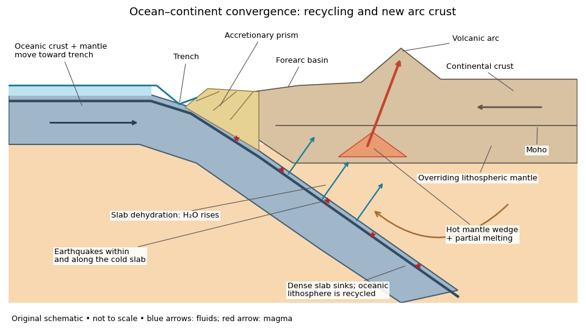

<h1 id="question-1/a/solution">Solution</h1>

↑ **Parent:** [A](../a.md)

Choose an ocean–continent [convergent margin](../../../../convergent-margin.md). The essential relationship is **recycling of [oceanic lithosphere](../../../../oceanic-lithosphere.md) by [subduction](../../../../subduction.md), together with production and modification of [crust](../../../../planetary-crust.md) in a [volcanic arc](../../../../volcanic-arc.md)**.

**[Figure 1](#question-1/a/image-an-original-ocean-continent-subduction-cross-section-with-slab-recycling-fluid-release-and-arc-crust-production). An original ocean–continent subduction cross-section, with slab recycling, fluid release and arc crust production**.

The incoming [tectonic plate](../../../../tectonic-plate.md) consists of thin [oceanic crust](../../../../oceanic-crust.md), chiefly [basalt](../../../../basalt.md) and [gabbro](../../../../gabbro.md), above colder [lithospheric mantle](../../../../lithospheric-mantle.md). As that [oceanic lithosphere](../../../../oceanic-lithosphere.md) approaches the [subduction zone](../../../../subduction-zone.md), bending produces the [subduction trench](../../../../subduction-trench.md). Its cold interior can become denser than the surrounding [mantle](../../../../planetary-mantle.md); the resulting [slab pull](../../../../slab-pull.md) helps sustain [subduction](../../../../subduction.md). The descending [slab](../../../../slab.md) carries both [oceanic crust](../../../../oceanic-crust.md) and [lithospheric mantle](../../../../lithospheric-mantle.md) into the interior. Thus the recycled unit is an entire portion of [lithosphere](../../../../lithosphere.md), rather than just its [crust](../../../../planetary-crust.md).

At the [subduction trench](../../../../subduction-trench.md), some incoming [sediment](../../../../sediment.md) is scraped off and stacked by [thrust faults](../../../../thrust-fault.md) into an [accretionary prism](../../../../accretionary-prism.md). Material can also be added beneath the [overriding plate](../../../../overriding-plate.md) by [tectonic underplating](../../../../tectonic-underplating.md). A [forearc basin](../../../../forearc-basin.md) collects [sediment](../../../../sediment.md) between the [accretionary prism](../../../../accretionary-prism.md) and the [volcanic arc](../../../../volcanic-arc.md). This is an accreting example: other [convergent margins](../../../../convergent-margin.md) lose upper-plate material through [tectonic erosion](../../../../tectonic-erosion.md), so an [accretionary prism](../../../../accretionary-prism.md) is not universal.

The cold [slab](../../../../slab.md) undergoes increasing [pressure](../../../../pressure-split.md) and [metamorphism](../../../../metamorphism.md). Conversion of [basaltic rocks](../../../../basaltic-rock.md) and [gabbro](../../../../gabbro.md) towards [eclogite](../../../../eclogite.md) increases their [density](../../../../density.md), while [slab dehydration](../../../../slab-dehydration.md) releases [water](../../../../water.md) from hydrated [minerals](../../../../mineral.md). The rising fluid lowers the [solidus](../../../../solidus.md) of hot [peridotite](../../../../peridotite.md) in the [mantle wedge](../../../../mantle-wedge.md), causing [flux melting](../../../../flux-melting.md). The usual source of [arc magma](../../../../arc-magma.md) is therefore the fluid-modified [mantle wedge](../../../../mantle-wedge.md); extensive [slab melting](../../../../slab-melting.md) is not required. Thermal-petrological calculations show that the depth and amount of [slab dehydration](../../../../slab-dehydration.md) depend on the incoming [slab](../../../../slab.md)'s thermal structure.[Abstract and depth-dependent water-release models.](../../../../subduction-factory-4-depth-dependent-flux-of-h2o-from-subducting-slabs-worldwide-by-peter-e-van-keken-and-others.md)

Buoyant [magma](../../../../magma.md) rises through the [overriding plate](../../../../overriding-plate.md), freezes in [igneous intrusions](../../../../igneous-intrusion.md) or erupts in the [volcanic arc](../../../../volcanic-arc.md). [Fractional crystallization](../../../../fractional-crystallization.md), interaction with existing [continental crust](../../../../continental-crust.md) and repeated intrusion can produce more evolved [arc magmas](../../../../arc-magma.md) and add new [crust](../../../../planetary-crust.md). Some material merely reworks old [crust](../../../../planetary-crust.md), and simultaneous [tectonic erosion](../../../../tectonic-erosion.md) can remove it: [volcanism](../../../../volcanism.md) alone does not measure net continental growth. [Tectonic shortening](../../../../tectonic-shortening.md), [folding](../../../../folding.md) and [thrust faults](../../../../thrust-fault.md) can thicken and raise the upper plate.

The [Wadati-Benioff zone](../../../../wadati-benioff-zone.md) marks [earthquakes](../../../../earthquake.md) along and within the cold descending [slab](../../../../slab.md). Shallow interface [earthquakes](../../../../earthquake.md) reflect unstable slip where the plates are coupled; deeper [earthquakes](../../../../earthquake.md) require mechanisms such as [dehydration embrittlement](../../../../dehydration-embrittlement.md) and are not simply dry shallow friction operating at every depth. In contrast, the hot [mantle wedge](../../../../mantle-wedge.md) deforms mainly by [material creep](../../../../creep-deformation.md). Together, the [subduction trench](../../../../subduction-trench.md), [accretionary prism](../../../../accretionary-prism.md), [forearc basin](../../../../forearc-basin.md), [volcanic arc](../../../../volcanic-arc.md) and inclined [seismicity](../../../../seismicity.md) connect surface features to the processes recycling and creating [crust](../../../../planetary-crust.md).

## ↑ Ancestors (12)

1. [A](../a.md)
2. [Question 1](../../question-1.md)
3. [2023](../../../2023-split.md)
4. [Past exam of the plate tectonics course of the University of Oxford](../../../split.md)
5. [Plate tectonics course of the University of Oxford](../../../../plate-tectonics-course-of-the-university-of-oxford.md)
6. [Year 3 of the earth sciences (geology) course of the University of Oxford](../../../../year-3-of-the-earth-sciences-geology-course-of-the-university-of-oxford.md)
7. [Earth sciences (geology) course of the University of Oxford](../../../../earth-sciences-geology-course-of-the-university-of-oxford.md)
8. [Undergraduate course of the University of Oxford](../../../../undergraduate-course-of-the-university-of-oxford.md)
9. [Course of the University of Oxford](../../../../course-of-the-university-of-oxford.md)
10. [University of Oxford](../../../../university-of-oxford-split.md)
11. [List of universities](../../../../list-of-universities.md)
12. [Codex Wiki](../../../../split.md)
