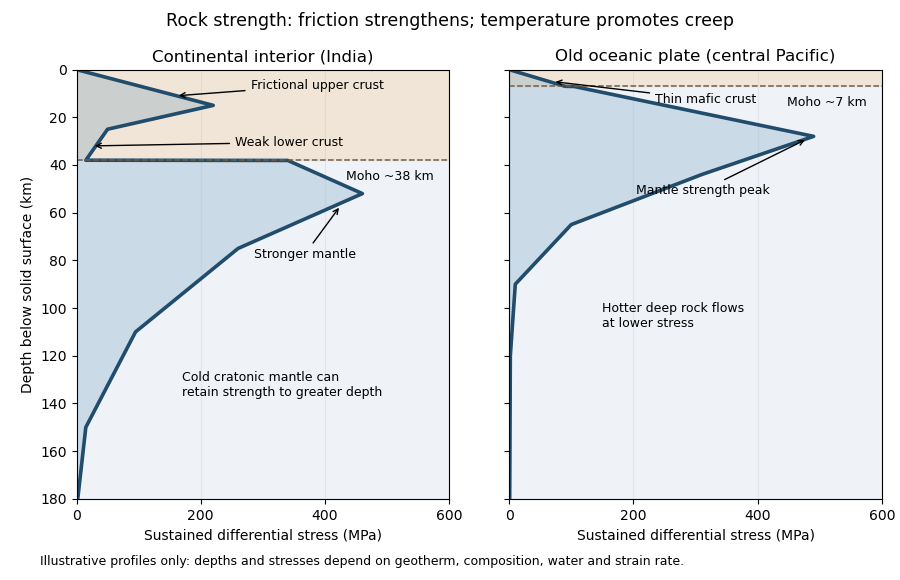

<h1 id="question-3/a/solution">Solution</h1>

↑ **Parent:** [A](../a.md)

Use a [rock strength envelope](../../../../rock-strength-envelope.md): at each depth plot the smaller [differential stress](../../../../differential-stress.md) needed for frictional failure and for sustained ductile [material creep](../../../../creep-deformation.md) at a specified [strain rate](../../../../strain-rate.md). **Shallow [rock](../../../../rock-geology.md) generally strengthens with depth because effective confining [pressure](../../../../pressure-split.md) increases; sufficiently deep hot [rock](../../../../rock-geology.md) weakens because thermally activated [material creep](../../../../creep-deformation.md) becomes efficient.**

**[Figure 2](#question-3/a/image-illustrative-rock-strength-envelopes-for-a-continental-interior-and-an-old-central-pacific-plate-these-are-conceptual-profiles-not-measurements). Illustrative rock-strength envelopes for a continental interior and an old central-Pacific plate; these are conceptual profiles, not measurements**.

At shallow depth, [Byerlee's law](../../../../byerlee-s-law.md) or a [Mohr-Coulomb failure criterion](../../../../mohr-coulomb-failure-criterion.md) gives a relation of the form

$$
\tau_f=C+\mu(\sigma_n-P_f),
$$

where $C$ is cohesion, $\mu$ a [coefficient of friction](../../../../coefficient-of-friction.md), $\sigma_n$ the compressive [normal stress](../../../../normal-stress.md) and $P_f$ the [pore pressure](../../../../pore-pressure.md). Increasing overburden generally increases [effective stress](../../../../effective-stress.md), hence the [frictional strength](../../../../frictional-strength.md). Conversion from fault [shear stress](../../../../shear-stress.md) to [differential stress](../../../../differential-stress.md) depends on the stress regime and fault orientation; a sketch should not label a universal numerical slope. High [pore pressure](../../../../pore-pressure.md) or weak [fault gouge](../../../../fault-gouge.md) can lower the [frictional strength](../../../../frictional-strength.md) substantially.

A simplified [dislocation creep](../../../../dislocation-creep.md) relation is

$$
\dot\epsilon=A\sigma^n\exp\!\left[-\frac{Q+PV^*}{RT}\right],
\qquad
\sigma_{\rm creep}=\left(\frac{\dot\epsilon}{A}\right)^{1/n}\exp\!\left[\frac{Q+PV^*}{nRT}\right].
$$

Here $Q$ is [activation energy](../../../../activation-energy.md), $V^*$ [activation volume](../../../../activation-volume.md), $R$ the [molar gas constant](../../../../molar-gas-constant.md) and $T$ absolute [temperature](../../../../temperature-split.md); $A$ and $n$ depend on composition and deformation mechanism. At fixed [strain rate](../../../../strain-rate.md), increasing [temperature](../../../../temperature-split.md) usually decreases the required [stress](../../../../stress.md) strongly. The competing effects of [pressure](../../../../pressure-split.md), [water weakening of rocks](../../../../water-weakening-of-rocks.md), [grain size](../../../../grain-size.md) and composition also matter. The intersection with frictional failure gives a [brittle-ductile transition](../../../../brittle-ductile-transition.md), not a change from solid to liquid.

For the Indian continental interior, a useful first sketch has an upper-crustal strength peak, a weaker lower [continental crust](../../../../continental-crust.md), and renewed strength in [lithospheric mantle](../../../../lithospheric-mantle.md) beneath the [Moho](../../../../mohorovicic-discontinuity.md). [Quartz](../../../../quartz.md)-bearing [rocks](../../../../rock-geology.md) can undergo ductile [material creep](../../../../creep-deformation.md) at conditions where colder, drier [olivine](../../../../olivine.md)-rich [mantle](../../../../planetary-mantle.md) retains appreciable strength. This creates a possible two-peak, or “jelly sandwich”, [rock strength envelope](../../../../rock-strength-envelope.md). With further depth the [mantle](../../../../planetary-mantle.md) also weakens. A cold [craton](../../../../craton.md) can retain strong [lithospheric mantle](../../../../lithospheric-mantle.md) to much greater depths than a tectonically heated continental region.

For the central Pacific, show thin [mafic](../../../../mafic.md) [oceanic crust](../../../../oceanic-crust.md) above a relatively thick layer of strong [lithospheric mantle](../../../../lithospheric-mantle.md). There need not be a conspicuous weak lower-crustal layer. Much of the integrated strength can reside below the [Moho](../../../../mohorovicic-discontinuity.md), with a broad strength peak followed by ductile weakening towards the [asthenosphere](../../../../asthenosphere.md). Cooling and age control the thickness: young hot [oceanic lithosphere](../../../../oceanic-lithosphere.md) would give a much shallower and weaker profile than an old central-Pacific plate.

The plotted [Moho](../../../../mohorovicic-discontinuity.md) depths of about 38 km and 7 km, and all plotted [stresses](../../../../stress.md), are illustrative assumptions. “India” alone does not specify a unique [geothermal gradient](../../../../geothermal-gradient.md), [water](../../../../water.md) content or [strain rate](../../../../strain-rate.md), and the Pacific includes plates of different ages. The robust comparison is the possible crust–mantle layering in a continent versus the thin [oceanic crust](../../../../oceanic-crust.md) and mantle-dominated strength of an old oceanic plate. The [Moho](../../../../mohorovicic-discontinuity.md) is a compositional boundary; neither it nor the deepest small plotted strength is automatically the seismic [lithosphere-asthenosphere boundary](../../../../lithosphere-asthenosphere-boundary.md).

## ↑ Ancestors (12)

1. [A](../a.md)
2. [Question 3](../../question-3.md)
3. [2023](../../../2023-split.md)
4. [Past exam of the plate tectonics course of the University of Oxford](../../../split.md)
5. [Plate tectonics course of the University of Oxford](../../../../plate-tectonics-course-of-the-university-of-oxford.md)
6. [Year 3 of the earth sciences (geology) course of the University of Oxford](../../../../year-3-of-the-earth-sciences-geology-course-of-the-university-of-oxford.md)
7. [Earth sciences (geology) course of the University of Oxford](../../../../earth-sciences-geology-course-of-the-university-of-oxford.md)
8. [Undergraduate course of the University of Oxford](../../../../undergraduate-course-of-the-university-of-oxford.md)
9. [Course of the University of Oxford](../../../../course-of-the-university-of-oxford.md)
10. [University of Oxford](../../../../university-of-oxford-split.md)
11. [List of universities](../../../../list-of-universities.md)
12. [Codex Wiki](../../../../split.md)
