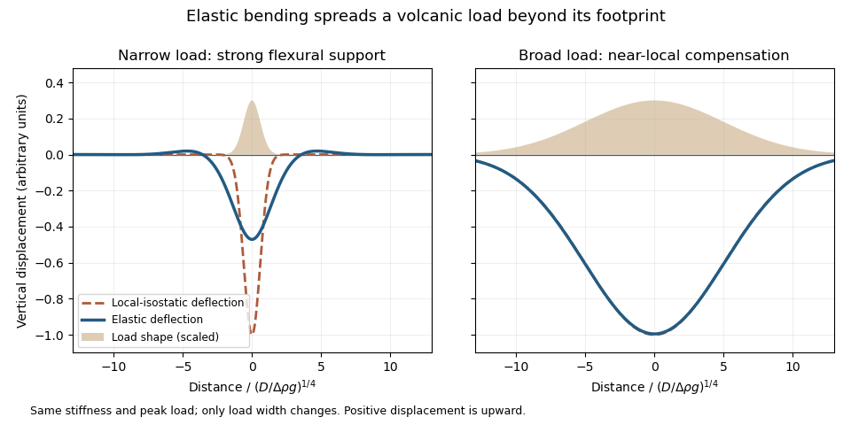

<h1 id="question-3/c/solution">Solution</h1>

↑ **Parent:** [C](../c.md)

[Elasticity](../../../../elasticity-physics-split.md) lets the [lithosphere](../../../../lithosphere.md) share a load with neighbouring regions through [lithospheric flexure](../../../../lithospheric-flexure.md). **Beneath the centre of a localized load, subsidence is generally smaller than the local [isostasy](../../../../isostasy.md) estimate, so the deposited surface stands higher.** The surrounding plate also bends down, and a more distant [flexural forebulge](../../../../flexural-forebulge.md) may rise. The extra support is regional bending resistance, rather than removal of the load's [mass](../../../../mass.md).

**[Figure 3](#question-3/c/image-an-original-elastic-plate-calculation-contrasting-narrow-and-broad-loads-at-the-same-flexural-rigidity-a-broad-load-approaches-local-isostasy). An original elastic-plate calculation contrasting narrow and broad loads at the same flexural rigidity; a broad load approaches local isostasy**.

The controlling comparison is load width against the [lithosphere](../../../../lithosphere.md)'s flexural length, which increases with [flexural rigidity](../../../../bending-stiffness.md) and decreases with the relevant buoyant [geophysical density contrast](../../../../geophysical-density-contrast.md). Equivalently, the [flexural support ratio](../../../../flexural-support-ratio.md) becomes large for short-wavelength loading. A very broad nearly uniform load produces little curvature in its interior, so even a strong [elastic lithosphere](../../../../elastic-lithosphere.md) has a nearly local [isostatic adjustment](../../../../isostatic-adjustment.md) there. Bending matters most near its edges. A narrow load requires more curvature and can be supported appreciably by the surrounding [elastic lithosphere](../../../../elastic-lithosphere.md).

The [Deccan Traps](../../../../deccan-traps.md) form a broad continental [large igneous province](../../../../large-igneous-province.md). The volcanic edifices of the [Hawaiian Islands](../../../../hawaiian-islands.md) are more localized loads on an old [oceanic lithosphere](../../../../oceanic-lithosphere.md), for which regional bending and a flexural moat are prominent. **Under the usual broad-Deccan versus narrow-Hawaiian-load comparison, elastic strength matters more for the [Hawaiian Islands](../../../../hawaiian-islands.md).** The more coherent mantle-dominated strength of an old oceanic plate can reinforce this contrast. It cannot be deduced simply from “oceanic” versus “continental”: a cold Indian [craton](../../../../craton.md) can be strong, and a site's [effective elastic thickness](../../../../effective-elastic-thickness.md) depends on its thermal and loading history.

For an initially submerged Hawaiian load, replacing [seawater](../../../../seawater.md) changes both the load and buoyant restoring contrast. At fixed deposited thickness, the added load relative to the initial [water](../../../../water.md) column uses the rock-minus-water [density](../../../../density.md), and the restoring term uses the mantle-minus-water [density](../../../../density.md). An emerged island requires separate treatment of its subaerial and submerged portions. These corrections change the local [isostasy](../../../../isostasy.md) reference but do not remove the importance of load width for [lithospheric flexure](../../../../lithospheric-flexure.md). The broad [Hawaiian swell](../../../../hawaiian-swell.md) should also be distinguished from the narrower volcanic load: deeper thermal or dynamic support of the [Hawaiian swell](../../../../hawaiian-swell.md) is not the same mechanism as elastic support of the volcanic ridge.

Finally, over long periods [material creep](../../../../creep-deformation.md), yielding and thermal modification can reduce elastic support. Without measured load geometries, ages and [effective elastic thicknesses](../../../../effective-elastic-thickness.md), the ranking is a justified qualitative expectation rather than a theorem valid for every continental and oceanic load.

## ↑ Ancestors (12)

1. [C](../c.md)
2. [Question 3](../../question-3.md)
3. [2023](../../../2023-split.md)
4. [Past exam of the plate tectonics course of the University of Oxford](../../../split.md)
5. [Plate tectonics course of the University of Oxford](../../../../plate-tectonics-course-of-the-university-of-oxford.md)
6. [Year 3 of the earth sciences (geology) course of the University of Oxford](../../../../year-3-of-the-earth-sciences-geology-course-of-the-university-of-oxford.md)
7. [Earth sciences (geology) course of the University of Oxford](../../../../earth-sciences-geology-course-of-the-university-of-oxford.md)
8. [Undergraduate course of the University of Oxford](../../../../undergraduate-course-of-the-university-of-oxford.md)
9. [Course of the University of Oxford](../../../../course-of-the-university-of-oxford.md)
10. [University of Oxford](../../../../university-of-oxford-split.md)
11. [List of universities](../../../../list-of-universities.md)
12. [Codex Wiki](../../../../split.md)
