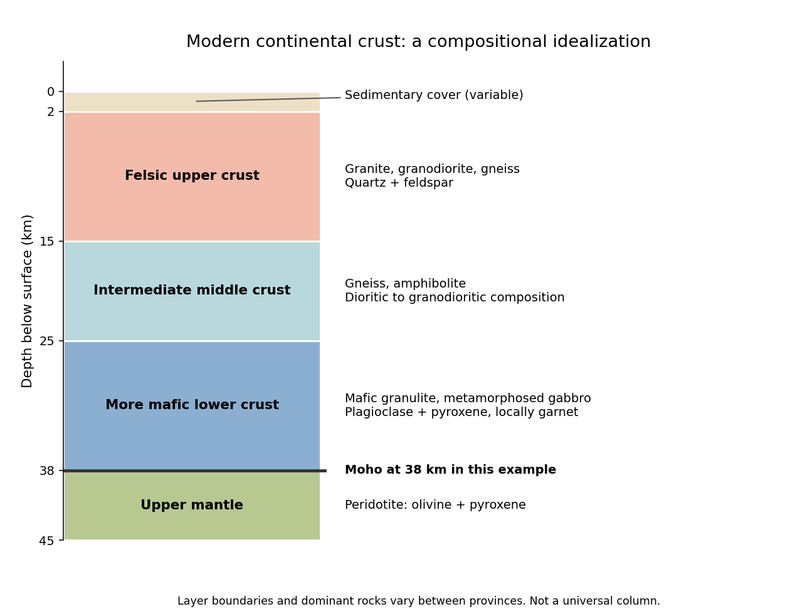
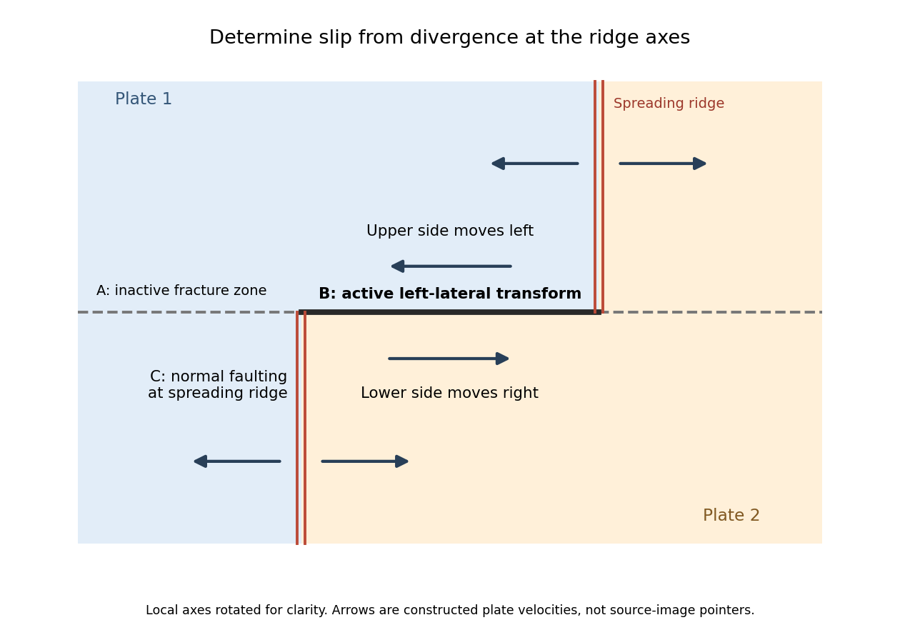

# 2024

↑ **Parent:** [Past exam of the plate tectonics course of the University of Oxford](../past-exam-of-the-plate-tectonics-course-of-the-university-of-oxford.md)

Source release: [https://www.whatdotheyknow.com/request/earth_science_past_papers_and_ex/response/3419815/attach/4/Papers.zip?cookie_passthrough=1](https://www.whatdotheyknow.com/request/earth_science_past_papers_and_ex/response/3419815/attach/4/Papers.zip?cookie_passthrough=1)

**Table of contents**

- [1](#1)
  - [a](#1/a)
    - [Solution](#1/a/solution)
  - [b](#1/b)
    - [Solution](#1/b/solution)
  - [c](#1/c)
    - [Solution](#1/c/solution)
  - [d](#1/d)
    - [Solution](#1/d/solution)
- [2](#2)
  - [a](#2/a)
    - [Solution](#2/a/solution)
  - [b](#2/b)
    - [Solution](#2/b/solution)
  - [c](#2/c)
    - [Solution](#2/c/solution)
  - [d](#2/d)
    - [Solution](#2/d/solution)
  - [e](#2/e)
    - [Solution](#2/e/solution)
- [3](#3)
  - [a](#3/a)
    - [Solution](#3/a/solution)
  - [b](#3/b)
    - [Solution](#3/b/solution)
  - [c](#3/c)
    - [Solution](#3/c/solution)
  - [d](#3/d)
    - [Solution](#3/d/solution)
  - [e](#3/e)
    - [Solution](#3/e/solution)

## 1

↑ **Parent:** [2024](2024.md)

<h3 id="1/a">a</h3>

↑ **Parent:** [1](#1)

<h4 id="1/a/solution">Solution</h4>

↑ **Parent:** [A](#1/a)

**A useful idealization is a thin [sedimentary cover](../geophysics.md#sedimentary-cover) over a [felsic](../planetary-science.md#felsic) upper [continental crust](../geophysics.md#continental-crust), an intermediate middle [continental crust](../geophysics.md#continental-crust), and a more [mafic](../planetary-science.md#mafic) lower [continental crust](../geophysics.md#continental-crust), ending at the [Mohorovičić discontinuity](../geophysics.md#mohorovicic-discontinuity) at about 35–40 km.** The boundaries within the [continental crust](../geophysics.md#continental-crust) are approximate compositional divisions, not three universal sharp interfaces.

**[Figure 1](#1/a/image-an-idealized-modern-continental-crustal-column). An idealized modern continental crustal column**. An original schematic for a 38 km thick continental crust. Depth ranges illustrate a compositional tendency; individual provinces have different lithologies and boundaries.

- At the surface, a variable, commonly kilometre-scale [sedimentary cover](../geophysics.md#sedimentary-cover) contains [sediments](../planetary-science.md#sediment) and [sedimentary rocks](../planetary-science.md#sedimentary-rock). Exposed crystalline basement can instead occur at the surface.
- In the upper roughly 15 km, representative [rocks](../planetary-science.md#rock-geology) are [granite](../planetary-science.md#granite), [granodiorite](../planetary-science.md#granodiorite) and compositionally related [gneiss](../planetary-science.md#gneiss), with [quartz](../chemical-substance.md#quartz) and [feldspar](../planetary-science.md#feldspar). [Sedimentary rocks](../planetary-science.md#sedimentary-rock), [metamorphic rocks](../planetary-science.md#metamorphic-rock) and volcanic [rocks](../planetary-science.md#rock-geology) make this layer heterogeneous.
- At roughly 15–25 km, intermediate [gneiss](../planetary-science.md#gneiss) and [amphibolite](../planetary-science.md#amphibolite)-facies assemblages become important. [Diorite](../planetary-science.md#diorite) to [granodiorite](../planetary-science.md#granodiorite) compositions and [amphibole](../planetary-science.md#amphibole)- and [plagioclase](../planetary-science.md#plagioclase)-bearing [rocks](../planetary-science.md#rock-geology) are representative.
- At roughly 25–38 km, [mafic granulite](../planetary-science.md#mafic-granulite) and [gabbro](../planetary-science.md#gabbro)-derived [metamorphic rocks](../planetary-science.md#metamorphic-rock) are a useful average, with [plagioclase](../planetary-science.md#plagioclase), [pyroxene](../planetary-science.md#pyroxene) and sometimes [garnet](../planetary-science.md#garnet). Some provinces instead have substantially intermediate or [felsic](../planetary-science.md#felsic) lower [continental crust](../geophysics.md#continental-crust).
- Below the [Mohorovičić discontinuity](../geophysics.md#mohorovicic-discontinuity) is [peridotite](../planetary-science.md#peridotite) of the [mantle](../geophysics.md#planetary-mantle), dominated by [olivine](../planetary-science.md#olivine) and [pyroxene](../planetary-science.md#pyroxene). This is not a fourth crustal layer.

The important trend is increasing average [mafic](../planetary-science.md#mafic) character with depth, rather than a change from [granite](../planetary-science.md#granite) directly to [peridotite](../planetary-science.md#peridotite). [Granulite](../planetary-science.md#granulite) describes a [metamorphic facies](../planetary-science.md#metamorphic-facies), not a unique chemical composition. The synthesis in [Nature and composition of the continental crust: A lower crustal perspective by Roberta L. Rudnick and David M. Fountain](../planetary-science.md#nature-and-composition-of-the-continental-crust-a-lower-crustal-perspective-by-roberta-l-rudnick-and-david-m-fountain) combines seismic and petrological evidence for these distinctions.

<h3 id="1/b">b</h3>

↑ **Parent:** [1](#1)

<h4 id="1/b/solution">Solution</h4>

↑ **Parent:** [B](#1/b)

**The expected broad contrast is a less mature, commonly thinner early juvenile [continental crust](../geophysics.md#continental-crust), with more [mafic](../planetary-science.md#mafic) material and abundant sodic [tonalite-trondhjemite-granodiorite](../planetary-science.md#tonalite-trondhjemite-granodiorite), rather than the more differentiated, potassium-rich granitoid component characteristic of much [Phanerozoic](../planetary-science.md#phanerozoic) [continental crust](../geophysics.md#continental-crust).** This is a secular tendency, not a single stratified column applicable throughout the [Archean](../planetary-science.md#archean).

[Archean](../planetary-science.md#archean) terrains commonly expose [tonalite-trondhjemite-granodiorite](../planetary-science.md#tonalite-trondhjemite-granodiorite) [gneiss](../planetary-science.md#gneiss) associated with [greenstone belts](../planetary-science.md#greenstone-belt) containing [basalt](../planetary-science.md#basalt), [komatiite](../planetary-science.md#komatiite) and [metasedimentary rocks](../planetary-science.md#metasedimentary-rock). Many later granitoids are richer in [potassium](../chemical-substance.md#potassium), including [granite](../planetary-science.md#granite) and [granodiorite](../planetary-science.md#granodiorite). The proportions changed during the [Archean](../planetary-science.md#archean): a reconstruction from [trace element](../planetary-science.md#trace-element) ratios in [sedimentary rocks](../planetary-science.md#sedimentary-rock) infers a markedly [mafic](../planetary-science.md#mafic) upper [continental crust](../geophysics.md#continental-crust) before about 3.0 Ga and a more [felsic](../planetary-science.md#felsic) upper [continental crust](../geophysics.md#continental-crust) by 2.5 Ga. Thus “all Archean continental crust was mafic” would be wrong. A preserved [tonalite-trondhjemite-granodiorite](../planetary-science.md#tonalite-trondhjemite-granodiorite)-dominated nucleus can be strongly [felsic](../planetary-science.md#felsic), including at depth; its composition is not identical to that of its original juvenile precursor.[Archean upper crust transition from mafic to felsic marks the onset of plate tectonics by Ming Tang and others](../planetary-science.md#archean-upper-crust-transition-from-mafic-to-felsic-marks-the-onset-of-plate-tectonics-by-ming-tang-and-others)

**Thickness needs a stated comparison.** An influential seismic compilation found preserved [Archean](../planetary-science.md#archean) [crust](../geophysics.md#planetary-crust) about 27–40 km thick, commonly without the thick high-velocity basal layer of its 40–55 km thick [Proterozoic](../planetary-science.md#proterozoic) comparison provinces. That supports a relatively thin endmember, but is not a measurement of every original [Archean](../planetary-science.md#archean) [continental crust](../geophysics.md#continental-crust), nor a demonstration that every [Archean](../planetary-science.md#archean) region was thinner than today's 35–40 km reference column. [Tectonic thickening](../geophysics.md#tectonic-thickening), [magmatic underplating](../geophysics.md#magmatic-underplating), [erosion](../planetary-science.md#erosion), [delamination](../geophysics.md#delamination) and preservation bias all alter what survives. The very thick [lithospheric mantle](../geophysics.md#lithospheric-mantle) beneath a [craton](../geophysics.md#craton) must also not be mistaken for thick [continental crust](../geophysics.md#continental-crust).[Evolution of the Precambrian lithosphere: Seismological and geochemical constraints by Raymond J. Durrheim and Walter D. Mooney](../planetary-science.md#evolution-of-the-precambrian-lithosphere-seismological-and-geochemical-constraints-by-raymond-j-durrheim-and-walter-d-mooney)

The transferable answer is therefore **more [mafic](../planetary-science.md#mafic) early juvenile precursors, widespread sodic [tonalite-trondhjemite-granodiorite](../planetary-science.md#tonalite-trondhjemite-granodiorite) production, and variable thickness evolving through time**; late [Archean](../planetary-science.md#archean) [felsic](../planetary-science.md#felsic) nuclei can already resemble substantial modern [continental crust](../geophysics.md#continental-crust).

<h3 id="1/c">c</h3>

↑ **Parent:** [1](#1)

<h4 id="1/c/solution">Solution</h4>

↑ **Parent:** [C](#1/c)

**Today the usual first melt is [basaltic](../planetary-science.md#basaltic-rock) melt from the [mantle wedge](../geophysics.md#mantle-wedge); in a hotter [Archean](../planetary-science.md#archean) [subduction zone](../geophysics.md#subduction-zone), melting of hydrated [basaltic crust](../geophysics.md#basaltic-crust) itself could generate sodic [felsic](../planetary-science.md#felsic) melt of [tonalite-trondhjemite-granodiorite](../planetary-science.md#tonalite-trondhjemite-granodiorite) composition.** Distinguish a primary melt from the evolved melt ultimately added to the upper [continental crust](../geophysics.md#continental-crust).

On the modern [Phanerozoic](../planetary-science.md#phanerozoic) [Earth](../planetary-science.md#earth):

- [Hydrothermal alteration](../planetary-science.md#hydrothermal-alteration) introduces [water](../chemical-substance.md#water) into the incoming [oceanic crust](../geophysics.md#oceanic-crust) and locally into [serpentinized mantle](../planetary-science.md#serpentinized-mantle). [Sediments](../planetary-science.md#sediment) also carry [water](../chemical-substance.md#water) in [pore space](../porous-media-flow.md#pore-space) and hydrous [minerals](../planetary-science.md#mineral).
- As the [slab](../geophysics.md#slab) descends, heating and [metamorphism](../planetary-science.md#metamorphism) break down hydrous [minerals](../planetary-science.md#mineral). Released fluids enter the hotter [peridotite](../planetary-science.md#peridotite) of the [mantle wedge](../geophysics.md#mantle-wedge) and lower its [solidus](../thermodynamic-potential.md#solidus), causing [flux melting](../planetary-science.md#flux-melting). Most ordinary modern [slabs](../geophysics.md#slab) release fluids before extensive melting of their [basaltic crust](../geophysics.md#basaltic-crust).
- The primary melt is predominantly hydrous [basaltic](../planetary-science.md#basaltic-rock) [magma](../geophysics.md#magma). During ascent, storage and [fractional crystallization](../planetary-science.md#fractional-crystallization), [mafic minerals](../planetary-science.md#mafic-mineral) are removed and the remaining liquid evolves toward [andesite](../planetary-science.md#andesite), [dacite](../planetary-science.md#dacite) and [rhyolite](../planetary-science.md#rhyolite) compositions. [Partial melting](../planetary-science.md#partial-melting) of recently emplaced [mafic](../planetary-science.md#mafic) lower [continental crust](../geophysics.md#continental-crust), [magma mixing](../geophysics.md#magma-mixing) and some [crustal contamination](../planetary-science.md#crustal-contamination) can contribute to [felsic](../planetary-science.md#felsic) [magma](../geophysics.md#magma). Intrusive equivalents include [diorite](../planetary-science.md#diorite), [tonalite](../planetary-science.md#tonalite) and [granodiorite](../planetary-science.md#granodiorite).

This adds juvenile material derived from the [mantle](../geophysics.md#planetary-mantle); simply remelting old [continental crust](../geophysics.md#continental-crust) is reworking, not net juvenile addition. The amount and depth of [slab](../geophysics.md#slab) [water](../chemical-substance.md#water) release depend on its thermal history, as quantified in [Subduction factory: 4. Depth-dependent flux of H2O from subducting slabs worldwide by Peter E. van Keken and others](../planetary-science.md#subduction-factory-4-depth-dependent-flux-of-h2o-from-subducting-slabs-worldwide-by-peter-e-van-keken-and-others).

For the hotter [Archean](../planetary-science.md#archean) endmember posited in the question, a hotter [mantle](../geophysics.md#planetary-mantle) and a warm descending plate make it easier for hydrated [basaltic crust](../geophysics.md#basaltic-crust) to reach its [solidus](../thermodynamic-potential.md#solidus). Its [partial melting](../planetary-science.md#partial-melting) can directly make [silica](../planetary-science.md#silica)-rich, [sodium](../chemical-substance.md#sodium)-rich [tonalite-trondhjemite-granodiorite](../planetary-science.md#tonalite-trondhjemite-granodiorite) liquids, leaving a more [mafic](../planetary-science.md#mafic) residue. Residual [garnet](../planetary-science.md#garnet) and [amphibole](../planetary-science.md#amphibole), and the presence or absence of residual [plagioclase](../planetary-science.md#plagioclase), help determine the [rare-earth element](../planetary-science.md#rare-earth-element) and strontium signatures. These are not ultramafic liquids merely because the surrounding [mantle](../geophysics.md#planetary-mantle) was hotter.

**The contrast is therefore commonly fluid-fluxed [mantle](../geophysics.md#planetary-mantle) melting followed by differentiation today, versus a greater potential contribution from direct melting of hydrated [mafic crust](../geophysics.md#mafic-crust) in the hotter case.** [Tonalite-trondhjemite-granodiorite](../planetary-science.md#tonalite-trondhjemite-granodiorite) is not unique evidence for [subduction](../geophysics.md#subduction): melting of thickened [mafic crust](../geophysics.md#mafic-crust) can produce similar liquids. Nor are all modern arcs devoid of [slab melting](../geophysics.md#slab-melting). These qualifications are central to [The composite Archaean grey gneisses: Petrological significance, and evidence for a non-unique tectonic setting for Archaean crustal growth by Jean-François Moyen](../planetary-science.md#the-composite-archaean-grey-gneisses-petrological-significance-and-evidence-for-a-non-unique-tectonic-setting-for-archaean-crustal-growth-by-jean-francois-moyen).

<h3 id="1/d">d</h3>

↑ **Parent:** [1](#1)

<h4 id="1/d/solution">Solution</h4>

↑ **Parent:** [D](#1/d)

**Hotter [Archean](../planetary-science.md#archean) [mantle](../geophysics.md#planetary-mantle) would generally produce thicker, more magnesium-rich [oceanic crust](../geophysics.md#oceanic-crust), together with a more strongly depleted residual [mantle](../geophysics.md#planetary-mantle).** Greater melt production, not merely thermal expansion of an unchanged modern column, is the principal reason for the increased crustal thickness.

At a [spreading ridge](../geophysics.md#spreading-ridge), upwelling [peridotite](../planetary-science.md#peridotite) undergoes [adiabatic decompression melting](../planetary-science.md#adiabatic-decompression-melting). A higher mantle [potential temperature](../geophysics.md#potential-temperature) makes the ascending [mantle](../geophysics.md#planetary-mantle) intersect the [solidus](../thermodynamic-potential.md#solidus) at greater [pressure](../pressure.md) and depth. It therefore melts over a longer decompression interval and generally reaches a larger integrated [melt fraction](../planetary-science.md#melt-fraction). With comparable [melt focusing](../planetary-science.md#melt-focusing), more melt is supplied per unit area of newly formed [oceanic crust](../geophysics.md#oceanic-crust).

Modern normal [oceanic crust](../geophysics.md#oceanic-crust) is about 6–7 km thick and contains [basaltic](../planetary-science.md#basaltic-rock) lavas, a [sheeted dike complex](../geophysics.md#sheeted-dike-complex), and [gabbro](../planetary-science.md#gabbro) with [mafic](../planetary-science.md#mafic) cumulates at depth. An illustrative reconstruction for hot ambient [Archean](../planetary-science.md#archean) [mantle](../geophysics.md#planetary-mantle) gives about 25–35 km of [oceanic crust](../geophysics.md#oceanic-crust), rather than a universal fixed thickness. Its primary liquids are more magnesium-rich than typical modern primary ridge liquids; their crystallization produces more [olivine](../planetary-science.md#olivine)- and [pyroxene](../planetary-science.md#pyroxene)-rich [cumulates](../planetary-science.md#cumulate-rock). The extracted liquid and its crystal products must be distinguished: the entire final [oceanic crust](../geophysics.md#oceanic-crust) need not be a homogeneous [komatiite](../planetary-science.md#komatiite) layer.[Thermal history of the Earth and its petrological expression by Claude Herzberg and others](../planetary-science.md#thermal-history-of-the-earth-and-its-petrological-expression-by-claude-herzberg-and-others)

The residual [peridotite](../planetary-science.md#peridotite) loses more melt components, becoming more refractory and commonly [harzburgite](../planetary-science.md#harzburgite)-rich. Thick buoyant [basaltic crust](../geophysics.md#basaltic-crust), its later [eclogitization](../planetary-science.md#eclogitization), and the depleted underlying [mantle](../geophysics.md#planetary-mantle) can change the mechanics of [subduction](../geophysics.md#subduction). A hotter [mantle](../geophysics.md#planetary-mantle) does not by itself establish how fast plates moved or whether a globally connected modern [plate tectonics](../geophysics.md#plate-tectonics) regime operated.

[Komatiites](../planetary-science.md#komatiite), with very magnesium-rich primary liquids and high inferred eruption [temperatures](../temperature.md), provide evidence for hot melting, but may sample especially hot [mantle plumes](../geophysics.md#mantle-plume). Estimates of ambient [mantle](../geophysics.md#planetary-mantle) conditions also use less exceptional non-arc [basalts](../planetary-science.md#basalt). Variable source composition, [water](../chemical-substance.md#water) content, cooling, melt extraction and later alteration all limit the precision of a single inferred [Archean](../planetary-science.md#archean) thickness. The robust prediction is **a larger melting column and melt yield, thicker igneous [oceanic crust](../geophysics.md#oceanic-crust), and a more depleted residue**.

## 2

↑ **Parent:** [2024](2024.md)

<h3 id="2/a">a</h3>

↑ **Parent:** [2](#2)

<h4 id="2/a/solution">Solution</h4>

↑ **Parent:** [A](#2/a)

**Cascadia subducts a young, warm plate and lacks the enormous plateau and crustal root of the central [Andes](../planetary-science.md#andes); the central Andean [Nazca Plate](../geophysics.md#nazca-plate) system also supports much deeper intraslab [earthquakes](../geophysics.md#earthquake).** These are regional comparisons: neither western margin is uniform along its length.

First, the [Juan de Fuca Plate](../geophysics.md#juan-de-fuca-plate) entering [Cascadia](../geophysics.md#cascadia-subduction-zone) is young, typically of order 10 million years old, because its [spreading ridge](../geophysics.md#spreading-ridge) lies close to the margin. Its [lithosphere](../geophysics.md#lithosphere) is comparatively thin and warm. Much of the [Nazca Plate](../geophysics.md#nazca-plate) entering the central [Andes](../planetary-science.md#andes) is older and colder. A cold plate carries low [temperatures](../temperature.md) farther into the [mantle](../geophysics.md#planetary-mantle), sustaining deep intraslab [seismicity](../geophysics.md#seismicity); the warm Cascadia [slab](../geophysics.md#slab) loses its brittle seismogenic character much shallower. This concerns [earthquakes](../geophysics.md#earthquake) within the [slab](../geophysics.md#slab), not the size of [megathrust earthquakes](../geophysics.md#megathrust-earthquake): **both margins can generate very large plate-interface events**. The official warm-slab synthesis treats [Cascadia](../geophysics.md#cascadia-subduction-zone) as an endmember.[USGS, 2002, warm-slab comparison and the 55 km deep Nisqually earthquake](https://www.usgs.gov/publications/cascadia-subduction-zone-and-related-subduction-systems-seismic-structure-intraslab)

Second, the central [Andes](../planetary-science.md#andes) have undergone major sustained [crustal shortening](../geophysics.md#crustal-shortening) and [tectonic thickening](../geophysics.md#tectonic-thickening), building a high plateau and locally roughly 60–70 km thick [continental crust](../geophysics.md#continental-crust). [Cascadia](../geophysics.md#cascadia-subduction-zone) has an active [volcanic arc](../geophysics.md#volcanic-arc) and mountains but no equivalent continuous central-Andean plateau and crustal root. The difference reflects the accumulated history of convergence, upper-plate deformation, [slab dip](../geophysics.md#slab-dip), trench motion and mechanical coupling, not just the instantaneous existence of [subduction](../geophysics.md#subduction). The [Andes](../planetary-science.md#andes) include flat-slab segments with gaps in arc volcanism as well as normally dipping segments.[USGS, Seismotectonics of South America, tectonic summary and depth sections](https://pubs.usgs.gov/of/2015/1031/e/pdf/of2015-1031-E.pdf)[USGS-hosted crustal seismic synthesis, central-Andean crustal thickness](https://escweb.wr.usgs.gov/share/mooney/54seismicvelocitystruct.pdf)

A young warm incoming plate and a faster, colder incoming plate can therefore generate different [thermal structures](../geophysics.md#thermal-structure), [dehydration](../chemical-reaction.md#dehydration) patterns and deformation histories. Plate age alone is insufficient to predict the thickness of the overriding [continental crust](../geophysics.md#continental-crust).

<h3 id="2/b">b</h3>

↑ **Parent:** [2](#2)

<h4 id="2/b/solution">Solution</h4>

↑ **Parent:** [B](#2/b)

**For a Seattle resident, the main consequences are [earthquake](../geophysics.md#earthquake) shaking and disruption, strongly modified by local ground conditions, plus location-dependent [tsunami](../planetary-science.md#tsunami), [landslide](../planetary-science.md#landslide) and volcanic hazards.**

Three [earthquake](../geophysics.md#earthquake) sources matter: the offshore [Cascadia](../geophysics.md#cascadia-subduction-zone) [megathrust](../geophysics.md#megathrust), deep events inside the [Juan de Fuca Plate](../geophysics.md#juan-de-fuca-plate), and shallow upper-plate [faults](../geophysics.md#geological-fault), including the [Seattle Fault](../geophysics.md#seattle-fault). Shaking can damage buildings, bridges, ports and utility networks, interrupting transport, electricity and water supply. Soft basin [sediments](../planetary-science.md#sediment) can amplify or prolong shaking; saturated loose fill can undergo [soil liquefaction](../planetary-science.md#soil-liquefaction) and lateral spreading. Steep slopes can fail as [landslides](../planetary-science.md#landslide). The same regional event can therefore have very different consequences on bedrock and on artificial fill.[Pacific Northwest Hazards by United States Geological Survey](../planetary-science.md#pacific-northwest-hazards-by-united-states-geological-survey)

Large [Cascadia](../geophysics.md#cascadia-subduction-zone) [tsunamis](../planetary-science.md#tsunami) chiefly threaten the outer Pacific coast. Seattle's inland waterways also have local [tsunami](../planetary-science.md#tsunami) hazards from crustal [faults](../geophysics.md#geological-fault) and underwater [landslides](../planetary-science.md#landslide); one should not equate a Seattle waterfront site with an open-ocean coastal site. Cascade eruptions can affect the region through [volcanic ash](../planetary-science.md#volcanic-ash) and transport disruption. [Lahars](../planetary-science.md#lahar) are strongly channelled by river valleys, so their exposure is location dependent rather than uniform across Seattle. These geological differences influence infrastructure design, land-use decisions and emergency planning.[Washington Geological Survey, earthquake and fault mechanisms](https://www.dnr.wa.gov/programs-and-services/geology/geologic-hazards/earthquakes-and-faults)[USGS, Puget Sound deltas, historic liquefaction damage and the Seattle Fault](https://cmgds.marine.usgs.gov/data/geotech/pugetposter/geologic.html)

<h3 id="2/c">c</h3>

↑ **Parent:** [2](#2)

<h4 id="2/c/solution">Solution</h4>

↑ **Parent:** [C](#2/c)

**In the interpretation of [Christopher Kincaid](../geophysics.md#christopher-kincaid) and colleagues, [slab rollback](../geophysics.md#slab-rollback) deforms and splits a [mantle plume](../geophysics.md#mantle-plume)'s thermal anomaly: one branch is swept toward the trench beneath the [High Lava Plains](../planetary-science.md#high-lava-plains), whereas the [Snake River Plain](../planetary-science.md#snake-river-plain) records the overriding plate moving over a deformed plume conduit.** Two opposite age progressions need not represent two stationary hotspots.

In the supplied map, ages decrease toward [Yellowstone](../geophysics.md#yellowstone-hotspot) in the northeast and toward [Newberry Volcano](../planetary-science.md#newberry-volcano) in the northwest. Southwestward [North American Plate](../geophysics.md#north-american-plate) motion leaves older [Snake River Plain](../planetary-science.md#snake-river-plain) volcanism to the southwest of the younger source expression. Meanwhile, rollback-driven, three-dimensional [mantle flow](../geophysics.md#mantle-flow), including [toroidal mantle flow](../geophysics.md#toroidal-mantle-flow) around the [slab](../geophysics.md#slab), carries a passive thermal anomaly trenchward beneath the [High Lava Plains](../planetary-science.md#high-lava-plains). The associated migrating heating and melting front produces the opposite younging toward [Newberry Volcano](../planetary-science.md#newberry-volcano).

The original experiment used a viscous syrup [mantle](../geophysics.md#planetary-mantle) analogue, a kinematically moved rigid [slab](../geophysics.md#slab), and an injected buoyant thermal plume. The result is **advection of deformed plume heat by subduction-driven flow**, rather than simple radial spreading of an intact plume head under a stationary plate. The mapped systematic progression principally concerns [rhyolitic](../planetary-science.md#rhyolitic-volcanism) volcanism; [basaltic](../planetary-science.md#basaltic-rock) eruptions are more diffuse in time. This laboratory result establishes a physically plausible explanation, not a unique observational proof of the deep source geometry.[2013, Figures 2–3, interpretation of the passive thermal anomaly and deformed conduit](../planetary-science.md#bifurcation-of-the-yellowstone-plume-driven-by-subduction-induced-mantle-flow-by-christopher-kincaid-and-others)

<h3 id="2/d">d</h3>

↑ **Parent:** [2](#2)

<h4 id="2/d/solution">Solution</h4>

↑ **Parent:** [D](#2/d)

**Left: ordinary frictional strengthening with depth followed by thermally activated [material creep](../engineering.md#creep-deformation). Right: a very weak shallow faulted layer above a narrow strong region near 10 km, followed by essentially the same weakening [material creep](../engineering.md#creep-deformation) branch.** These are the shapes actually plotted in Figure 2. The right curve is not a strong upper crust over a uniformly weak lower crust; neither diagram displays a second mantle-strength peak.

For the left curve, increasing overburden increases the effective normal load on [faults](../geophysics.md#geological-fault). A schematic [Coulomb friction](../newtonian-mechanics.md#coulomb-friction) law is

$$
\tau_f=C+\mu(\sigma_n-P_f),
$$

where $C$ is cohesion, $\mu$ the [coefficient of friction](../newtonian-mechanics.md#coefficient-of-friction), $\sigma_n$ the compressive normal [stress](../continuum-mechanics.md#stress) and $P_f$ the [pore pressure](../porous-media-flow.md#pore-pressure). With ordinary rock friction and approximately [hydrostatic pressure](../fluid-mechanics.md#hydrostatic-pressure), $\sigma_n-P_f$ increases roughly linearly with depth. The stress needed for [frictional sliding](../newtonian-mechanics.md#frictional-sliding) therefore increases, as in the straight shallow branch. [Byerlee's law](../newtonian-mechanics.md#byerlee-s-law) summarizes the relatively high friction found in many laboratory [rocks](../planetary-science.md#rock-geology).[Friction of rocks by James Byerlee](../planetary-science.md#friction-of-rocks-by-james-byerlee)

At higher [temperature](../temperature.md), [dislocation creep](../engineering.md#dislocation-creep) or another ductile mechanism accommodates the imposed deformation at lower [stress](../continuum-mechanics.md#stress). For example,

$$
\dot\epsilon=A\sigma^n\exp\!\left(-\frac{Q}{RT}\right),\qquad
\sigma_d=\left(\frac{\dot\epsilon}{A}\right)^{1/n}\exp\!\left(\frac{Q}{nRT}\right).
$$

Here $\dot\epsilon$ is [strain rate](../continuum-mechanics.md#strain-rate), $Q$ an [activation energy](../chemical-kinetics.md#activation-energy), $R$ the [molar gas constant](../ideal-gas.md#molar-gas-constant) and $T$ absolute [temperature](../temperature.md). At fixed [strain rate](../continuum-mechanics.md#strain-rate), increasing $T$ lowers the required [stress](../continuum-mechanics.md#stress). The operative envelope is approximately $\min(\sigma_f,\sigma_d)$, expressed in a consistent stress convention; the peak marks the [brittle-ductile transition](../engineering.md#brittle-ductile-transition). This accounts for the left curve's peak near 100 MPa and its decline toward small strength by about 20 km.

For the right curve, normal high-friction sliding with depth-independent fluid-pressure ratio cannot explain the nearly vertical weak shallow branch. Plausible weakening includes high [pore pressure](../porous-media-flow.md#pore-pressure) tracking the overburden, low-friction [fault gouge](../geophysics.md#fault-gouge), or a connected network of pre-existing weak [faults](../geophysics.md#geological-fault). Roughly constant small $\sigma_n-P_f$ yields roughly constant small [frictional strength](../newtonian-mechanics.md#frictional-strength). The abrupt increase near the base of this layer requires a change of conditions: for example, the weak fluid-rich fault network terminates or becomes discontinuous, leaving stronger intact or less altered [rock](../planetary-science.md#rock-geology) below. A change in [mineralogy](../planetary-science.md#mineralogy) or deformation localization can also give a contrast. **Simply saying “there are fluids” does not explain the return to high strength.** Below the strong region, thermal [material creep](../engineering.md#creep-deformation) again lowers the strength.

The figure alone does not identify the weakening mechanism or a particular lithological boundary. In particular, a 10 km strength maximum is not evidence for a 10 km deep [Mohorovičić discontinuity](../geophysics.md#mohorovicic-discontinuity). The strong-fault/weak-fault evidence and the distinction between fault strength and surrounding crustal strength are discussed in [Stress orientations at intermediate angles to the San Andreas Fault, California by Jeanne L. Hardebeck and Andrew J. Michael](../planetary-science.md#stress-orientations-at-intermediate-angles-to-the-san-andreas-fault-california-by-jeanne-l-hardebeck-and-andrew-j-michael).

<h3 id="2/e">e</h3>

↑ **Parent:** [2](#2)

<h4 id="2/e/solution">Solution</h4>

↑ **Parent:** [E](#2/e)

**Support for the left curve comes from high laboratory friction and substantial in situ [differential stress](../continuum-mechanics.md#differential-stress); support for the right curve comes from low inferred fault traction, weak fault materials or high [pore pressure](../porous-media-flow.md#pore-pressure).** No single observation directly measures the whole plotted envelope.

For the **left, stronger shallow-crust model**:

- Many friction experiments on ordinary [rocks](../planetary-science.md#rock-geology) give a [coefficient of friction](../newtonian-mechanics.md#coefficient-of-friction) around 0.6–0.85. Together with approximately [hydrostatic pressure](../fluid-mechanics.md#hydrostatic-pressure), these values predict increasing [frictional strength](../newtonian-mechanics.md#frictional-strength) with depth.
- Deep-borehole measurements of [stress](../continuum-mechanics.md#stress) and [pore pressure](../porous-media-flow.md#pore-pressure) in some continental settings indicate a crust close to frictional failure at appreciable [differential stress](../continuum-mechanics.md#differential-stress). Jointly with appropriate [fault](../geophysics.md#geological-fault) orientations, these support a strong frictional upper [crust](../geophysics.md#planetary-crust).

For the **right, weak shallow-layer model**:

- On well-studied plate-boundary [faults](../geophysics.md#geological-fault), low resolved [shear stress](../viscous-fluid-flow.md#shear-stress) inferred from the orientation of principal [stresses](../continuum-mechanics.md#stress) relative to the active [fault plane](../geophysics.md#fault-plane) can support low effective traction.
- The absence of the expected localized long-term [frictional heating](../newtonian-mechanics.md#frictional-heating) anomaly can support weak sliding. Directly measured high [pore pressure](../porous-media-flow.md#pore-pressure) or very low-friction [fault gouge](../geophysics.md#fault-gouge) would give a physical explanation. The heat-flow and stress evidence is particularly developed for the [San Andreas Fault](../geophysics.md#san-andreas-fault); it is an analogue argument, not an observation that the entire Cascadia upper [crust](../geophysics.md#planetary-crust) follows that curve.[2004, introduction and discussion of strong and weak fault models](../planetary-science.md#stress-orientations-at-intermediate-angles-to-the-san-andreas-fault-california-by-jeanne-l-hardebeck-and-andrew-j-michael)

**To discriminate, measure the strength-controlling quantities through depth and across both faults and their surroundings.** Obtain borehole [stress](../continuum-mechanics.md#stress), [pore pressure](../porous-media-flow.md#pore-pressure) and [temperature](../temperature.md) profiles where feasible; use [borehole breakouts](../geophysics.md#borehole-breakout) and hydraulic tests to constrain [effective stress](../continuum-mechanics.md#effective-stress). Recover fault and host [rocks](../planetary-science.md#rock-geology) and test their [friction](../newtonian-mechanics.md#friction) and [material creep](../engineering.md#creep-deformation) at relevant fluid conditions. The right curve specifically predicts an end to the shallow weakening near its sharp rise: investigate changes in [permeability of a porous medium](../porous-media-flow.md#permeability-of-a-porous-medium), alteration and [fault gouge](../geophysics.md#fault-gouge) with depth, rather than testing only a surface sample.

Combine those measurements with [heat flux](../heat.md#heat-flux-density) transects, [magnetotelluric sounding](../geophysics.md#magnetotelluric-sounding) for conductive fluids, accurate [earthquake](../geophysics.md#earthquake) depths and [focal mechanisms](../wave-equation.md#focal-mechanism), and [GNSS](../geophysics.md#gnss) or [InSAR](../radiometry.md#interferometric-synthetic-aperture-radar) observations of deformation. The latter can help constrain the depth distribution of locking and [postseismic relaxation](../planetary-science.md#postseismic-relaxation), but neither locking nor [seismicity](../geophysics.md#seismicity) alone gives absolute strength. [Earthquake stress drop](../geophysics.md#earthquake-stress-drop) is a change in [stress](../continuum-mechanics.md#stress), not the pre-event [stress](../continuum-mechanics.md#stress). Low [heat flux](../heat.md#heat-flux-density) can also reflect heat transport or transient weakening; high electrical conductivity can have causes other than free [water](../chemical-substance.md#water). A joint explanation of all these data is needed to choose between the models locally.

## 3

↑ **Parent:** [2024](2024.md)

<h3 id="3/a">a</h3>

↑ **Parent:** [3](#3)

<h4 id="3/a/solution">Solution</h4>

↑ **Parent:** [A](#3/a)

**A: currently inactive; B: active [left-lateral strike-slip faulting](../geophysics.md#left-lateral-strike-slip-faulting); C: active [normal faulting](../geophysics.md#normal-faulting).**

A lies on the continuation of the offset outside the two ridge tips: it is the [fracture zone](../geophysics.md#fracture-zone), whose two sides are carried in the same overall plate direction. A bathymetric step can remain because the two sides have different ages and thermal histories, without continuing plate-boundary [strike-slip faulting](../geophysics.md#strike-slip-faulting).

B is the black segment connecting the two white [spreading ridges](../geophysics.md#spreading-ridge). Construct the [plate motion](../geophysics.md#plate-motion) from divergence away from those ridge axes. Between their tips, the upper side of B belongs to the plate west of the right-hand ridge and moves approximately west-northwest; the lower side belongs to the plate east of the left-hand ridge and moves approximately east-southeast. Looking across B from either side, the opposite side moves to the observer's left. B is therefore a **[left-lateral strike-slip faulting](../geophysics.md#left-lateral-strike-slip-faulting) on a [transform fault](../geophysics.md#transform-fault)**. The offset preserved outside the active segment must not be read as the sense of present slip.

**The grey arrows in the source image are pointers to [detachment faults](../geophysics.md#detachment-fault), not plate-motion vectors.** The original publication identifies white lines as [spreading ridges](../geophysics.md#spreading-ridge), black lines as [transform faults](../geophysics.md#transform-fault), and arrows as pointers to detachments. Its Figure 1b is the unlettered source of the exam's Figure 3.[2023, Figure 1 caption](../planetary-science.md#how-transform-fault-shear-influences-where-detachment-faults-form-near-mid-ocean-ridges-by-jana-c-schierjott-and-others)

C lies on the white [spreading ridge](../geophysics.md#spreading-ridge) extending down from the left-hand ridge-transform intersection. Relative motion there is extensional, so its tectonic [faults](../geophysics.md#geological-fault) have **normal slip**. [Dike](../geophysics.md#dike) intrusion also accommodates extension at a [spreading ridge](../geophysics.md#spreading-ridge); “normal slip” is the appropriate category among the four offered, not a claim that all spreading is achieved by a single [normal fault](../geophysics.md#normal-fault).

**[Figure 2](#3/a/image-why-the-active-transform-in-the-supplied-geometry-is-left-lateral). Why the active transform in the supplied geometry is left lateral**. Original idealized plan-view construction using the supplied ridge arrangement and relative motion directions. It illustrates the kinematic test, rather than reproducing the exam bathymetry.

<h3 id="3/b">b</h3>

↑ **Parent:** [3](#3)

<h4 id="3/b/solution">Solution</h4>

↑ **Parent:** [B](#3/b)

**Probably yes in connected fractures or transiently opened [pore space](../porous-media-flow.md#pore-space), especially where a [transform fault](../geophysics.md#transform-fault) admits circulating [seawater](../planetary-science.md#seawater); a uniform water-filled porous layer several kilometres thick is not guaranteed.** [Porosity](../porous-media-flow.md#porosity) and [permeability of a porous medium](../porous-media-flow.md#permeability-of-a-porous-medium) generally decrease as cracks close or seal, while ongoing [faulting](../geophysics.md#faulting) can reopen pathways. Fluid can occur at high [pressure](../pressure.md) and [temperature](../temperature.md), including a supercritical state; it need not resemble cold surface [water](../chemical-substance.md#water).

Several complementary tests address presence and origin:

- **Geological:** recover fresh cores or dredged [fault rocks](../geophysics.md#fault-rock). Hydrous alteration assemblages, veins, [serpentinite](../planetary-science.md#serpentinite) replacing [peridotite](../planetary-science.md#peridotite), and altered [gabbro](../planetary-science.md#gabbro) record [water-rock interaction](../planetary-science.md#water-rock-interaction). Sealed [fluid inclusions](../planetary-science.md#fluid-inclusion) can preserve former fluids. These establish fluid access in the past; they do not by themselves demonstrate currently connected free [pore fluid](../porous-media-flow.md#pore-fluid).
- **Geochemical:** analyse sampled fluids and [fluid inclusions](../planetary-science.md#fluid-inclusion) for salinity and chlorine, oxygen and hydrogen [isotope ratios](../chemical-substance.md#isotope-ratio), and strontium or boron [isotope ratios](../chemical-substance.md#isotope-ratio) in alteration products. Compare with [seawater](../planetary-science.md#seawater), host [rocks](../planetary-science.md#rock-geology), and possible magmatic or metamorphic sources. A seawater-like input modified systematically by [water-rock interaction](../planetary-science.md#water-rock-interaction) supports deep circulation from the [ocean](../planetary-science.md#ocean). Exchange, [isotope fractionation](../chemical-substance.md#isotope-fractionation), mixing and phase separation mean that altered fluids need not retain the exact surface composition.
- **Geophysical:** combine [seismic tomography](../inverse-problem.md#seismic-tomography), [Compressional-to-shear wave speed ratio](../geophysics.md#compressional-to-shear-wave-speed-ratio) and [seismic attenuation](../geophysics.md#seismic-attenuation) with [magnetotelluric sounding](../geophysics.md#magnetotelluric-sounding) or controlled-source electrical measurements. A connected saline fluid network can reduce [electrical resistivity](../electric-charge.md#electrical-resistivity) and change elastic [wave speeds](../wave-equation.md#wave-speed). Sample [hydrothermal vents](../planetary-science.md#hydrothermal-vent), measure [heat flux](../heat.md#heat-flux-density) and, if drilling is possible, make direct [pore pressure](../porous-media-flow.md#pore-pressure) and permeability measurements.

**No one anomaly uniquely identifies water.** [Seismic velocity](../geophysics.md#seismic-velocity) can also reflect cracks, composition and [temperature](../temperature.md); [electrical conductivity](../electric-charge.md#electrical-conductivity) can reflect [melt](../geophysics.md#geological-melt) or conductive [minerals](../planetary-science.md#mineral). [Serpentinization](../planetary-science.md#serpentinization) demonstrates incorporation of [water](../chemical-substance.md#water) into [minerals](../planetary-science.md#mineral), which must be distinguished from fluid currently occupying [pore space](../porous-media-flow.md#pore-space). At an oceanic [transform fault](../geophysics.md#transform-fault), an external [seawater](../planetary-science.md#seawater) supply is the natural first hypothesis, but [isotope ratios](../chemical-substance.md#isotope-ratio) and chemical budgets can test contributions from deep fluids rather than presuming the source. A research example of coupled deformation and hydrothermal alteration is [Mass transfer and fluid flow during detachment faulting and development of an oceanic core complex, Atlantis Massif by Chiara Boschi and others](../planetary-science.md#mass-transfer-and-fluid-flow-during-detachment-faulting-and-development-of-an-oceanic-core-complex-atlantis-massif-by-chiara-boschi-and-others); a detachment system illustrates the methods without proving identical flow at every [transform fault](../geophysics.md#transform-fault).

<h3 id="3/c">c</h3>

↑ **Parent:** [3](#3)

<h4 id="3/c/solution">Solution</h4>

↑ **Parent:** [C](#3/c)

**Cooling makes the [oceanic lithosphere](../geophysics.md#oceanic-lithosphere) denser and contracts it; [isostatic adjustment](../geophysics.md#isostatic-adjustment) therefore lowers the seafloor.** The cooling layer includes substantial [mantle](../geophysics.md#planetary-mantle), not just the approximately fixed-thickness igneous [oceanic crust](../geophysics.md#oceanic-crust).

New plate near a [spreading ridge](../geophysics.md#spreading-ridge) is hot and relatively buoyant. As it moves away, conductive cooling penetrates more deeply, and material formerly in the hot [asthenosphere](../geophysics.md#asthenosphere) becomes part of the colder [thermal boundary layer](../continuum-mechanics.md#thermal-boundary-layer). To first order,

$$
\delta\rho(z,t)=\rho_m\alpha\,[T_m-T(z,t)],
$$

where $\alpha$ is the volumetric [thermal expansion coefficient](../thermodynamics.md#coefficient-of-thermal-expansion), $\rho_m$ a reference mantle [density](../fluid-mechanics.md#density), $T_m$ the hot reference [temperature](../temperature.md), and $t$ plate age. A positive depth-integrated [density](../fluid-mechanics.md#density) anomaly makes the column negatively buoyant relative to the ridge column. [Isostasy](../geophysics.md#isostasy) is restored by downward displacement and mantle redistribution; cold [rock](../planetary-science.md#rock-geology) also occupies less [volume](../geometry-and-topology.md#volume).

At a fixed sufficiently deep datum, deepening the seafloor by $\Delta d$ removes an equivalent thickness of [rock](../planetary-science.md#rock-geology) from the column and replaces it with less dense [seawater](../planetary-science.md#seawater). In the usual constant-property approximation this gives

$$
(\rho_m-\rho_w)\Delta d\simeq
\int_0^{z_c}\delta\rho(z,t)\,dz,
$$

where $\rho_w$ is [seawater](../planetary-science.md#seawater) [density](../fluid-mechanics.md#density) and $z_c$ lies below the relevant thermal anomaly. This explains why contraction alone and water-loaded seafloor subsidence are not identical numerical quantities.

For a [half-space cooling model](../geophysics.md#half-space-cooling-model),

$$
T(z,t)=T_s+(T_m-T_s)\operatorname{erf}\!\left(\frac{z}{2\sqrt{\kappa t}}\right),
$$

so [integration](../integral.md) yields

$$
\boxed{\Delta d(t)=\frac{2\rho_m\alpha(T_m-T_s)}{\rho_m-\rho_w}\sqrt{\frac{\kappa t}{\pi}}.}
$$

Here $\kappa$ is [thermal diffusivity](../heat.md#thermal-diffusivity) and $z$ is measured downward from the surface of the thermal model. The leading [oceanic thermal subsidence](../geophysics.md#oceanic-thermal-subsidence) is proportional to $\sqrt t$. A finite [oceanic plate cooling model](../geophysics.md#oceanic-plate-cooling-model) limits this growth at old ages. [Sediment loading](../geophysics.md#sediment-loading), [dynamic topography](../geophysics.md#dynamic-topography), anomalous [crust](../geophysics.md#planetary-crust) thickness and hydrothermal heat transport can produce departures from the simple relation.[An analysis of the variation of ocean floor bathymetry and heat flow with age by Barry Parsons and John G. Sclater](../physics-bibliography.md#an-analysis-of-the-variation-of-ocean-floor-bathymetry-and-heat-flow-with-age-by-barry-parsons-and-john-g-sclater)

<h3 id="3/d">d</h3>

↑ **Parent:** [3](#3)

<h4 id="3/d/solution">Solution</h4>

↑ **Parent:** [D](#3/d)

**Choose a common horizontal [compensation depth](../geophysics.md#compensation-depth) beneath the deepest cooling-induced [density](../fluid-mechanics.md#density) anomaly, within [mantle](../geophysics.md#planetary-mantle) that can relax pressure differences over the timescale considered.** In a normal oceanic plate model, this means below the old plate's thermal [lithosphere](../geophysics.md#lithosphere), not at the base of the approximately 7 km thick [oceanic crust](../geophysics.md#oceanic-crust).

The reason is that cooling changes [density](../fluid-mechanics.md#density) through both [crust](../geophysics.md#planetary-crust) and [lithospheric mantle](../geophysics.md#lithospheric-mantle). A datum at the [Mohorovičić discontinuity](../geophysics.md#mohorovicic-discontinuity) would omit most of the changing column [mass](../classical-mechanics.md#mass). A different datum for each age would also compare unlike columns. Once the common datum is sufficiently deep, extending it farther into laterally uniform [mantle](../geophysics.md#planetary-mantle) adds the same [mass](../classical-mechanics.md#mass) per unit area to each column and does not change the predicted relative subsidence.

There is no unique number fixed by the question. For an illustrative [oceanic plate cooling model](../geophysics.md#oceanic-plate-cooling-model) with a thermal thickness about 100–125 km, a common datum beneath that layer, of order 150–200 km below sea level, is a defensible choice provided the model has no substantial lateral [density](../fluid-mechanics.md#density) anomaly there. These are model choices, not measured universal boundaries. In a [half-space cooling model](../geophysics.md#half-space-cooling-model), use the oldest age $t_{\max}$ to choose a practical cutoff: $z_c\gtrsim4\sqrt{\kappa t_{\max}}$ makes the remaining [temperature](../temperature.md) anomaly less than about 0.5% of its surface contrast. For $\kappa=10^{-6}\,\mathrm{m^2\,s^{-1}}$ and $t_{\max}=100$ million years, this is about 225 km. A half-space model has no mathematically sharp finite thermal base.

Finally, equal column [mass](../classical-mechanics.md#mass) is the local, approximately constant-[gravitational acceleration](../newton-s-law-of-universal-gravitation.md#gravitational-acceleration) representation of equal [pressure](../pressure.md) at the datum. A weak [asthenosphere](../geophysics.md#asthenosphere) permits pressure relaxation through slow solid-state [material creep](../engineering.md#creep-deformation); it need not be liquid. Short-wavelength loads, [lithospheric flexure](../geophysics.md#lithospheric-flexure) or [dynamic topography](../geophysics.md#dynamic-topography) can violate local column-by-column [isostasy](../geophysics.md#isostasy), requiring a more complete mechanical model.

<h3 id="3/e">e</h3>

↑ **Parent:** [3](#3)

<h4 id="3/e/solution">Solution</h4>

↑ **Parent:** [E](#3/e)

**I would not assign the [lunar mare](../planetary-science.md#lunar-mare) an automatic terrestrial 100–125 km compensation level. For present-day mare basins, a local equal-column-mass model may have no physically valid [compensation depth](../geophysics.md#compensation-depth); first test whether [lithospheric flexure](../geophysics.md#lithospheric-flexure) supports the load.** For ancient thermally driven subsidence that did relax, choose a common datum beneath the cooling layer in deformable [lunar mantle](../planetary-science.md#lunar-mantle) appropriate to that epoch.

The [Moon](../planetary-science.md#moon) is smaller than [Earth](../planetary-science.md#earth) and has lost a larger fraction of its original heat. Its cold, mechanically strong outer shell can be much thicker relative to its radius than the terrestrial oceanic [lithosphere](../geophysics.md#lithosphere). [Lunar mare](../planetary-science.md#lunar-mare) [basalts](../planetary-science.md#basalt) filled pre-existing impact basins: their loading, basin excavation, mantle uplift, cooling and the evolving strength of the lithosphere all matter. A thick [elastic lithosphere](../geophysics.md#elastic-lithosphere) can support lateral [stress](../continuum-mechanics.md#stress) differences, so equal column [mass](../classical-mechanics.md#mass) need not hold even after a long time. The strong [gravity anomalies](../geophysics.md#gravity-anomaly) of lunar [mascons](../geophysics.md#mascon), measured by [GRAIL](../geophysics.md#gravity-recovery-and-interior-laboratory), are evidence that the present mare-basin system is not everywhere locally compensated.[NASA's GRAIL Mission Solves Mystery of Moon's Surface Gravity by National Aeronautics and Space Administration](../planetary-science.md#nasa-s-grail-mission-solves-mystery-of-moon-s-surface-gravity-by-national-aeronautics-and-space-administration)

For an explicitly assumed ancient relaxed thermal model, estimate its thermal penetration depth from [thermal diffusivity](../heat.md#thermal-diffusivity) and the elapsed cooling time, infer the contemporaneous mechanical lid from [gravity-topography admittance](../geophysics.md#gravity-topography-admittance) or basin deformation, and place $z_c$ below that layer where lateral [pressure](../pressure.md) anomalies relax. For example, a hypothetical several-hundred-kilometre-thick lid requires a deeper datum than that lid, not the shallow [crust-mantle boundary](../geophysics.md#mohorovicic-discontinuity). The paper supplies neither an epoch-specific thermal model nor a load wavelength, so a unique kilometre value is not determined. If the chosen datum is a substantial fraction of the lunar radius, spherical geometry and radial variation in [gravity](../physics.md#gravity) must replace the flat, constant-gravity column approximation.

**Does the Moon have an [asthenosphere](../geophysics.md#asthenosphere)? Not a demonstrated shallow, globally connected Earth-like layer underlying mobile plates; but “no weak or partially molten mantle anywhere, ever” is too strong.** [Apollo lunar seismology](../geophysics.md#apollo-lunar-seismology) indicates a cold outer interior and more attenuating deep regions. Reanalyses support a deep low-velocity or partially molten region near the [lunar core](../planetary-science.md#lunar-core), while [lunar laser ranging](../energy.md#lunar-laser-ranging) and tidal [Love numbers](../newton-s-law-of-universal-gravitation.md#love-number) constrain deep deformability and [tidal dissipation](../planetary-science.md#tidal-dissipation). Such a deep weak region is sometimes called a lunar [asthenosphere](../geophysics.md#asthenosphere); it is not automatically the correct local compensation surface for a mare load.[Seismic detection of the layers of the lunar core by Renee C. Weber and colleagues](../physics-bibliography.md#seismic-detection-of-the-layers-of-the-lunar-core-by-renee-c-weber-and-colleagues)

The inferred melt fraction and distribution remain model dependent: [Dissipation at tidal and seismic frequencies in a melt-free Moon by Francis Nimmo and others](../planetary-science.md#dissipation-at-tidal-and-seismic-frequencies-in-a-melt-free-moon-by-francis-nimmo-and-others) demonstrates that much of the dissipation can also be explained by hot solid-state [anelasticity](../rheology.md#anelasticity), although its model does not reproduce every frequency-dependent constraint. The [Moon](../planetary-science.md#moon) was hotter during mare emplacement and could relax loads differently then. **Choose the datum from the relevant thermal and mechanical history, or use a flexural model when local [isostasy](../geophysics.md#isostasy) fails.**

## ↑ Ancestors (9)

1. [Past exam of the plate tectonics course of the University of Oxford](../past-exam-of-the-plate-tectonics-course-of-the-university-of-oxford.md)
2. [Plate tectonics course of the University of Oxford](../university-of-oxford.md#plate-tectonics-course-of-the-university-of-oxford)
3. [Year 3 of the earth sciences (geology) course of the University of Oxford](../university-of-oxford.md#year-3-of-the-earth-sciences-geology-course-of-the-university-of-oxford)
4. [Earth sciences (geology) course of the University of Oxford](../university-of-oxford.md#earth-sciences-geology-course-of-the-university-of-oxford)
5. [Undergraduate course of the University of Oxford](../university-of-oxford.md#undergraduate-course-of-the-university-of-oxford)
6. [Course of the University of Oxford](../university-of-oxford.md#course-of-the-university-of-oxford)
7. [University of Oxford](../university-of-oxford.md)
8. [List of universities](../README.md#list-of-universities)
9. [Codex Wiki](../README.md)
