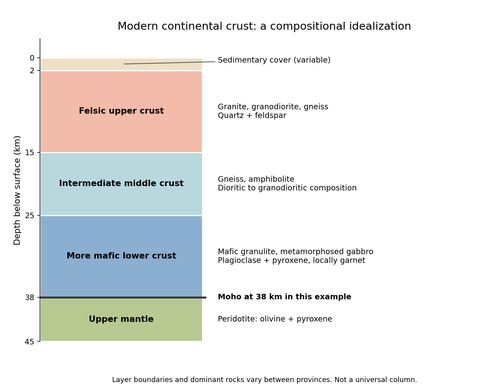

<h1 id="1/a/solution">Solution</h1>

↑ **Parent:** [A](../a.md)

**A useful idealization is a thin [sedimentary cover](../../../../sedimentary-cover.md) over a [felsic](../../../../felsic.md) upper [continental crust](../../../../continental-crust.md), an intermediate middle [continental crust](../../../../continental-crust.md), and a more [mafic](../../../../mafic.md) lower [continental crust](../../../../continental-crust.md), ending at the [Mohorovičić discontinuity](../../../../mohorovicic-discontinuity.md) at about 35–40 km.** The boundaries within the [continental crust](../../../../continental-crust.md) are approximate compositional divisions, not three universal sharp interfaces.

**[Figure 1](#1/a/image-an-idealized-modern-continental-crustal-column). An idealized modern continental crustal column**. An original schematic for a 38 km thick continental crust. Depth ranges illustrate a compositional tendency; individual provinces have different lithologies and boundaries.

- At the surface, a variable, commonly kilometre-scale [sedimentary cover](../../../../sedimentary-cover.md) contains [sediments](../../../../sediment.md) and [sedimentary rocks](../../../../sedimentary-rock.md). Exposed crystalline basement can instead occur at the surface.
- In the upper roughly 15 km, representative [rocks](../../../../rock-geology.md) are [granite](../../../../granite.md), [granodiorite](../../../../granodiorite.md) and compositionally related [gneiss](../../../../gneiss.md), with [quartz](../../../../quartz.md) and [feldspar](../../../../feldspar.md). [Sedimentary rocks](../../../../sedimentary-rock.md), [metamorphic rocks](../../../../metamorphic-rock.md) and volcanic [rocks](../../../../rock-geology.md) make this layer heterogeneous.
- At roughly 15–25 km, intermediate [gneiss](../../../../gneiss.md) and [amphibolite](../../../../amphibolite.md)-facies assemblages become important. [Diorite](../../../../diorite.md) to [granodiorite](../../../../granodiorite.md) compositions and [amphibole](../../../../amphibole.md)- and [plagioclase](../../../../plagioclase.md)-bearing [rocks](../../../../rock-geology.md) are representative.
- At roughly 25–38 km, [mafic granulite](../../../../mafic-granulite.md) and [gabbro](../../../../gabbro.md)-derived [metamorphic rocks](../../../../metamorphic-rock.md) are a useful average, with [plagioclase](../../../../plagioclase.md), [pyroxene](../../../../pyroxene.md) and sometimes [garnet](../../../../garnet.md). Some provinces instead have substantially intermediate or [felsic](../../../../felsic.md) lower [continental crust](../../../../continental-crust.md).
- Below the [Mohorovičić discontinuity](../../../../mohorovicic-discontinuity.md) is [peridotite](../../../../peridotite.md) of the [mantle](../../../../planetary-mantle.md), dominated by [olivine](../../../../olivine.md) and [pyroxene](../../../../pyroxene.md). This is not a fourth crustal layer.

The important trend is increasing average [mafic](../../../../mafic.md) character with depth, rather than a change from [granite](../../../../granite.md) directly to [peridotite](../../../../peridotite.md). [Granulite](../../../../granulite.md) describes a [metamorphic facies](../../../../metamorphic-facies.md), not a unique chemical composition. The synthesis in [Nature and composition of the continental crust: A lower crustal perspective by Roberta L. Rudnick and David M. Fountain](../../../../nature-and-composition-of-the-continental-crust-a-lower-crustal-perspective-by-roberta-l-rudnick-and-david-m-fountain.md) combines seismic and petrological evidence for these distinctions.

## ↑ Ancestors (12)

1. [A](../a.md)
2. [1](../../1.md)
3. [2024](../../../2024-split.md)
4. [Past exam of the plate tectonics course of the University of Oxford](../../../split.md)
5. [Plate tectonics course of the University of Oxford](../../../../plate-tectonics-course-of-the-university-of-oxford.md)
6. [Year 3 of the earth sciences (geology) course of the University of Oxford](../../../../year-3-of-the-earth-sciences-geology-course-of-the-university-of-oxford.md)
7. [Earth sciences (geology) course of the University of Oxford](../../../../earth-sciences-geology-course-of-the-university-of-oxford.md)
8. [Undergraduate course of the University of Oxford](../../../../undergraduate-course-of-the-university-of-oxford.md)
9. [Course of the University of Oxford](../../../../course-of-the-university-of-oxford.md)
10. [University of Oxford](../../../../university-of-oxford-split.md)
11. [List of universities](../../../../list-of-universities.md)
12. [Codex Wiki](../../../../split.md)
