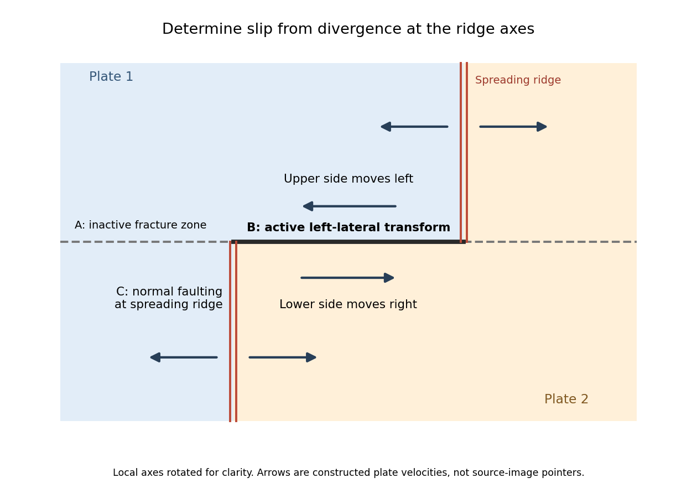

<h1 id="3/a/solution">Solution</h1>

↑ **Parent:** [A](../a.md)

**A: currently inactive; B: active [left-lateral strike-slip faulting](../../../../left-lateral-strike-slip-faulting.md); C: active [normal faulting](../../../../normal-faulting.md).**

A lies on the continuation of the offset outside the two ridge tips: it is the [fracture zone](../../../../fracture-zone.md), whose two sides are carried in the same overall plate direction. A bathymetric step can remain because the two sides have different ages and thermal histories, without continuing plate-boundary [strike-slip faulting](../../../../strike-slip-faulting.md).

B is the black segment connecting the two white [spreading ridges](../../../../spreading-ridge.md). Construct the [plate motion](../../../../plate-motion.md) from divergence away from those ridge axes. Between their tips, the upper side of B belongs to the plate west of the right-hand ridge and moves approximately west-northwest; the lower side belongs to the plate east of the left-hand ridge and moves approximately east-southeast. Looking across B from either side, the opposite side moves to the observer's left. B is therefore a **[left-lateral strike-slip faulting](../../../../left-lateral-strike-slip-faulting.md) on a [transform fault](../../../../transform-fault.md)**. The offset preserved outside the active segment must not be read as the sense of present slip.

**The grey arrows in the source image are pointers to [detachment faults](../../../../detachment-fault.md), not plate-motion vectors.** The original publication identifies white lines as [spreading ridges](../../../../spreading-ridge.md), black lines as [transform faults](../../../../transform-fault.md), and arrows as pointers to detachments. Its Figure 1b is the unlettered source of the exam's Figure 3.[2023, Figure 1 caption](../../../../how-transform-fault-shear-influences-where-detachment-faults-form-near-mid-ocean-ridges-by-jana-c-schierjott-and-others.md)

C lies on the white [spreading ridge](../../../../spreading-ridge.md) extending down from the left-hand ridge-transform intersection. Relative motion there is extensional, so its tectonic [faults](../../../../geological-fault.md) have **normal slip**. [Dike](../../../../dike.md) intrusion also accommodates extension at a [spreading ridge](../../../../spreading-ridge.md); “normal slip” is the appropriate category among the four offered, not a claim that all spreading is achieved by a single [normal fault](../../../../normal-fault.md).

**[Figure 2](#3/a/image-why-the-active-transform-in-the-supplied-geometry-is-left-lateral). Why the active transform in the supplied geometry is left lateral**. Original idealized plan-view construction using the supplied ridge arrangement and relative motion directions. It illustrates the kinematic test, rather than reproducing the exam bathymetry.

## ↑ Ancestors (12)

1. [A](../a.md)
2. [3](../../3.md)
3. [2024](../../../2024-split.md)
4. [Past exam of the plate tectonics course of the University of Oxford](../../../split.md)
5. [Plate tectonics course of the University of Oxford](../../../../plate-tectonics-course-of-the-university-of-oxford.md)
6. [Year 3 of the earth sciences (geology) course of the University of Oxford](../../../../year-3-of-the-earth-sciences-geology-course-of-the-university-of-oxford.md)
7. [Earth sciences (geology) course of the University of Oxford](../../../../earth-sciences-geology-course-of-the-university-of-oxford.md)
8. [Undergraduate course of the University of Oxford](../../../../undergraduate-course-of-the-university-of-oxford.md)
9. [Course of the University of Oxford](../../../../course-of-the-university-of-oxford.md)
10. [University of Oxford](../../../../university-of-oxford-split.md)
11. [List of universities](../../../../list-of-universities.md)
12. [Codex Wiki](../../../../split.md)
