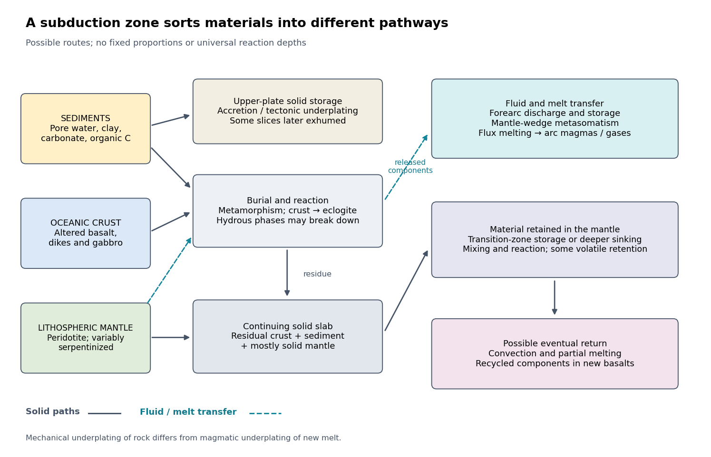

# 2025

↑ **Parent:** [Past exam of the plate tectonics course of the University of Oxford](../past-exam-of-the-plate-tectonics-course-of-the-university-of-oxford.md)

Source release: [https://www.whatdotheyknow.com/request/earth_science_past_papers_and_ex/response/3419815/attach/4/Papers.zip?cookie_passthrough=1](https://www.whatdotheyknow.com/request/earth_science_past_papers_and_ex/response/3419815/attach/4/Papers.zip?cookie_passthrough=1)

**Table of contents**

- [1](#1)
  - [a](#1/a)
    - [Solution](#1/a/solution)
  - [b](#1/b)
    - [Solution](#1/b/solution)
  - [c](#1/c)
    - [Solution](#1/c/solution)
- [2](#2)
  - [Solution](#2/solution)
- [3](#3)
  - [a](#3/a)
    - [Solution](#3/a/solution)
  - [b](#3/b)
    - [Solution](#3/b/solution)
  - [c](#3/c)
    - [Solution](#3/c/solution)

## 1

↑ **Parent:** [2025](2025.md)

<h3 id="1/a">a</h3>

↑ **Parent:** [1](#1)

<h4 id="1/a/solution">Solution</h4>

↑ **Parent:** [A](#1/a)

[Plate tectonics](../geophysics.md#plate-tectonics) changes the environments in which [evolution](../evolution.md) operates: it redistributes habitats, supplies and buries nutrients, and helps regulate [climate](../geophysics.md#climate). It does not prescribe the direction of [evolution](../evolution.md), and its presence neither guarantees [life](../biology.md#life) nor demonstrates that [life](../biology.md#life) could not persist under another tectonic regime.

**Long-term environmental regulation.** [Seafloor spreading](../geophysics.md#seafloor-spreading) and [subduction](../geophysics.md#subduction) exchange material between the [mantle](../geophysics.md#planetary-mantle), [crust](../geophysics.md#planetary-crust), [ocean](../planetary-science.md#ocean) and [atmosphere](../planetary-science.md#atmosphere). [Volcanism](../geophysics.md#volcanism) and [metamorphism](../planetary-science.md#metamorphism) release [carbon dioxide](../chemical-substance.md#carbon-dioxide), while exposure of fresh [silicate minerals](../planetary-science.md#silicate-mineral) by [tectonic uplift](../planetary-science.md#tectonic-uplift) and [erosion](../planetary-science.md#erosion) can promote [chemical weathering](../planetary-science.md#chemical-weathering). Coupled [silicate weathering](../geophysics.md#silicate-weathering) and [carbonate](../chemistry.md#carbonate) burial remove [carbon dioxide](../chemical-substance.md#carbon-dioxide) from the surface system. In a simplified net reaction,

$$
\mathrm{CaSiO_3+CO_2\longrightarrow CaCO_3+SiO_2}.
$$

The [carbonate-silicate cycle](../geophysics.md#carbonate-silicate-cycle) can provide a [negative feedback](../signal-transduction.md#negative-feedback): warming and greater runoff can accelerate [silicate weathering](../geophysics.md#silicate-weathering), lowering atmospheric [carbon dioxide](../chemical-substance.md#carbon-dioxide) and weakening the [greenhouse effect](../exoplanet.md#greenhouse-effect). This requires available fresh rock and [liquid water](../chemical-substance.md#liquid-water); a supply-limited [chemical weathering](../planetary-science.md#chemical-weathering) regime need not respond strongly to warming. [Plate tectonics](../geophysics.md#plate-tectonics) therefore helps sustain some long-lived habitable environments without acting as an infallible thermostat.[1981, abstract and weathering feedback model](../planetary-science.md#a-negative-feedback-mechanism-for-the-long-term-stabilization-of-earth-s-surface-temperature-by-james-c-g-walker-and-others)

**Nutrients and oxygenation.** [Tectonic uplift](../planetary-science.md#tectonic-uplift), [erosion](../planetary-science.md#erosion) and [hydrothermal circulation](../planetary-science.md#hydrothermal-circulation) supply nutrients such as [phosphorus](../chemical-substance.md#phosphorus) and [iron](../chemical-substance.md#iron) to surface environments. Changes in [continental configuration](../planetary-science.md#continental-configuration), [continental shelf](../planetary-science.md#continental-shelf) area and [ocean circulation](../geophysical-fluid-dynamics.md#ocean-circulation) alter [primary production](../ecology.md#primary-production), nutrient recycling and [ocean anoxia](../planetary-science.md#ocean-anoxia). Burial of [organic carbon](../geophysics.md#organic-carbon) and reduced [sulfur](../chemical-substance.md#sulfur) can leave an oxidizing surface budget, whereas reduced volcanic gases and freshly exposed reduced rock consume oxidants. Thus [plate tectonics](../geophysics.md#plate-tectonics) can influence atmospheric [oxygen](../chemical-substance.md#oxygen) and the ecological opportunities for [aerobic respiration](../metabolism.md#aerobic-respiration), but the sign depends on competing fluxes rather than simply on the amount of [volcanism](../geophysics.md#volcanism).

**Geographical isolation and environmental diversity.** [Continental rifting](../geophysics.md#continental-rifting) separates populations, favoring [allopatric speciation](../evolution.md#allopatric-speciation); [continental collision](../geophysics.md#continental-collision) and the emergence of land bridges can reconnect populations, enabling dispersal and competition. Opening or closing [ocean gateways](../planetary-science.md#ocean-gateway) changes [ocean circulation](../geophysical-fluid-dynamics.md#ocean-circulation) and [heat transport](../heat.md#heat-transport). [Mountain building](../planetary-science.md#mountain-building) creates elevational habitats and [rain shadows](../geophysics.md#rain-shadow); changing [continental shelf](../planetary-science.md#continental-shelf) area changes shallow-water habitat. These processes can promote diversification, eliminate habitats or both. A proposed biological response should be tested against independently dated [paleogeography](../planetary-science.md#paleogeography) and the [fossil record](../paleontology.md#fossil-record), accounting for unequal preservation.

**Abrupt disturbances.** Large episodes of [volcanism](../geophysics.md#volcanism), including a [large igneous province](../geophysics.md#large-igneous-province), can rapidly perturb the [carbon cycle](../geophysics.md#carbon-cycle), [ocean acidification](../planetary-science.md#ocean-acidification) and [ocean anoxia](../planetary-science.md#ocean-anoxia); [sulfur dioxide](../chemical-substance.md#sulfur-dioxide) aerosols can instead produce shorter cooling episodes. Such disturbances may cause [mass extinction](../evolution.md#mass-extinction), followed by ecological release and diversification of survivors. A [mantle plume](../geophysics.md#mantle-plume) need not originate at a [plate boundary](../geophysics.md#plate-boundary), so association with a tectonically active planet is not proof that horizontal [plate motion](../geophysics.md#plate-motion) directly caused every eruption. The relevant reasoning links a dated geological forcing to its environmental effects and then to biological selectivity, rather than attributing all biological crises to [plate tectonics](../geophysics.md#plate-tectonics).

Over billions of years, [plate tectonics](../geophysics.md#plate-tectonics) can repeatedly create habitable environments and new selective pressures. Nevertheless, models allow [carbon cycling](../geophysics.md#carbon-cycling) and habitable [climate](../geophysics.md#climate) on some [stagnant-lid planets](../planetary-science.md#stagnant-lid-planet). This makes [plate tectonics](../geophysics.md#plate-tectonics) a plausible contributor to sustained environmental diversity, not a demonstrated universal requirement for [evolution](../evolution.md).[2018, coupled thermal and carbon-cycle models](../planetary-science.md#carbon-cycling-and-habitability-of-earth-sized-stagnant-lid-planets-by-bradford-j-foley-and-andrew-j-smye)

<h3 id="1/b">b</h3>

↑ **Parent:** [1](#1)

<h4 id="1/b/solution">Solution</h4>

↑ **Parent:** [B](#1/b)

**Define the requirement before listing planetary properties.** For known [life](../biology.md#life), a habitable environment must supply a suitable solvent, accessible chemical ingredients, usable [free energy](../thermodynamic-potential.md#thermodynamic-free-energy), and conditions allowing organized [organic chemistry](../chemistry.md#organic-chemistry) to persist for sufficient time. [Habitability](../planetary-science.md#habitability) is the capacity to support [life](../biology.md#life), not evidence that [abiogenesis](../biology.md#abiogenesis) or colonization actually occurred. Here the main target is long-lived near-surface [liquid water](../chemical-substance.md#liquid-water) on a [rocky planet](../planetary-science.md#terrestrial-planet); a local subsurface habitat can satisfy the biological requirements even if most of the surface is hostile.

**Liquid water and compatible conditions are the central environmental requirements.** The local [temperature](../temperature.md), [pressure](../pressure.md) and composition must permit [liquid water](../chemical-substance.md#liquid-water) with adequate [water activity](../chemical-potential.md#water-activity). The pure-water [triple point](../thermodynamic-potential.md#triple-point), approximately $273.16\,\mathrm K$ and $611\,\mathrm{Pa}$, is a useful reference, not a universal habitable threshold: dissolved salts alter the [phase diagram](../thermodynamic-potential.md#phase-diagram), and subsurface [pressure](../pressure.md) differs from atmospheric [pressure](../pressure.md). A brine being liquid does not establish biological usability if its [water activity](../chemical-potential.md#water-activity) is too low. There is no reason to require a global mean surface [temperature](../temperature.md) of exactly $288\,\mathrm K$, or to treat $0$ to $100\,{}^\circ\mathrm C$ at one atmosphere as a universal range for all habitats.

**Composition, nutrients and energy must be accessible together.** A planet needs reservoirs of [water](../chemical-substance.md#water) and biogenic elements, notably [carbon](../chemical-substance.md#carbon), [hydrogen](../chemical-substance.md#hydrogen), [nitrogen](../chemical-substance.md#nitrogen), [oxygen](../chemical-substance.md#oxygen), [phosphorus](../chemical-substance.md#phosphorus) and [sulfur](../chemical-substance.md#sulfur), in forms available to a habitat. Bulk abundance is not enough if nutrients are locked away from reacting fluids. [pH](../acid-base-chemistry.md#ph), [salinity](../mathematical-physics.md#salinity), toxic solutes and [water-rock interaction](../planetary-science.md#water-rock-interaction) influence accessibility. [Photosynthesis](../metabolism.md#photosynthesis) can use sunlight, while [chemolithotrophy](../metabolism.md#chemolithotrophy) can exploit [redox disequilibrium](../electrochemistry.md#redox-disequilibrium) generated by [water-rock interaction](../planetary-science.md#water-rock-interaction), for example [hydrogen](../chemical-substance.md#hydrogen) production during [serpentinization](../planetary-science.md#serpentinization). A warm environment at chemical equilibrium supplies no sustained metabolic [free energy](../thermodynamic-potential.md#thermodynamic-free-energy) merely because it is warm. Conversely, atmospheric [oxygen](../chemical-substance.md#oxygen) and an [ozone layer](../exoplanet.md#ozone-layer) are not prerequisites for all [life](../biology.md#life): they favor particular surface environments and metabolisms, whereas anaerobic [life](../biology.md#life) uses other pathways.

**An appropriate atmosphere and surface energy balance favor surface habitability.** The inventory and composition of the [atmosphere](../planetary-science.md#atmosphere) control surface [pressure](../pressure.md), the [greenhouse effect](../exoplanet.md#greenhouse-effect), [heat transport](../heat.md#heat-transport), and protection from some harmful [ultraviolet radiation](../electromagnetic-radiation.md#ultraviolet-radiation). Too little warming can freeze the surface; too much can produce a [runaway greenhouse](../exoplanet.md#runaway-greenhouse) and eventual [water](../chemical-substance.md#water) loss. The [albedo](../geophysics.md#albedo), clouds, [ocean](../planetary-science.md#ocean) coverage and [atmospheric circulation](../geophysics.md#atmospheric-circulation) matter alongside atmospheric [carbon dioxide](../chemical-substance.md#carbon-dioxide) and [water vapor](../chemical-substance.md#water-vapor). An illustrative globally averaged radiative balance is

$$
\frac{(1-A)L_\star}{16\pi a^2}=\sigma T_{\rm eff}^4,
$$

where $A$ is the [Bond albedo](../exoplanet.md#bond-albedo), $a$ the orbital [semimajor axis](../celestial-mechanics.md#semi-major-axis), $L_\star$ the specified stellar [luminosity](../astrophysics.md#luminosity), and $\sigma$ the [Stefan-Boltzmann constant](../heat.md#stefan-boltzmann-constant). This determines an [planetary effective radiating temperature](../exoplanet.md#planetary-effective-radiating-temperature), not the surface [temperature](../temperature.md). The latter requires a model of the [greenhouse effect](../exoplanet.md#greenhouse-effect) and [heat transport](../heat.md#heat-transport). The stellar [luminosity](../astrophysics.md#luminosity) here is an imposed boundary condition; the planetary variables under discussion are the [orbit](../dynamical-systems.md#orbit-dynamical-system), [albedo](../geophysics.md#albedo) and atmospheric properties, not characteristics of the host system.

**Mass and interior properties govern retention and replenishment.** Planetary [mass](../classical-mechanics.md#mass), [radius](../topology.md#radius) and [surface gravity](../general-relativity.md#surface-gravity) influence [atmospheric escape](../exoplanet.md#atmospheric-escape), internal [pressure](../pressure.md), and cooling. In a simple thermal-retention diagnostic,

$$
v_{\rm esc}=\sqrt{\frac{2GM_p}{R_p}},\qquad
\lambda=\frac{GM_pm}{k_BT_{\rm exo}R_{\rm exo}},
$$

where $v_{\rm esc}$ is the surface [escape velocity](../energy.md#escape-velocity), $G$ the [gravitational constant](../newton-s-law-of-universal-gravitation.md#gravitational-constant), $M_p$ and $R_p$ the planetary [mass](../classical-mechanics.md#mass) and [radius](../topology.md#radius), and $m$, $T_{\rm exo}$ and $R_{\rm exo}$ refer to a gas particle and the [exobase](../exoplanet.md#exobase). A large [Jeans escape parameter](../exoplanet.md#jeans-escape-parameter) $\lambda$ suppresses ordinary thermal escape of that species; it does not exclude [hydrodynamic escape](../exoplanet.md#hydrodynamic-escape) or nonthermal losses. There is no single demonstrated minimum Earth-like [mass](../classical-mechanics.md#mass) valid for every atmospheric composition, age and habitat. [Radiogenic heating](../physics.md#radiogenic-heating), retained formation heat and possibly [tidal heating](../planetary-science.md#tidal-heating) sustain internal activity, [volcanic outgassing](../geophysics.md#volcanic-outgassing) and subsurface [liquid water](../chemical-substance.md#liquid-water); excessive heating can be destructive. A massive primordial [hydrogen](../chemical-substance.md#hydrogen) envelope can also make a nominally rocky body unlike a temperate terrestrial surface.

**The orbit must supply a tolerable irradiation history.** With the host irradiation held specified, the [semimajor axis](../celestial-mechanics.md#semi-major-axis) must be compatible with the particular planet's [radiation budget](../geophysics.md#radiation-budget), not merely with a nominal distance label. The [circumstellar habitable zone](../exoplanet.md#circumstellar-habitable-zone) is a conditional surface-[liquid water](../chemical-substance.md#liquid-water) criterion; it neither guarantees [habitability](../planetary-science.md#habitability) nor excludes internally heated subsurface habitats outside it. [Orbital eccentricity](../celestial-mechanics.md#orbital-eccentricity) $e$ produces an apoapsis-to-periapsis flux ratio

$$
\frac{F_{\rm peri}}{F_{\rm apo}}=\left(\frac{1+e}{1-e}\right)^2.
$$

For fixed [semimajor axis](../celestial-mechanics.md#semi-major-axis), the orbit-averaged incident flux is $\langle F\rangle=L_\star/(4\pi a^2\sqrt{1-e^2})$. Both the average and the extremes matter; [thermal inertia](../heat.md#thermal-inertia) may buffer seasonal changes, so a perfectly circular [orbit](../dynamical-systems.md#orbit-dynamical-system) is favorable in some cases but not necessary. Sustained [orbital stability](../dynamical-systems.md#orbital-stability) matters more than requiring $e=0$.

**Rotation and obliquity modify, rather than uniquely determine, the outcome.** [Obliquity](../planetary-science.md#obliquity), [rotation period](../planetary-science.md#rotation-period) and their evolution control seasonality, the distribution of sunlight and the efficiency of atmospheric and oceanic [heat transport](../heat.md#heat-transport). Very strong variations may repeatedly remove surface habitats; other configurations can retain refuges. [Tidal locking](../planetary-science.md#tidal-locking) does not automatically make a planet uninhabitable if an adequate [atmosphere](../planetary-science.md#atmosphere) or [ocean](../planetary-science.md#ocean) redistributes [heat](../heat.md). Neither Earth's particular day length nor its particular [obliquity](../planetary-science.md#obliquity) is a necessary biological condition. [Tidal heating](../planetary-science.md#tidal-heating) should be assessed as a planetary [energy](../energy.md) budget, without assuming that more heating is always beneficial.

**Long-lived recycling is favorable; its mechanism need not be unique.** Exchange between interior and surface reservoirs can replace gases lost by [atmospheric escape](../exoplanet.md#atmospheric-escape) or burial, expose nutrients, and moderate [climate](../geophysics.md#climate) through the [carbonate-silicate cycle](../geophysics.md#carbonate-silicate-cycle). [Plate tectonics](../geophysics.md#plate-tectonics) is one effective mechanism, but [stagnant-lid planets](../planetary-science.md#stagnant-lid-planet) can have [volcanism](../geophysics.md#volcanism), [chemical weathering](../planetary-science.md#chemical-weathering) and crustal recycling sufficient for modeled intervals of surface [habitability](../planetary-science.md#habitability). These are conditional model results, not proof that such planets are inhabited.[2018, abstract: viable carbon cycling without a mobile lid](../planetary-science.md#carbon-cycling-and-habitability-of-earth-sized-stagnant-lid-planets-by-bradford-j-foley-and-andrew-j-smye)

A [planetary magnetic field](../planetary-science.md#planetary-magnetic-field) can alter charged-particle access and atmospheric loss, but it is not a universal shield against all [atmospheric escape](../exoplanet.md#atmospheric-escape) and is not established as a necessary condition for [habitability](../planetary-science.md#habitability). An [atmosphere](../planetary-science.md#atmosphere), [water](../chemical-substance.md#water) column or rock overburden can also protect habitats. Likewise, exposed continents, a large moon, modern atmospheric [oxygen](../chemical-substance.md#oxygen) and [plate tectonics](../geophysics.md#plate-tectonics) should not be promoted from plausible advantages to universal necessities. The defensible test is whether this particular body maintains accessible [liquid water](../chemical-substance.md#liquid-water), chemical ingredients and usable [free energy](../thermodynamic-potential.md#thermodynamic-free-energy) in sufficiently persistent environments. A planet can pass that test without any demonstration that [life](../biology.md#life) arose there.

<h3 id="1/c">c</h3>

↑ **Parent:** [1](#1)

<h4 id="1/c/solution">Solution</h4>

↑ **Parent:** [C](#1/c)

I would prioritize an accessible exposure of **ancient, fine-grained [lacustrine deposits](../planetary-science.md#lacustrine-deposit) associated with a [river delta](../planetary-science.md#river-delta)**, preferably with nearby [hydrothermal deposits](../planetary-science.md#hydrothermal-deposit) or [groundwater](../planetary-science.md#groundwater) alteration that offer a second environmental window. A good target maximizes three separate probabilities: past [habitability](../planetary-science.md#habitability), preservation of a [biosignature](../biology.md#biosignature), and practical access to the preserved material. A spectacular former water channel alone need not score well on the second or third.

**First choice: a stratigraphically resolved ancient lake basin.** Look for a closed or formerly overflowing basin fed by an inlet valley, a [river delta](../planetary-science.md#river-delta) with coherent layering, and adjacent fine [mudstone](../planetary-science.md#mudstone) deposited below strong wave or channel disturbance. [Delta](../planetary-science.md#river-delta) foresets and bottomsets, channel relationships and laterally continuous [lacustrine deposits](../planetary-science.md#lacustrine-deposit) provide a testable [paleoenvironment](../planetary-science.md#paleoenvironment), rather than relying on an isolated fan shape. An inlet plus an outlet and consistent shoreline elevations can constrain lake level and water throughput. Select [Noachian](../astrophysics.md#noachian) or early [Hesperian](../astrophysics.md#hesperian) units where available, while avoiding the assumption that all younger environments were uninhabitable.

Quiet [lacustrine deposits](../planetary-science.md#lacustrine-deposit) can concentrate material from a wider drainage area; [clay minerals](../planetary-science.md#clay-mineral) provide large surfaces for [adsorption](../physical-chemistry.md#adsorption) of [organic matter](../chemistry.md#organic-matter). Rapid burial and limited exposure to oxidizing fluids favor preservation. [Carbonate](../chemistry.md#carbonate) or [silica](../planetary-science.md#silica) cements can trap chemical or microscopic evidence, although later [diagenesis](../paleontology.md#diagenesis) may erase or redistribute it. A near-neutral, not excessively saline [paleoenvironment](../planetary-science.md#paleoenvironment) is attractive for known [life](../biology.md#life), but should be inferred from mineral assemblages and sedimentary context rather than assumed from the presence of [water](../chemical-substance.md#water).

This strategy has direct primary-source precedents. An ancient lake [mudstone](../planetary-science.md#mudstone) investigated by a rover preserved evidence for near-neutral [pH](../acid-base-chemistry.md#ph), low [salinity](../mathematical-physics.md#salinity) and variable [oxidation states](../chemical-reaction.md#oxidation-state), making a plausible habitat for [chemolithotrophy](../metabolism.md#chemolithotrophy). This established past [habitability](../planetary-science.md#habitability), not past [life](../biology.md#life).[Science 343, 1242777; NASA repository abstract](../planetary-science.md#a-habitable-fluvio-lacustrine-environment-at-yellowknife-bay-gale-crater-mars-by-john-p-grotzinger-and-others) Independently, rover images of another basin established a [delta](../planetary-science.md#river-delta)-lake succession followed by high-energy floods. That distinction helps choose fine background deposits rather than assuming the coarsest flood layers are the best [biosignature](../biology.md#biosignature) archive.[2021, sedimentary architecture and changing depositional conditions](../planetary-science.md#perseverance-rover-reveals-an-ancient-delta-lake-system-and-flood-deposits-at-jezero-crater-mars-by-nicolas-mangold-and-others)

**Second choice: ancient water-rock reaction systems.** Target exhumed [hydrothermal deposits](../planetary-science.md#hydrothermal-deposit) associated with old volcanic terrain, basin-floor alteration, or impact-generated [hydrothermal circulation](../planetary-science.md#hydrothermal-circulation). Especially useful settings contain [silica](../planetary-science.md#silica), [clay minerals](../planetary-science.md#clay-mineral), [carbonates](../chemistry.md#carbonate) and reduced [iron](../chemical-substance.md#iron) or [sulfur](../chemical-substance.md#sulfur) phases in a coherent geological association. Chemical gradients between reacted fluids and surrounding [water](../chemical-substance.md#water) can supply [free energy](../thermodynamic-potential.md#thermodynamic-free-energy) for [chemolithotrophy](../metabolism.md#chemolithotrophy); rapid mineral precipitation may entomb [biosignatures](../biology.md#biosignature). Habitable cooler mixing zones are more promising than assuming the hottest vent was habitable. Mineralogical mapping of thick, ancient basin deposits on [Mars](../astrophysics.md#mars) has motivated a deep-water [hydrothermal alteration](../planetary-science.md#hydrothermal-alteration) interpretation, providing a physically grounded alternative to shallow lakes. The interpretation remains a hypothesis to test in situ, not a detection of [life](../biology.md#life).[2017, proposed deep-water alteration setting and its astrobiological implications](../planetary-science.md#ancient-hydrothermal-seafloor-deposits-in-eridania-basin-on-mars-by-joseph-r-michalski-and-others)

**Additional targets: protected groundwater archives.** Old fractures, mineral veins and [groundwater](../planetary-science.md#groundwater)-fed [sedimentary deposits](../planetary-science.md#sedimentary-deposit) exposed by recent [erosion](../planetary-science.md#erosion) can sample former subsurface habitats protected from surface [ultraviolet radiation](../electromagnetic-radiation.md#ultraviolet-radiation). [Evaporites](../planetary-science.md#evaporite) can preserve inclusions and record water chemistry, but strongly acidic or hypersaline terminal brines may be poor habitats, and a salt deposit alone does not distinguish a long-lived ecosystem from brief evaporation. Choose a traverse that can test the relation between these deposits and the lake or [hydrothermal alteration](../planetary-science.md#hydrothermal-alteration) succession.

**Preservation and sampling can overturn the apparent ranking.** Favor ancient rocks that were buried for most of their history and only recently exhumed, with little thermal alteration, pervasive oxidation or recrystallization. Drill beneath weathered rinds and sample fresh bedrock; loose modern [regolith](../geophysics.md#regolith) mixes unrelated sources. Cosmic [ionizing radiation](../physics.md#ionizing-radiation) penetrates deeper than [ultraviolet radiation](../electromagnetic-radiation.md#ultraviolet-radiation), so shallow abrasion is not complete protection. Laboratory work reported by [National Aeronautics and Space Administration](../physics-author.md#national-aeronautics-and-space-administration) shows that survival depths depend on molecule, mineral matrix and accumulated dose; meter-scale burial or a short exposure history can be important, rather than one universal safe drilling depth.[27 June 2022, irradiation experiment and implications for sampling](../planetary-science.md#nasa-experiment-suggests-need-to-dig-deep-for-evidence-of-life-on-mars-by-national-aeronautics-and-space-administration)

The landing ellipse needs safe terrain and a feasible traverse to several related exposures. Orbital [spectroscopy](../physics.md#spectroscopy), imaging and [surface topography](../optics.md#surface-topography) should establish the initial target; field observations must then test [stratigraphy](../planetary-science.md#stratigraphy), sedimentary textures and alteration history. Combine [organic chemistry](../chemistry.md#organic-chemistry), [isotope ratios](../chemical-substance.md#isotope-ratio), mineral associations and microscopic structures in their geological context, using contamination controls and samples from neighboring noncandidate material. [Organic molecules](../chemistry.md#organic-molecule), [carbon isotope fractionation](../chemical-substance.md#carbon-isotope-fractionation) or a cell-like shape alone can have abiotic explanations. A convergent suite of contextual observations is a stronger case for ancient [life](../biology.md#life) than any single signal.

## 2

↑ **Parent:** [2025](2025.md)

<h3 id="2/solution">Solution</h3>

↑ **Parent:** [2](#2)

At a [convergent margin](../geophysics.md#convergent-margin), the incoming [oceanic lithosphere](../geophysics.md#oceanic-lithosphere) is a chemically and mechanically layered package: [sediments](../planetary-science.md#sediment), [oceanic crust](../geophysics.md#oceanic-crust) and [lithospheric mantle](../geophysics.md#lithospheric-mantle). [Subduction](../geophysics.md#subduction) does not deliver this whole package unchanged to one destination. Solids can be accreted, underplated, exhumed or recycled deeply, while released fluids and melts carry selected components to the [overriding plate](../geophysics.md#overriding-plate). The outcome depends on incoming composition and hydration, [slab](../geophysics.md#slab) age, convergence rate, thermal structure, interface coupling and subsequent tectonic history.

**[Figure 1](#2/image-diverging-pathways-of-sediments-oceanic-crust-and-lithospheric-mantle-at-a-convergent-margin). Diverging pathways of sediments, oceanic crust and lithospheric mantle at a convergent margin**. Original process diagram. Solid-material pathways are separated from fluid and melt transfer. The arrows represent possible routes, not universal proportions or fixed reaction depths; temporary storage and later remobilization are possible.

**The incoming material already contains a history.** [Sediments](../planetary-science.md#sediment) include terrigenous debris, biogenic [carbonates](../chemistry.md#carbonate), siliceous deposits, [clay minerals](../planetary-science.md#clay-mineral), pore [water](../chemical-substance.md#water) and [organic matter](../chemistry.md#organic-matter). [Oceanic crust](../geophysics.md#oceanic-crust) consists mainly of [basalt](../planetary-science.md#basalt), sheeted dikes and [gabbro](../planetary-science.md#gabbro); [hydrothermal alteration](../planetary-science.md#hydrothermal-alteration) can add [water](../chemical-substance.md#water), [carbonates](../chemistry.md#carbonate) and mobile elements before [subduction](../geophysics.md#subduction). Beneath it, residual [peridotite](../planetary-science.md#peridotite) forms the [lithospheric mantle](../geophysics.md#lithospheric-mantle). Faulting at a spreading environment, a transform boundary or an outer-rise bending region can let [seawater](../planetary-science.md#seawater) enter and cause [serpentinization](../planetary-science.md#serpentinization). The [lithospheric mantle](../geophysics.md#lithospheric-mantle) is not uniformly hydrated to its full thickness. Consequently, sediment thickness alone does not measure the incoming volatile inventory.

**Sediments: separation starts near the trench.** Compaction and increasing effective [pressure](../pressure.md) expel pore fluids, which can escape through the [forearc](../geophysics.md#forearc), transport dissolved constituents and influence [pore pressure](../porous-media-flow.md#pore-pressure) on the plate interface. Some [sediments](../planetary-science.md#sediment) are scraped off into an [accretionary prism](../geophysics.md#accretionary-prism), shortened by thrusts and retained in the upper plate. Others pass beneath the leading edge, then detach and undergo [tectonic underplating](../geophysics.md#tectonic-underplating) beneath the [forearc](../geophysics.md#forearc). Deeper underplated material may return to the surface during [tectonic exhumation](../planetary-science.md#tectonic-exhumation), preserving a record of burial and deformation. At a sediment-starved erosive margin, little prism may form, and [tectonic erosion](../geophysics.md#tectonic-erosion) can entrain material from the [overriding plate](../geophysics.md#overriding-plate) as well. Thus net continental gain and net continental loss are both possible; they can even alternate at one margin.

[Sediments](../planetary-science.md#sediment) that remain attached to the [slab](../geophysics.md#slab) undergo [metamorphism](../planetary-science.md#metamorphism), [dehydration](../chemical-reaction.md#dehydration), and potentially [decarbonation](../planetary-science.md#decarbonation) or carbonate dissolution. The released fluids can transport [boron](../chemical-substance.md#boron), [barium](../chemical-substance.md#barium), [strontium](../chemical-substance.md#strontium), [lead](../chemical-substance.md#lead) and other soluble constituents. [Carbon](../chemical-substance.md#carbon) can leave as dissolved species, remain in [carbonate](../chemistry.md#carbonate), or occur as reduced [carbon](../chemical-substance.md#carbon) depending on [redox](../chemical-reaction.md#redox) conditions and reaction history. Along sufficiently hot paths, sediment-derived melts or mixtures of sediment and altered rock can transfer material into the [mantle wedge](../geophysics.md#mantle-wedge); buoyant mixed material may rise as a [mélange diapir](../geophysics.md#melange-diapir). Cold paths can instead retain more solid material and some volatile-bearing phases to greater depths. These are alternative reaction and transport pathways, not a single compulsory sequence. A carbon-budget study explicitly includes fluid dissolution, sediment diapirism and storage in the upper plate, showing why volcanic [carbon dioxide](../chemical-substance.md#carbon-dioxide) alone cannot close the whole [subduction](../geophysics.md#subduction) [carbon](../chemical-substance.md#carbon) budget.[2015, proposed pathways and reservoir accounting](../planetary-science.md#reevaluating-carbon-fluxes-in-subduction-zones-what-goes-down-mostly-comes-up-by-peter-b-kelemen-and-craig-e-manning)

**Oceanic crust: metamorphic transformation and chemical filtration.** Altered [basalt](../planetary-science.md#basalt) and [gabbro](../planetary-science.md#gabbro) are progressively buried. Depending on their [pressure](../pressure.md)-[temperature](../temperature.md) paths and reaction kinetics, they can pass through [blueschist facies](../planetary-science.md#blueschist-facies) or warmer assemblages and eventually form [eclogite](../planetary-science.md#eclogite), dominated by [garnet](../planetary-science.md#garnet) and [omphacite](../planetary-science.md#omphacite). [Eclogitization](../planetary-science.md#eclogitization) increases [density](../fluid-mechanics.md#density) and can strengthen negative [slab buoyancy](../geophysics.md#slab-buoyancy), but a kinetic delay can leave metastable rock. It is incorrect to assign every [slab](../geophysics.md#slab) the same sequence or the same fixed depths for these changes.

During burial, breakdown of hydrous phases releases [water](../chemical-substance.md#water)-rich fluids; different [mineral](../planetary-science.md#mineral) assemblages retain different quantities of [water](../chemical-substance.md#water). The fluids migrate through or along the interface and into the [mantle wedge](../geophysics.md#mantle-wedge), where they cause [metasomatism](../planetary-science.md#metasomatism) and lower the [solidus](../thermodynamic-potential.md#solidus) of [peridotite](../planetary-science.md#peridotite). [Flux melting](../planetary-science.md#flux-melting) of the [mantle wedge](../geophysics.md#mantle-wedge) generates much of the primary magma feeding a [volcanic arc](../geophysics.md#volcanic-arc). This is different from saying that the entire descending [oceanic crust](../geophysics.md#oceanic-crust) melts beneath the arc. Most of its refractory mass can remain solid. [Partial melting](../planetary-science.md#partial-melting) of [oceanic crust](../geophysics.md#oceanic-crust) is more plausible for unusually hot or young [slabs](../geophysics.md#slab), or other favorable thermal conditions, and produces a distinct crustal contribution.

The depth of [dehydration](../chemical-reaction.md#dehydration) is controlled by thermal structure and composition. Global thermal-petrological calculations, for example, predict more efficient deep [water](../chemical-substance.md#water) transport in old, fast, cold [slabs](../geophysics.md#slab) than in hot ones, with substantial differences between volcanic [crust](../geophysics.md#planetary-crust), [gabbro](../planetary-science.md#gabbro) and hydrated [peridotite](../planetary-science.md#peridotite). Such a calculation supports conditional deep retention; its modeled proportions should not be imposed on every margin.[2011, abstract and sections 3–4](../planetary-science.md#subduction-factory-4-depth-dependent-flux-of-h2o-from-subducting-slabs-worldwide-by-peter-e-van-keken-and-others)

Mechanical detachment adds more branches. Upper-crustal slices, seamounts or oceanic plateaus may be accreted or underplated instead of continuing down the [slab](../geophysics.md#slab). A complete or partial [ophiolite](../planetary-science.md#ophiolite) can be emplaced onto another plate by [obduction](../geophysics.md#obduction) in suitable convergence histories. Most intact [oceanic crust](../geophysics.md#oceanic-crust) is not saved this way. High-[pressure](../pressure.md) fragments may be entrained in an interface channel or [mélange](../planetary-science.md#melange) and exhumed; their small preserved volume should not be mistaken for the dominant global mass flux. Magma generated after slab-derived transfer may also pond and crystallize beneath the upper [crust](../geophysics.md#planetary-crust) by [magmatic underplating](../geophysics.md#magmatic-underplating), which is a different process from mechanical [tectonic underplating](../geophysics.md#tectonic-underplating) of solid slices.

**Lithospheric mantle: residual rock and a variable water carrier.** Most incoming [lithospheric mantle](../geophysics.md#lithospheric-mantle) is depleted [peridotite](../planetary-science.md#peridotite) left after extraction of ridge melts. Its cold, dense, mechanically coherent portion contributes to [slab pull](../geophysics.md#slab-pull) and generally sinks with the plate. Hydrated portions contain [serpentine](../planetary-science.md#serpentine) and possibly other hydrous [minerals](../planetary-science.md#mineral). Breakdown of these phases releases [water](../chemical-substance.md#water) at conditions that depend on the thermal path, feeding further [metasomatism](../planetary-science.md#metasomatism) of the [mantle wedge](../geophysics.md#mantle-wedge) and sometimes [dehydration embrittlement](../geophysics.md#dehydration-embrittlement). The latter is a proposed contributor to intermediate-depth [earthquakes](../geophysics.md#earthquake), not an exclusive explanation for all such events. Very cold paths may transfer some [water](../chemical-substance.md#water) onward in high-[pressure](../pressure.md) hydrous phases or as hydrogen incorporated in nominally anhydrous [minerals](../planetary-science.md#mineral).

Do not confuse the incoming hydrated [lithospheric mantle](../geophysics.md#lithospheric-mantle) with newly serpentinized [forearc mantle](../geophysics.md#forearc-mantle) in the [overriding plate](../geophysics.md#overriding-plate). The latter receives slab-derived fluids and can temporarily store their [water](../chemical-substance.md#water). Hydrated, relatively buoyant interface material can facilitate return flow and [tectonic exhumation](../planetary-science.md#tectonic-exhumation), while the colder deeper bulk of the [lithospheric mantle](../geophysics.md#lithospheric-mantle) continues down. Some [peridotite](../planetary-science.md#peridotite) may also be accreted or obducted with an [ophiolite](../planetary-science.md#ophiolite). These exchanges mean that even an exposed [serpentinite](../planetary-science.md#serpentinite) requires structural and chemical context before it can be assigned to its original plate.

**Deep recycling and eventual return.** The residual [eclogite](../planetary-science.md#eclogite), remaining [sediments](../planetary-science.md#sediment) and [lithospheric mantle](../geophysics.md#lithospheric-mantle) can enter the deeper [mantle](../geophysics.md#planetary-mantle). A [slab](../geophysics.md#slab) can temporarily stagnate around the [mantle transition zone](../geophysics.md#mantle-transition-zone) or penetrate into the lower [mantle](../geophysics.md#planetary-mantle), depending on [buoyancy](../fluid-mechanics.md#buoyancy), phase transformations, geometry and [mantle viscosity](../planetary-science.md#mantle-viscosity). Crustal material can remain as compositionally distinct domains, mix, or react with surrounding [peridotite](../planetary-science.md#peridotite); it need not retain the near-surface [eclogite](../planetary-science.md#eclogite) assemblage indefinitely as [pressure](../pressure.md) rises. Subsequent [mantle convection](../geophysics.md#mantle-convection) can return recycled components toward spreading regions or [mantle plumes](../geophysics.md#mantle-plume), where [partial melting](../planetary-science.md#partial-melting) incorporates them into new [basalt](../planetary-science.md#basalt). A primary study of Hawaiian [basalt](../planetary-science.md#basalt) illustrates a specific model in which melts derived from recycled crust react with [peridotite](../planetary-science.md#peridotite) to form a [pyroxenite](../planetary-science.md#pyroxenite) source. It is an interpretation of combined chemical evidence, not a unique label attached to every enriched [basalt](../planetary-science.md#basalt).[2005, recycled-crust reaction and melt-source model](../planetary-science.md#an-olivine-free-mantle-source-of-hawaiian-shield-basalts-by-alexander-v-sobolev-and-others)

**How the pathways can be observed.** Seismic reflection profiles, drilling, wedge geometry and balanced structural sections constrain accretion, fluid escape and [tectonic erosion](../geophysics.md#tectonic-erosion). [High-pressure metamorphism](../planetary-science.md#high-pressure-metamorphism), mineral zoning, [radiometric dating](../physics.md#radiometric-dating) and [pressure-temperature-time paths](../planetary-science.md#pressure-temperature-time-path) in exhumed rocks reveal burial, reaction and return. Their reconstructable histories are especially useful when deformation and fluid inclusions are linked to the dated [mineral](../planetary-science.md#mineral) growth. [Earthquake](../geophysics.md#earthquake) distributions, [seismic tomography](../inverse-problem.md#seismic-tomography), [seismic attenuation](../geophysics.md#seismic-attenuation) and [electrical conductivity](../electric-charge.md#electrical-conductivity) constrain the geometry and physical state of the [slab](../geophysics.md#slab) and [mantle wedge](../geophysics.md#mantle-wedge), although fluids, melts and [temperature](../temperature.md) can produce nonunique signals.

[Arc magmas](../geophysics.md#arc-magma) carry complementary chemical evidence: relatively mobile [barium](../chemical-substance.md#barium), [boron](../chemical-substance.md#boron), [lead](../chemical-substance.md#lead) or [strontium](../chemical-substance.md#strontium) can trace fluid-mediated transfer, whereas sediment-sensitive [thorium](../chemical-substance.md#thorium) and [isotope ratios](../chemical-substance.md#isotope-ratio) can help identify other contributions. Element mobility changes with fluid composition and [pressure](../pressure.md)-[temperature](../temperature.md) conditions, so no one element is an infallible tracer. [Boron isotope ratios](../chemical-substance.md#boron-isotope-ratio), radiogenic [strontium isotope ratios](../chemical-substance.md#strontium-isotope-ratio) and [lead isotope ratios](../chemical-substance.md#lead-isotope-ratio) should be interpreted with measured incoming [sediments](../planetary-science.md#sediment) and altered [oceanic crust](../geophysics.md#oceanic-crust). Arc gases and [forearc](../geophysics.md#forearc) fluid discharge constrain volatile return; [ocean-island basalts](../planetary-science.md#ocean-island-basalt), [mantle xenoliths](../geophysics.md#mantle-xenolith) and [diamond inclusions](../planetary-science.md#diamond-inclusion) provide possible evidence of deeper recycling. Each observation samples only part of the system.

For any element $X$, a useful control-volume statement is

$$
F_X^{\rm incoming}+F_X^{\rm upper\ plate\ erosion}
=F_X^{\rm accretion}+F_X^{\rm return}+F_X^{\rm deep}
+\frac{dM_X^{\rm stored}}{dt}.
$$

Here permanent accretion is counted outside the chosen reactive control volume, return includes fluid, melt and exhumed-solid exports, and transient underplating or reservoir growth contributes to storage until exported. For a different boundary choice, the terms must be regrouped consistently. The three incoming layers can have very different transfer efficiencies for bulk rock, [water](../chemical-substance.md#water), [carbon](../chemical-substance.md#carbon) and a particular [trace element](../planetary-science.md#trace-element). A small mass of escaping fluid can dominate an element's return while most of the solid [slab](../geophysics.md#slab) continues into the deep [mantle](../geophysics.md#planetary-mantle).

## 3

↑ **Parent:** [2025](2025.md)

<h3 id="3/a">a</h3>

↑ **Parent:** [3](#3)

<h4 id="3/a/solution">Solution</h4>

↑ **Parent:** [A](#3/a)

**Specify what “onset” means.** I would distinguish the first local, perhaps short-lived [subduction](../geophysics.md#subduction) event from persistent, self-sustaining recycling in a connected global network of [tectonic plates](../geophysics.md#tectonic-plate). Modern [plate tectonics](../geophysics.md#plate-tectonics) combines relatively rigid moving [lithosphere](../geophysics.md#lithosphere), localized boundary deformation, [seafloor spreading](../geophysics.md#seafloor-spreading) and sustained convergence. A sinking drip or a single imposed descending sheet is not sufficient evidence of that global regime. Different processes may become established at different times, so a transition interval may be a better hypothesis than an instantaneous worldwide switch.

**Construct competing physical models.** Solve conservation of [mass](../classical-mechanics.md#mass), [momentum](../momentum.md) and [energy](../energy.md) for evolving [mantle convection](../geophysics.md#mantle-convection) and [lithosphere](../geophysics.md#lithosphere), including [temperature](../temperature.md)- and stress-dependent [rheology](../rheology.md), brittle yielding, [plastic deformation](../continuum-mechanics.md#plastic-deformation), melting, compositional [buoyancy](../fluid-mechanics.md#buoyancy) and relevant phase changes. Use [geodynamic modelling](../geophysics.md#geodynamic-modelling) to compare a [stagnant lid](../geophysics.md#stagnant-lid), episodic overturn, drip-dominated recycling and a sustained [mobile lid](../geophysics.md#mobile-lid). In a simplified incompressible creeping-flow framework,

$$
\nabla\cdot\mathbf u=0,\qquad
-\nabla p+\nabla\cdot(2\eta\dot{\boldsymbol\epsilon})+\rho\mathbf g=0,
$$

$$
\rho c_p\left(\frac{\partial T}{\partial t}+\mathbf u\cdot\nabla T\right)
=\nabla\cdot(k\nabla T)+\rho H+\Phi.
$$

Here $\mathbf u$ is [velocity](../classical-mechanics.md#velocity), $p$ [pressure](../pressure.md), $\eta$ effective [viscosity](../dynamic-viscosity.md), $\dot{\boldsymbol\epsilon}$ the [strain-rate tensor](../viscous-fluid-flow.md#strain-rate-tensor), $\rho$ [density](../fluid-mechanics.md#density), $\mathbf g$ [gravitational acceleration](../newton-s-law-of-universal-gravitation.md#gravitational-acceleration), $c_p$ [specific heat capacity](../heat.md#specific-heat-capacity), $k$ [thermal conductivity](../heat.md#thermal-conductivity), $H$ radiogenic power per unit [mass](../classical-mechanics.md#mass), and $\Phi$ dissipative heating per unit [volume](../geometry-and-topology.md#volume). These equations are a framework: compressibility, latent heat and chemical transport may require additional terms. A simple [yield stress](../rheology.md#yield-stress) law $\tau_y=C+\mu(\rho gz-P_f)$ represents cohesion $C$, friction coefficient $\mu$ and [pore pressure](../porous-media-flow.md#pore-pressure) $P_f$, illustrating why hydration and interface weakening can change the outcome.

**Vary the early-planet controls rather than assuming the answer.** Explore plausible initial mantle [potential temperature](../geophysics.md#potential-temperature), [radiogenic heating](../physics.md#radiogenic-heating), [crust](../geophysics.md#planetary-crust) thickness and composition, [water](../chemical-substance.md#water) inventory, grain-size evolution, surface [temperature](../temperature.md), and boundary strength. Hotter [mantle](../geophysics.md#planetary-mantle) lowers [viscosity](../dynamic-viscosity.md) but can produce thicker buoyant [basaltic crust](../geophysics.md#basaltic-crust); it does not automatically make sustained [subduction](../geophysics.md#subduction) easier. A cold strong plate can transmit [slab pull](../geophysics.md#slab-pull) yet resist bending and initiation. [Water weakening of rocks](../engineering.md#water-weakening-of-rocks), melt-induced weakening, inherited faults and mechanically weak [sediments](../planetary-science.md#sediment) can change this balance. Test proposed triggers such as [mantle plume](../geophysics.md#mantle-plume) impingement or gravitational instability without presupposing an established global plate-force system.

Useful diagnostics include the [Rayleigh number](../geophysics.md#rayleigh-number),

$$
\mathrm{Ra}=\frac{\rho g\alpha\Delta T D^3}{\eta\kappa},
$$

with [thermal expansion coefficient](../thermodynamics.md#coefficient-of-thermal-expansion) $\alpha$, layer thickness $D$, [thermal diffusivity](../heat.md#thermal-diffusivity) $\kappa$ and [temperature](../temperature.md) contrast $\Delta T$, together with surface mobility, the localization of deformation, plate longevity, melt production and material recycling. A large [Rayleigh number](../geophysics.md#rayleigh-number) establishes vigorous [convection](../convection.md) under suitable conditions, not necessarily a [mobile lid](../geophysics.md#mobile-lid). A convincing model should sustain one-sided [subduction](../geophysics.md#subduction), connected boundary evolution and [seafloor spreading](../geophysics.md#seafloor-spreading) after any artificial trigger is removed. Compare initiation thresholds with continuation thresholds: [hysteresis](../critical-phenomenon.md#hysteresis) can allow an established regime to persist under conditions in which it would not spontaneously start.

As an example of the type of experiment, three-dimensional models have tested [mantle plume](../geophysics.md#mantle-plume)-induced [subduction initiation](../geophysics.md#subduction-initiation), finding sensitivity to plate [buoyancy](../fluid-mechanics.md#buoyancy), magmatic weakening and hydration of the interface. The scientific use of such results here is to identify a feasible mechanism and its predicted signatures, not to adopt their success as a direct measurement of an ancient onset date.[2015, modeled initiation conditions and alternative dripping behavior](../planetary-science.md#plate-tectonics-on-the-earth-triggered-by-plume-induced-subduction-initiation-by-taras-v-gerya-and-others)

**Connect a model regime to a date through independent evidence.** Couple the experiments to candidate planetary cooling histories, then predict observable [pressure-temperature-time paths](../planetary-science.md#pressure-temperature-time-path), magmatic compositions, deformation patterns and recycling rates for each regime. If independently dated rocks constrain a thermal or compositional state, ask which regimes can reproduce that state and the observed geological associations. Repeat over uncertain initial conditions and constitutive parameters, check numerical resolution, and compare two- and three-dimensional results where geometry matters. Models that prescribe a descending [slab](../geophysics.md#slab), fix plate [velocity](../classical-mechanics.md#velocity), or insert a weak boundary may be excellent forward models of a working [subduction zone](../geophysics.md#subduction-zone) but do not demonstrate spontaneous initiation.

The result is a conditional statement: persistent [plate tectonics](../geophysics.md#plate-tectonics) is physically feasible under a range of conditions, and dated geological observations may favor that range at a particular time. Uncertain cooling histories, several feasible regimes and uncertain [rheology](../rheology.md) prevent numerical feasibility alone from dating onset. The strongest constraint comes when the same parameter range explains multiple independently dated observations and alternative regimes fail those tests.

<h3 id="3/b">b</h3>

↑ **Parent:** [3](#3)

<h4 id="3/b/solution">Solution</h4>

↑ **Parent:** [B](#3/b)

**Use chemical signatures to reconstruct processes, then test tectonic context.** [Geochemistry](../planetary-science.md#geochemistry) can establish melting conditions, surface alteration and recycling, but [plate tectonics](../geophysics.md#plate-tectonics) is a kinematic system. I would sample dated suites across a mapped geological succession and compare competing origins, rather than declare an isolated “arc-like” analysis proof of a global regime. [Radiometric dating](../physics.md#radiometric-dating) must identify whether the measured age records crystallization, later [metamorphism](../planetary-science.md#metamorphism), alteration or inheritance.

**Hydrous magmatism and selective element transfer.** Analyze fresh [basalt](../planetary-science.md#basalt), associated intrusive rocks and differentiated volcanic suites for [major elements](../planetary-science.md#major-element), [trace elements](../planetary-science.md#trace-element) and [isotope ratios](../chemical-substance.md#isotope-ratio). Relative enrichment of fluid-mobile elements such as [barium](../chemical-substance.md#barium), [strontium](../chemical-substance.md#strontium) and [lead](../chemical-substance.md#lead), together with relative depletion of [niobium](../chemical-substance.md#niobium) and [tantalum](../chemical-substance.md#tantalum), can support addition of slab-derived components to a depleted [mantle wedge](../geophysics.md#mantle-wedge). Test coherent variations in [barium](../chemical-substance.md#barium)/[niobium](../chemical-substance.md#niobium), [thorium](../chemical-substance.md#thorium)/[niobium](../chemical-substance.md#niobium) and [rare-earth element](../planetary-science.md#rare-earth-element) patterns against modeled fluid addition, sediment melting, source depletion and [fractional crystallization](../planetary-science.md#fractional-crystallization). Do not treat these ratios as fixed universal cutoffs. [Crustal contamination](../planetary-science.md#crustal-contamination), remelting of previously arc-modified [crust](../geophysics.md#planetary-crust), residual [rutile](../planetary-science.md#rutile) or other source effects can create some similar patterns. Altered rocks can also gain mobile elements long after their formation.

The case becomes stronger if the chemical evolution occurs in a plausible succession of oceanic, early forearc and mature [arc magmas](../geophysics.md#arc-magma), with supporting structure and [geochronology](../planetary-science.md#geochronology). The key evidence would be correlated process changes in an independently reconstructed margin, not resemblance to one modern [basalt](../planetary-science.md#basalt) plot. A [geochemical discrimination diagram](../planetary-science.md#geochemical-discrimination-diagram) is a comparison tool; its modern training associations are not a proof that only those settings could exist on a hotter [Earth](../planetary-science.md#earth).

**High-pressure melting and the fate of mafic crust.** [Tonalite-trondhjemite-granodiorite](../planetary-science.md#tonalite-trondhjemite-granodiorite) suites with high [strontium](../chemical-substance.md#strontium)/[yttrium](../chemical-substance.md#yttrium) or [lanthanum](../chemical-substance.md#lanthanum)/[ytterbium](../chemical-substance.md#ytterbium) and low heavy [rare-earth element](../planetary-science.md#rare-earth-element) abundances can indicate melting with residual [garnet](../planetary-science.md#garnet) and little [plagioclase](../planetary-science.md#plagioclase). Model the combined [major element](../planetary-science.md#major-element) composition, residual phases and melt fraction to estimate the [pressure](../pressure.md), hydration and source of melting. This could support melting of buried hydrous [oceanic crust](../geophysics.md#oceanic-crust). However, basal melting of thickened [crust](../geophysics.md#planetary-crust), [delamination](../geophysics.md#delamination) and nonplate vertical burial can produce related conditions. High [strontium](../chemical-substance.md#strontium)/[yttrium](../chemical-substance.md#yttrium) alone neither proves a descending [slab](../geophysics.md#slab) nor dates the first [subduction](../geophysics.md#subduction). Conversely, hotter ancient [subduction](../geophysics.md#subduction) might not produce exactly the same magmatic products as modern cold [slabs](../geophysics.md#slab).[2011, modeled source mineralogies and distinct melting-pressure groups](../planetary-science.md#the-composite-archaean-grey-gneisses-petrological-significance-and-evidence-for-a-non-unique-tectonic-setting-for-archaean-crustal-growth-by-jean-francois-moyen)

**Radiogenic isotopes distinguish new extraction from reworking.** Couple [zircon](../planetary-science.md#zircon) [uranium-lead dating](../physics.md#uranium-lead-dating) with [hafnium isotope ratios](../chemical-substance.md#hafnium-isotope-ratio), and whole-rock [samarium-neodymium isotope ratios](../chemical-substance.md#samarium-neodymium-isotope-ratio) with [strontium isotope ratios](../chemical-substance.md#strontium-isotope-ratio) or [lead isotope ratios](../chemical-substance.md#lead-isotope-ratio). These systems can constrain contributions from depleted [mantle](../geophysics.md#planetary-mantle), older [continental crust](../geophysics.md#continental-crust) and altered surface reservoirs. For a closed parent-daughter system,

$$
D^*(t)=P(t)\bigl(e^{\lambda t}-1\bigr),
$$

where $P(t)$ is the present parent abundance, $D^*$ the radiogenic daughter accumulated since closure, and $\lambda$ the [radioactive decay constant](../physics.md#radioactive-decay-constant). Initial daughter composition, closure and mixing must be constrained before interpreting an age. A crustal extraction model age depends on a reference [mantle](../geophysics.md#planetary-mantle) evolution and subsequent history; it is not automatically a rock's crystallization age or the date of a tectonic transition.

Juvenile signatures can indicate addition from the [mantle](../geophysics.md#planetary-mantle), while evolved signatures can indicate reworking of older [crust](../geophysics.md#planetary-crust); neither is exclusive to a particular tectonic regime. Spatially organized juvenile additions at a reconstructed margin, followed by collision and reworking, are more diagnostic than an undifferentiated global age histogram. Work combining [zircon](../planetary-science.md#zircon) [hafnium isotope ratios](../chemical-substance.md#hafnium-isotope-ratio), [oxygen isotope ratios](../chemical-substance.md#oxygen-isotope-ratio) and age distributions illustrates how crustal generation, reworking and preservation can be separated conceptually, while remaining dependent on sampling and model assumptions.[2019, interpretation of age distributions and zircon isotope constraints](../planetary-science.md#rates-of-generation-and-growth-of-the-continental-crust-by-christopher-hawkesworth-and-others)

**Stable isotopes can identify a visit to the surface.** Zircon [oxygen isotope ratios](../chemical-substance.md#oxygen-isotope-ratio) substantially different from an appropriate mantle reference may record melting of material that previously underwent low-[temperature](../temperature.md) [water-rock interaction](../planetary-science.md#water-rock-interaction). This would support surface alteration followed by burial or remelting. It would not, by itself, distinguish [subduction](../geophysics.md#subduction) from burial under a thick volcanic pile or another form of recycling. Alteration, metamorphic exchange, inherited cores and analytical domains need checking. Multiple [stable isotope](../chemical-substance.md#stable-isotope) systems, including [boron isotope ratios](../chemical-substance.md#boron-isotope-ratio) in appropriate rocks, can strengthen a fluid-transfer interpretation if their fractionation and later resetting are modeled.

**Deep samples provide an independent archive.** If dated [diamond inclusions](../planetary-science.md#diamond-inclusion) or [mantle xenoliths](../geophysics.md#mantle-xenolith) preserve [eclogite](../planetary-science.md#eclogite) compositions together with a surface-alteration chemical signature, they could demonstrate transfer of crustal material into deep [lithospheric mantle](../geophysics.md#lithospheric-mantle). Dating the relevant mineral assemblage and distinguishing inclusion growth from later host transport are essential. A primary diamond-inclusion study used coupled chemical and isotopic observations to infer changes in deep recycling; the general lesson is to test a transport history, not to make the first preserved sample an infallible onset clock.[2011, diamond-inclusion data and proposed recycling interpretation](../planetary-science.md#start-of-the-wilson-cycle-at-3-ga-shown-by-diamonds-from-subcontinental-mantle-by-steven-b-shirey-and-stephen-h-richardson) [Delamination](../geophysics.md#delamination) or other sinking processes remain alternatives unless structure and regional history establish plate convergence.

For each candidate signal, I would seek an older comparison population, quantify alteration and analytical uncertainty, reproduce the pattern in several independent regions, and combine chemistry with the tests in the other parts. A securely dated demonstration of [subduction](../geophysics.md#subduction) shows that it operated by that time in that region; it does not demonstrate that it began then everywhere. A secular shift toward more frequent, spatially coherent signatures can support expansion of the regime, but only after correcting for the survival of its archive.

<h3 id="3/c">c</h3>

↑ **Parent:** [3](#3)

<h4 id="3/c/solution">Solution</h4>

↑ **Parent:** [C](#3/c)

**Test geological associations and their chronology.** The most persuasive hypothetical record would combine rigid-block relative motion, creation of [oceanic lithosphere](../geophysics.md#oceanic-lithosphere), its destruction at a coherent margin, and repeated assembly and dispersal of continents. I would compile independently dated rock and structural occurrences in age bins, map their associations, and distinguish primary formation from later emplacement. The aim is to evaluate alternative tectonic regimes, not simply to collect the oldest example of a familiar name.

**Oceanic lithosphere and sutures.** An [ophiolite](../planetary-science.md#ophiolite) association containing residual [peridotite](../planetary-science.md#peridotite), [gabbro](../planetary-science.md#gabbro), sheeted dikes and submarine [basalt](../planetary-science.md#basalt) could demonstrate construction of an oceanic section. Its case for [plate tectonics](../geophysics.md#plate-tectonics) strengthens if it is associated with an oceanward [sedimentary succession](../planetary-science.md#sedimentary-succession), a [metamorphic sole](../planetary-science.md#metamorphic-sole), an [accretionary prism](../geophysics.md#accretionary-prism) or [mélange](../planetary-science.md#melange), and eventual emplacement along a [suture zone](../geophysics.md#suture-zone) between formerly distinct blocks. Date construction, metamorphic heating and emplacement separately. A dismembered collection of ultramafic and mafic rocks need not be a complete [ophiolite](../planetary-science.md#ophiolite); an isolated volcanic pile or [greenstone belt](../planetary-science.md#greenstone-belt) can also arise in a plateau or vertical-overturn setting. Hotter early [mantle](../geophysics.md#planetary-mantle) may produce oceanic sections unlike a modern template.

**Cold burial beside a hot arc.** [Blueschist](../planetary-science.md#blueschist) and [eclogite](../planetary-science.md#eclogite) with well-constrained low [temperature](../temperature.md)/[pressure](../pressure.md) ratios would support unusually deep burial before substantial heating. [Coesite](../chemical-substance.md#coesite) or metamorphic [diamond](../chemical-substance.md#diamond) in a suitable [continental crust](../geophysics.md#continental-crust) protolith could establish [ultrahigh-pressure metamorphism](../planetary-science.md#ultrahigh-pressure-metamorphism), consistent with deep continental burial and return. Reconstruct [pressure-temperature-time paths](../planetary-science.md#pressure-temperature-time-path) using mineral assemblages, zoning, reaction textures and [radiometric dating](../physics.md#radiometric-dating); a peak [pressure](../pressure.md) without its timing and burial geometry gives a weaker constraint. [Eclogite](../planetary-science.md#eclogite) alone only indicates appropriate [pressure](../pressure.md)-[temperature](../temperature.md)-composition conditions and may also form at the base of thick [crust](../geophysics.md#planetary-crust).

An approximately coeval, spatially organized pair of low thermal-gradient and high thermal-gradient [metamorphic belts](../planetary-science.md#metamorphic-belt) would be stronger evidence for juxtaposition of a cold descending plate and a hotter [volcanic arc](../geophysics.md#volcanic-arc) or hinterland. Test the original spatial relation rather than pairing unrelated rocks brought together much later. A statistical study of metamorphic [temperature](../temperature.md)/[pressure](../pressure.md) distributions illustrates how gradual widening and bimodality can be used to evaluate changing tectonic behavior. The ratio is an apparent metamorphic thermal gradient, not necessarily a directly measured steady [geothermal gradient](../geophysics.md#geothermal-gradient).[2019, statistical analysis of metamorphic thermal-gradient distributions](../planetary-science.md#metamorphism-and-the-evolution-of-plate-tectonics-by-robert-m-holder-and-others)

The absence of old [blueschist](../planetary-science.md#blueschist) is not a decisive absence of old [subduction](../geophysics.md#subduction). A hotter thermal regime may suppress its production, and later heating can transform it. The test should therefore include the distribution of [pressure-temperature-time paths](../planetary-science.md#pressure-temperature-time-path) predicted by early-planet models, rather than demanding the youngest modern mineral assemblages at all ages.

**Kinematic structures and basin evolution.** Long, coherent [thrust belts](../planetary-science.md#thrust-belt), imbricated [sediments](../planetary-science.md#sediment), [folds](../planetary-science.md#fold), regionally consistent [shear sense](../planetary-science.md#shear-sense), major [strike-slip faults](../geophysics.md#strike-slip-fault), and [suture zones](../geophysics.md#suture-zone) can identify lateral shortening and relative displacement. A reconstructed ocean-facing [volcanic arc](../geophysics.md#volcanic-arc), [forearc basin](../geophysics.md#forearc-basin) and [accretionary prism](../geophysics.md#accretionary-prism) with a common polarity is more compelling than isolated shortening. [Mountain building](../planetary-science.md#mountain-building) alone is not exclusive to [plate tectonics](../geophysics.md#plate-tectonics): vertical instabilities and impacts can also deform rock. The length scale, sequence, strain partitioning and linkage between structures matter.

For repeated opening and closing, seek a dated progression from [continental rifting](../geophysics.md#continental-rifting), through a subsiding [passive margin](../geophysics.md#passive-margin) and an intervening oceanic assemblage, to convergence, [continental collision](../geophysics.md#continental-collision) and renewed [rifting](../geophysics.md#rifting). Matching stratigraphy, [sedimentary provenance](../planetary-science.md#sedimentary-provenance) and structural restoration on opposing blocks can test whether a reconstructed [Wilson cycle](../geophysics.md#wilson-cycle) is geometrically possible. [Paleomagnetism](../geophysics.md#paleomagnetism) from independently dated, demonstrably primary magnetizations could show differential latitudinal motion and rotation of separate blocks. Relative motion between blocks is more useful than motion of one block, which could include [true polar wander](../planetary-science.md#true-polar-wander). Remagnetization, inclination shallowing and longitude ambiguity must be assessed.

**Secular changes require an archive model.** Compile the incidence, spatial scale and recurrence of these associations through time, normalized where possible by exposed rock area, sampling effort and dating opportunities. Include [detrital zircon](../planetary-science.md#detrital-zircon) and [sedimentary provenance](../planetary-science.md#sedimentary-provenance) where they preserve information from eroded source rocks, while recognizing zircon fertility and sedimentary sorting biases. Increased abundance of plate-like associations in several independent regions could support their transition from local episodes to a widespread regime. A sharp break is only one possible outcome; a progressive increase in persistence or geographical coverage would support gradual establishment.

A useful conceptual accounting is

$$
N_{\rm observed}(t)\sim N_{\rm formed}(t)\,
p_{\rm survive}(t)\,p_{\rm expose}(t)\,p_{\rm detect}(t),
$$

with additional redistribution between age bins if ages are reset or misassigned. This is not a calibrated dating law: it shows why an observed first appearance need not equal a true first formation. [Subduction](../geophysics.md#subduction) consumes [oceanic lithosphere](../geophysics.md#oceanic-lithosphere); [erosion](../planetary-science.md#erosion), [metamorphism](../planetary-science.md#metamorphism), [tectonic reworking](../planetary-science.md#tectonic-reworking) and burial selectively remove or obscure evidence. The oldest archive is especially incomplete, and some apparently diagnostic assemblages only become likely as the planet cools. An age peak may measure enhanced preservation during [continental collision](../geophysics.md#continental-collision) rather than an increased production rate.

**State the chronological inference precisely.** If an unambiguous assemblage forms at time $t_e$, then the required process was operating by $t_e$; an onset time measured forward from planetary formation obeys $t_{\rm onset}\leq t_e$. If both are expressed as ages before present, the inequality reverses: the onset age is at least as old as the assemblage age. Constraining how much earlier onset could have occurred requires well-sampled older records and a credible prediction that the sought evidence would have formed and survived. Several coeval, independent records consistent with sustained horizontal recycling give a stronger inference of widespread [plate tectonics](../geophysics.md#plate-tectonics) than the oldest ambiguous occurrence of any single rock type. Combined with [geodynamic modelling](../geophysics.md#geodynamic-modelling) and [geochemistry](../planetary-science.md#geochemistry), the defensible answer would report a range for first local activity and a potentially different range for establishment of a persistent global system.

## ↑ Ancestors (9)

1. [Past exam of the plate tectonics course of the University of Oxford](../past-exam-of-the-plate-tectonics-course-of-the-university-of-oxford.md)
2. [Plate tectonics course of the University of Oxford](../university-of-oxford.md#plate-tectonics-course-of-the-university-of-oxford)
3. [Year 3 of the earth sciences (geology) course of the University of Oxford](../university-of-oxford.md#year-3-of-the-earth-sciences-geology-course-of-the-university-of-oxford)
4. [Earth sciences (geology) course of the University of Oxford](../university-of-oxford.md#earth-sciences-geology-course-of-the-university-of-oxford)
5. [Undergraduate course of the University of Oxford](../university-of-oxford.md#undergraduate-course-of-the-university-of-oxford)
6. [Course of the University of Oxford](../university-of-oxford.md#course-of-the-university-of-oxford)
7. [University of Oxford](../university-of-oxford.md)
8. [List of universities](../README.md#list-of-universities)
9. [Codex Wiki](../README.md)
