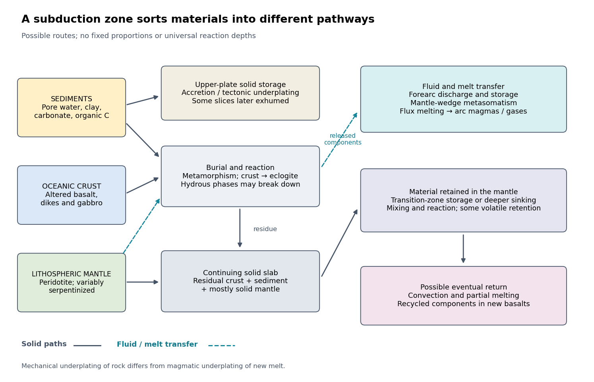

<h1 id="2/solution">Solution</h1>

↑ **Parent:** [2](../2.md)

At a [convergent margin](../../../convergent-margin.md), the incoming [oceanic lithosphere](../../../oceanic-lithosphere.md) is a chemically and mechanically layered package: [sediments](../../../sediment.md), [oceanic crust](../../../oceanic-crust.md) and [lithospheric mantle](../../../lithospheric-mantle.md). [Subduction](../../../subduction.md) does not deliver this whole package unchanged to one destination. Solids can be accreted, underplated, exhumed or recycled deeply, while released fluids and melts carry selected components to the [overriding plate](../../../overriding-plate.md). The outcome depends on incoming composition and hydration, [slab](../../../slab.md) age, convergence rate, thermal structure, interface coupling and subsequent tectonic history.

**[Figure 1](#2/image-diverging-pathways-of-sediments-oceanic-crust-and-lithospheric-mantle-at-a-convergent-margin). Diverging pathways of sediments, oceanic crust and lithospheric mantle at a convergent margin**. Original process diagram. Solid-material pathways are separated from fluid and melt transfer. The arrows represent possible routes, not universal proportions or fixed reaction depths; temporary storage and later remobilization are possible.

**The incoming material already contains a history.** [Sediments](../../../sediment.md) include terrigenous debris, biogenic [carbonates](../../../carbonate.md), siliceous deposits, [clay minerals](../../../clay-mineral.md), pore [water](../../../water.md) and [organic matter](../../../organic-matter.md). [Oceanic crust](../../../oceanic-crust.md) consists mainly of [basalt](../../../basalt.md), sheeted dikes and [gabbro](../../../gabbro.md); [hydrothermal alteration](../../../hydrothermal-alteration.md) can add [water](../../../water.md), [carbonates](../../../carbonate.md) and mobile elements before [subduction](../../../subduction.md). Beneath it, residual [peridotite](../../../peridotite.md) forms the [lithospheric mantle](../../../lithospheric-mantle.md). Faulting at a spreading environment, a transform boundary or an outer-rise bending region can let [seawater](../../../seawater.md) enter and cause [serpentinization](../../../serpentinization.md). The [lithospheric mantle](../../../lithospheric-mantle.md) is not uniformly hydrated to its full thickness. Consequently, sediment thickness alone does not measure the incoming volatile inventory.

**Sediments: separation starts near the trench.** Compaction and increasing effective [pressure](../../../pressure-split.md) expel pore fluids, which can escape through the [forearc](../../../forearc.md), transport dissolved constituents and influence [pore pressure](../../../pore-pressure.md) on the plate interface. Some [sediments](../../../sediment.md) are scraped off into an [accretionary prism](../../../accretionary-prism.md), shortened by thrusts and retained in the upper plate. Others pass beneath the leading edge, then detach and undergo [tectonic underplating](../../../tectonic-underplating.md) beneath the [forearc](../../../forearc.md). Deeper underplated material may return to the surface during [tectonic exhumation](../../../tectonic-exhumation.md), preserving a record of burial and deformation. At a sediment-starved erosive margin, little prism may form, and [tectonic erosion](../../../tectonic-erosion.md) can entrain material from the [overriding plate](../../../overriding-plate.md) as well. Thus net continental gain and net continental loss are both possible; they can even alternate at one margin.

[Sediments](../../../sediment.md) that remain attached to the [slab](../../../slab.md) undergo [metamorphism](../../../metamorphism.md), [dehydration](../../../dehydration.md), and potentially [decarbonation](../../../decarbonation.md) or carbonate dissolution. The released fluids can transport [boron](../../../boron.md), [barium](../../../barium.md), [strontium](../../../strontium.md), [lead](../../../lead.md) and other soluble constituents. [Carbon](../../../carbon.md) can leave as dissolved species, remain in [carbonate](../../../carbonate.md), or occur as reduced [carbon](../../../carbon.md) depending on [redox](../../../redox.md) conditions and reaction history. Along sufficiently hot paths, sediment-derived melts or mixtures of sediment and altered rock can transfer material into the [mantle wedge](../../../mantle-wedge.md); buoyant mixed material may rise as a [mélange diapir](../../../melange-diapir.md). Cold paths can instead retain more solid material and some volatile-bearing phases to greater depths. These are alternative reaction and transport pathways, not a single compulsory sequence. A carbon-budget study explicitly includes fluid dissolution, sediment diapirism and storage in the upper plate, showing why volcanic [carbon dioxide](../../../carbon-dioxide.md) alone cannot close the whole [subduction](../../../subduction.md) [carbon](../../../carbon.md) budget.[2015, proposed pathways and reservoir accounting](../../../reevaluating-carbon-fluxes-in-subduction-zones-what-goes-down-mostly-comes-up-by-peter-b-kelemen-and-craig-e-manning.md)

**Oceanic crust: metamorphic transformation and chemical filtration.** Altered [basalt](../../../basalt.md) and [gabbro](../../../gabbro.md) are progressively buried. Depending on their [pressure](../../../pressure-split.md)-[temperature](../../../temperature-split.md) paths and reaction kinetics, they can pass through [blueschist facies](../../../blueschist-facies.md) or warmer assemblages and eventually form [eclogite](../../../eclogite.md), dominated by [garnet](../../../garnet.md) and [omphacite](../../../omphacite.md). [Eclogitization](../../../eclogitization.md) increases [density](../../../density.md) and can strengthen negative [slab buoyancy](../../../slab-buoyancy.md), but a kinetic delay can leave metastable rock. It is incorrect to assign every [slab](../../../slab.md) the same sequence or the same fixed depths for these changes.

During burial, breakdown of hydrous phases releases [water](../../../water.md)-rich fluids; different [mineral](../../../mineral.md) assemblages retain different quantities of [water](../../../water.md). The fluids migrate through or along the interface and into the [mantle wedge](../../../mantle-wedge.md), where they cause [metasomatism](../../../metasomatism.md) and lower the [solidus](../../../solidus.md) of [peridotite](../../../peridotite.md). [Flux melting](../../../flux-melting.md) of the [mantle wedge](../../../mantle-wedge.md) generates much of the primary magma feeding a [volcanic arc](../../../volcanic-arc.md). This is different from saying that the entire descending [oceanic crust](../../../oceanic-crust.md) melts beneath the arc. Most of its refractory mass can remain solid. [Partial melting](../../../partial-melting.md) of [oceanic crust](../../../oceanic-crust.md) is more plausible for unusually hot or young [slabs](../../../slab.md), or other favorable thermal conditions, and produces a distinct crustal contribution.

The depth of [dehydration](../../../dehydration.md) is controlled by thermal structure and composition. Global thermal-petrological calculations, for example, predict more efficient deep [water](../../../water.md) transport in old, fast, cold [slabs](../../../slab.md) than in hot ones, with substantial differences between volcanic [crust](../../../planetary-crust.md), [gabbro](../../../gabbro.md) and hydrated [peridotite](../../../peridotite.md). Such a calculation supports conditional deep retention; its modeled proportions should not be imposed on every margin.[2011, abstract and sections 3–4](../../../subduction-factory-4-depth-dependent-flux-of-h2o-from-subducting-slabs-worldwide-by-peter-e-van-keken-and-others.md)

Mechanical detachment adds more branches. Upper-crustal slices, seamounts or oceanic plateaus may be accreted or underplated instead of continuing down the [slab](../../../slab.md). A complete or partial [ophiolite](../../../ophiolite.md) can be emplaced onto another plate by [obduction](../../../obduction.md) in suitable convergence histories. Most intact [oceanic crust](../../../oceanic-crust.md) is not saved this way. High-[pressure](../../../pressure-split.md) fragments may be entrained in an interface channel or [mélange](../../../melange.md) and exhumed; their small preserved volume should not be mistaken for the dominant global mass flux. Magma generated after slab-derived transfer may also pond and crystallize beneath the upper [crust](../../../planetary-crust.md) by [magmatic underplating](../../../magmatic-underplating.md), which is a different process from mechanical [tectonic underplating](../../../tectonic-underplating.md) of solid slices.

**Lithospheric mantle: residual rock and a variable water carrier.** Most incoming [lithospheric mantle](../../../lithospheric-mantle.md) is depleted [peridotite](../../../peridotite.md) left after extraction of ridge melts. Its cold, dense, mechanically coherent portion contributes to [slab pull](../../../slab-pull.md) and generally sinks with the plate. Hydrated portions contain [serpentine](../../../serpentine.md) and possibly other hydrous [minerals](../../../mineral.md). Breakdown of these phases releases [water](../../../water.md) at conditions that depend on the thermal path, feeding further [metasomatism](../../../metasomatism.md) of the [mantle wedge](../../../mantle-wedge.md) and sometimes [dehydration embrittlement](../../../dehydration-embrittlement.md). The latter is a proposed contributor to intermediate-depth [earthquakes](../../../earthquake.md), not an exclusive explanation for all such events. Very cold paths may transfer some [water](../../../water.md) onward in high-[pressure](../../../pressure-split.md) hydrous phases or as hydrogen incorporated in nominally anhydrous [minerals](../../../mineral.md).

Do not confuse the incoming hydrated [lithospheric mantle](../../../lithospheric-mantle.md) with newly serpentinized [forearc mantle](../../../forearc-mantle.md) in the [overriding plate](../../../overriding-plate.md). The latter receives slab-derived fluids and can temporarily store their [water](../../../water.md). Hydrated, relatively buoyant interface material can facilitate return flow and [tectonic exhumation](../../../tectonic-exhumation.md), while the colder deeper bulk of the [lithospheric mantle](../../../lithospheric-mantle.md) continues down. Some [peridotite](../../../peridotite.md) may also be accreted or obducted with an [ophiolite](../../../ophiolite.md). These exchanges mean that even an exposed [serpentinite](../../../serpentinite.md) requires structural and chemical context before it can be assigned to its original plate.

**Deep recycling and eventual return.** The residual [eclogite](../../../eclogite.md), remaining [sediments](../../../sediment.md) and [lithospheric mantle](../../../lithospheric-mantle.md) can enter the deeper [mantle](../../../planetary-mantle.md). A [slab](../../../slab.md) can temporarily stagnate around the [mantle transition zone](../../../mantle-transition-zone.md) or penetrate into the lower [mantle](../../../planetary-mantle.md), depending on [buoyancy](../../../buoyancy.md), phase transformations, geometry and [mantle viscosity](../../../mantle-viscosity.md). Crustal material can remain as compositionally distinct domains, mix, or react with surrounding [peridotite](../../../peridotite.md); it need not retain the near-surface [eclogite](../../../eclogite.md) assemblage indefinitely as [pressure](../../../pressure-split.md) rises. Subsequent [mantle convection](../../../mantle-convection.md) can return recycled components toward spreading regions or [mantle plumes](../../../mantle-plume.md), where [partial melting](../../../partial-melting.md) incorporates them into new [basalt](../../../basalt.md). A primary study of Hawaiian [basalt](../../../basalt.md) illustrates a specific model in which melts derived from recycled crust react with [peridotite](../../../peridotite.md) to form a [pyroxenite](../../../pyroxenite.md) source. It is an interpretation of combined chemical evidence, not a unique label attached to every enriched [basalt](../../../basalt.md).[2005, recycled-crust reaction and melt-source model](../../../an-olivine-free-mantle-source-of-hawaiian-shield-basalts-by-alexander-v-sobolev-and-others.md)

**How the pathways can be observed.** Seismic reflection profiles, drilling, wedge geometry and balanced structural sections constrain accretion, fluid escape and [tectonic erosion](../../../tectonic-erosion.md). [High-pressure metamorphism](../../../high-pressure-metamorphism.md), mineral zoning, [radiometric dating](../../../radiometric-dating.md) and [pressure-temperature-time paths](../../../pressure-temperature-time-path.md) in exhumed rocks reveal burial, reaction and return. Their reconstructable histories are especially useful when deformation and fluid inclusions are linked to the dated [mineral](../../../mineral.md) growth. [Earthquake](../../../earthquake.md) distributions, [seismic tomography](../../../seismic-tomography.md), [seismic attenuation](../../../seismic-attenuation.md) and [electrical conductivity](../../../electrical-conductivity.md) constrain the geometry and physical state of the [slab](../../../slab.md) and [mantle wedge](../../../mantle-wedge.md), although fluids, melts and [temperature](../../../temperature-split.md) can produce nonunique signals.

[Arc magmas](../../../arc-magma.md) carry complementary chemical evidence: relatively mobile [barium](../../../barium.md), [boron](../../../boron.md), [lead](../../../lead.md) or [strontium](../../../strontium.md) can trace fluid-mediated transfer, whereas sediment-sensitive [thorium](../../../thorium.md) and [isotope ratios](../../../isotope-ratio.md) can help identify other contributions. Element mobility changes with fluid composition and [pressure](../../../pressure-split.md)-[temperature](../../../temperature-split.md) conditions, so no one element is an infallible tracer. [Boron isotope ratios](../../../boron-isotope-ratio.md), radiogenic [strontium isotope ratios](../../../strontium-isotope-ratio.md) and [lead isotope ratios](../../../lead-isotope-ratio.md) should be interpreted with measured incoming [sediments](../../../sediment.md) and altered [oceanic crust](../../../oceanic-crust.md). Arc gases and [forearc](../../../forearc.md) fluid discharge constrain volatile return; [ocean-island basalts](../../../ocean-island-basalt.md), [mantle xenoliths](../../../mantle-xenolith.md) and [diamond inclusions](../../../diamond-inclusion.md) provide possible evidence of deeper recycling. Each observation samples only part of the system.

For any element $X$, a useful control-volume statement is

$$
F_X^{\rm incoming}+F_X^{\rm upper\ plate\ erosion}
=F_X^{\rm accretion}+F_X^{\rm return}+F_X^{\rm deep}
+\frac{dM_X^{\rm stored}}{dt}.
$$

Here permanent accretion is counted outside the chosen reactive control volume, return includes fluid, melt and exhumed-solid exports, and transient underplating or reservoir growth contributes to storage until exported. For a different boundary choice, the terms must be regrouped consistently. The three incoming layers can have very different transfer efficiencies for bulk rock, [water](../../../water.md), [carbon](../../../carbon.md) and a particular [trace element](../../../trace-element.md). A small mass of escaping fluid can dominate an element's return while most of the solid [slab](../../../slab.md) continues into the deep [mantle](../../../planetary-mantle.md).

## ↑ Ancestors (11)

1. [2](../2.md)
2. [2025](../../2025-split.md)
3. [Past exam of the plate tectonics course of the University of Oxford](../../split.md)
4. [Plate tectonics course of the University of Oxford](../../../plate-tectonics-course-of-the-university-of-oxford.md)
5. [Year 3 of the earth sciences (geology) course of the University of Oxford](../../../year-3-of-the-earth-sciences-geology-course-of-the-university-of-oxford.md)
6. [Earth sciences (geology) course of the University of Oxford](../../../earth-sciences-geology-course-of-the-university-of-oxford.md)
7. [Undergraduate course of the University of Oxford](../../../undergraduate-course-of-the-university-of-oxford.md)
8. [Course of the University of Oxford](../../../course-of-the-university-of-oxford.md)
9. [University of Oxford](../../../university-of-oxford-split.md)
10. [List of universities](../../../list-of-universities.md)
11. [Codex Wiki](../../../split.md)
